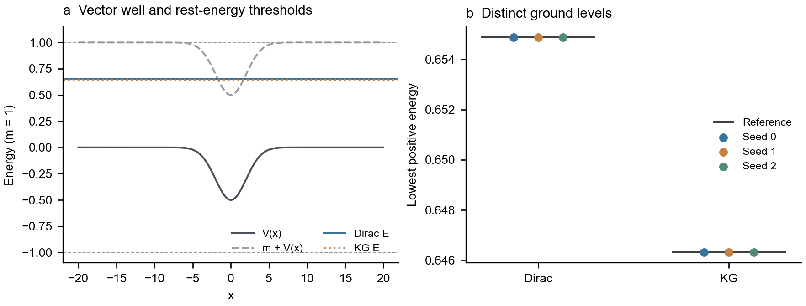
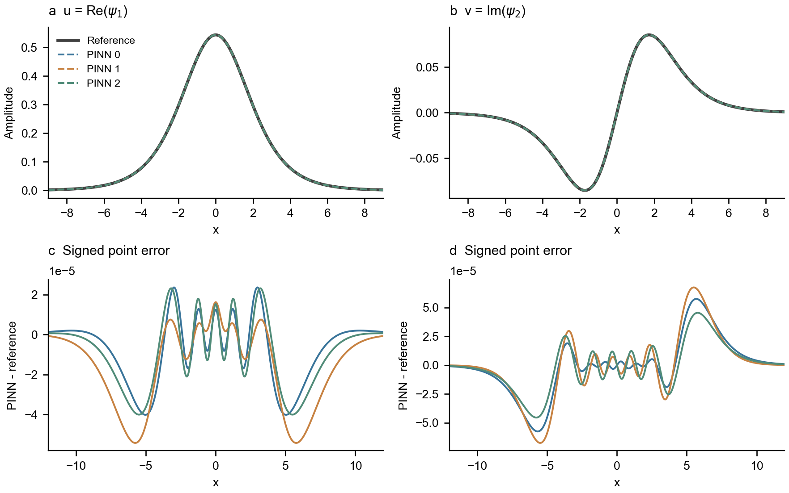
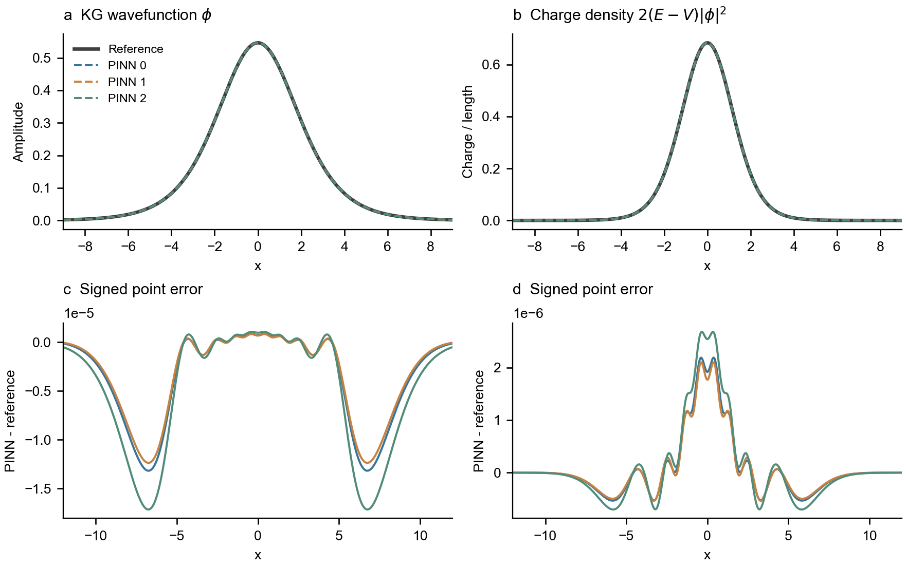
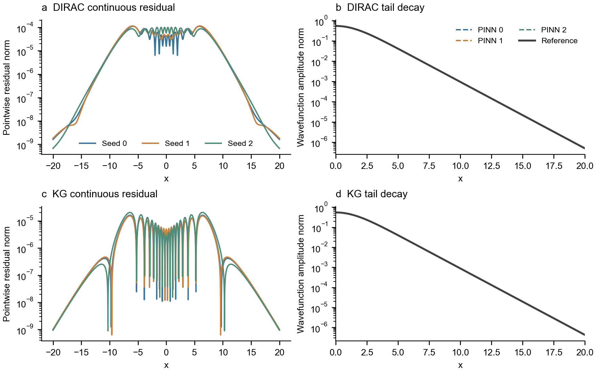
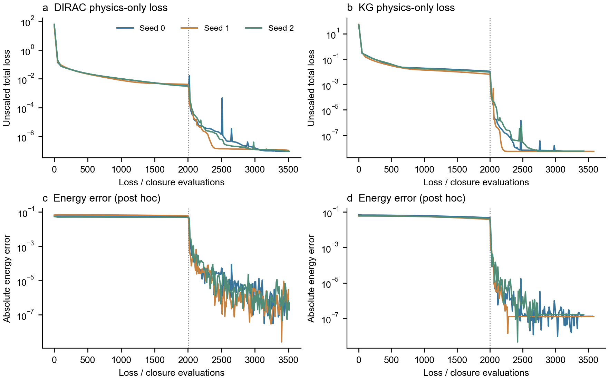
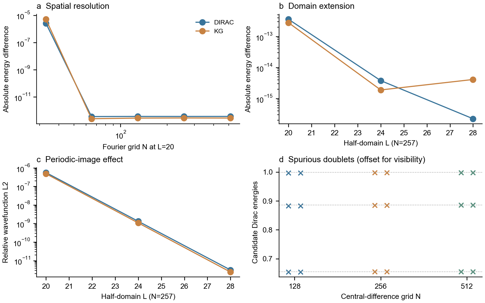

# 一维 Dirac / Klein–Gordon 定态束缚态：基础验证报告

计算日期：2026-09-26。全部数据来自本目录实际运行；每个模型三个随机种子，无失败种子删选。

## 1. 模型和已确认结果

采用 ℏ=c=1，m=1，V(x)=−0.5 exp(−x²/8)，仅含静态时间分量矢量耦合，Lorentz 标量势 S=0。传统参考方法先确认束缚态，再冻结参数。每个方程只训练最低正能、第一分量无节点的束缚态。

| 模型 | 参考能量 | PINN 三种子均值 ± 样本标准差 | 波函数相对 L²（均值 ± 标准差） |
| --- | --- | --- | --- |
| DIRAC | 0.654873526708 | 0.654874512977 ± 8.47e-07 | 1.547e-04 ± 2.58e-05 |
| KG | 0.646320822040 | 0.646320961490 ± 1.94e-08 | 3.112e-05 ± 6.05e-06 |

两参考能量相差 **0.008552705**，不能视为同谱。这是一项基础数值复现与验证，不构成原创物理结果，也不证明 PINN 优于传统方法。

## 2. 物理约定与辨态

定态分离 Ψ=e^(−iEt)ψ、Φ=e^(−iEt)φ；Dirac 取 ψ=(u,iv)ᵀ，则

\[u'=-(E-V+m)v,\qquad v'=(E-V-m)u.\]

KG 为 \(\phi''+[(E-V)^2-m^2]\phi=0\)。若采用标量势，质量应替换为 m+S；不能将其当作上述 V。V→0 时 κ=√(m²−E²)，指数衰减束缚态位于 −m<E<m，本轮只找 0<E<m。右端边界为 v=κu/(E+m) 或 φ′=−κφ。完整符号推导、Dirac 消元后的 V′ 项与 KG 正交关系见 [THEORY.md](THEORY.md)。

Dirac 使用 ∫(u²+v²)dx=1。KG 使用 ∫φ²dx=1 固定幅度，电荷约定为 ρ=2(E−V)|φ|²；参考总电荷 **Q=2.1127758793>0**。所有 PINN 目标态亦为正电荷，|φ|² 不被解释为一般概率密度。

## 3. 参考解可信度

主参考为 L=28 上的自适应 BVP 配点（tol=2×10⁻¹²），再用 DOP853 反向射击及 N=513 的 Fourier 谱方法独立核验。KG 谱计算使用关于 E 的二次铅笔伴随线性化。

| 模型 | 射击 \|ΔE\| | Fourier \|ΔE\| | 射击波形 L² 差 | Fourier 波形 L² 差 | BVP 连续残差 L² |
| --- | --- | --- | --- | --- | --- |
| DIRAC | 5.55e-16 | 2.00e-15 | 2.56e-14 | 3.14e-12 | 3.59e-12 |
| KG | 2.22e-16 | 9.88e-15 | 2.01e-14 | 2.39e-12 | 2.38e-12 |

L=12,16,20,24,28；BVP 初始网格 81/161/321 点、容差 10⁻⁷/10⁻⁹/2×10⁻¹²；Fourier 在 L=20 上用 N=33,65,129,257,513 加密。最终 BVP 自适应实际节点数分别为 7092（Dirac）、7503（KG）。

| 模型 | BVP E(L=20)−E(L=28) 绝对值 | Fourier 波形差 L=20 | Fourier 波形差 L=24 | Fourier 波形差 L=28 |
| --- | --- | --- | --- | --- |
| DIRAC | 2.22e-16 | 5.59e-07 | 1.32e-09 | 3.14e-12 |
| KG | 0.00e+00 | 4.85e-07 | 1.08e-09 | 2.43e-12 |

能量一致性到约 10⁻¹⁴–10⁻¹⁵、波形一致性到约 10⁻¹²；这只是经验一致性，不是严格误差上界。保守采用参考能量不确定量级 2×10⁻¹²、公共评价区间 [−20,20] 上参考波形误差量级 10⁻⁹ 进行本轮误差分离，均明显小于六次 PINN 误差。

中心差分的导数符号 sin(kh)/h 在零动量和网格极限处有两个零点，计算中确实出现成对候选能级；其高频分量及连续残差暴露了离散污染。正式采用奇数网格的非局域 Fourier 导数，并用 BVP/射击核验，没有把中心差分能隙内候选值当作物理态。近 E=1 的高激发候选点仍受区间效应影响，本报告不将其计为已验证成果。完整网格和倍增原始记录见 参考数据（本地档案） 与 倍增诊断（本地档案）。

## 4. PINN 与三种子验证

MLP 为三层 32 宽 tanh、float64；能量作为 sigmoid 参数训练。Dirac 参数数 2243，KG 2210（均含能量参数）。偶/奇宇称、第一分量无节点和指数包络为硬结构；归一化与有限端点 Robin 条件为软损失。384 点残差求积、256 点归一化求积，Adam 2000 次后 L-BFGS 最多 1200 次。

**先验披露：** 参考谱用于选定 [0.5,0.8] 的宽能区与目标宇称；训练没有参考波函数监督、参考能量回归项或能量最小化项。固定预算结束后才评估参考误差。初始能量覆盖约 0.588–0.716；种子 0/1/2 代表不同参数初始化，配点固定。损失公式、初始化、L-BFGS 数值尺度调整及首轮数据说明见 [METHODS.md](METHODS.md)。

| 模型/种子 | E_PINN | \|ΔE\| | 相对能量误差 | 波函数相对 L² | 耗时/s |
| --- | --- | --- | --- | --- | --- |
| dirac/0 | 0.654875490536 | 1.964e-06 | 2.999e-06 | 1.465e-04 | 69.7 |
| dirac/1 | 0.654874008206 | 4.815e-07 | 7.353e-07 | 1.836e-04 | 68.2 |
| dirac/2 | 0.654874040191 | 5.135e-07 | 7.841e-07 | 1.340e-04 | 68.4 |
| kg/0 | 0.646320951755 | 1.297e-07 | 2.007e-07 | 2.864e-05 | 83.1 |
| kg/1 | 0.646320948924 | 1.269e-07 | 1.963e-07 | 2.670e-05 | 80.8 |
| kg/2 | 0.646320983793 | 1.618e-07 | 2.503e-07 | 3.801e-05 | 77.7 |

只对齐一个整体符号，Dirac 两分量共用；不对预测结果事后重归一化。下表在独立 8001 点测试网格上计算；R_L² 是残差向量的积分范数，R_RMS=R_L²/√40。

| 模型/种子 | \|N−1\| | R_L² | R_RMS | max\|R\| | 端点振幅 | Q |
| --- | --- | --- | --- | --- | --- | --- |
| dirac/0 | 1.06e-06 | 2.81e-04 | 4.44e-05 | 1.11e-04 | 5.02e-07 | 1.000001057 |
| dirac/1 | 7.46e-07 | 2.99e-04 | 4.73e-05 | 1.15e-04 | 4.94e-07 | 1.000000746 |
| dirac/2 | 3.07e-07 | 2.95e-04 | 4.67e-05 | 1.00e-04 | 5.00e-07 | 0.999999693 |
| kg/0 | 3.22e-09 | 3.52e-05 | 5.56e-06 | 1.61e-05 | 4.32e-07 | 2.112778050 |
| kg/1 | 3.21e-10 | 3.44e-05 | 5.43e-06 | 1.53e-05 | 4.32e-07 | 2.112777920 |
| kg/2 | 5.56e-10 | 4.54e-05 | 7.18e-06 | 2.04e-05 | 4.31e-07 | 2.112778642 |

六次第一分量节点数均为 0，宇称误差约机器精度。Dirac 的下分量相对误差较大：

| Dirac 种子 | u 相对 L² | v 相对 L² |
| --- | --- | --- |
| 0 | 8.759e-05 | 6.448e-04 |
| 1 | 1.246e-04 | 7.448e-04 |
| 2 | 9.320e-05 | 5.320e-04 |

两个定态的连续性方程残差在选定实表示下代数上为零；这一点由参数化保证，不能当作独立精度证据。上表非零的微分方程残差才是求解误差诊断。训练时间为单线程 CPU 的实际墙钟，正式运行有两个进程并发；不能据此作严格硬件性能比较。传统单次高精度 BVP 仅需约 0.28 秒；PINN 的 Dirac/KG 平均耗时分别为 68.8/80.5 秒，本例传统方法明显更适合作为高精度求解器。

## 5. 衰减与敏感性

| 模型 | κ_ref | 参考 \|y(20)\| | 参考域外归一化积分 | PINN 最大端点/峰值 | PINN 端点对数斜率范围 |
| --- | --- | --- | --- | --- | --- |
| DIRAC | 0.755738489 | 4.899e-07 | 3.175e-13 | 9.226e-07 | 0.753960–0.754314 |
| KG | 0.763065787 | 4.272e-07 | 2.392e-13 | 7.921e-07 | 0.761554–0.761651 |

Robin 条件是软约束，因此端点斜率仍有小偏差；不能因端点振幅小便声称尾形完全准确。域外归一化积分 ∫|y|²dx 按自由尾估计为约 10⁻¹³；其平方根（域外 L² 范数）为约 5×10⁻⁷。表中波函数误差在各自有限计算区间上评价，没有混入域外截断误差。

| 模型 | 测试网格 4001→8001：最大 L² 指标变化 | 最大残差范数变化 |
| --- | --- | --- |
| DIRAC | 9.999e-17 | 0.000e+00 |
| KG | 1.049e-17 | 2.873e-18 |

另在种子 0 固定预算下分别将残差/归一化求积加密为 768/512 点、或将 L 扩展至 24：

| 模型 | 设置 | E | \|ΔE\| | 相对 L² | R_L² |
| --- | --- | --- | --- | --- | --- |
| dirac | 基准 | 0.654875490536 | 1.96e-06 | 1.46e-04 | 2.81e-04 |
| kg | 基准 | 0.646320951755 | 1.30e-07 | 2.86e-05 | 3.52e-05 |
| dirac | 配点加密 | 0.654874389291 | 8.63e-07 | 1.16e-04 | 2.66e-04 |
| kg | 配点加密 | 0.646320978410 | 1.56e-07 | 3.86e-05 | 4.86e-05 |
| dirac | L=24 | 0.654873654542 | 1.28e-07 | 1.82e-04 | 3.01e-04 |
| kg | L=24 | 0.646320893756 | 7.17e-08 | 1.35e-05 | 2.00e-05 |

这些是单种子敏感性检查，不能当作训练误差随网格单调收敛的证明。PINN 优化路径会随配点和域长变化，即便积分已收敛，最终训练误差也可能波动；所有敏感性运行均保留，未替换正式三种子结果。

## 6. 图表

PINN 图包含全部三个正式种子；最后一组图展示独立参考验证。CSV/NPZ 来源和图注记录在 图表清单（本地档案），另附可编辑 SVG 与 PDF。

## 7. 可靠范围与仍需改进

已经可靠：给定浅高斯时间分量矢量势下，两模型最低正能束缚态存在；其能量不同，波形平滑、具有正确宇称和指数尾；三种子 PINN 的能量、归一化与波形误差均已定量核验，参考误差明显较小。

仍需改进：Dirac 下分量和尾部 Robin 关系的精度、训练后期停滞、PINN 对优化设置的敏感性。没有验证更深势阱、超临界现象、负能态或完整激发态谱；没有完成效率优势或通用性论证。KG 激发态应使用含 (Eₙ+Eₘ−2V) 权重的关系，不能直接加普通 L² 正交惩罚。

## 8. 可复现交付与来源

代码、配置、测试、原始检查点/曲线/密集预测及参考多项式均位于本目录。运行方式见 [README.md](README.md)，完整逐种子指标见 formal_summary.csv（本地档案），审计见 [audit.json](results/audit.json)。已有时间演化代码与结果未由本任务改写，也未作为本征态训练标签。

物理/方法来源：Hasegawa 的一维标量与矢量 Dirac 势阱研究 [DOI:10.1016/j.physe.2014.01.011](https://doi.org/10.1016/j.physe.2014.01.011)；Aquino Curi 等的 KG 耦合与电荷讨论 [DOI:10.1140/epjp/i2019-12571-8](https://doi.org/10.1140/epjp/i2019-12571-8)；Tisseur–Meerbergen 二次本征值综述 [DOI:10.1137/S0036144500381988](https://doi.org/10.1137/S0036144500381988)；Beenakker 等倍增综述 [DOI:10.1002/andp.202300081](https://doi.org/10.1002/andp.202300081)；Raissi 等 PINN 方法 [DOI:10.1016/j.jcp.2018.10.045](https://doi.org/10.1016/j.jcp.2018.10.045)。出处、核实链接及适用边界见 [REFERENCES.md](REFERENCES.md)。
