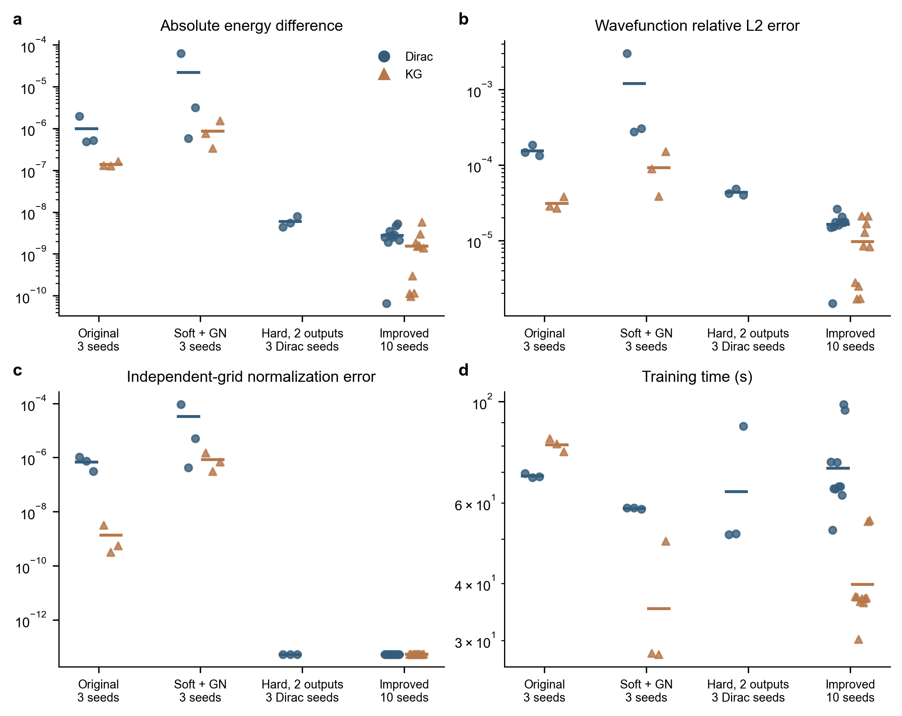
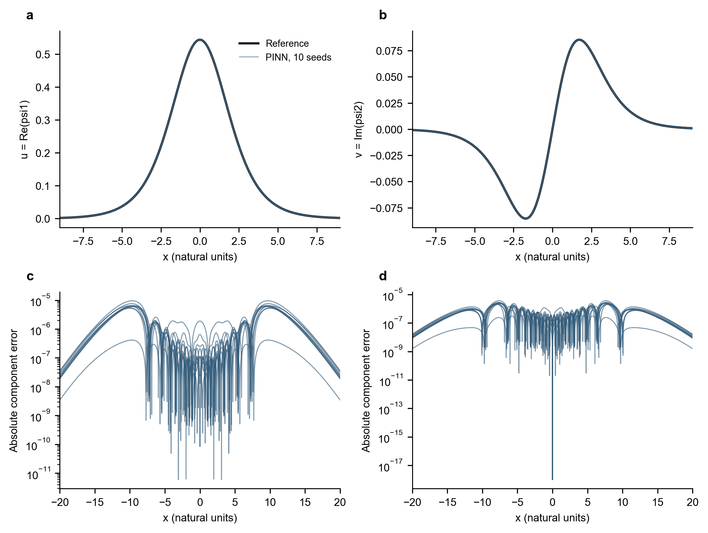
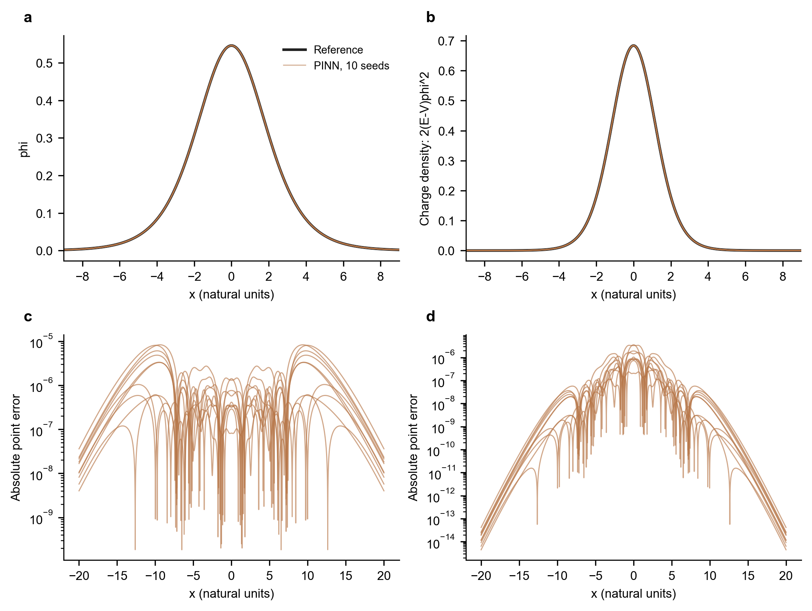

# Dirac / KG 束缚态：改进与验证

## 结论

固定静态高斯时间分量矢量势，四组参数共十二个目标态；完成 50 次正式运行，其中 49 次通过事后联合验收。基准两模型各十种子。波函数平均相对 L² 误差较原三种子均值改善：Dirac **9.4 倍**，KG **3.2 倍**。这是特定已见问题和本轮配置的实测改善，不是前沿排名或泛化保证。

本轮以硬结构替代幅度/边界软约束，取消参考能区限制，并扩大验证范围。四个势阱的最低态全部通过；Dirac 深宽阱第二激发态仍有一个种子失败，近阈值初值需要重启，部分运行未达严格训练容差，求解成本明显高于 BVP。原基础结果和失败试验均保留。

**协议版本明确区分**：38 次已通过独立波形/归一化核验的版本 6 最低/第一激发态保留；后续 12 次正式运行及 13 次对照/敏感性使用版本 7。第二激发态暴露了尺度溢出伪零解，版本 7 用等价整体尺度变换和实际范数检查修复。最终表按目标态逐行列版本，基准十种子同属版本 6，不静默宣称所有运行是同一训练协议。[campaign_manifest.json](campaign_manifest.json) 明列每次运行及低态依赖。

## 物理与方法

ℏ=c=1；Dirac 为 −iσ_x∂_x+mσ_z+VI，KG 为 φ″+[(E−V)²−m²]φ=0。**S=0**，没有把矢量 V 当作质量修正；若有 Lorentz 标量 S，质量项应变为 m+S。定态时间因子 e^{−iEt}；本轮研究实空间幅度。全实线束缚态要求可积并在两端按 κ=√(m²−E²) 衰减，允许能隙 −m<E<m，本轮选择 0<E<m 的指定最低/低激发态。

KG 的完整场取带电复标量 Φ(x,t)=e^{−iEt}φ(x)，实数只指空间幅度 φ；电荷定义针对这个复场。

ψ=(u,iv) 给出 u′=−(E−V+m)v、v′=(E−V−m)u；精确消元 v=−u′/(E−V+m) 及符号、端点推导见 [METHODS.md](METHODS.md)。第一条 Dirac 残差被结构恒等满足，因此精度判断依赖另一条残差和独立传统解，不能把恒为零的分量当作成功证据。

积分归一化与有限区间自由 Robin 为硬约束；Dirac ∫(u²+v²)=1，KG ∫φ²=1 仅固定振幅。KG 约定 ρ=2(E−V)φ²，Q=∫ρ；不是一般概率密度。所有 KG 正式态 Q 位于 **[2.082221, 2.406405]**，电荷为正。

数值硬归一化及表中 N 均指有限区间 [−L,L]；全实线还存在域外衰减尾，另列自由尾估计。训练求积上的恒等归一化与独立测试网格/全空间误差分别解释，不宣称全空间达到机器精度。

2×24 tanh 网络，三个已知偶坐标特征，E=m sigmoid(ηE)；只限制物理正能隙，初值覆盖 E/m=0.1–0.95，**无参考波形标签或参考能量区间**。指定宇称/节点数是保留的辨态先验；二阶激发态节点位置可训练，正交对象为已训练同种子 PINN 低态。Adam 500→L-BFGS 最多 300→阻尼 Gauss–Newton 最多 12，float64、CPU 单线程串行。无能量最小化项，参考误差不参与损失、早停或检查点选择。

## 基准最低态：全部种子

表内为均值 ± 样本标准差，归一化列为最大误差；原始 n=3，改进 n=10；绝对能量误差与总能量相对误差分列。两组网络、优化、能区先验不同，不能把倍数完全归因于某一个改动。原始时间曾并发计时，不据此作严格速度比。

本轮每个种子同时对应不同的 E 初值，标准差包含随机网络和能量初始条件的共同影响，不能解释为固定 E 初值的纯种子方差。完整初值与重启次数均在逐运行 CSV 中。

| 模型/组 | n | \|ΔE\| | \|ΔE\|/\|Eref\| | 波形相对 L² | 残差 L² | 最大 \|N−1\| | 训练秒 | 参数 |
|---|---|---|---|---|---|---|---|---|
| DIRAC 原始 | 3 | 9.86e-07 ± 8.47e-07 | 1.51e-06 ± 1.29e-06 | 1.55e-04 ± 2.58e-05 | 2.92e-04 ± 9.93e-06 | 1.06e-06 | 6.88e+01 ± 7.98e-01 | 2243 |
| DIRAC 改进 | 10 | 2.81e-09 ± 1.46e-09 | 4.29e-09 ± 2.22e-09 | 1.64e-05 ± 6.18e-06 | 1.09e-05 ± 3.60e-06 | 5.33e-14 | 7.16e+01 ± 1.48e+01 | 722 |
| KG 原始 | 3 | 1.39e-07 ± 1.94e-08 | 2.16e-07 ± 3.00e-08 | 3.11e-05 ± 6.05e-06 | 3.83e-05 ± 6.17e-06 | 3.22e-09 | 8.05e+01 ± 2.73e+00 | 2210 |
| KG 改进 | 10 | 1.57e-09 ± 1.74e-09 | 2.43e-09 ± 2.70e-09 | 9.73e-06 ± 7.85e-06 | 1.14e-05 ± 7.86e-06 | 5.40e-14 | 3.99e+01 ± 8.17e+00 | 722 |

| Dirac 分量 | 相对 L² 均值 ± SD | 最大 |
|---|---|---|
| 上分量 u | 1.59e-05 ± 6.03e-06 | 2.53e-05 |
| 下分量 v（ψ₂=iv） | 2.80e-05 ± 9.82e-06 | 4.37e-05 |

逐种子的能量、绝对/相对误差、结合能相对误差、分量误差、归一化、独立残差、边界、时间及重启见 formal_summary.csv（本地档案）。对齐仅使用一个常数整体符号，未事后重归一化 PINN。残差在独立 8001 点均匀网格计算；Dirac 残差单位为 m，KG 为 m²，不跨模型比较绝对残差大小。



图 1：全部种子散点、算术均值短线；样本数和计时差异见图注，不作显著性检验。



图 2：同一个整体符号对齐后的 Dirac 上/下分量，十种子及完整区间误差。



图 3：KG 波形和当前电流约定下的电荷密度，十种子及逐点误差。

## 参数与激发态覆盖

V=−V₀exp[−x²/(2a²)]，m=1。base:(V₀,a,L)=(0.5,2,20)；shallow:(0.3,2,28)；narrow:(0.5,1.5,24)；deep_wide:(0.8,3,32)。每组独立重训；深宽阱验证 n=0,1,2，其他阱只报告 n=0，不宣称穷尽其全部束缚谱。

| 势阱 | 方程 | n | 协议 | 种子数 | 参考 E | PINN 最终 E 均值 ± SD | 最大 \|ΔE\| | 波形 L² 均值 ± SD | 最大残差 | 验收 |
|---|---|---|---|---|---|---|---|---|---|---|
| base | DIRAC | 0 | 6 | 10 | 0.654873526708 | 0.654873523896 ± 1.5e-09 | 5.27e-09 | 1.64e-05 ± 6.18e-06 | 1.70e-05 | 10/10 |
| base | KG | 0 | 6 | 10 | 0.646320822040 | 0.646320820513 ± 1.8e-09 | 5.71e-09 | 9.73e-06 ± 7.85e-06 | 2.42e-05 | 10/10 |
| shallow | DIRAC | 0 | 6 | 3 | 0.814152268921 | 0.814152268626 ± 4.8e-10 | 8.39e-10 | 6.35e-06 ± 1.98e-06 | 6.37e-06 | 3/3 |
| shallow | KG | 0 | 6 | 3 | 0.809850116093 | 0.809850115516 ± 2.3e-10 | 7.72e-10 | 5.44e-06 ± 2.62e-06 | 6.16e-06 | 3/3 |
| narrow | DIRAC | 0 | 6 | 3 | 0.696063610533 | 0.696063608345 ± 3.5e-09 | 6.24e-09 | 1.51e-05 ± 1.82e-05 | 1.89e-05 | 3/3 |
| narrow | KG | 0 | 6 | 3 | 0.683844521209 | 0.683844517517 ± 3.4e-09 | 7.64e-09 | 2.93e-05 ± 3.83e-05 | 6.74e-05 | 3/3 |
| deep_wide | DIRAC | 0 | 6 | 3 | 0.340519204632 | 0.340519205100 ± 4.4e-10 | 9.80e-10 | 4.24e-06 ± 2.33e-06 | 5.78e-06 | 3/3 |
| deep_wide | DIRAC | 1 | 6 | 3 | 0.574452373459 | 0.574452378110 ± 5.2e-09 | 1.06e-08 | 1.14e-05 ± 8.71e-06 | 1.71e-05 | 3/3 |
| deep_wide | DIRAC | 2 | 7 | 3 | 0.760006838885 | 0.840003764550 ± 1.4e-01 | 2.40e-01 | 3.26e-01 ± 5.64e-01 | 2.18e+00 | 2/3 |
| deep_wide | KG | 0 | 7 | 3 | 0.332326965362 | 0.332326965563 ± 7.2e-11 | 2.53e-10 | 2.79e-06 ± 5.86e-07 | 6.11e-06 | 3/3 |
| deep_wide | KG | 1 | 7 | 3 | 0.570490110223 | 0.570490110194 ± 3.2e-10 | 3.37e-10 | 3.43e-06 ± 2.71e-07 | 7.87e-06 | 3/3 |
| deep_wide | KG | 2 | 7 | 3 | 0.758992505701 | 0.758992508315 ± 7.5e-09 | 1.10e-08 | 6.82e-05 ± 2.37e-05 | 6.75e-05 | 3/3 |

表中保留失败尝试；含失败的均值描述训练结果分布，不能当作该态的本征值估计。可靠能级以独立传统参考及通过联合核验的 PINN 样本为据。验收列明确成功数，失败样本仍进入误差分布、训练成本和原始 CSV。

未通过的正式尝试如下。节点数、宇称及极小端点幅度均不能单独证明是物理束缚态；Dirac 第二激发态种子 8 在一次重启后仍漂移至 E≈m，独立残差和真实范数验收失败。这说明数值非零保护已经修复，但激发态优化的稳健性仍需改进。

| 势阱 | 方程 | n | 种子 | 最终搜索 E | 波形 L² | 独立残差 L² | \|N−1\| |
|---|---|---|---|---|---|---|---|
| deep_wide | DIRAC | 2 | 8 | 0.999997645293 | 9.771e-01 | 2.184e+00 | 4.834e-03 |

联合验收：节点符合目标、|ΔE|<1e−6、波形/残差 L²<5e−4、|N−1|<1e−7、正电荷及有限值。严格训练早停采用目标≤1e−11 且更紧的归一化/边界标准；正式组结束原因 **{'iteration_budget': 41, 'physics_tolerance': 9}**。预算结束与物理辨态失败分别记录，不能声称全部达到更紧停止容差。该阈值是实验验收约定，不是严格误差证明。

## 参考可信度、区间和网格

每态用长区间 BVP、独立反向 DOP853 射击和奇数网格 Fourier 对照。谱导数没有中心差分的额外高频零点，并核对节点、波形、连续方程残差；原项目的朴素中心差分倍增审计仍保留。KG 使用 E²−2VE+V²−m²+∂² 的**二次能量铅笔**，不是 Schrödinger 线性谱。谱网格 257→513，参考半区间 Lref→Lref+8；最后分别为 36、48、40、56。深宽 KG n=2 的 BVP 因节点预算从 2e−12 放宽至 1e−11，原始说明见该态参考 JSON，其他独立核验未省略。

| 势阱 | 目标 | 扩域 \|ΔE\| | 射击 \|ΔE\| | 谱法 \|ΔE\| | 最大波形差 | BVP 连续残差 |
|---|---|---|---|---|---|---|
| base | dirac_0 | 8.9e-16 | 5.6e-16 | 2.1e-15 | 2.1e-14 | 3.6e-12 |
| base | kg_0 | 1.1e-16 | 2.2e-16 | 5.1e-15 | 1.3e-13 | 2.2e-12 |
| shallow | dirac_0 | 2.0e-15 | 3.3e-16 | 3.3e-16 | 4.8e-14 | 4.0e-12 |
| shallow | kg_0 | 7.8e-16 | 1.1e-16 | 2.2e-14 | 9.9e-14 | 2.2e-12 |
| narrow | dirac_0 | 5.6e-16 | 1.7e-15 | 0.0e+00 | 4.5e-14 | 4.2e-12 |
| narrow | kg_0 | 4.4e-16 | 1.4e-15 | 8.9e-15 | 1.4e-13 | 2.6e-12 |
| deep_wide | dirac_0 | 1.9e-15 | 1.7e-16 | 8.3e-16 | 4.6e-14 | 3.6e-12 |
| deep_wide | dirac_1 | 5.6e-16 | 1.7e-15 | 5.6e-16 | 3.2e-14 | 1.3e-12 |
| deep_wide | dirac_2 | 1.2e-15 | 3.2e-15 | 1.0e-15 | 6.7e-14 | 3.0e-12 |
| deep_wide | kg_0 | 2.8e-16 | 2.8e-16 | 8.9e-15 | 4.5e-14 | 2.7e-12 |
| deep_wide | kg_1 | 3.3e-16 | 1.6e-15 | 1.7e-15 | 4.9e-14 | 1.9e-12 |
| deep_wide | kg_2 | 2.2e-16 | 2.9e-15 | 9.4e-15 | 1.7e-13 | 8.5e-12 |

这些差值是经验一致性证据，不能把 1e−15 的能量一致性当作经严格证明的绝对精度。保守比较尺度取能量至少 2e−12、波形至少 1e−10 或交叉差值十倍；低于该尺度的能量误差只作参考分辨率受限解释。参考波形差明显小于 PINN 波形误差。原始完整 reference 数据（本地档案） 与收敛 CSV 可复核。

独立测试网格 2001→4001→8001；最后一次加密，全部正式尝试的最大归一化变化 8.86e-10、最大相对残差变化 3.46e-06；仅联合验收通过样本分别为 3.33e-16、1.28e-12。测试积分稳定不表示残差足够小，失败态的残差即使加密后稳定仍不合格。基准尾部验收如下；自由指数估计仅适用于极小势的域外，网络四次指数修正不作域外外推。

| 方程 | 最大端点幅度 | 最大相对 Robin 残差 | 最大域外 L² 尾量估计 | 最大归一化误差 |
|---|---|---|---|---|
| DIRAC | 5.291e-07 | 1.14e-16 | 3.70e-13 | 5.33e-14 |
| KG | 4.632e-07 | 1.22e-16 | 2.81e-13 | 5.40e-14 |

| 方程 | 单种子敏感性 | \|ΔE\| | 波形 L² | 残差 L² | \|N−1\| |
|---|---|---|---|---|---|
| DIRAC | 基准 | 2.47e-09 | 1.49e-05 | 1.00e-05 | 5.33e-14 |
| DIRAC | 求积加倍 | 1.97e-09 | 1.36e-05 | 9.40e-06 | 6.37e-14 |
| DIRAC | 区间 L=24 | 8.82e-10 | 6.85e-06 | 4.72e-06 | 6.55e-14 |
| KG | 基准 | 1.12e-10 | 2.76e-06 | 3.66e-06 | 5.37e-14 |
| KG | 求积加倍 | 1.13e-10 | 2.72e-06 | 3.68e-06 | 6.44e-14 |
| KG | 区间 L=24 | 6.08e-12 | 2.49e-06 | 4.19e-06 | 6.62e-14 |

上述区间/求积敏感性只有种子 0，不构成普适单调训练收敛结论。传统参考收敛与有限预算非凸训练误差分别报告。

## KG 正交与对照消融

不同能量 KG 解满足 ∫(Eₙ+Eₘ−2V)φₙφₘdx=0，全实线衰减时边界 Wronskian 消失；普通 L² 重叠一般不为零。深宽阱同宇称 n=0,2 的检查包含自由尾修正，带权量除以 √(QₙQₘ)。不同宇称的零重叠是结构保证，不是独立数值精度证据。

| 来源 | 种子 | 普通 L² 重叠 | 电荷带权归一化重叠 |
|---|---|---|---|
| reference | -1 | -7.62889e-02 | -5.63882e-16 |
| pinn | 0 | -7.62877e-02 | +9.89720e-07 |
| pinn | 4 | -7.62886e-02 | +1.74009e-07 |
| pinn | 8 | -7.62885e-02 | +3.54864e-07 |

| 方程 | 变体 | 协议 | n | \|ΔE\| 均值 ± SD | 波形 L² | 残差 L² | 最大 \|N−1\| | 参数 | 训练秒 | 验收 |
|---|---|---|---|---|---|---|---|---|---|---|
| DIRAC | derivative | 6 | 3 | 3.49e-09 ± 1.55e-09 | 1.94e-05 ± 5.91e-06 | 1.28e-05 ± 3.67e-06 | 5.33e-14 | 722 | 8.20e+01 ± 1.44e+01 | 3/3 |
| DIRAC | independent | 7 | 3 | 5.96e-09 ± 1.83e-09 | 4.35e-05 ± 4.22e-06 | 3.85e-05 ± 8.84e-06 | 5.31e-14 | 747 | 6.36e+01 ± 2.14e+01 | 3/3 |
| DIRAC | legacy | 7 | 3 | 2.22e-05 ± 3.52e-05 | 1.20e-03 ± 1.58e-03 | 9.62e-04 ± 1.06e-03 | 9.34e-05 | 699 | 5.84e+01 ± 2.07e-01 | 0/3 |
| KG | derivative | 6 | 3 | 2.57e-09 ± 2.86e-09 | 1.50e-05 ± 1.06e-05 | 1.65e-05 ± 1.12e-05 | 5.37e-14 | 722 | 4.30e+01 ± 1.01e+01 | 3/3 |
| KG | legacy | 7 | 3 | 8.73e-07 ± 6.03e-07 | 9.29e-05 ± 5.65e-05 | 2.11e-04 ± 8.66e-05 | 1.52e-06 | 674 | 3.52e+01 ± 1.24e+01 | 0/3 |

本消融表各变体统一采用种子 0/4/8（derivative 从正式十种子中取这三个），以便核对相同初始能量。legacy 为原软约束表示在新正能隙/优化预算下重训；independent 为 Dirac 硬约束但独立双输出。结构、输入、参数量有差异，消融不是完全等参数的因果归因。全部运行保留，未达验收的对照也进入表和图。

六个 legacy 软约束对照均未满足本轮联合阈值，至少一项原因是独立归一化误差大于 1e−7；部分波形和能量已较接近参考，不能将验收失败等同于完全未找到近似态。硬双输出 Dirac 三种子均通过，但波形精度逊于精确重建表示，见同初值对照和逐运行数据。

## 稳定性、失败与成本

版本 5 第一轮在 Dirac 种子 8、初值 E=0.9 漂移到 E=m 并产生 NaN；八个已完成样本和失败数据保留在 [campaign_v5_failure.json](results/campaign_v5_failure.json)，未混入正式统计。版本 6 在损失前拒绝舍入到能隙端点/非有限梯度，恢复最小有限物理目标；预算后目标>1e−7 时允许一次固定 E=m/2 的新网络重启（种子+10000），不读参考解。下表列出正式组所有重启，耗时包含失败尝试；不是删掉坏种子。

浅阱等情况下也可能在能隙内部靠近 E=m 形成较差的有限区间近连续态，即使没有 NaN 也不应认定为可靠束缚态。是否重启只依据物理目标，是否辨认出指定束缚态则另经节点、独立残差、波形、能量和衰减检查。一次固定重启并不构成全能隙任意初值的收敛保证。

版本 6 第二激发态种子 0 出现未归一化范数溢出，归一化后波形为零，而旧损失记录把硬归一化范数写为常数 1，产生伪零残差；独立测试网格检测了该失败。原模型、历史和 [失败说明](results/campaign_v6_failure.json) 保留。版本 7 将 P₂ 乘以正的空间无关因子，并统一减去指数尺度，归一化物理解及参数梯度保持等价；同时直接检查有限、正的未归一化范数和实际积分范数。回归测试覆盖两模型三个态的波形/残差/梯度等价及真实失败记录的拒绝。

| 势阱 | 方程 | 态 | 种子 | 初值 E | 重启 | 拒绝试探 | 累计秒 | 最终验收 |
|---|---|---|---|---|---|---|---|---|
| base | dirac | 0 | 8 | 0.90 | 1 | 1 | 98.7 | True |
| base | dirac | 0 | 9 | 0.95 | 1 | 1 | 95.7 | True |
| base | kg | 0 | 8 | 0.90 | 1 | 1 | 54.6 | True |
| base | kg | 0 | 9 | 0.95 | 1 | 1 | 55.0 | True |
| shallow | dirac | 0 | 0 | 0.10 | 1 | 0 | 116.2 | True |
| shallow | kg | 0 | 0 | 0.10 | 1 | 1 | 57.7 | True |
| narrow | kg | 0 | 0 | 0.10 | 1 | 0 | 64.3 | True |
| narrow | kg | 0 | 8 | 0.90 | 1 | 1 | 54.3 | True |
| deep_wide | dirac | 0 | 8 | 0.90 | 1 | 1 | 84.0 | True |
| deep_wide | dirac | 1 | 8 | 0.90 | 1 | 1 | 97.4 | True |
| deep_wide | dirac | 2 | 0 | 0.10 | 1 | 0 | 207.8 | True |
| deep_wide | dirac | 2 | 8 | 0.90 | 1 | 1 | 222.8 | False |
| deep_wide | kg | 0 | 8 | 0.90 | 1 | 1 | 81.7 | True |
| deep_wide | kg | 1 | 8 | 0.90 | 1 | 1 | 86.6 | True |
| deep_wide | kg | 2 | 8 | 0.90 | 1 | 1 | 107.9 | True |

九次消融、四次单种子敏感性也完整保留；63 次训练累计 70.8 分钟（含重启），不含试运行、评价或参考交叉核验。第二激发态依赖同种子低态，逐行记录低态训练成本，不能将单态时间解释为零成本独立求解。BVP 以解析试函数和物理猜测初始化，单线程串行、每容差五次，预热不计时：

另有至少 36.3 分钟已保存 training.json 的开发/归档运行，不计入上面的 63 次；部分中断仅留历史的运行还有额外成本。正式求解成本与开发调优成本分别披露，不用挑选后的最终训练时间代表项目总投入。

| 方程 | BVP 容差 | 重复数 | 求解秒均值 ± SD | 最大 \|ΔE\| | 最大波形 L² |
|---|---|---|---|---|---|
| DIRAC | 2e-11 | 5 | 6.07e-02 ± 7.38e-04 | 1.55e-15 | 7.12e-14 |
| DIRAC | 1e-09 | 5 | 3.38e-02 ± 7.18e-04 | 2.60e-13 | 5.23e-12 |
| DIRAC | 1e-07 | 5 | 1.47e-02 ± 5.68e-04 | 6.89e-11 | 7.42e-10 |
| KG | 2e-11 | 5 | 6.10e-02 ± 7.91e-04 | 4.44e-16 | 5.54e-14 |
| KG | 1e-09 | 5 | 3.22e-02 ± 2.52e-04 | 9.51e-14 | 4.20e-12 |
| KG | 1e-07 | 5 | 1.33e-02 ± 2.02e-04 | 6.30e-11 | 6.71e-10 |

此基础一维任务上 BVP 明显更快、更准。PINN 给出可微表示和结构约束方案，但当前没有效率优于传统方法的证据；一次推理速度不代替完整训练成本。

计时细节：PINN 从优化开始计时，含实际范数检查、恢复与重启，不含首次库导入、网络初建、文件保存和事后评价；BVP 计时含解析初试构造及迭代，亦不含导入/预热/评价。两者均为同机器串行单线程求解阶段成本，不能解释为含开发与所有进程启动的端到端项目总时间。

## 与已核实相关工作相比

本轮增加了多初值、多参数、激发态、合法 KG 正交、硬结构和失败披露，补足此前基础验证的证据。仍缺少三维/径向核结构、不同耦合的统一检验、高密度谱、负能支/近阈值/超临界测试、参数化模型和同模型同预算的前沿算法复现。文献已经研究本征 PINN 与分量重建，本项目应定位为可复现基础求解及方法比较，不能直接写作新原创成果。

- Du & Zhang, *Commun. Theor. Phys.* **78**, 035303 (2026), [DOI:10.1088/1572-9494/ae1a5c](https://ctp.itp.ac.cn/EN/10.1088/1572-9494/ae1a5c)：核 Dirac Woods–Saxon 势，残差 PINN、非零与正交约束；含标量/矢量势、径向几何和核结合能指标，不能与这里一维总能量误差直接排名。
- Wang et al., *Eur. Phys. J. A* **61**, 162 (2025), [DOI:10.1140/epja/s10050-025-01630-5](https://doi.org/10.1140/epja/s10050-025-01630-5)，[作者全文](https://arxiv.org/html/2412.03090v2)：逆 Hamiltonian 避免变分坍缩，计算 Coulomb/Woods–Saxon 低激发态；其式 (11) 已从大分量重建小分量。本项目的精确分量消元不宣称原创。
- Kalitenko & Pronin, *Numerical Methods and Programming* **25**(4), 464–475 (2024), [DOI:10.26089/NumMet.v25r435](https://en.num-meth.ru/index.php/journal/article/view/1379)：KG–Fock 神经量子态，Coulomb 与相对论振子；方法和势模型不同，作为覆盖范围对照。
- Jin, Mattheakis & Protopapas (2022), [DOI:10.48550/arXiv.2203.00451](https://arxiv.org/abs/2203.00451)：本征问题 PINN 的归一化、正交、宇称及边界结构已有研究基础。
- 基础物理、二次本征值与倍增的教材/原始文献见 [原项目核实来源](../docs/references.md)。以上链接本轮已核对，核查日期 2026-10-03。

## 文件与复现

- [方法与推导](METHODS.md)、[当前配置](config.json)、[运行入口](run.py)、[版本 6 源文件](frozen_sources_v6.json)、[版本 7 源文件](frozen_sources_v7.json)、[协议/运行清单](campaign_manifest.json)。
- 逐运行结果（本地档案）、[消融](results/ablations_summary.csv)、[KG 正交](results/orthogonality.csv)、[BVP 重复计时](results/bvp_benchmark.csv)。每运行保留模型、配置、训练点、历史、检查点、独立测试数据及评价 NPZ。
- [图表清单与图注](figures/manifest.json)：8 组 PNG/SVG/PDF，全部种子、分量、误差、势阱能级、训练与收敛。图内对数显示下限不改原始数据。
- 其他图：[参数与能级](figures/04_parameter_state_coverage.png)、[Dirac 激发态](figures/05_deep_dirac.png)、[KG 激发态](figures/06_deep_kg.png)、[正交/收敛核验](figures/07_validation_diagnostics.png)、[训练曲线与成本](figures/08_training_cost.png)。
- 最终测试：34 passed in 11.12s；保存 [测试日志](results/tests.txt) 与 [交付审计](results/audit.json)。原代码/正式基础结果通过 168 文件 SHA256 保留审计；README 仅添加新报告入口。

```powershell
Set-Location 'E:\PINN for Quantum Physics'
python -m bound_state_dirac_kg.upgrade.run --stage all
```

相同配置已完成运行会跳过；改变科学源文件/配置必须使用新版本及运行组，以免静默混合。环境与固定依赖沿用原项目，各运行另存实际版本。可靠结论限于本表指定矢量势正能束缚态和联合误差验收；更紧精度、盲发现全谱与复杂物理扩展仍需改进。
