# 从公共单相位 CPA 到耦合谱 LTPB：Dirac-PINN 六轮实验总报告

整理日期：2026-09-30。范围：本项目已经完成的六轮数值实验，以及最初开题设想与当前下一步问题。本文是基于本地正式结果的研究总报告，不是新增训练、事后调参或新的预注册。

项目目录：`E:\PINN for Quantum Physics\dirac_cpa_transfer_experiment`。

## 摘要

本课题研究的是：面对一阶、复数、双分量的 Dirac 动力学，如何通过表示方式降低物理信息神经网络（PINN）学习快速振荡的难度，同时避免仅凭守恒量或训练损失误判解的正确性。实际实验路线从公共单相位 CPA 的失效诊断出发，转向自由 Dirac 能支对齐的独立相位表示，随后依次扩展到两个已知波数、共享网络表示的高斯谱波包，最后检验弱周期外势导致的动量耦合。

结果具有明确的成功区间和边界。单动量混合态中，公共单相位 SP-CPA 的旋量误差约为 0.799，而可学习双能支相位 LTPB-CPA 将其降至约 0.00245，并恢复概率流、旋量相对相位和正负载频。机制消融显示：在相同自由能支基底内学习普通复系数，或在原始旋量分量上使用双相位，均未取得同等效果；但预注册的“逐级基底旋转退化”强判据未通过，不能将支持性消融结果写成强机制证明。双波数实验和共享谱高斯波包实验分别通过本轮预注册判据；后者的五种子平均旋量误差为 0.04104，概率流误差为 0.04806，平均 fidelity 为 0.998249，未训练波数中点的加权相位斜率误差约为 0.115%。这些结果支持已知自由 Fourier 表示下的载频学习和谱区间内插值，不等于未知连续谱发现。

弱周期外势下，当前耦合谱 LTPB 的五种子平均旋量误差为 0.36670、概率流误差为 0.45612、fidelity 为 0.87253，没有达到迁移成功条件。虽然所有五个种子在旋量和概率流上均优于同基底复系数网络，两种共享谱模型都未成功，因此预注册分类是 **INCONCLUSIVE**，不是 **REPRESENTATION_FAILURE**。另一方面，零初始振幅与硬相位门控造成的初始虚部切向缺失可以直接推导并由梯度诊断验证，构成下一轮研究的具体线索，但尚不能单独解释整个长期优化失败。

总的主张是：**能支对齐的独立可学习相位，在本项目已检验的自由问题中提供了很强的表示预条件优势；遇到动态生成的零初始振幅通道后，其适用性尚未建立，且出现了可定位的局部参数化缺陷。**

## 阅读导航与证据规则

正文第 1–3 节说明研究起点、数学定义和共同协议；第 4–9 节逐轮描述问题、模型、训练、结果与判据；第 10–12 节给出跨轮解释、质量控制和下一步。附录 A 保留全部逐运行主要指标，附录 B 汇总资源与损失，附录 C 链接所有正式图表。

数值表优先从原始 `metrics.json` 重新汇总，均值与标准差使用未四舍五入的数值计算；正文显示精度有限，完整数值在 CSV/JSON 中。标准差统一为种子间 **population SD（ddof=0）**，不是均值标准误，也不是置信区间。单次 oracle 的“n=1”不提供重复试验不确定性估计。本文不以少量种子作总体显著性声明。

三类判断必须分开：训练是否完整执行、工程审计是否通过、科学成功判据是否通过。例如第 3 轮和第 6 轮工程审计均通过，但科学判断分别是强机制判据未通过与迁移结论不确定。

原始总数据及本次整理的机器可读附件：

- [110 份记录的统一逐运行表](results/reports/dirac_ltpb_comprehensive/all_runs.csv)；[按轮次汇总的均值与 population SD](results/reports/dirac_ltpb_comprehensive/aggregate_by_round.csv)。
- [全部原生指标，不丢弃各轮特有诊断](results/reports/dirac_ltpb_comprehensive/native_metrics.json)；[逐运行六类产物路径索引](results/reports/dirac_ltpb_comprehensive/run_artifact_index.csv)。
- [本次报告核验](results/reports/dirac_ltpb_comprehensive/report_audit.json)；[既有证据的 SHA-256 保护清单](results/reports/dirac_ltpb_comprehensive/original_source_sha256.json)。

## 1. 研究从哪里开始：开题设想与实际路线

### 1.1 最初的问题不是“Dirac 网络层数不够”

开题工作的切入点是：把在其他波动方程中有效的公共相位复振幅方法迁移到 Dirac 方程后，能否仍然简化高频振荡的学习？Dirac 状态具有两个复旋量分量，概率流依赖它们之间的相对相位，不能只评价概率密度和总范数。

对于写成公共相位形式的旋量

\[
\psi(x,t)=A(x,t)e^{iS(x,t)},\qquad A\in\mathbb C^2,
\]

只要允许复振幅 \(A\) 足够一般，任意 \(\psi\) 都可以通过 \(A=\psi e^{-iS}\) 表示。因此，公共相位形式并不在数学上排除正负能支混合态。真正的问题是：选取一个公共载波后，剩余复振幅是否仍包含难学的快速振荡？有限网络、固定优化器和固定训练预算能否找到正确解？这属于预条件和优化问题，而不是直接的不可表示定理。

### 1.2 开题计划和实际模型并非同一个方案

最初的开题报告（本地档案）提出过 SDP-Dirac-PINN：先到 \(\sigma_x\) 的特征通道，把方程写为右行/左行形式，研究两个通道的独立相位及交换约束，并考虑开边界、散射和逆问题。这是研究规划，不应追认为已经完成的实验。

实际完成的六轮走了另一条更容易辨认载频机制的路线：使用自由符号矩阵 \(H(k)=k\sigma_x+m\sigma_z\) 的正负能本征旋量，先从单动量自由演化做可控验证，再逐步增加谱复杂性。除第 1 轮专门设置的守恒约束对照外，后续 learned 主模型均只用 PDE 强残差训练。

| 项目 | 开题设想 | 六轮实际完成内容 |
| --- | --- | --- |
| 通道含义 | \(\sigma_x\) 的特征通道、左右传播结构 | \(H(k)\) 的自由正负能支 |
| 约束重点 | PDE 与通道交换关系等候选结构 | 主要是 PDE-only、公平表示对照 |
| 空间条件 | 拟扩展到开边界与散射 | 周期区域 |
| 动力学范围 | 自由、外势、散射、逆问题等规划 | 自由单 k、双 k、高斯谱，以及一个弱周期外势 |
| 本轮终点 | 尚未预先保证方法成功 | 原有 LTPB 外势迁移未通过，形成明确失效线索 |

本报告中的“正负能支”不等于最初特征通道，也不等于外势完整 Hamiltonian 的精确本征态。本文不涉及场量子化，不把单粒子 Dirac 模型中的分支混合解释为已经模拟了量子场论的粒子产生。

### 1.3 研究问题逐步变化的原因

| 轮次 | 本轮要排除的解释或回答的问题 | 实际完成 | 科学结论 |
| --- | --- | --- | --- |
| R1 | 公共单相位在混合态中是否退化？守恒量能否识别相位错误？ | P/M 主实验、解析反例、结构权重敏感性、梯度冲突 | 固定预算下预条件优势退化；守恒量存在盲点 |
| R2 | 独立能支相位能否不写入时间载频而自行学出载频？ | P/M 各 3 seeds 的 LTPB pilot | 初步支持；已知能支先验仍然存在 |
| R3 | 改善来自本征基底、一般极坐标，还是二者对齐？ | 5 个模型、15 runs | 支持对齐敏感性，但强预注册判据 FAIL |
| R4 | 能否同时学习两个已知 k 的四个载频？ | 25 learned runs + 精确 oracle | 本轮预注册 PASS |
| R5 | 同一网络能否表示一段已知谱，并在中点插值？ | 33 个训练 k、32 个中点、25 learned runs | 本轮预注册 PASS；仅为有限已知谱与区间内插值 |
| R6 | 原有表示在动量动态耦合、侧带从零生成时是否仍有效？ | 参考校准、授权截断修订、15 learned runs | 绝对迁移未成功；两种谱模型均失败，INCONCLUSIVE |

早期 [RESEARCH_PROGRESS_SUMMARY.md](RESEARCH_PROGRESS_SUMMARY.md)只覆盖前三轮，其“多 k、波包、外势尚待完成”的状态已被后续正式记录更新。本报告保留旧记录原貌，不改写历史文件。

可从文档直接核对的时间锚点是：前三轮阶段总结及双波数预注册为 2026-08-31；共享谱波包预注册为 2026-09-01；外势截断修订授权及正式冻结为 2026-09-29；本总报告整理于 2026-09-30。这些是记录/冻结日期，不用文件修改时间反推每个训练运行的精确起止时间。

## 2. 数学、表示与指标的统一解释

### 2.1 Dirac 方程及可观测量

采用自然单位，

\[
i\partial_t\psi=\left(-i\sigma_x\partial_x+m\sigma_z+V(x)I_2\right)\psi,
\quad \rho=\psi^\dagger\psi,\quad j=\psi^\dagger\sigma_x\psi.
\]

总范数 \(N(t)=\int\rho\,dx\)。残差定义为

\[
R=i\psi_t+i\sigma_x\psi_x-m\sigma_z\psi-V\psi.
\]

对于实外势，有

\[
\partial_t\rho+\partial_xj=2\operatorname{Im}(\psi^\dagger R).
\]

因此 PDE 残差为零意味着连续性方程成立；反方向一般不成立。连续性只检验残差在一个特定投影上的信息。总范数和总能量进一步积分压缩信息，也不能代替复旋量和局部概率流的评价。

若 \(\psi_1=b_1e^{iS_1},\psi_2=b_2e^{iS_2}\)，实振幅可带符号，则

\[
j=2b_1b_2\cos(S_2-S_1).
\]

这说明为什么“密度差不多”不足以说明 Dirac 动力学正确。本报告中的 current 指概率流密度，不是未指定电荷归一化的电流。

### 2.2 自由能支与允许使用的物理先验

自由符号矩阵为

\[
H(k)=\begin{pmatrix}m&k\\k&-m\end{pmatrix},\qquad
u_+=\begin{pmatrix}\cos(\alpha/2)\\\sin(\alpha/2)\end{pmatrix},\quad
u_-=\begin{pmatrix}-\sin(\alpha/2)\\\cos(\alpha/2)\end{pmatrix},\quad
\alpha=\operatorname{atan2}(k,m).
\]

它们构成确定性实规范的正交归一基。参考评价使用 \(E(k)=\sqrt{k^2+m^2}\)，对应载频为 \(-E,+E\)。learned LTPB 可以使用已知的 \(k,m,u_\pm(k)\)，但不把 \(e^{\mp iEt}\) 写入前向，也不把目标斜率作监督标签。

“没有写入精确 E 载波”不等于“没有物理先验”：已知初始 Fourier 模态、自由本征方向和 PDE 本身都提供了非常强的信息。后续结论是网络在这些已知结构下从残差学习时间演化，而不是从原始数据发现 Dirac 色散律。

### 2.3 复系数与实振幅—相位表示

通道复系数方案写为

\[
c=c_0+\tau(\Delta c_R+i\Delta c_I),\qquad \tau=t/T.
\]

LTPB 通道写为

\[
c=(a_0+\tau r)e^{i\tau q},\qquad r,q\in\mathbb R.
\]

两者每通道都是两个实输出，均硬满足初值。实振幅限制阻止把快速时间相位重新藏进复振幅，但允许振幅为负，避免使用无界指数振幅。符号振幅还存在 \((a,S)\sim(-a,S+\pi)\) 的等价性，因此内部相位的普通 RMSE 要结合圆周误差和总场物理投影解读。

对于非零自由通道，精确状态有恒定振幅及线性时间相位，是 LTPB 十分简洁的目标。这是表示预条件的合理来源，但不能由此推出它对所有耦合、过零、外势问题同样简洁。

### 2.4 误差、规范与相位可辨识性

对于统一网格上的复场或实可观测量，relative L2 为

\[
\varepsilon(f)=\sqrt{\frac{\sum|\widehat f-f_{\rm ref}|^2}{\sum|f_{\rm ref}|^2}}.
\]

final L2 只取终点时间。每个时间的 fidelity 为

\[
F(t)=\frac{|\langle\psi_{\rm ref}(t),\widehat\psi(t)\rangle|^2}
{\|\psi_{\rm ref}(t)\|^2\,\|\widehat\psi(t)\|^2},
\]

本项目保存其均值、最小值和终值。fidelity 对归一化和整体相位不敏感，所以仍须联合范数、旋量 L2 和概率流判断。

R1–R3 的主旋量指标是原始复场 L2，未作全局相位对齐。R4–R6 的主指标仅消去一个覆盖全时空的常数相位：

\[
\phi_* = \arg\sum\psi_{\rm ref}^\dagger\widehat\psi,
\qquad \widehat\psi_{\rm aligned}=e^{-i\phi_*}\widehat\psi.
\]

没有逐时间或逐模态分别对齐；这些做法会掩盖真实的载频与相干错误。后期 raw L2 也保存在原始指标中。密度、概率流、模态占据和 fidelity 本身不受常数整体相位影响。

R1–R3 的旋量分量相对相位误差使用圆周差，并以参考分量乘积 \(|\psi_1\psi_2|\) 大于其最大值的 \(10^{-8}\) 定义参考有效区域。该历史规则不等于 R6 的占据阈值规则。R4 起主要载频和通道相位从**总预测场的 Fourier—能支投影**获得，内部网络相位只作辅助检查。R6 参考分支占据小于 \(10^{-6}\) 时不评价相位或该通道参与的相干量；预测相位还需预测占据不低于 \(10^{-12}\)，并独立报告覆盖率，不把零预测悄悄剔除出相干量误差。

### 2.5 不能把各轮模态误差混成同一指标

R1–R3 报告分支系数 relative L2 和分支占据 RMSE。R4 使用四通道占据相对 RMSE。R5、R6 则报告谱/模态占据 relative L2。这些量分母、归一化和维数不同。R4 内部展开采用 \(e^{ikx}\) 乘系数，归一化模态系数需乘 \(\sqrt L\)；R5、R6 的展开显式带 \(1/\sqrt L\)。因此 R4 初始内部系数是 \(1/(2\sqrt L)\)，对应物理模态占据仍为 \(1/4\)。原始定义没有被本文强行替换。

## 3. 公平性、预算与历史变化

### 3.1 共同训练原则

全部 learned 正式运行使用 `float64/complex128`、4 层 tanh 隐层、Adam、学习率 \(10^{-3}\)、5000 steps、硬初值和逐步重新采样。早期通常每层 64 单元；R4 的两个八输出多通道网络用每层 63 单元，保持参数量接近。没有通过对某个模型单独追加训练步骤获得正式优势。

随机初始化与配置点随机数发生器分离。同一轮、同一 seed 的对照使用配对随机流。形状相同的共享谱 Complex/LTPB 不仅种子相同，初始可训练权重完全相同；形状不同的网络只能保证统一初始化规则与随机流协议，不能宣称每个参数逐元素相等。

| 轮次 | 空间域；测试网格 | seeds | learned / 训练 oracle / 未训练 oracle | 每步采样 | 初始化与配置点协议 |
| --- | --- | --- | --- | --- | --- |
| R1 | \([-\pi,\pi)\)；128×201 | 0–2；oracle 各 Case 1 次 | 18 / 2 / 0；另有 2 次敏感性训练 | 1024 时空点；结构项另用 4×64 积分点 | 初始化 s；配置点 100000+s；结构项 200000+s |
| R2 | 同 R1 | 0–2 | 6 / 0 / 0；旧对照复用 | 1024 时空点 | 同 R1 |
| R3 | \([0,2\pi)\)；128×201 | 0–2 | 15 / 0 / 0 | 1024 时空点 | 初始化 s；配置点 100000+s |
| R4 | \([0,2\pi)\)；128×201 | 0–4 | 25 / 0 / 1 | 1024 时空点 | 初始化 200000+s；配置点 300000+s |
| R5 | \([-8\pi,8\pi)\)；256×201 | 0–4 | 25 / 0 / 1 | 谱 32 时间×33 k=1056；物理 32 时间×32 x=1024 | 初始化 200000+s；时间 300000+s；物理 x 400000+s |
| R6 | \([-8\pi,8\pi)\)；256×201 | 0–4 | 15 / 0 / 0 | 谱 32 时间×13 k=416；物理 32 时间×32 x=1024 | 初始化 500000+s；时间 600000+s；物理 x 700000+s |

采样数不是全部计算成本：物理残差需要空间自动微分，谱模型使用显式空间符号，且共享批处理方式不同。参数量接近也不意味着使用的物理先验相同。因此报告训练时间和内存，但不把所有差异称为单一相位参数化的加速效果。

### 3.2 参数量及精确载频隔离的边界

| 架构 | 输入 / 输出 | 实际可训练参数量 |
| --- | --- | --- |
| 4×64 单动量 Vanilla、LTPB、Branch-Complex、Component-Polar、旋转基底模型 | 3 / 4 | 12996 |
| 4×64 SP-CPA 与守恒版本 | 3 / 5 | 13061 |
| 4×63 MultiBranchComplex、Multi-LTPB | 3 / 8 | 12860 |
| 4×64 Shared-Spectral-Complex、Shared-Spectral-LTPB（含耦合版本） | 2 / 4 | 12932 |
| 未训练精确 oracle（R4、R5） | 无 learned 参数 | 0 |

R4 最大参数量差约 1.56%；R5 最大差约 1%。共享谱模型的参数量不随 17、33、65 模态数变化，测试验证的是网络参数维数，不是三个分辨率都训练成功。

历史隔离要求逐步加严，不能一概写成“所有旧文件完全没有 E”。R1–R3 的公共配置/基类保存过 `spectral_energy` 或 eigensystem 信息，R1 的守恒损失还用能量尺度归一化。R2、R3 learned LTPB 的 forward 和 PDE-only 训练未使用解析时间载波；早期 oracle 则明确写入载波。R4 起正式隔离范围扩展到 learned 配置与 checkpoint 元数据，精确频率只出现在参考/评价路径。该区别由[模型代码](src/models.py)、[多模态模型](src/multimode_models.py)、[共享谱模型](src/wavepacket_models.py)及各轮审计记录支持。

### 3.3 样本计数与运行环境

原始正式目录共检索到 **110 份 metrics 记录**：106 个独立完成的 learned 训练运行、2 个训练型 Two-Branch oracle、2 个未训练精确 oracle。完整训练运行合计 108 次、540000 个优化步骤；其中 learned 完整运行 530000 steps。该计数不含 smoke 或未完成的中断尝试，不是整个项目历史上所有计算开销之和。R1 敏感性 \(\lambda=1\) 直接复用主实验 seed 0，不重复计数。

R4、R5 未训练 oracle 的原生 metrics 仍有从模板继承的 `steps=5000` 字段；它们参数量和训练时间均为零，也没有 loss history/checkpoint，实际未执行优化。本报告保留原生字段，并在统一表中另外记录 `actual_optimizer_steps=0`，不把这些记录算作训练。

环境记录为 Windows 11、CPU、Python 3.13.7、PyTorch 2.12.0+cpu、NumPy 2.3.5。早期使用 2 个计算线程，后期单进程 1 线程并有并行运行安排。因此跨轮耗时不能解释为受控硬件基准。内存仅 R5、R6 系统测量；更早轮次不补造内存数字。`peak_rss_mb` 原字段实际按 \(2^{20}\) 字节换算，本文标记为 MiB。

## 4. R1：公共单相位的迁移边界与守恒量盲点

本轮证据：[正式报告](EXPERIMENT_REPORT.md)、[README](README.md)、主实验原始结果（本地档案）、敏感性原始结果（本地档案）、解析验证（本地档案）。

### 4.1 物理初值与对照

固定 \(m=5,k=2,T=5,L=2\pi\)，自由精确解为

\[
\psi(x,t)=\frac{e^{ikx}}{\sqrt{L(1+\eta^2)}}
\left[u_+e^{-iEt}+\eta u_-e^{iEt}\right].
\]

Case P 取 \(\eta=0\)，只有正能支；Case M 取 \(\eta=1\)，两支等权。参考 \(E=\sqrt{29}\approx5.385164807\)。Case M 中密度恒为 \(1/L\)，但

\[
j(t)=\frac{m}{LE}\cos(2Et),
\]

所以它是区分“密度正确”和“相位/概率流正确”的干净测试。

Vanilla 使用 \(\psi_0+\tau\Delta\psi\)；SP-CPA 使用解调复振幅 \((A_0+\tau\Delta A)e^{i(kx+\tau q)}\)。SP-CPA-Conservative 在同一模型上增加连续性、总范数、总能量项，主权重 \(\lambda_{\rm struct}=1\)。Two-Branch oracle 保留可训练复分支系数，但显式乘 \(e^{-iEt}\)、\(e^{+iEt}\)，只作载波机制诊断，不作为新 learned 方法。

主目标对 Vanilla、SP 和 oracle 是 \(L_{\rm PDE}\)；守恒对照为 \(L_{\rm PDE}+\lambda_{\rm struct}(L_C+L_N+L_H)\)。连续性按 \(E\rho_0\) 归一化，能量偏差按 E 归一化，而不是除以混合态为零的初始总能量。结构项的额外积分点和计算成本也须计入公平性解释。

### 4.2 先验证数学与实现

解析测试中，本征方程最大误差约 \(8.88\times10^{-16}\)，正交误差约 \(2.22\times10^{-16}\)，Dirac PDE 最大残差约 \(9.31\times10^{-16}\)，连续性最大残差约 \(3.89\times10^{-16}\)。归一化与总能量漂移均处于浮点舍入量级。因此后续失败不是精确参考解本身明显不满足方程。

另构造错误相位反例：在负能支附加 \(\delta(t)=0.7\sin(0.9t)\)，满足 \(\delta(0)=0\) 因而保留初值。其连续性最大误差约 \(5.0\times10^{-16}\)，总范数和总能量也仍为机器精度；但旋量误差为 0.33684，概率流误差为 0.46978，PDE residual RMS 为 0.09087。这个场**不满足 Dirac PDE**；反例证明的是守恒指标无法充分识别相对相位错误，而不是 PDE 不唯一或错误解同样有效。

### 4.3 主实验结果

| 模型 / Case | n | spinor L2 | density L2 | current L2 | mean fidelity | 分量相对相位 RMSE / rad |
| --- | --- | --- | --- | --- | --- | --- |
| Vanilla / P | 3 | 0.922776 ± 0.0011569 | 0.943275 ± 0.00171138 | 0.943066 ± 0.00166952 | 0.432466 ± 0.0843112 | 0.559742 ± 0.16156 |
| SP-CPA / P | 3 | 0.0066753 ± 0.00170465 | 0.00928048 ± 0.00085723 | 0.0113033 ± 0.00328805 | 0.999972 ± 1.55668e-05 | 0.0110255 ± 0.0112311 |
| SP-CPA-Conservative / P | 3 | 0.0110712 ± 0.00175382 | 0.00522113 ± 0.000509817 | 0.00469226 ± 0.000312338 | 0.999955 ± 2.16177e-05 | 0.0040845 ± 0.00212169 |
| Two-Branch oracle / P | 1 | 0.00787915（n=1） | 0.0101571（n=1） | 0.0186524（n=1） | 0.999967（n=1） | 0.0167421（n=1） |
| Vanilla / M | 3 | 0.945172 ± 0.0026706 | 0.956392 ± 0.00282023 | 0.969259 ± 0.00153377 | 0.225369 ± 0.0336635 | 1.76579 ± 0.00244039 |
| SP-CPA / M | 3 | 0.799137 ± 0.0917816 | 0.787558 ± 0.160516 | 0.939212 ± 0.0162772 | 0.593479 ± 0.0235493 | 1.58636 ± 0.04584 |
| SP-CPA-Conservative / M | 3 | 1.07846 ± 0.0427891 | 0.555422 ± 0.0184084 | 1.06977 ± 0.0242944 | 0.163074 ± 0.0242937 | 1.79798 ± 0.0103521 |
| Two-Branch oracle / M | 1 | 0.00622166（n=1） | 0.00998791（n=1） | 0.0105201（n=1） | 0.999990（n=1） | 0.00287622（n=1） |

Case P 中 SP-CPA 的旋量误差从 Vanilla 约 0.923 降至约 0.0066753；Case M 中只从约 0.945 降至约 0.799。按相同误差口径计算，改善从约 99.3% 降为约 15.5%。混合态中 SP-CPA 的概率流误差约 0.939、相对相位 RMSE 约 1.586 rad，不能称为解决了核心动力学问题。

oracle 在 Case M 的误差约 0.00622166，说明消去正确双载频后，剩余任务在此预算下容易得多。但它包含精确时间解结构，而且每个 Case 只有一个 seed，不能把 oracle 误差当作同等训练条件下的普适统计结论。它是后续提出可学习双相位的动机。

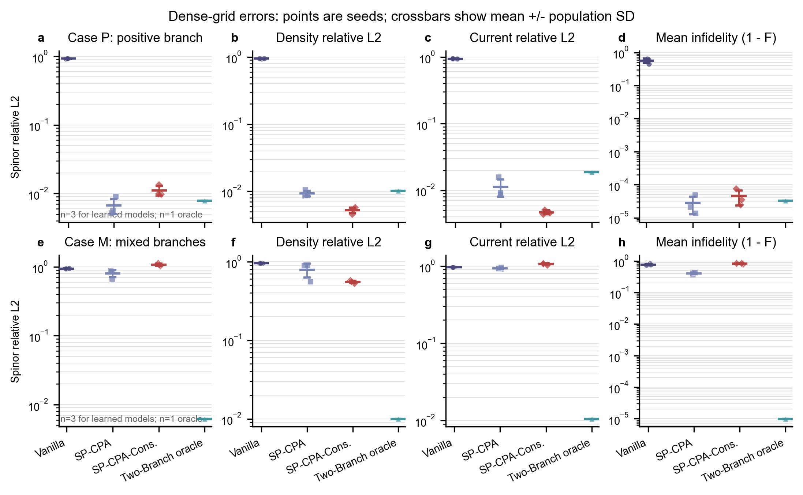

图 1　原始单动量主实验：SP-CPA 的优势从纯正能支到混合能支明显退化。 [可编辑 SVG](results/figures/01_main_metric_comparison.svg) · [PDF](results/figures/01_main_metric_comparison.pdf) · [Source data 1](results/summary.csv) · [Source data 2](results/summary_aggregated.csv)

### 4.4 增大守恒损失为何不能解决核心问题

敏感性试验仅 Case M、seed 0，比较 \(\lambda=0.1,1,10\)，其中 \(\lambda=1\) 是主运行复用。

| λ | 数据来源 | spinor | current | mean F | 连续性归一化 RMS | max norm drift | max energy drift |
| --- | --- | --- | --- | --- | --- | --- | --- |
| 0.1 | 独立训练 | 0.675482 | 0.983303 | 0.568388 | 0.0769255 | 0.522707 | 2.70379 |
| 1 | 复用主实验 | 1.13493 | 1.09353 | 0.144654 | 0.085688 | 0.481375 | 3.06716 |
| 10 | 独立训练 | 1.44918 | 1.06373 | 0.062512 | 0.0652727 | 0.089988 | 0.0701131 |

较大的权重确实可以明显减少某些守恒量漂移，但旋量和概率流没有随之恢复。不能以范数曲线“更平”判成功，也不能声称所有守恒指标都会随 \(\lambda\) 单调改善。

梯度诊断在每个 Case 的 3 个种子合计 63 个检查点上，计算 PDE 与结构损失梯度余弦：Case P 的负余弦比例为 49.21%，平均余弦为 −0.0115；Case M 的比例为 88.89%，平均余弦为 −0.5293。这支持当前约束组合存在明显优化冲突，但不证明每个守恒约束在所有问题上都不利。数据见[梯度冲突汇总](results/gradient_conflict_summary.csv)。

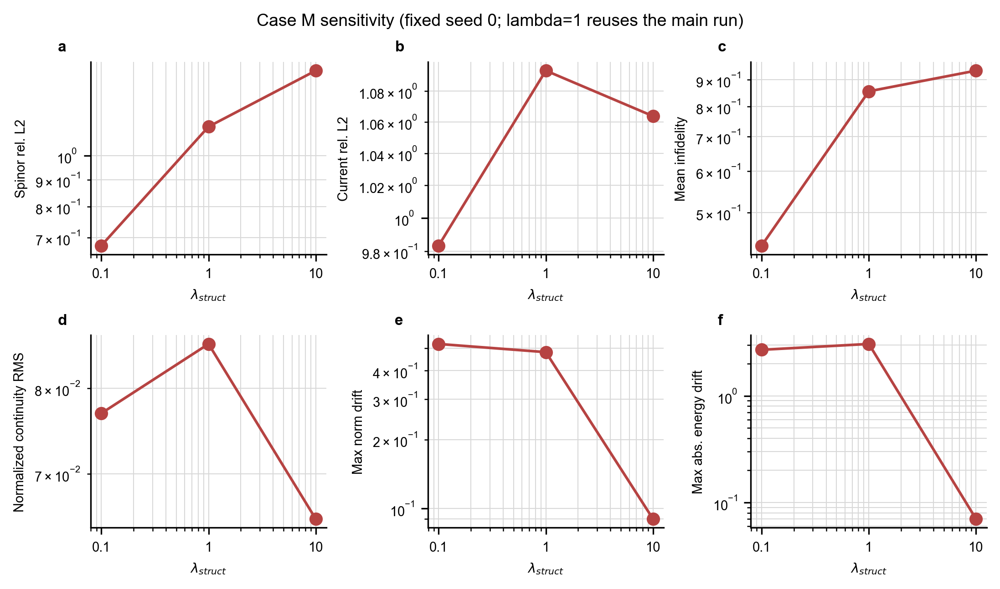

图 2　结构损失权重敏感性：守恒量改善不等于旋量和概率流恢复。 [可编辑 SVG](results/figures/07_lambda_struct_sensitivity.svg) · [PDF](results/figures/07_lambda_struct_sensitivity.pdf) · Source data（本地档案）

### 4.5 本轮结论与不能推出的内容

本轮确认了固定预算下公共单相位的载波预条件优势在混合能支中退化，同时构造出守恒量盲点的直接反例。它没有证明公共单相位在数学上不能表示混合态，也没有通过更大网络、更多训练或所有优化器排除可收敛的可能。计划中的更强压力测试并未作为正式结果执行，不能用拟议参数补充证据。

## 5. R2：LTPB-CPA 初步可学习双相位实验

证据：[pilot 报告](LEARNED_TWO_PHASE_PILOT_REPORT.md)、原始六个运行（本地档案）、[与历史对照的比较表](results/learned_two_phase_pilot_comparison.csv)。

### 5.1 模型与实验假设

模型为

\[
\widehat\psi=e^{ikx}\left[a_+(x,t)u_+e^{iS_+(x,t)}+a_-(x,t)u_-e^{iS_-(x,t)}\right],
\]

\[
a_+=\frac1{\sqrt{2\pi(1+\eta^2)}}+\tau r_+,\quad
a_-=\frac\eta{\sqrt{2\pi(1+\eta^2)}}+\tau r_-,\quad
S_\pm=\tau q_\pm.
\]

一个 4×64 tanh MLP 接收 \([\sin x,\cos x,t/T]\)，输出 \((r_+,r_-,q_+,q_-)\)，共 12996 个参数。目标表达在函数层面是 \(r_\pm=0,q_\pm=\mp ET\)，但这组值只用于表示能力测试和训练后评价，没有放入 learned 训练目标或前向载波。

沿用 R1 的物理参数、采样、初始化和测试网格，新增 P/M 各 3 seeds，共 6 runs，只有 PDE loss。历史 Vanilla、SP、Conservative 和 oracle 结果在确认配置匹配后直接复用，不重复训练。

### 5.2 精度与相位学习结果

| 模型 / Case | n | spinor L2 | density L2 | current L2 | mean fidelity | 分量相对相位 RMSE / rad |
| --- | --- | --- | --- | --- | --- | --- |
| LTPB-CPA / P | 3 | 0.00316675 ± 0.000324922 | 0.00374699 ± 0.000575062 | 0.0042369 ± 0.0003004 | 0.999999 ± 2.84387e-07 | 0.00192377 ± 0.000615037 |
| LTPB-CPA / M | 3 | 0.00245433 ± 0.000345159 | 0.00334791 ± 0.000748638 | 0.00455415 ± 0.000677218 | 0.999996 ± 9.24038e-07 | 0.00295109 ± 0.000513861 |

LTPB 在 Case P 的平均旋量误差约为 SP-CPA 的 0.474 倍，没有出现明显退化。Case M 中平均旋量、概率流和分量相对相位误差分别约 0.00245433、0.00455415、0.00295109 rad，fidelity 约 0.999996。对 SP-CPA 的降低幅度是数百倍量级；该改善并非只发生在密度或总范数。

| 模型 / Case | S+ 斜率 | S− 斜率¹ | S+ RMSE / rad | S− RMSE / rad¹ | a+ 相对 RMS 漂移 | a− 相对 RMS 漂移¹ | 分支系数 L2 | 分支占据 RMSE |
| --- | --- | --- | --- | --- | --- | --- | --- | --- |
| LTPB-CPA / P | -5.3863 ± 0.000182907 | 不适用（初始未占据） | 0.00248536 ± 0.000285232 | 不适用（初始未占据） | 0.00187254 ± 0.000286699 | 不适用（初始未占据） | 0.00299574 ± 0.000327531 | 0.00245033 ± 0.000429875 |
| LTPB-CPA / M | -5.38547 ± 0.000241601 | 5.38542 ± 0.000349643 | 0.00148654 ± 0.000200959 | 0.00158796 ± 0.00031841 | 0.00218575 ± 0.000729419 | 0.00144557 ± 0.000100462 | 0.00206858 ± 0.000404905 | 0.00161128 ± 0.000432673 |

¹ Case P 初始负能支未占据，不能把其网络输出相位理解为物理上辨识出的 \(+E\) 载频。原始软件保存的空支相位数值仍保留在附件，但本文在物理结论表中标为不适用。Case M 两支均占据，拟合斜率接近 \(-5.38516,+5.38516\)，相位近似线性，振幅漂移很小。

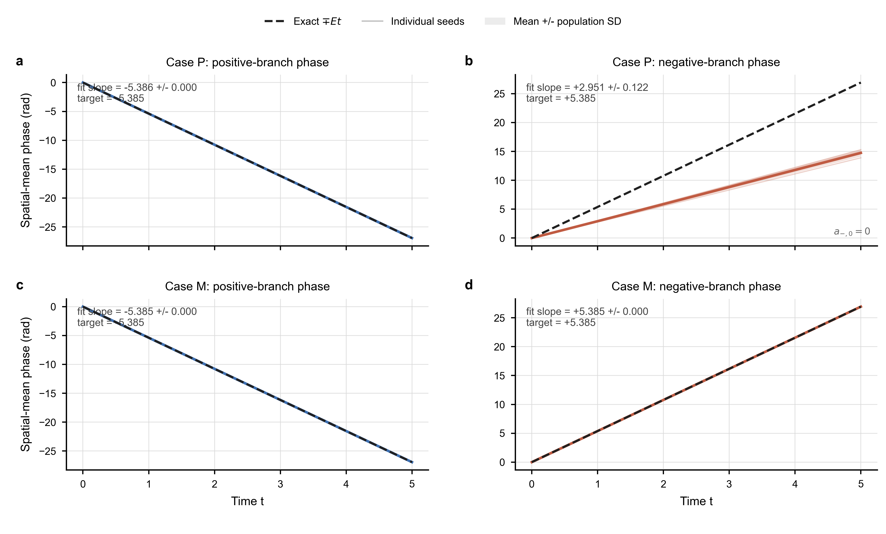

图 3　初步 LTPB 学到的独立能支相位；Case P 的空负能支相位不作为成功证据。 [可编辑 SVG](results/figures/learned_two_phase_pilot/02_learned_branch_phases.svg) · [PDF](results/figures/learned_two_phase_pilot/02_learned_branch_phases.pdf) · [Source data 1](results/figures/learned_two_phase_pilot/source_data/02_learned_branch_phases.csv) · [Source data 2](results/figures/learned_two_phase_pilot/source_data/02_learned_branch_phase_slopes.csv)

### 5.3 判定与边界

pilot 的操作性比较包括：Case P 旋量误差不超过 SP 的 1.25 倍且 fidelity 不降低超过 0.01；Case M 旋量、概率流、分量相对相位三误差均至少降低 25%，fidelity 至少提升 0.05；可辨识支的平均斜率相对误差不超过 10%、线性拟合 \(R^2\ge0.95\)。结果支持这一初步假设。这里不把后续 R4/R5 的严格冻结流程倒推为 pilot 当时已经完成了同样形式的预注册。

与 oracle 接近说明模型不必硬编码时间载频也能在本问题中找到低误差解。但 LTPB 仍使用已知自由能支基底；因此这一轮尚未排除“本征基底本身”或“一般双相位”才是主要贡献的解释。下一轮消融正是为此而设。

## 6. R3：LTPB 机制归因消融

证据：[预注册](LTPB_MECHANISM_ABLATION_PREREGISTRATION.md)、[正式报告](LTPB_MECHANISM_ABLATION_REPORT.md)、[自动决策](results/ltpb_mechanism_ablation_decision.json)、原始结果（本地档案）。

### 6.1 五个模型如何控制变量

只考察 Case M。空间域改为 \([0,2\pi)\)，其他核心物理参数和预算不变。五个模型均为四个实输出、12996 参数、相同初始化和同 seed 配置点序列；本轮的 LTPB 重新训练，不能把 pilot 的单次结果直接移作消融对照。

| 模型 | 基底 | 通道系数 | 要检验的解释 |
| --- | --- | --- | --- |
| LTPB-CPA | \(u_+,u_-\) | 实振幅 × 独立相位 | 基准 |
| Branch-Complex | 同一自由能支基底 | 普通复系数硬初值 | 是否仅本征基底就足够 |
| Component-Polar | 原始两个旋量分量 | 实振幅 × 独立相位 | 是否一般分量极坐标就足够 |
| Rotated-LTPB 15° | 能支基底旋转 15° | 实振幅 × 独立相位 | 偏离能支对齐的影响 |
| Rotated-LTPB 30° | 能支基底旋转 30° | 同上 | 更大偏离是否继续恶化 |

旋转定义为

\[
v_1=\cos\theta\,u_++\sin\theta\,u_-,\qquad
v_2=-\sin\theta\,u_++\cos\theta\,u_-.
\]

初始系数用正交变换精确计算，不手工近似，两个角度均避免初始某一通道恰为零。对混合态而言，旋转后的精确系数包含 \(\cos\theta e^{-iEt}+\sin\theta e^{iEt}\) 等叠加，因此振幅与相位通常不再是“恒定振幅＋线性相位”。旋转后解依然可由一般通道函数表示；其有限预算难度增加不能直接称为表达空间被删除。

在本项目的实规范下，自由能支矩阵本身是角度 \(\varphi=\tfrac12\operatorname{atan2}(2,5)\approx10.9007^\circ\) 的二维旋转，所以 Component-Polar 等价于旋转族中 \(\theta=-10.9007^\circ\) 的一个成员，不是与旋转族完全独立的另一机制。这使消融结论更具体，也限制了把它推广到任意双分量极坐标的力度。

执行记录中有一次宿主会话中断：首次启动的三个 seed 都在首个 LTPB run 尚未完成、没有生成正式 metrics 时中止，随后用完全相同代码、初始化和配置点随机流从 step 1 重启。只有最终完整的 15 个 runs 进入统计；它不属于看到结果后选择性重跑。原始恢复日志保存在 R3 日志目录（本地档案）。

### 6.2 结果

| 模型 / Case | n | spinor L2 | density L2 | current L2 | mean fidelity | 分量相对相位 RMSE / rad |
| --- | --- | --- | --- | --- | --- | --- |
| LTPB-CPA / M | 3 | 0.00245759 ± 0.000313109 | 0.00337985 ± 0.000644178 | 0.00454682 ± 0.000656815 | 0.999996 ± 8.44264e-07 | 0.00292169 ± 0.000587692 |
| Branch-Complex / M | 3 | 0.901359 ± 0.00554064 | 0.931182 ± 0.00320258 | 0.934158 ± 0.00387493 | 0.568052 ± 0.033913 | 1.6268 ± 0.0176194 |
| Component-Polar / M | 3 | 0.890684 ± 0.00687608 | 0.930927 ± 0.00344247 | 0.930903 ± 0.0037179 | 0.634308 ± 0.0443004 | 1.48019 ± 0.178682 |
| Rotated-LTPB 15° / M | 3 | 0.8996 ± 0.00511505 | 0.931765 ± 0.00635518 | 0.942564 ± 0.00617442 | 0.604150 ± 0.0321037 | 1.55789 ± 0.0586184 |
| Rotated-LTPB 30° / M | 3 | 0.930638 ± 0.00978366 | 0.950757 ± 0.00741894 | 0.959017 ± 0.00501425 | 0.452510 ± 0.0428879 | 1.68295 ± 0.0296162 |

LTPB 的旋量、概率流与分量相对相位误差均远低于 Branch-Complex 和 Component-Polar，后两者在本预算下没有接近 LTPB。15° 旋转就把三个主要误差从约 \(10^{-3}\) 提高到 \(10^{-1}\)–\(10^0\) 量级，说明基底方向是重要因素。

内部通道复杂性还同时评价预测系数和该基底下的精确系数。相邻时间点的相位增量取 \(\arg[c(t)^*c(t+\Delta t)]\)，以两端振幅乘积加权；近零振幅或相位跳跃过大的链接不进入速度/曲率拟合。相位速度波动是其偏离通道平均速度的加权 RMS，曲率是相位速度差分的加权 RMS；振幅漂移以初始振幅为尺度。

| 模型 / Case | 振幅漂移：预测 | 振幅漂移：精确 | 相位速度波动：预测 | 相位速度波动：精确 | 加权曲率：预测 | 加权曲率：精确 |
| --- | --- | --- | --- | --- | --- | --- |
| LTPB-CPA / M | 0.00187061 ± 0.000353878 | 2.71656e-16 ± 0 | 0.00247104 ± 0.000404964 | 4.31085e-14 ± 0 | 0.00893529 ± 0.00140081 | 3.07398e-12 ± 0 |
| Branch-Complex / M | 0.872241 ± 0.00605556 | 2.71656e-16 ± 0 | 0.412985 ± 0.0105427 | 4.31085e-14 ± 0 | 4.30102 ± 0.797741 | 3.07398e-12 ± 0 |
| Component-Polar / M | 0.883296 ± 0.00532819 | 0.233118 ± 0 | 1.29998 ± 0.0291501 | 1.39045 ± 0 | 14.0464 ± 0.32802 | 15.6836 ± 0 |
| Rotated-LTPB 15° / M | 0.882071 ± 0.0175704 | 0.318931 ± 0 | 1.75562 ± 0.00714147 | 1.84038 ± 0 | 18.021 ± 2.24215 | 21.8526 ± 0 |
| Rotated-LTPB 30° / M | 0.939373 ± 0.00596332 | 0.614166 ± 0 | 1.59622 ± 0.0121349 | 2.73674 ± 0 | 19.8454 ± 1.35853 | 49.2608 ± 0 |

“精确”列说明某种基底本来需要多复杂的振幅和相位；“预测”列则可能反映错误解或衰减解，不能以预测曲率较小反推物理解较容易。所有标度和原生有效链接比例仍在原始指标中。

### 6.3 为什么不能把它写成“强机制支持通过”

预注册的强机制支持是三个条件的交集：

1. LTPB 三项核心平均误差均不超过 Branch-Complex 和 Component-Polar 的 0.2；
2. 至少两项核心误差在 0°→15°、15°→30° **每一步**均增加至少 1.25 倍，且各步至少 2/3 配对种子增加；
3. 30° 相对 LTPB 至少两项误差达到 3 倍。

第一、第三条通过；第二条没有通过。15°→30° 的旋量、概率流、相对相位平均误差比分别为 **1.03450、1.01746、1.08028**，都低于 1.25。不能因为 0°→15° 的变化非常大就事后删除第二步条件。

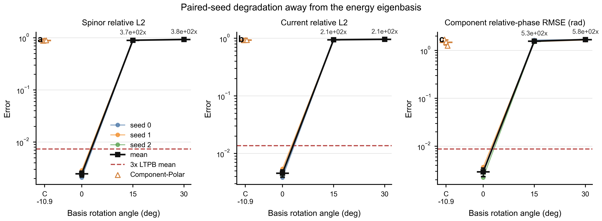

图 4　基底旋转显著降低精度，但 15°→30° 的增幅未达到预注册 1.25 倍逐级门槛。 [可编辑 SVG](results/figures/ltpb_mechanism_ablation/05_rotation_degradation.svg) · [PDF](results/figures/ltpb_mechanism_ablation/05_rotation_degradation.pdf) · [Source data](results/figures/ltpb_mechanism_ablation/source_data/05_rotation_degradation.csv)

因此本轮自动结果是 `strong_mechanism_support=false`。更准确的论述是：“在所测试预算和初值下，能支对齐的实振幅—独立相位组合最有效，且对基底扰动敏感；但预注册的强归因证据要求未全部满足。”不能写成“两个因素缺一不可”的普遍定理，也不能从两个旋转角推断完整角度响应曲线。振幅漂移、相位速度波动与加权曲率的源数据和所有逐 seed 结果仍保留；这些是复杂性诊断，不是替代失败判据的证据。

## 7. R4：两个已知波数的 Multi-LTPB

证据：[预注册](MULTIMODE_LTPB_PREREGISTRATION.md)、[正式报告](MULTIMODE_LTPB_EXPERIMENT_REPORT.md)、[决策 JSON](results/multimode_ltpb_decision.json)、原始结果（本地档案）。

### 7.1 问题与模型扩展

取 \(k_1=2,k_2=5\)，其他参数 \(L=2\pi,m=5,T=5\)。精确归一化状态为

\[
\psi(x,t)=\frac1{2\sqrt L}\sum_{\ell=1}^{2}e^{ik_\ell x}
\left[u_+(k_\ell)e^{-iE_\ell t}+u_-(k_\ell)e^{iE_\ell t}\right].
\]

四个归一化 Fourier—能支通道均有初始占据 \(1/4\)，因此没有空通道相位不可辨识的问题。它们的正交性是空间积分结合旋量内积意义下的正交性，不是四条时间函数在有限区间自动正交。

Multi-LTPB 用四个通道分别输出 \(r_\alpha,q_\alpha\)，写成 \(\sum_\alpha e^{ik_\alpha x}u_\alpha(a_0+\tau r_\alpha)e^{i\tau q_\alpha}\)。MultiBranchComplex 使用相同四通道的普通复系数。两者都是 8 输出、4×63 tanh、12860 参数。Vanilla、SP-CPA、ComponentPolar 使用 4×64；这里 SP 采用适配一般初值的 \((\psi_0+\tau\Delta A)e^{i\tau q}\)，不再假设一个共同空间 k。ComponentPolar 保留初始分量的复相位方向，再增加可学习相位。

五个 learned 模型各 5 seeds；另设不训练的精确四载频 oracle。正式前冻结协议和代码摘要；smoke 仅排除实现、梯度、NaN 和落盘问题，没有据此改变预算或成功阈值。

### 7.2 主要结果与四载频恢复

| 模型 / Case | n | spinor L2 | density L2 | current L2 | mean fidelity | 分量相对相位 RMSE / rad |
| --- | --- | --- | --- | --- | --- | --- |
| Vanilla | 5 | 0.969512 ± 0.00255416 | 0.966442 ± 0.00146825 | 0.981403 ± 0.00130165 | 0.114129 ± 0.0140832 | 1.79331 ± 0.0114479 |
| SP-CPA | 5 | 0.954861 ± 0.0146455 | 0.958566 ± 0.00749884 | 0.981647 ± 0.00168171 | 0.173654 ± 0.0483846 | 1.79912 ± 0.0226582 |
| Component-Polar | 5 | 0.957793 ± 0.00229519 | 0.966527 ± 0.000724883 | 0.966803 ± 0.000966524 | 0.180909 ± 0.0219343 | 1.74878 ± 0.0261672 |
| MultiBranchComplex | 5 | 0.939819 ± 0.0040744 | 0.952951 ± 0.0042265 | 0.957364 ± 0.00532613 | 0.317156 ± 0.0362938 | 1.70661 ± 0.0423557 |
| Multi-LTPB | 5 | 0.0065942 ± 0.00137481 | 0.00689605 ± 0.00184925 | 0.0109759 ± 0.00202993 | 0.999965 ± 1.40748e-05 | 0.0186358 ± 0.00632547 |
| Four-carrier oracle（未训练） | 1 | 0（n=1） | 0（n=1） | 0（n=1） | 1.000000（n=1） | 0（n=1） |

Multi-LTPB 的平均旋量误差为 0.00659420，概率流误差为 0.0109759，fidelity 为 0.999965。相对本轮最佳非 oracle learned 对照，旋量和概率流分别改善 **142.522 倍、87.224 倍**。全部 5 个种子都同时满足两项至少 10 倍的优势，而不是仅依靠最佳 seed。

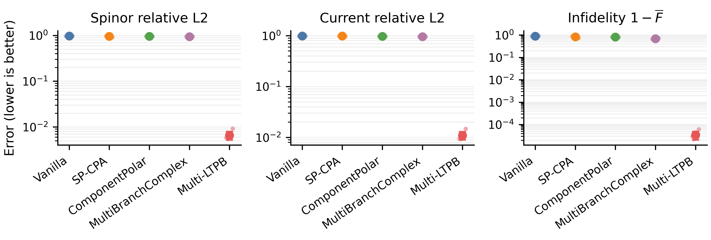

图 5　双波数实验的 learned 模型比较；精确四载频 oracle 不参加排名。 [可编辑 SVG](results/figures/multimode_ltpb/primary_error_comparison.svg) · [PDF](results/figures/multimode_ltpb/primary_error_comparison.pdf) · [Source data](results/figures/multimode_ltpb/primary_error_comparison_source_data.csv)

目标斜率按 \((k2,+),(k2,-),(k5,+),(k5,-)\) 为 \((-\sqrt{29},+\sqrt{29},-\sqrt{50},+\sqrt{50})\)。从总场投影后拟合出的斜率如下。

因为本轮通道系数允许依赖 x，内部四个通道存在重参数化冗余；内部 S 不必逐项等于唯一物理 Fourier 模态的相位。因此正式斜率判据使用总场投影，不能只看网络 q 接近目标就宣称四载频恢复。

| seed | k=2,+ 斜率 | k=2,− 斜率 | k=5,+ 斜率 | k=5,− 斜率 | 四通道最大斜率相对误差 |
| --- | --- | --- | --- | --- | --- |
| 0 | -5.38592 | 5.38636 | -7.07401 | 7.07291 | 0.000415884 |
| 1 | -5.3866 | 5.38679 | -7.07321 | 7.07339 | 0.000328845 |
| 2 | -5.38718 | 5.3872 | -7.07408 | 7.07374 | 0.000426497 |
| 3 | -5.38693 | 5.38677 | -7.07254 | 7.07362 | 0.000361246 |
| 4 | -5.38697 | 5.38672 | -7.07256 | 7.07375 | 0.000378642 |

| 模型 / Case | 四模态系数 L2 | 模态占据相对 RMSE | 四对相对相位 RMSE / rad | 相位速度波动 | 加权相位曲率 |
| --- | --- | --- | --- | --- | --- |
| Vanilla | 0.968793 ± 0.00249313 | 0.97166 ± 0.00151773 | 1.77148 ± 0.0868753 | 1.13653 ± 0.0327792 | 14.3767 ± 0.957953 |
| SP-CPA | 0.954145 ± 0.014758 | 0.963852 ± 0.00753508 | 1.80457 ± 0.0295663 | 1.38233 ± 0.0681228 | 13.3253 ± 0.750471 |
| Component-Polar | 0.957558 ± 0.00228909 | 0.972231 ± 0.000704774 | 1.67727 ± 0.0734779 | 1.14236 ± 0.0742642 | 13.7164 ± 0.40581 |
| MultiBranchComplex | 0.939791 ± 0.00407442 | 0.957998 ± 0.00393216 | 1.69319 ± 0.0507189 | 1.97749 ± 0.839361 | 13.2094 ± 1.99937 |
| Multi-LTPB | 0.00602108 ± 0.00138471 | 0.00831564 ± 0.00306436 | 0.00616922 ± 0.000726724 | 0.00571064 ± 0.000569584 | 0.013006 ± 0.00228724 |
| Four-carrier oracle（未训练） | 0（n=1） | 0（n=1） | 0（n=1） | 3.97074e-14（n=1） | 1.76255e-12（n=1） |

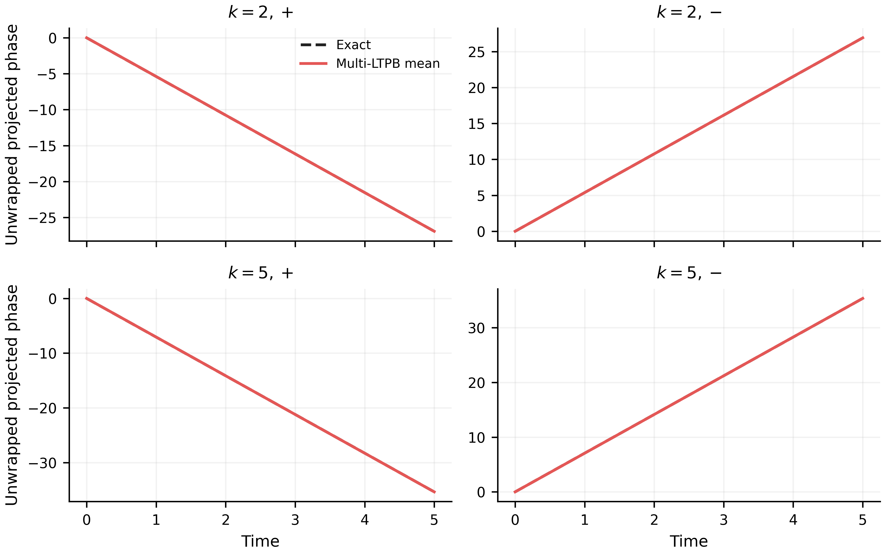

图 6　双波数四条物理投影相位，诊断载频是否真正恢复。 [可编辑 SVG](results/figures/multimode_ltpb/learned_four_phases.svg) · [PDF](results/figures/multimode_ltpb/learned_four_phases.pdf) · [Source data](results/figures/multimode_ltpb/learned_four_phases_source_data.csv)

### 7.3 预注册判定

同时要求五种子均值 spinor≤0.05、current≤0.10、fidelity≥0.99；相对每项最佳 learned baseline 均至少 10 倍改善；至少 4/5 配对种子同时达到上述优势；四条可辨识相位中至少三条的种子平均相对斜率误差低于 1%。结果全部通过，四条相位均通过斜率条件，正式判定 **PASS**。

这个实验已经超出一个公共空间载频，但仍是两个事先给定的离散 k。网络知道四个通道的身份，并为它们设置输出；它尚不回答“同一网络能否统一表示整段 k 谱”，也不涉及外势动量耦合。R4 的早期审计曾出现 dtype 重建和浮点/链接检查等审计层误报，后用独立 finalizer 修正，未修改冻结训练代码或正式指标；详见[最终审计说明](results/multimode_ltpb_audit.json)。

## 8. R5：自由高斯波包的共享谱 LTPB

证据：[预注册](WAVEPACKET_SHARED_SPECTRAL_LTPB_PREREGISTRATION.md)、[正式报告](WAVEPACKET_SHARED_SPECTRAL_LTPB_REPORT.md)、[自动判定](results/wavepacket_shared_spectral_ltpb_decision.json)、正式数据（本地档案）。

### 8.1 从枚举通道输出到共享 k 网络

固定 \(L=16\pi,x\in[-8\pi,8\pi),m=5,T=5\)。训练模态 \(k_n=n/8,n=0,\ldots,32\)，覆盖 \([0,4]\)。谱高斯系数为

\[
g_n=C\exp\left[-\frac{(k_n-2)^2}{4(0.5)^2}\right],\qquad \sum_n|g_n|^2=1,
\]

\[
\widetilde\psi_n(0)=\frac{g_n}{\sqrt2}(u_+(k_n)+u_-(k_n)),\qquad
\psi(x,t)=\frac1{\sqrt L}\sum_ne^{ik_nx}\widetilde\psi_n(t).
\]

33 个模态的两支初始系数全部非零。Shared-Spectral-LTPB 用同一个 4×64 网络接收 \([(k-2)/2,t/T]\)，输出四个实数，而不是每增加一个模态增加四个输出。Complex 对照具有完全相同 MLP、权重初值、参数量及时间采样，仅复系数参数化不同。

训练残差使用原始旋量矩阵方程

\[
R_k=i\partial_t\widehat{\widetilde\psi}(k,t)
-[k\sigma_x+m\sigma_z]\widehat{\widetilde\psi}(k,t),
\]

没有把方程改写成包含精确 \(\pm E(k)\) 的对角标量 ODE。由于使用正交 Fourier 基，

\[
\frac1L\int|R(x,t)|^2dx=\frac1L\sum_k|R_k(t)|^2.
\]

代码按时间及旋量分量平均、按 k 求和再除以 L，使自由谱残差和物理空间均方残差符合 Parseval 对应。谱模型每步全部 33 k×32 随机时间；物理空间三个对照每步 32 x×32 时间。输入和表示空间变化具有计算优势，不能只把耗时差归于极坐标本身；最干净的参数化对照仍是共享谱 Complex 与 LTPB。

### 8.2 全场、模态和波包结果

| 模型 / Case | n | spinor L2 | density L2 | current L2 | mean fidelity |
| --- | --- | --- | --- | --- | --- |
| Physical-Vanilla | 5 | 1.3971 ± 0.00048347 | 0.487106 ± 0.0161196 | 2.11752 ± 0.0138208 | 0.386112 ± 0.00029868 |
| Physical-SP-CPA | 5 | 1.14395 ± 0.0321922 | 0.535669 ± 0.048676 | 1.11406 ± 0.0149695 | 0.100000 ± 0.0218579 |
| Physical-ComponentPolar | 5 | 0.909412 ± 0.00426237 | 0.902442 ± 0.00831826 | 0.88401 ± 0.00765967 | 0.304673 ± 0.0318113 |
| Shared-Spectral-Complex | 5 | 0.965506 ± 0.00760205 | 0.953713 ± 0.00407885 | 0.960592 ± 0.00688249 | 0.277063 ± 0.0136441 |
| Shared-Spectral-LTPB | 5 | 0.0410385 ± 0.00953971 | 0.0152623 ± 0.00347549 | 0.0480569 ± 0.00809016 | 0.998249 ± 0.000827313 |
| Spectral oracle（未训练） | 1 | 0（n=1） | 0（n=1） | 0（n=1） | 1.000000（n=1） |

| 模型 / Case | 谱系数 L2 | 谱占据 L2 | dense physical PDE RMS | max norm drift |
| --- | --- | --- | --- | --- |
| Physical-Vanilla | 1.39692 ± 0.000468091 | 0.0185318 ± 0.00923863 | 0.540308 ± 0.000324411 | 0.0138652 ± 0.0070131 |
| Physical-SP-CPA | 1.07203 ± 0.0228864 | 1.00833 ± 0.018215 | 0.213493 ± 0.00643048 | 0.548112 ± 0.0359584 |
| Physical-ComponentPolar | 0.908674 ± 0.00391204 | 0.939998 ± 0.00434757 | 0.0720569 ± 0.00190165 | 0.997765 ± 0.0012898 |
| Shared-Spectral-Complex | 0.965506 ± 0.00760205 | 0.966174 ± 0.00270701 | 0.0726834 ± 0.00430458 | 0.999613 ± 0.000112136 |
| Shared-Spectral-LTPB | 0.0410385 ± 0.00953971 | 0.0189799 ± 0.00702445 | 0.00191829 ± 0.000525411 | 0.0137205 ± 0.00736882 |
| Spectral oracle（未训练） | 0（n=1） | 0（n=1） | 8.24578e-17（n=1） | 5.55112e-16（n=1） |

Shared-Spectral-LTPB 平均 spinor=0.0410385、current=0.0480569、fidelity=0.998249，相对本轮最佳 learned baseline（Physical-ComponentPolar）分别改善 22.160 倍、18.395 倍。与同样使用谱基底的 Shared-Spectral-Complex 相比也大幅改善，说明本轮收益不能只归因于转到 Fourier 空间。

需要保留一个重要细节：seed 3 的 spinor 误差为 0.0576639，高于 0.05。预注册要求的是五种子**均值**达到绝对阈值，并有 4/5 seeds 达到相对误差优势；本轮符合规则，但不能改写成“每个种子都通过所有绝对阈值”。

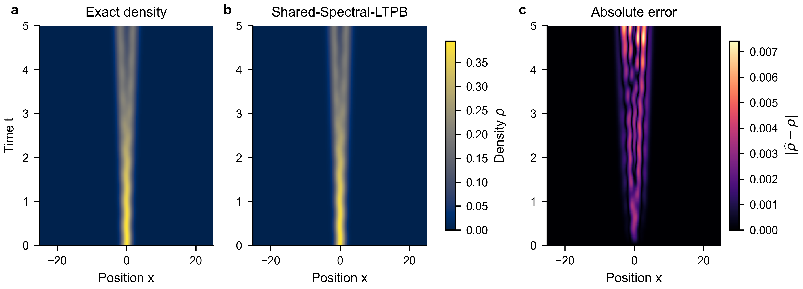

图 7　共享谱高斯波包的参考密度、预测及误差；代表图使用固定 seed 0。 [可编辑 SVG](results/figures/wavepacket_shared_spectral_ltpb/wavepacket_density_spacetime.svg) · [PDF](results/figures/wavepacket_shared_spectral_ltpb/wavepacket_density_spacetime.pdf) · Source data（本地档案）

正负支分别从总场投影后重建分支密度；概率中心使用周期一阶矩并展开角度，宽度使用圆周集中程度，传播速度由中心—时间线性拟合得到。定义为 \(z=\int\rho_b e^{i2\pi x/L}dx/\int\rho_bdx\)，中心为 \(L\arg z/(2\pi)\)，宽度为 \(L\sqrt{-2\ln|z|}/(2\pi)\)。当分支范数太小时不作有效诊断。

| seed | v+ | v− | 中心 RMSE + | 中心 RMSE − | 宽度 L2 + | 宽度 L2 − |
| --- | --- | --- | --- | --- | --- | --- |
| 0 | 0.367805 | -0.363723 | 0.0166848 | 0.0139116 | 0.00600902 | 0.00331353 |
| 1 | 0.366841 | -0.364868 | 0.00562737 | 0.00856267 | 0.01835 | 0.00712085 |
| 2 | 0.370909 | -0.368076 | 0.0123408 | 0.0112036 | 0.00842014 | 0.00898404 |
| 3 | 0.362793 | -0.365927 | 0.0350228 | 0.0316942 | 0.0185577 | 0.0143812 |
| 4 | 0.364267 | -0.366731 | 0.0190712 | 0.0183316 | 0.0102451 | 0.0131519 |

精确参考速度约为 ±0.367332，终点中心约为 ±1.83666。LTPB 的五种子平均速度约为 +0.366523、−0.365865，中心 RMSE 约 0.01775、0.01674，宽度相对 L2 约 0.01232、0.00939，反映了向相反方向分裂传播及宽度变化。

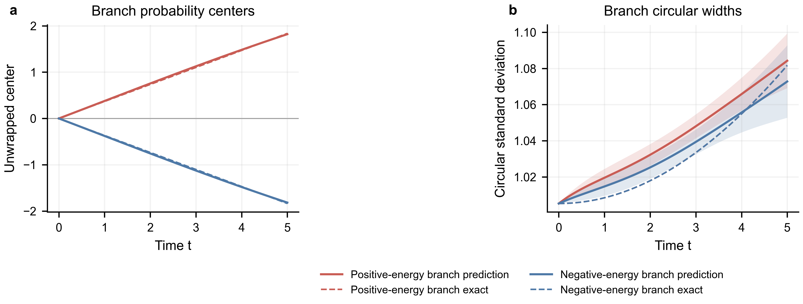

图 9　正负能波包中心和宽度：两支向相反方向传播。 [可编辑 SVG](results/figures/wavepacket_shared_spectral_ltpb/branch_center_width.svg) · [PDF](results/figures/wavepacket_shared_spectral_ltpb/branch_center_width.pdf) · [Source data](results/figures/wavepacket_shared_spectral_ltpb/source_data/branch_center_width.csv)

### 8.3 未训练中点是否只是插值失败

训练结束后直接在 \(k_{n+1/2}=(n+1/2)/8\) 的 32 个中点调用共享网络，不增加训练。初始高斯系数沿用训练谱的同一归一化常数 C，不为中点集合重新归一化。相位斜率从谱物理系数提取、按初始占据加权；不以内部 q 代替实际物理解。

| seed | 训练模态斜率加权相对误差 | 中点斜率加权相对误差 | 中点振幅相对 RMS 漂移 | 中点谱残差 RMS | 中点最小有效时间比例 |
| --- | --- | --- | --- | --- | --- |
| 0 | 0.000836157 | 0.000832934 | 0.011923 | 0.00170342 | 1 |
| 1 | 0.00132412 | 0.0013371 | 0.0110662 | 0.00193725 | 1 |
| 2 | 0.000657676 | 0.000656672 | 0.0148347 | 0.00190755 | 1 |
| 3 | 0.00174108 | 0.00172953 | 0.0213951 | 0.00325016 | 1 |
| 4 | 0.00119592 | 0.00119302 | 0.0213152 | 0.003098 | 1 |

训练格点与中点的五种子平均加权斜率相对误差分别为 0.00115099、0.00114985，即约 0.1151%、0.1150%，低于 1%、2% 门槛。有效性检查没有通过删除失败通道来获得这一数值；目标运行的相位有效时间覆盖达到要求。图中同时保存随 k 的误差连续性和曲率诊断。

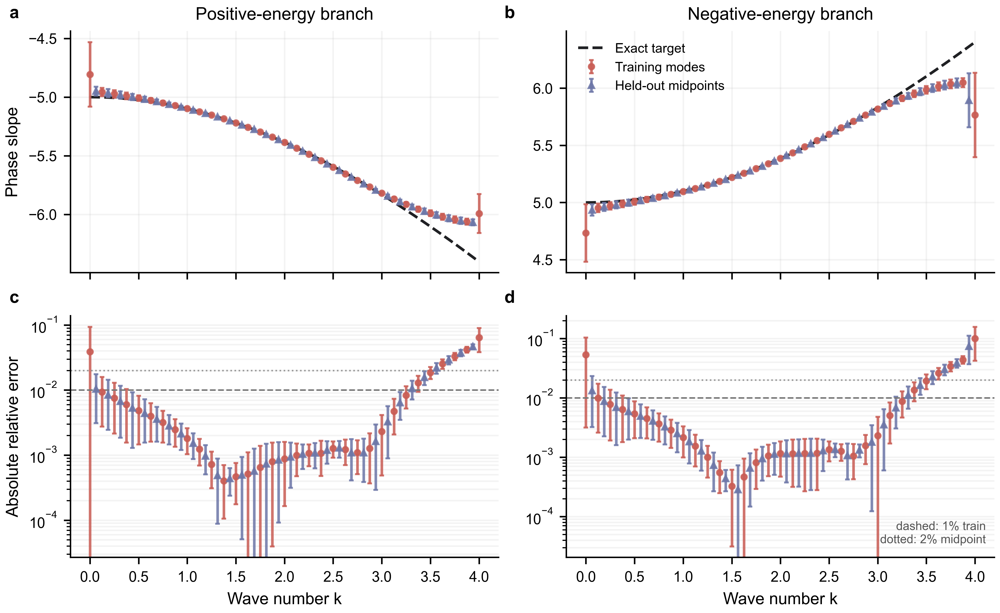

图 8　训练格点与未训练中点的相位斜率；支持已知谱区间内的插值，而非无限连续谱或未知谱发现。 [可编辑 SVG](results/figures/wavepacket_shared_spectral_ltpb/phase_slope_train_midpoint.svg) · [PDF](results/figures/wavepacket_shared_spectral_ltpb/phase_slope_train_midpoint.pdf) · [Source data](results/figures/wavepacket_shared_spectral_ltpb/source_data/phase_slope_train_midpoint.csv)

“连续谱推广”的语义需收紧：有限周期盒中的 Fourier 波数本来是离散的，中点并非同一个长度 L 盒子的允许整数周期模态。这里验证的是把自由谱 ODE 看成 k 的参数化问题时，在已知区间内进行 held-out 插值；它不是构造了一个新周期盒上的物理中点波包，更不是证明无限连续谱、谱外外推或任意未知初态均正确。

### 8.4 本轮判定与适用范围

预注册同时要求：三项主要均值阈值；相对最佳 learned baseline 两项至少 10 倍；至少 4/5 配对种子同时达到优势；训练格点加权斜率误差低于 1%；中点低于 2%；分支中心、宽度及传播趋势正确。分支趋势具体检查包括速度符号、平均速度相对误差<10%、中心 RMSE≤0.25、宽度 L2<10%、终点中心分裂及宽度变化方向。以上均通过，结论 **PASS**。

33/17/65 模态的参数量测试表明网络不按模态数线性扩张；实际前向计算、残差求和、存储与 Fourier 重建成本仍随模态数增长。没有训练 17、65 模态的完整正式实验，不能从参数量测试推出分辨率独立精度。

图表 QA 曾发现逐 seed 图的轴外图例挤压坐标区，后续只用原有 75 行 source CSV 修正版面，保留修复前图像与摘要；训练、指标、判据和 source data 均未变化。该历史修复见[图表修订记录](results/figures/wavepacket_shared_spectral_ltpb/POSTFREEZE_FIGURE_CORRECTION.json)，不属于结果筛选或改变科学门槛。

到这一轮为止，所有主要成功案例中的目标能支系数在自由演化中都不需要从零产生新的通道。这成为外势迁移的关键挑战。

## 9. R6：弱周期外势下的耦合谱 LTPB 迁移

证据：[预注册](PERIODIC_POTENTIAL_COUPLED_LTPB_PREREGISTRATION.md)、[唯一授权修订](PERIODIC_POTENTIAL_COUPLED_LTPB_AMENDMENT_01.md)、[正式报告](PERIODIC_POTENTIAL_COUPLED_LTPB_REPORT.md)、自动决策（本地档案）、参考验证（本地档案）。

### 9.1 物理变化：不是给每个模态换一个 E

外势是 \(V(x)=V_0\cos(qx)I_2\)，其中 \(q=1,L=16\pi,m=5,k_0=2\)。它是乘单位矩阵的电势型项，不是乘 \(\sigma_z\) 的质量型 Lorentz 标量势。动量梯级 \(k_j=k_0+jq\)，\(j=-J,\ldots,J\) 满足

\[
i\partial_t\widetilde\psi_j=H(k_j)\widetilde\psi_j+
\frac{V_0}{2}(\widetilde\psi_{j-1}+\widetilde\psi_{j+1}).
\]

初态只有中心模态，\(\widetilde\psi_0(0)=(u_+(k_0)+u_-(k_0))/\sqrt2\)，其他模态严格为零。自由 \(u_\pm(k_j)\) 仍可作表示基底，但完整 Hamiltonian 不再在这些通道上对角，真正动力学必须包含邻近动量耦合。不能将自由能支标签误认为外势系统的独立守恒能级。

### 9.2 参考解先行，原校准门槛确实失败

先构造块三对角 Hermitian 矩阵：对角块 H(kj)，相邻块 \(V_0I_2/2\)。本征分解产生 \(e^{-i\mathcal Ht}\psi_0\)，并与独立矩阵指数作交叉验证。在任何神经网络正式训练前，对 \(V_0=0.1,0.2,0.5\) 和首先 T=5、必要时 T=8 校准。

原门槛要求：中心外最大总占据在 10%–60%；最外截断层占据<\(10^{-8}\)；J=4 和 J=6 的零填充**全复旋量轨迹**相对差<\(10^{-6}\)。不是仅比较共同模态的占据，也不是各模态任意相位对齐后比较。

| T | V₀ | 中心外最大占据（J=6） | J=6 外层最大总占据 | J=4/6 全轨迹复旋量相对差 | 原判据 |
| --- | --- | --- | --- | --- | --- |
| 5 | 0.1 | 0.0891852 | 5.59193e-14 | 2.15509e-06 | 未通过 |
| 5 | 0.2 | 0.3209 | 2.18548e-10 | 6.76012e-05 | 未通过 |
| 5 | 0.5 | 0.972215 | 9.34629e-06 | 0.00574057 | 未通过 |
| 8 | 0.1 | 0.13941 | 5.91958e-12 | 1.84599e-05 | 未通过 |
| 8 | 0.2 | 0.465551 | 2.14858e-08 | 0.000563215 | 未通过 |
| 8 | 0.5 | 0.987672 | 0.000534827 | 0.0393184 | 未通过 |

六个候选均不满足所有原门槛。T=5、V₀=0.2 的转移比例合适且 J=6 外层足够小，但 J=4/6 的全旋量差为 \(6.76\times10^{-5}\)，超过门槛。不能将这个结果直接宣布校准通过。

随后取得用户明确授权：“允许这一处修订，继续正式实验”。**只把截断比较从 J=4/6 改为 J=6/8**，固定 V₀=0.2、T=5、正式训练 J=6。修订后的 8001 时间点评价得到 J=6/8 全轨迹相对差 \(2.18998\times10^{-7}\)。这次参数冻结只依据参考解，没有查看 PINN 正式结果后择优换参数。授权记录与范围见上述修订文件及正式选择记录（本地档案）。

正式梯级共有 13 个 k，范围 −4 到 8，Hamiltonian 为 26×26。Hermiticity 误差为零，范数漂移约 \(1.44\times10^{-15}\)，时间可逆性误差约 \(1.11\times10^{-15}\)；参考校验记录中本征法与独立矩阵指数的最大相对差约 \(1.52\times10^{-14}\)。参考解及截断误差远小于后续 PINN 的主要误差。

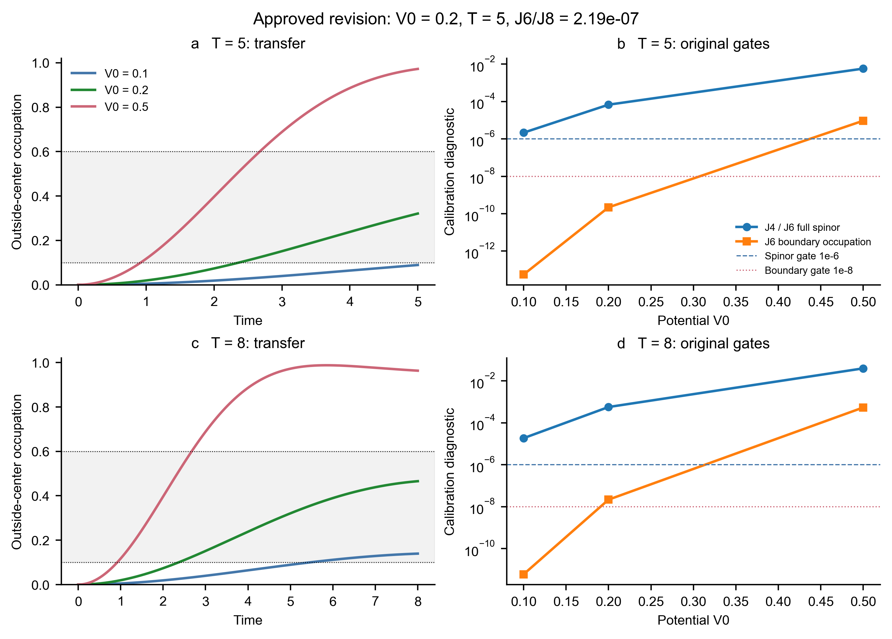

图 10　外势问题的纯参考解校准，包含原门槛失败与获授权的截断修订。 [可编辑 SVG](results/figures/periodic_potential_coupled_ltpb/calibration_modal_transfer.svg) · [PDF](results/figures/periodic_potential_coupled_ltpb/calibration_modal_transfer.pdf) · [Source data 1](results/figures/periodic_potential_coupled_ltpb/source_data/calibration_modal_transfer_gates.csv) · [Source data 2](results/figures/periodic_potential_coupled_ltpb/source_data/calibration_modal_transfer_approved_revision.csv)

### 9.3 比较模型、残差及冻结边界

只训练 Physical-Vanilla、Coupled-Shared-Spectral-Complex、Coupled-Shared-Spectral-LTPB 三个模型，各 seeds 0–4，沿用 4×64、5000 steps、Adam 1e−3、双精度和硬初值。两种谱模型共享相同 2 维输入、12932 参数、初始权重和每一步的 32 个时间样本。每步与全部 13 个 k 作笛卡尔积，共 416 个谱点；Physical-Vanilla 仍为 1024 个物理点。

谱损失严格用完整耦合残差

\[
R_j=i\partial_t\widehat{\widetilde\psi}_j-H(k_j)\widehat{\widetilde\psi}_j
-\frac{V_0}{2}(\widehat{\widetilde\psi}_{j-1}+\widehat{\widetilde\psi}_{j+1}).
\]

不使用矩阵指数标签、参考相位或模态占据作监督。dense physical residual 的核验还计入截断外侧由势耦合产生的残差，而不把保留梯级内残差冒充全部物理残差。对物理空间 baseline 的主旋量评价保留其完整预测场，并额外记录梯级外泄漏，避免只投影保留模态而隐去错误。

本轮没有训练混合复数/极坐标、振幅阈值正则化或其他补救模型；失败后只做诊断。15 个正式训练均完整结束，未为某个模型选择性追加预算或重跑。

### 9.4 主结果：相对更好，但未成功迁移

模态占据为 \(P_j=\|\widetilde\psi_j\|^2\)，自由基底分支系数为 \(c_{j,\pm}=u_\pm(k_j)^\dagger\widetilde\psi_j\)，分支占据为 \(|c_{j,\pm}|^2\)。活跃通道相干量使用 \(C_{ab}=c_ac_b^*\)，在两端参考占据均达到 \(10^{-6}\) 的非对角通道对上统计复数 relative L2。它对整体相位不敏感，同时保留幅度和相对相位信息；预测为零不会被有效性 mask 隐去。零参考占据点不报告普通相位误差。

| 模型 / Case | n | spinor L2 | density L2 | current L2 | mean fidelity |
| --- | --- | --- | --- | --- | --- |
| Physical-Vanilla | 5 | 1.39344 ± 0.00224828 | 0.13515 ± 0.0363566 | 1.73708 ± 0.0156515 | 0.432817 ± 0.00271654 |
| Coupled-Shared-Spectral-Complex | 5 | 0.974201 ± 0.00698316 | 0.964767 ± 0.00261108 | 0.991955 ± 0.00247076 | 0.230814 ± 0.0470799 |
| Coupled-Shared-Spectral-LTPB | 5 | 0.366703 ± 0.000220082 | 0.103431 ± 0.00103694 | 0.456121 ± 0.000662673 | 0.872527 ± 0.000127198 |

| 模型 / Case | 模态占据 L2 | 分支占据 L2 | max norm drift | 活跃相干量 L2 | 有效相位 RMSE / rad | 预测相位覆盖率 |
| --- | --- | --- | --- | --- | --- | --- |
| Physical-Vanilla | 0.22378 ± 0.000440322 | 0.223855 ± 0.000565229 | 0.0201949 ± 0.0221889 | 1.35799 ± 0.00799276 | 1.78441 ± 0.00279909 | 0.312886 ± 0 |
| Coupled-Shared-Spectral-Complex | 0.955278 ± 0.00314502 | 0.955281 ± 0.00314409 | 0.999563 ± 0.000264106 | 0.99402 ± 0.00185091 | 1.80134 ± 0.0323779 | 1 ± 0 |
| Coupled-Shared-Spectral-LTPB | 0.216503 ± 0.0022714 | 0.216522 ± 0.00228246 | 0.0108665 ± 0.00377314 | 0.620468 ± 0.000393561 | 1.4081 ± 0.0118609 | 1 ± 0 |

LTPB 的五种子平均旋量误差 0.366703、概率流误差 0.456121、fidelity 0.872527、模态占据误差 0.216503，均未达目标；平均最大范数漂移 0.0108665 则低于 0.02。这个结果再次说明：范数较好并不等于正确的模态转移与相干动力学。

Complex 对照的范数漂移接近 1，表现出强烈的幅度衰减/接近零解趋势；当前固定预算下它也没有学会可靠动力学。因此不能仅因 LTPB 优于这个失败对照就宣称迁移有效。

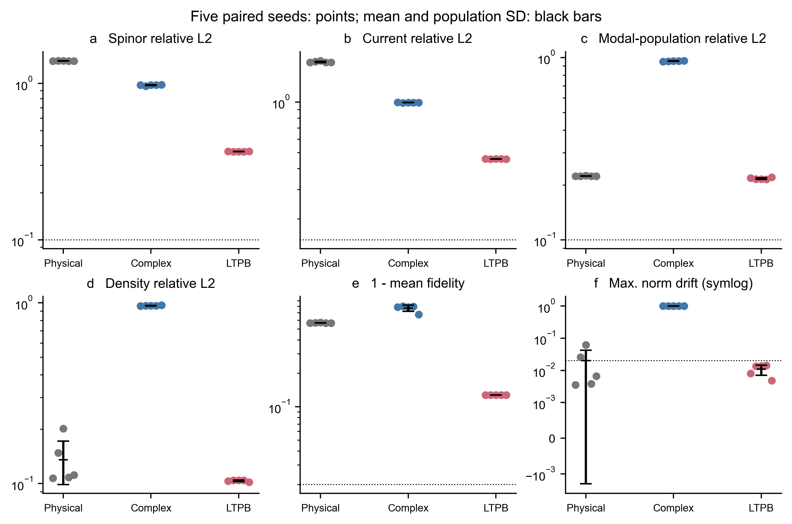

图 11　外势迁移全部五种子的主要误差；相对较好不等于达到绝对成功条件。 [可编辑 SVG](results/figures/periodic_potential_coupled_ltpb/all_seed_primary_metrics.svg) · [PDF](results/figures/periodic_potential_coupled_ltpb/all_seed_primary_metrics.pdf) · [Source data](results/figures/periodic_potential_coupled_ltpb/source_data/all_seed_primary_metrics.csv)

### 9.5 与同基底复系数网络的配对比较

| seed | spinor：LTPB−Complex | spinor：LTPB/Complex | current：LTPB−Complex | current：LTPB/Complex | 两项均胜出 |
| --- | --- | --- | --- | --- | --- |
| 0 | -0.608633 | 0.37614 | -0.538028 | 0.459093 | 是 |
| 1 | -0.594791 | 0.381154 | -0.531559 | 0.461594 | 是 |
| 2 | -0.608211 | 0.376097 | -0.536231 | 0.459794 | 是 |
| 3 | -0.610829 | 0.375118 | -0.535903 | 0.460159 | 是 |
| 4 | -0.615024 | 0.373654 | -0.53745 | 0.458472 | 是 |

五个配对种子中 LTPB 均在旋量和概率流两项胜出。均值误差比 LTPB/Complex 为 0.376414、0.459820，即约降低 2.657 倍、2.175 倍。配对差值的均值±population SD 分别为 −0.607498±0.006797、−0.535834±0.002274。这里报告实际幅度，不设置事后 1.25 倍或 10 倍优势门槛，也不将这五次结果作总体显著性检验。

### 9.6 模态占据明确显示没有学会侧带产生

预先固定代表 seed 0，而不是从五个结果中挑最好者。参考解中心外最大占据为 0.320900，即 32.09%；LTPB 对应量约为 0.000265738，即 **0.0266%**。终点参考中心占据约 0.67910，而 LTPB 约 0.99186。参考 k₀−q、k₀+q 占据约 0.16864、0.13629，LTPB 只有约 \(2.38\times10^{-5}\)、\(1.22\times10^{-5}\)。

这不是单纯整体相位偏移，而是新增动量模态几乎没有建立。模态热图、分支占据、物理密度/概率流时空图和活跃相干量相互支持这一观察。seed 0 的活跃相干量误差约 0.621，minimum fidelity 约 0.679；不会因为总范数接近 1 而消失。

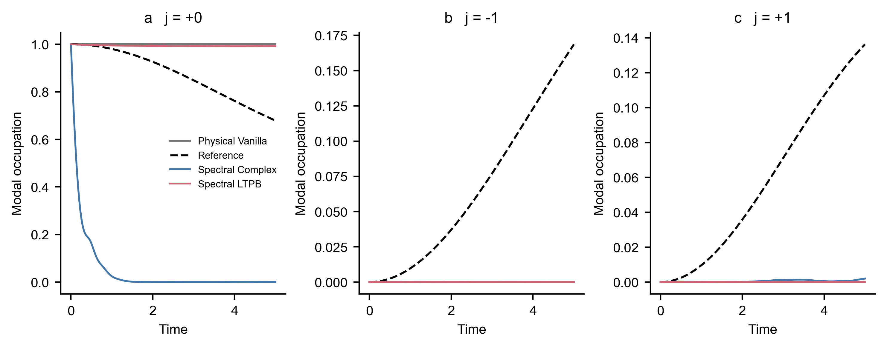

图 12　固定 seed 0 的中心与一阶侧带占据：当前 LTPB 未恢复动态模态产生。 [可编辑 SVG](results/figures/periodic_potential_coupled_ltpb/center_sideband_trajectories_seed0.svg) · [PDF](results/figures/periodic_potential_coupled_ltpb/center_sideband_trajectories_seed0.pdf) · [Source data](results/figures/periodic_potential_coupled_ltpb/source_data/center_sideband_trajectories_seed0.csv)

### 9.7 零振幅相位退化：能证明哪一层问题

对于初始空通道，当前参数化为

\[
c(t)=\frac{t}{T}r(t)\exp\left[i\frac{t}{T}q(t)\right],\qquad r,q\ \text{为有限、光滑实输出}.
\]

因此

\[
c'(0)=\frac{r(0)}{T}\in\mathbb R.
\]

相位分支的参数不能在 t=0 提供非零虚部的一阶时间切向。而耦合方程对两个一阶侧带要求

\[
\widetilde\psi_{\pm1}'(0)=-i\frac{V_0}{2}\widetilde\psi_0(0),
\]

在所选实基底中，它具有非零纯虚初始方向。这就得到当前硬门控形式的端点 \(C^1\) 不匹配，不依赖“训练损失看起来较大”的经验猜测。

| 模型 / Case | 初始侧带导数 relative L2 | 虚部切向参数敏感度 |
| --- | --- | --- |
| Coupled-Shared-Spectral-Complex | 1.14493 ± 0.0796573 | 1.36412 ± 0.15487 |
| Coupled-Shared-Spectral-LTPB | 1.00108 ± 0.000226061 | 0 ± 0 |

自动微分诊断中，LTPB 初始侧带虚部切向的参数敏感度严格为零；Complex 的该方向可非零。LTPB 的所需初始侧带导数相对误差下界为 1，实际诊断也与此一致。零初始振幅时相位不可辨识，使这个局部退化具有清晰物理含义。

但需要三个限制。第一，缺陷来自本轮具体的 \(a=\tau r,S=\tau q\) 硬门控，不是“所有极坐标表示在数学上都不能表示耦合解”。第二，端点导数不匹配并不自动推出全时间 L2 有同样下界，有限网络可能通过短初始层近似；其优化代价仍需研究。第三，Complex 虽具有该切向方向也没有训练成功，所以当前全局误差仍混有共同优化、采样或损失尺度问题，尚不能把全部失败因果归给 LTPB。

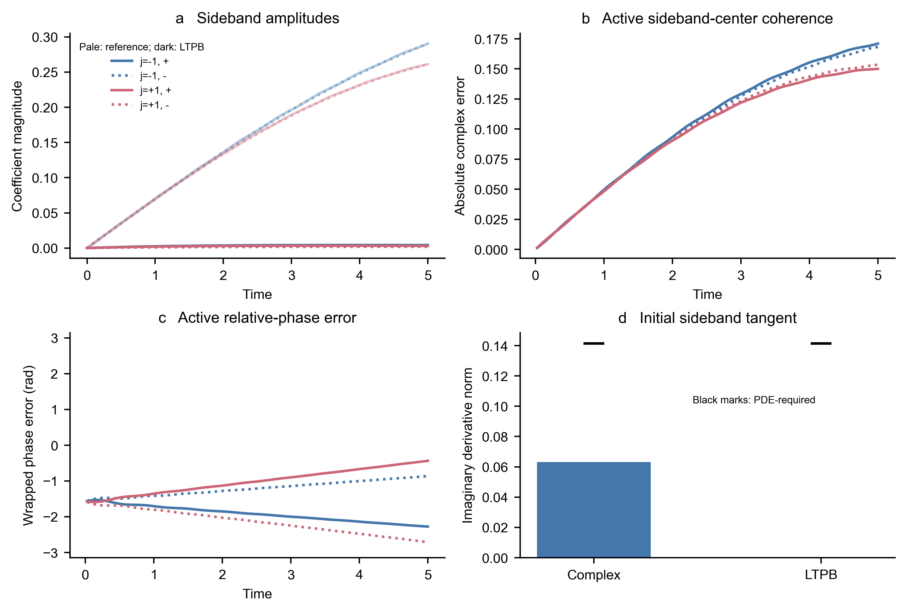

图 13　有效相位区域和初始切向诊断：空通道的相位退化有局部数学证据，整体失败仍受共同优化失败混杂。 [可编辑 SVG](results/figures/periodic_potential_coupled_ltpb/active_channel_diagnostics_seed0.svg) · [PDF](results/figures/periodic_potential_coupled_ltpb/active_channel_diagnostics_seed0.pdf) · [Source data 1](results/figures/periodic_potential_coupled_ltpb/source_data/active_channel_diagnostics_seed0_channels.csv) · [Source data 2](results/figures/periodic_potential_coupled_ltpb/source_data/active_channel_diagnostics_seed0_tangent.csv)

### 9.8 预注册分类逐项解释

`TRANSFER_SUCCESS` 要求：五种子 mean spinor≤0.10、current≤0.15、fidelity≥0.98、模态占据误差≤0.10、最大范数漂移均值≤0.02，且至少 4/5 seeds 同时满足这五项。LTPB 仅范数均值通过，联合 seed 通过数为 0/5。

`COMPARATIVE_ADVANTAGE` 以迁移成功为前提，再要求对 Complex 的均值双项更优且至少 4/5 配对双赢。虽然相对条件为 5/5，前提没有通过，因此不能使用这一正式标签。

`REPRESENTATION_FAILURE` 需要 LTPB 未成功而 Complex 成功；本轮不满足。两种共享谱模型均失败，按预注册必须判为 **INCONCLUSIVE**。结论同时保留“迁移未成功”“相对数值优势存在”“有局部表示退化证据”“全局因果归因尚不闭合”四件事，不能只选其中最有利的一句。

## 10. 六轮结果合起来意味着什么

### 10.1 五种概念必须分开

| 概念 | 现有证据支持什么 | 不能据此推出什么 |
| --- | --- | --- |
| 表达能力 | 单 k LTPB 可以构造精确双相位解；公共相位配一般复振幅并不排除混合态；空通道硬门控有端点切向限制 | 任意有限网络都能精确表示所有解；所有极坐标方法都失败 |
| 载波预条件 | 自由能支对齐让目标更接近恒振幅、线性相位；R2/R4/R5 精度提升与此一致 | 不依赖已知谱先验的通用求解器 |
| 优化难度 | 固定预算下笛卡尔和未对齐基底常失败；外势两种谱模型均失败 | 增大预算必然解决；当前失败一定来自参数量不足 |
| 守恒量盲点 | R1 解析反例和 R6 范数较好但侧带失败都表明守恒量不充分 | 守恒律无用或不应检查 |
| 已知能支基底先验 | 提供自由 H(k) 的物理坐标系，显著简化自由载频问题 | 完整外势 Hamiltonian 已被对角化；网络自行发现未知谱 |

### 10.2 当前最可靠的证据链

R1 用解析反例和受控 P/M 对照把问题从“密度或守恒量是否正确”转为“相对相位和概率流是否正确”。R2 证明在已知能支基底内不写入时间载频也可获得高精度。R3 缩小了“仅基底”或“任意双相位”的解释空间，但未达到强判据。R4 证明自由问题可处理四载频；R5 证明共享 k 网络可以处理 33 模态并在中点插值。R6 则揭示：这些成功没有自动迁移到从零产生动态通道的耦合问题。

这不是一条“每轮都更成功”的故事，而是一条逐步收紧条件、最后触及边界的研究链。负结果本身提供了下一轮可检验的问题，比将它改写为通用成功更有价值。

### 10.3 仍缺少的证据

尚无未知连续谱发现、任意新初态泛化、谱区间外推、强外势、非周期/吸收边界、开域散射、高维问题、非线性 Dirac 或量子场论效应的正式结果。没有训练预算扫描、宽度扫描或大规模种子统计，因此失败不能直接归为“参数不足”，成功也不能声明训练复杂度标度已确定。外势下还缺少一个在同问题上真正达到绝对精度门槛的 learned 控制模型，限制了当前因果归因强度。

本文没有重新开展文献检索，也不作“世界首次”或最新文献覆盖声明；开题报告中的文献状态属于当时研究记录，不是本次验证结果。

## 11. 代码、测试、冻结、审计与结果保护

### 11.1 实际代码链

| 范围 | 物理 / 模型 | 训练与评价 | 判定与汇总 |
| --- | --- | --- | --- |
| R1–R3 | [physics.py](src/physics.py)；[models.py](src/models.py) | [train.py](src/train.py)；[evaluate.py](src/evaluate.py)；[losses.py](src/losses.py) | [aggregate.py](src/aggregate.py)；[ltpb_mechanism_decision.py](src/ltpb_mechanism_decision.py) |
| R4 | [multimode_physics.py](src/multimode_physics.py)；[multimode_models.py](src/multimode_models.py) | [train_multimode_ltpb.py](src/train_multimode_ltpb.py)；[multimode_evaluate.py](src/multimode_evaluate.py) | [multimode_ltpb_decision.py](src/multimode_ltpb_decision.py) |
| R5 | [wavepacket_physics.py](src/wavepacket_physics.py)；[wavepacket_models.py](src/wavepacket_models.py) | [train_wavepacket_shared_spectral_ltpb.py](src/train_wavepacket_shared_spectral_ltpb.py)；[wavepacket_evaluate.py](src/wavepacket_evaluate.py) | [wavepacket_shared_spectral_ltpb_decision.py](src/wavepacket_shared_spectral_ltpb_decision.py) |
| R6 | [periodic_potential_physics.py](src/periodic_potential_physics.py)；[periodic_potential_models.py](src/periodic_potential_models.py) | [train_periodic_potential_coupled_ltpb.py](src/train_periodic_potential_coupled_ltpb.py)；[periodic_potential_evaluate.py](src/periodic_potential_evaluate.py) | [periodic_potential_coupled_ltpb_decision.py](src/periodic_potential_coupled_ltpb_decision.py) |

### 11.2 测试覆盖什么，不覆盖什么

测试逐步增加，覆盖解析 PDE 残差、正交/归一化、硬初值、复数输出、精确双相位可构造性、基底旋转、参数量、配对随机流、无目标时间频率进入 learned 路径、Fourier/Parseval 对应、参考 Hamiltonian Hermiticity、时间可逆性、截断收敛、有效相位 mask 和完整产物等。R6 完成时全套 pytest 为 **137 项通过**，记录见最终 pytest 结果（本地档案）及[测试目录](tests/)。

单元测试通过可以排除一批实现错误，不保证 PINN 一定优化到正确解；表示测试能构造目标函数，不等于训练过程自动找到该函数。smoke 也只验证最小流程可运行，不能当作正式精度结果。本次总报告整理没有重新训练或修改科学代码，另行核对了原始产物、配置预算、统计、决策数值与链接，并重新运行完整 pytest，仍为 **137 项通过**；新日志单独保存在报告整理测试记录（本地档案），没有覆盖旧测试记录。

### 11.3 预注册和审计状态

| 历史冻结证据 | 该清单文件的当前 SHA-256（清单内另含各源文件摘要） |
| --- | --- |
| [multimode_ltpb_preregistration_sha256.json](results/multimode_ltpb_preregistration_sha256.json) | f6fdb6d5c99e9c7e22cc3459b726a7c9c3285fed8c40b898e420043cadce578c |
| [wavepacket_shared_spectral_ltpb_preregistration_sha256.json](results/wavepacket_shared_spectral_ltpb_preregistration_sha256.json) | a8f54fbbcfadd3747ba8139f648440aef81786ebf46f18efccd7efeb152c7889 |
| frozen_protocol_and_code.json（本地档案） | b0e6680c160651036646220c9e5f6314c9726b3a9a72e4d1f626867d42b5e5a3 |

上表是历史冻结清单本身的摘要；各清单内部保存当时预注册和代码文件的 SHA-256。本文新生成的保护清单是 **报告整理时的快照**，不能替代历史预注册时间证据。R3 有预注册文件与自动阈值判断，R4 以后冻结/保护链更完整。R6 唯一校准修订在正式训练前取得用户授权并另存记录，未悄悄覆盖原门槛。

| 轮次 | 证据 | 工程审计 | 计数 |
| --- | --- | --- | --- |
| R1 | [原始审计](results/reproducibility_audit.json) | PASS | 检查项见原 JSON |
| R2 | [原始审计](results/learned_two_phase_pilot_audit.json) | PASS | 检查项见原 JSON |
| R3 | [原始审计](results/ltpb_mechanism_ablation_audit.json) | PASS | 检查项见原 JSON |
| R4 | [原始审计](results/multimode_ltpb_audit.json) | PASS | 12/12 |
| R5 | [原始审计](results/wavepacket_shared_spectral_ltpb_audit.json) | PASS | 14/14 |
| R6 | 原始审计（本地档案） | PASS | 9/9 |

R6 最终审计包括 15 份指标从 dense data 重算，最大数值差约 \(4.55\times10^{-15}\)，全部六类 run 产物、173 个报告链接、既有结果保护与图表证据链等。其“PASS”只说明执行和证据一致，不改变 INCONCLUSIVE 科学结论。

本次独立报告保护了 1024 个既有正式数据、图表、报告、科学代码与测试文件的 SHA-256。没有覆盖任何旧正式结果、旧报告或旧预注册。各轮图的 PNG、SVG、PDF、source data 与原始 QA 均继续使用原文件，未重新筛选 seed 或改变图中数值。

项目当前不具备可用的 Git 仓库元数据，不能凭 Git 状态声称旧工作已保护；实际保护证据是逐文件哈希核对。本次汇总核实 110 份 metrics 对应的 656 个必需产物均存在，训练配置和最终 loss history 步数符合 5000-step 协议，并将 R4–R6 主均值与各自原决策文件独立对照。所有本地引用的检查结果见本次报告 audit。

### 11.4 本报告的逻辑闭环核查

| 问题 | 对应方法与证据 | 闭环情况 |
| --- | --- | --- |
| 公共单相位是否对混合态有效？ | R1 同物理 P/M 对照、解析反例、流与相位指标 | 给出有限预算退化证据，不越界成表达不可能 |
| 可学习独立相位能否替代 oracle 载频？ | R2 无时间载波 forward、相位斜率、全场误差 | 单 k 情形闭环，已知基底先验保留 |
| 是否已证明对齐是唯一机制？ | R3 复系数、分量极坐标、基底旋转与冻结阈值 | 未完全闭环；明确保留强判据 FAIL |
| 能否扩展到多个已知 k 与共享谱？ | R4/R5 全场投影、全部 seeds、中点 held-out | 在所测试有限自由谱范围闭环，不外推未知谱 |
| 外势是否迁移成功，失败是否纯表示问题？ | R6 精确校准、模态占据、配对 Complex、端点梯度 | 迁移未成功；局部缺陷可证，全局归因不确定 |

## 12. 当前结论与下一轮工作建议

### 12.1 用通俗语言回答目前最关心的四个问题

**外势下现有 LTPB 是否仍然有效？** 还没有。它保住了不少中心模态和总范数，但几乎没学出应当出现的侧带，旋量和概率流误差都明显超标。

**是否仍优于同基底复系数网络？** 在这次同预算、五个配对种子中是的，旋量和概率流都更好；但两者都没有成功，所以这是“失败中的相对较好”，不是预注册意义上的迁移优势成立。

**失败证据是否指向零振幅相位退化？** 有直接证据：当前硬初值写法不能在空通道起点产生方程要求的虚部时间导数。但因为复系数对照也失败，仍不能把长期误差全部归因于这一点。

**下一轮应扩大外势，还是开始设计混合表示？** 更合理的是先在同一个已校准的弱外势问题上研究表示与优化的修正，再扩大外势。混合复数/极坐标是候选方向，但不应在本轮事后补训练后只报告成功；需要新的预注册、独立结果目录和成功的对照来形成干净证据。

### 12.2 建议的新一轮应保留哪些控制

保持当前参考解、物理参数和指标定义，优先明确解决“空通道的正确初始切向能否表达、能否被优化器实际学出”的问题。可以在新轮中比较具有正确初始切向的表示、复系数方案和候选混合方案，但这只是建议，本文没有实现或训练这些新模型。训练预算、候选结构、是否需要优化流程修正都应在看新正式结果之前冻结，并把“方法改变”和“预算改变”分开控制。

新轮至少继续报告侧带占据、活跃相干量、主旋量和概率流、相位覆盖率，而不仅是总范数和 loss；所有统计图显示全部种子，时空图固定 seed 0。一旦有对照真正达到当前绝对误差条件，才能更有力区分表示问题与共同优化失败。之后再讨论更强外势、更多耦合步长、一般光滑势和更复杂初态。

### 12.3 最终结论

已经完成的工作不是一个通用 Dirac 求解器，而是一条可复核的表示机制研究链：发现单相位的混合能支预条件退化，验证自由能支可学习独立相位的优势，将其推广到两个已知 k 和共享高斯谱，再通过弱外势实验暴露零初始振幅通道与耦合动力学的边界。自由问题的正结果、消融强判据的失败和外势迁移的 INCONCLUSIVE 都是课题的组成部分，必须共同进入后续论文叙事。

## 附录 A. 全部逐运行主要指标

每个模型名称直接链接该 run 的原始 metrics；原始配置、loss history、time series、dense grid、checkpoint 的对应关系在[完整产物索引](results/reports/dirac_ltpb_comprehensive/run_artifact_index.csv)。R1–R3 spinor/final 为 raw；R4–R6 为单个全局常数相位对齐后的指标。下表不把不同轮次横向排名。oracle 的 seed 字段仅标识记录；R4/R5 oracle 未训练。

### R1：单相位迁移与守恒量诊断

| 模型（链接原始 metrics） | seed | spinor L2 | final L2 | density L2 | current L2 | mean F | min F |
| --- | --- | --- | --- | --- | --- | --- | --- |
| Vanilla / P（本地档案） | 0 | 0.921217 | 1.00533 | 0.941222 | 0.941558 | 0.353366 | 0.00334554 |
| Vanilla / P（本地档案） | 1 | 0.923128 | 1.00182 | 0.945412 | 0.945394 | 0.549282 | 0.0079678 |
| Vanilla / P（本地档案） | 2 | 0.923984 | 1.00649 | 0.943191 | 0.942248 | 0.394751 | 0.00672577 |
| SP-CPA / P（本地档案） | 0 | 0.00907162 | 0.0139968 | 0.0104911 | 0.0159411 | 0.999950 | 0.999855 |
| SP-CPA / P（本地档案） | 1 | 0.00524923 | 0.00585035 | 0.00861997 | 0.00869373 | 0.999986 | 0.999966 |
| SP-CPA / P（本地档案） | 2 | 0.00570504 | 0.00695228 | 0.00873035 | 0.0092749 | 0.999979 | 0.999953 |
| SP-CPA-Conservative / P（本地档案） | 0 | 0.00975844 | 0.00883548 | 0.00453759 | 0.00510995 | 0.999975 | 0.999923 |
| SP-CPA-Conservative / P（本地档案） | 1 | 0.0135501 | 0.0136598 | 0.00536427 | 0.00460784 | 0.999925 | 0.999852 |
| SP-CPA-Conservative / P（本地档案） | 2 | 0.00990522 | 0.00878133 | 0.00576153 | 0.00435898 | 0.999964 | 0.999923 |
| Two-Branch oracle / P（本地档案） | 0 | 0.00787915 | 0.0146763 | 0.0101571 | 0.0186524 | 0.999967 | 0.999909 |
| Vanilla / M（本地档案） | 0 | 0.947086 | 1.01859 | 0.952753 | 0.969989 | 0.178506 | 3.17925e-06 |
| Vanilla / M（本地档案） | 1 | 0.941395 | 1.00643 | 0.956796 | 0.967125 | 0.241535 | 8.18947e-05 |
| Vanilla / M（本地档案） | 2 | 0.947034 | 1.0062 | 0.959626 | 0.970663 | 0.256065 | 0.000100359 |
| SP-CPA / M（本地档案） | 0 | 0.876793 | 0.918978 | 0.907472 | 0.925644 | 0.623895 | 0.0136902 |
| SP-CPA / M（本地档案） | 1 | 0.850381 | 1.04697 | 0.894526 | 0.929891 | 0.590018 | 0.201989 |
| SP-CPA / M（本地档案） | 2 | 0.670237 | 0.717512 | 0.560678 | 0.9621 | 0.566524 | 0.472164 |
| SP-CPA-Conservative / M（本地档案） | 0 | 1.13493 | 1.20244 | 0.574624 | 1.09353 | 0.144654 | 0.00238236 |
| SP-CPA-Conservative / M（本地档案） | 1 | 1.03139 | 1.02682 | 0.530597 | 1.07938 | 0.197399 | 0.0297124 |
| SP-CPA-Conservative / M（本地档案） | 2 | 1.06907 | 1.16942 | 0.561045 | 1.0364 | 0.147168 | 0.00727947 |
| Two-Branch oracle / M（本地档案） | 0 | 0.00622166 | 0.0122439 | 0.00998791 | 0.0105201 | 0.999990 | 0.999969 |

### R1S：结构损失权重敏感性

| 模型（链接原始 metrics） | seed | spinor L2 | final L2 | density L2 | current L2 | mean F | min F |
| --- | --- | --- | --- | --- | --- | --- | --- |
| SP-CPA-Conservative / M / λ=0.1（本地档案） | 0 | 0.675482 | 0.694983 | 0.484535 | 0.983303 | 0.568388 | 0.376574 |
| SP-CPA-Conservative / M / λ=10（本地档案） | 0 | 1.44918 | 1.58767 | 0.90626 | 1.06373 | 0.062512 | 0.000290739 |

### R2：可学习双能支相位 pilot

| 模型（链接原始 metrics） | seed | spinor L2 | final L2 | density L2 | current L2 | mean F | min F |
| --- | --- | --- | --- | --- | --- | --- | --- |
| LTPB-CPA / P（本地档案） | 0 | 0.00270737 | 0.00182509 | 0.0031153 | 0.00389876 | 0.999999 | 0.999997 |
| LTPB-CPA / P（本地档案） | 1 | 0.00340589 | 0.00170224 | 0.00450642 | 0.00462869 | 0.999999 | 0.999997 |
| LTPB-CPA / P（本地档案） | 2 | 0.00338699 | 0.00243723 | 0.00361925 | 0.00418324 | 0.999998 | 0.999994 |
| LTPB-CPA / M（本地档案） | 0 | 0.00203276 | 0.00230411 | 0.00229088 | 0.00373001 | 0.999997 | 0.999994 |
| LTPB-CPA / M（本地档案） | 1 | 0.00287821 | 0.00237723 | 0.00392849 | 0.00538875 | 0.999995 | 0.999991 |
| LTPB-CPA / M（本地档案） | 2 | 0.00245201 | 0.00311524 | 0.00382435 | 0.00454369 | 0.999997 | 0.99999 |

### R3：能支对齐机制消融

| 模型（链接原始 metrics） | seed | spinor L2 | final L2 | density L2 | current L2 | mean F | min F |
| --- | --- | --- | --- | --- | --- | --- | --- |
| LTPB-CPA / M（本地档案） | 0 | 0.00208385 | 0.00261733 | 0.00247838 | 0.00382397 | 0.999997 | 0.999994 |
| LTPB-CPA / M（本地档案） | 1 | 0.00285012 | 0.00242499 | 0.00394441 | 0.00541344 | 0.999995 | 0.999992 |
| LTPB-CPA / M（本地档案） | 2 | 0.00243881 | 0.00296059 | 0.00371677 | 0.00440306 | 0.999997 | 0.999991 |
| Branch-Complex / M（本地档案） | 0 | 0.893689 | 1.02675 | 0.926729 | 0.928833 | 0.611722 | 0.00102177 |
| Branch-Complex / M（本地档案） | 1 | 0.903804 | 0.989016 | 0.932691 | 0.935703 | 0.563388 | 0.012132 |
| Branch-Complex / M（本地档案） | 2 | 0.906583 | 0.980759 | 0.934125 | 0.93794 | 0.529046 | 0.00320029 |
| Component-Polar / M（本地档案） | 0 | 0.881945 | 0.991716 | 0.926235 | 0.925929 | 0.576438 | 0.00345875 |
| Component-Polar / M（本地档案） | 1 | 0.89136 | 0.974641 | 0.934397 | 0.934866 | 0.642456 | 0.229152 |
| Component-Polar / M（本地档案） | 2 | 0.898747 | 1.00544 | 0.932149 | 0.931914 | 0.684029 | 0.13855 |
| Rotated-LTPB 15° / M（本地档案） | 0 | 0.892834 | 0.998975 | 0.922803 | 0.951241 | 0.558911 | 0.0118268 |
| Rotated-LTPB 15° / M（本地档案） | 1 | 0.900769 | 0.990011 | 0.935661 | 0.937375 | 0.630093 | 0.00804111 |
| Rotated-LTPB 15° / M（本地档案） | 2 | 0.905198 | 1.00568 | 0.936831 | 0.939077 | 0.623447 | 0.0713248 |
| Rotated-LTPB 30° / M（本地档案） | 0 | 0.919954 | 1.00302 | 0.942805 | 0.952831 | 0.508798 | 0.00768457 |
| Rotated-LTPB 30° / M（本地档案） | 1 | 0.928366 | 1.00366 | 0.948805 | 0.959108 | 0.404801 | 0.00404944 |
| Rotated-LTPB 30° / M（本地档案） | 2 | 0.943594 | 0.999033 | 0.960661 | 0.965112 | 0.443933 | 0.00183675 |

### R4：双波数 Multi-LTPB

| 模型（链接原始 metrics） | seed | spinor L2 | final L2 | density L2 | current L2 | mean F | min F |
| --- | --- | --- | --- | --- | --- | --- | --- |
| Vanilla（本地档案） | 0 | 0.966254 | 1.00651 | 0.964447 | 0.981337 | 0.124312 | 0.000464589 |
| Vanilla（本地档案） | 1 | 0.96732 | 1.00708 | 0.965069 | 0.980366 | 0.134819 | 0.000224445 |
| Vanilla（本地档案） | 2 | 0.969176 | 1.00469 | 0.967107 | 0.980065 | 0.095755 | 6.28807e-05 |
| Vanilla（本地档案） | 3 | 0.97199 | 1.00188 | 0.967149 | 0.983769 | 0.112580 | 0.000537669 |
| Vanilla（本地档案） | 4 | 0.97282 | 1.00219 | 0.968435 | 0.981477 | 0.103178 | 0.000109814 |
| SP-CPA（本地档案） | 0 | 0.963673 | 1.00396 | 0.963505 | 0.982251 | 0.128549 | 7.08318e-06 |
| SP-CPA（本地档案） | 1 | 0.955282 | 1.00955 | 0.95773 | 0.981994 | 0.210850 | 0.062195 |
| SP-CPA（本地档案） | 2 | 0.964297 | 1.00194 | 0.963848 | 0.981218 | 0.124881 | 0.00014267 |
| SP-CPA（本地档案） | 3 | 0.964648 | 0.993778 | 0.963466 | 0.983968 | 0.155617 | 0.0190685 |
| SP-CPA（本地档案） | 4 | 0.926404 | 1.00097 | 0.944278 | 0.978804 | 0.248375 | 0.129383 |
| Component-Polar（本地档案） | 0 | 0.956597 | 0.997716 | 0.966272 | 0.966826 | 0.190164 | 0.000269679 |
| Component-Polar（本地档案） | 1 | 0.954488 | 0.993835 | 0.965755 | 0.966038 | 0.202920 | 0.0030571 |
| Component-Polar（本地档案） | 2 | 0.958885 | 1.00349 | 0.966373 | 0.966892 | 0.155955 | 0.000129627 |
| Component-Polar（本地档案） | 3 | 0.961367 | 0.996846 | 0.967907 | 0.968519 | 0.153332 | 0.000186625 |
| Component-Polar（本地档案） | 4 | 0.957629 | 0.999856 | 0.966327 | 0.965738 | 0.202175 | 5.034e-05 |
| MultiBranchComplex（本地档案） | 0 | 0.941133 | 0.994075 | 0.955957 | 0.960588 | 0.335429 | 0.000595548 |
| MultiBranchComplex（本地档案） | 1 | 0.934177 | 0.977881 | 0.946068 | 0.949173 | 0.332414 | 0.00144084 |
| MultiBranchComplex（本地档案） | 2 | 0.938043 | 1.00109 | 0.952624 | 0.95531 | 0.271142 | 0.00144677 |
| MultiBranchComplex（本地档案） | 3 | 0.939151 | 0.993019 | 0.951591 | 0.95666 | 0.367126 | 0.00266467 |
| MultiBranchComplex（本地档案） | 4 | 0.94659 | 0.999396 | 0.958513 | 0.965087 | 0.279670 | 3.24547e-05 |
| Multi-LTPB（本地档案） | 0 | 0.00582771 | 0.00359467 | 0.00488557 | 0.00940107 | 0.999970 | 0.999936 |
| Multi-LTPB（本地档案） | 1 | 0.00542274 | 0.00490315 | 0.0059739 | 0.00934732 | 0.999977 | 0.999964 |
| Multi-LTPB（本地档案） | 2 | 0.00671957 | 0.00603411 | 0.00669003 | 0.0112421 | 0.999964 | 0.999941 |
| Multi-LTPB（本地档案） | 3 | 0.00579284 | 0.00500818 | 0.00656294 | 0.0100902 | 0.999976 | 0.999959 |
| Multi-LTPB（本地档案） | 4 | 0.00920816 | 0.00510723 | 0.0103678 | 0.0147989 | 0.999939 | 0.999867 |
| Four-carrier oracle（未训练）（本地档案） | -1 | 0 | 0 | 0 | 0 | 1.000000 | 1 |

### R5：高斯波包共享谱 LTPB

| 模型（链接原始 metrics） | seed | spinor L2 | final L2 | density L2 | current L2 | mean F | min F |
| --- | --- | --- | --- | --- | --- | --- | --- |
| Physical-Vanilla（本地档案） | 0 | 1.39682 | 1.52528 | 0.492551 | 2.12204 | 0.386333 | 1.21254e-05 |
| Physical-Vanilla（本地档案） | 1 | 1.39692 | 1.52463 | 0.469218 | 2.10103 | 0.386187 | 9.0435e-06 |
| Physical-Vanilla（本地档案） | 2 | 1.39734 | 1.52438 | 0.508427 | 2.13649 | 0.385853 | 1.45591e-05 |
| Physical-Vanilla（本地档案） | 3 | 1.39791 | 1.52961 | 0.497761 | 2.12582 | 0.385690 | 1.28763e-05 |
| Physical-Vanilla（本地档案） | 4 | 1.39651 | 1.52387 | 0.467575 | 2.10222 | 0.386495 | 8.67703e-06 |
| Physical-SP-CPA（本地档案） | 0 | 1.17247 | 1.21128 | 0.51419 | 1.12033 | 0.086093 | 0.00555038 |
| Physical-SP-CPA（本地档案） | 1 | 1.14413 | 1.11858 | 0.46554 | 1.11806 | 0.104761 | 0.0127486 |
| Physical-SP-CPA（本地档案） | 2 | 1.08508 | 1.10847 | 0.573156 | 1.08778 | 0.139287 | 0.0128576 |
| Physical-SP-CPA（本地档案） | 3 | 1.17399 | 1.09794 | 0.520319 | 1.13316 | 0.075574 | 0.00611344 |
| Physical-SP-CPA（本地档案） | 4 | 1.14407 | 1.08236 | 0.605142 | 1.11095 | 0.094287 | 0.0107147 |
| Physical-ComponentPolar（本地档案） | 0 | 0.908503 | 0.999928 | 0.899659 | 0.878431 | 0.359343 | 0.000381581 |
| Physical-ComponentPolar（本地档案） | 1 | 0.917165 | 1.02079 | 0.892548 | 0.87677 | 0.286864 | 0.00467685 |
| Physical-ComponentPolar（本地档案） | 2 | 0.90829 | 0.991987 | 0.909534 | 0.8908 | 0.278592 | 0.000315458 |
| Physical-ComponentPolar（本地档案） | 3 | 0.904073 | 0.973692 | 0.895895 | 0.878495 | 0.321817 | 0.0163203 |
| Physical-ComponentPolar（本地档案） | 4 | 0.909029 | 0.991273 | 0.914573 | 0.895555 | 0.276751 | 7.77881e-05 |
| Shared-Spectral-Complex（本地档案） | 0 | 0.961634 | 1.00122 | 0.955158 | 0.961512 | 0.286141 | 0.00473105 |
| Shared-Spectral-Complex（本地档案） | 1 | 0.970394 | 1.00449 | 0.953938 | 0.9605 | 0.298649 | 0.000875832 |
| Shared-Spectral-Complex（本地档案） | 2 | 0.969939 | 0.997992 | 0.953829 | 0.964783 | 0.267974 | 0.000256029 |
| Shared-Spectral-Complex（本地档案） | 3 | 0.952399 | 1.01525 | 0.946517 | 0.947938 | 0.260484 | 0.00934321 |
| Shared-Spectral-Complex（本地档案） | 4 | 0.973163 | 1.0295 | 0.959121 | 0.968227 | 0.272067 | 0.00143278 |
| Shared-Spectral-LTPB（本地档案） | 0 | 0.0321287 | 0.0466776 | 0.013694 | 0.0425819 | 0.998971 | 0.997822 |
| Shared-Spectral-LTPB（本地档案） | 1 | 0.0335379 | 0.0487349 | 0.0142451 | 0.0456574 | 0.998880 | 0.997636 |
| Shared-Spectral-LTPB（本地档案） | 2 | 0.0362964 | 0.0495565 | 0.0105463 | 0.0395933 | 0.998692 | 0.997549 |
| Shared-Spectral-LTPB（本地档案） | 3 | 0.0576639 | 0.085283 | 0.0209136 | 0.0627994 | 0.996761 | 0.992811 |
| Shared-Spectral-LTPB（本地档案） | 4 | 0.0455655 | 0.0681697 | 0.0169122 | 0.0496524 | 0.997942 | 0.995444 |
| Spectral oracle（未训练）（本地档案） | -1 | 0 | 0 | 0 | 0 | 1.000000 | 1 |

### R6：弱周期外势耦合谱迁移

| 模型（链接原始 metrics） | seed | spinor L2 | final L2 | density L2 | current L2 | mean F | min F |
| --- | --- | --- | --- | --- | --- | --- | --- |
| Physical-Vanilla（本地档案） | 0 | 1.39173 | 1.52551 | 0.107102 | 1.72554 | 0.434803 | 2.94354e-07 |
| Physical-Vanilla（本地档案） | 1 | 1.39409 | 1.53078 | 0.147838 | 1.74163 | 0.433032 | 2.87665e-07 |
| Physical-Vanilla（本地档案） | 2 | 1.39759 | 1.55482 | 0.201247 | 1.76586 | 0.427526 | 2.30953e-07 |
| Physical-Vanilla（本地档案） | 3 | 1.39179 | 1.52746 | 0.108125 | 1.72454 | 0.434085 | 2.79034e-07 |
| Physical-Vanilla（本地档案） | 4 | 1.39202 | 1.52804 | 0.111438 | 1.72784 | 0.434636 | 2.71219e-07 |
| Coupled-Shared-Spectral-Complex（本地档案） | 0 | 0.975593 | 1.01279 | 0.961255 | 0.994677 | 0.214883 | 0.00155135 |
| Coupled-Shared-Spectral-Complex（本地档案） | 1 | 0.961129 | 0.991909 | 0.963683 | 0.987284 | 0.197971 | 5.81681e-05 |
| Coupled-Shared-Spectral-Complex（本地档案） | 2 | 0.974849 | 1.01127 | 0.965493 | 0.992641 | 0.210745 | 8.85426e-05 |
| Coupled-Shared-Spectral-Complex（本地档案） | 3 | 0.977511 | 1.0093 | 0.964194 | 0.992704 | 0.206170 | 0.00071297 |
| Coupled-Shared-Spectral-Complex（本地档案） | 4 | 0.981924 | 1.02053 | 0.969208 | 0.992469 | 0.324302 | 0.000957451 |
| Coupled-Shared-Spectral-LTPB（本地档案） | 0 | 0.36696 | 0.592434 | 0.102996 | 0.456649 | 0.872466 | 0.678689 |
| Coupled-Shared-Spectral-LTPB（本地档案） | 1 | 0.366338 | 0.591317 | 0.104044 | 0.455724 | 0.872647 | 0.679002 |
| Coupled-Shared-Spectral-LTPB（本地档案） | 2 | 0.366638 | 0.591327 | 0.104264 | 0.45641 | 0.872438 | 0.678934 |
| Coupled-Shared-Spectral-LTPB（本地档案） | 3 | 0.366682 | 0.59174 | 0.104267 | 0.456801 | 0.872377 | 0.678462 |
| Coupled-Shared-Spectral-LTPB（本地档案） | 4 | 0.366899 | 0.591864 | 0.101582 | 0.455019 | 0.872707 | 0.679704 |

## 附录 B. 参数、训练时间、PDE loss、范数及内存

每行均值±population SD；单个运行直接显示数值。最终训练 PDE loss 是最后一批随机配置点的损失，不等于测试集误差，也不与其他轮次不同归一化的 loss 直接比较。早期没有内存记录的位置显示“—”。完整逐种子资源值见统一逐运行 CSV。不同轮次并行安排不同，不将跨轮耗时视为受控速度排名。

| 轮次 | 模型 / Case | 参数 | 训练秒数 | 最终 PDE loss | max norm drift | 训练 peak RSS / MiB | RSS 增量 / MiB |
| --- | --- | --- | --- | --- | --- | --- | --- |
| R1 | Vanilla / P | 12996 | 652.99 ± 46.9743 | 0.0200821 ± 0.00158337 | 0.99886 ± 0.000625507 | — | — |
| R1 | SP-CPA / P | 13061 | 843.95 ± 132.431 | 0.000107453 ± 0.000128927 | 0.0144608 ± 0.0011775 | — | — |
| R1 | SP-CPA-Conservative / P | 13061 | 950.428 ± 30.6262 | 2.75079e-05 ± 2.54857e-05 | 0.00300135 ± 0.00233196 | — | — |
| R1 | Two-Branch oracle / P | 12996 | 777.175 | 6.33445e-06 | 0.0207591 | — | — |
| R1 | Vanilla / M | 12996 | 668.221 ± 48.6527 | 0.0352933 ± 0.0108216 | 0.998679 ± 0.00108243 | — | — |
| R1 | SP-CPA / M | 13061 | 851.674 ± 132.462 | 0.0173956 ± 0.00991148 | 0.867977 ± 0.182099 | — | — |
| R1 | SP-CPA-Conservative / M | 13061 | 959.971 ± 25.4479 | 0.0623229 ± 0.0120032 | 0.518051 ± 0.0364913 | — | — |
| R1 | Two-Branch oracle / M | 12996 | 782.553 | 1.53486e-06 | 0.0188479 | — | — |
| R1S | SP-CPA-Conservative / M / λ=0.1 | 13061 | 964.768 | 0.034335 | 0.522707 | — | — |
| R1S | SP-CPA-Conservative / M / λ=10 | 13061 | 1046.41 | 0.187736 | 0.089988 | — | — |
| R2 | LTPB-CPA / P | 12996 | 865.254 ± 9.57959 | 2.3063e-06 ± 1.88908e-07 | 0.00591127 ± 0.000629382 | — | — |
| R2 | LTPB-CPA / M | 12996 | 966.646 ± 11.7433 | 1.82492e-06 ± 2.471e-07 | 0.0046844 ± 0.000588488 | — | — |
| R3 | LTPB-CPA / M | 12996 | 718.035 ± 0.139669 | 1.85964e-06 ± 1.20486e-07 | 0.00485354 ± 0.00046733 | — | — |
| R3 | Branch-Complex / M | 12996 | 660.485 ± 0.141843 | 0.0127721 ± 0.000815743 | 0.999726 ± 0.000130742 | — | — |
| R3 | Component-Polar / M | 12996 | 741.575 ± 0.125557 | 0.012594 ± 0.000809092 | 0.999963 ± 1.11933e-05 | — | — |
| R3 | Rotated-LTPB 15° / M | 12996 | 953.356 ± 0.314973 | 0.0142331 ± 0.000939334 | 0.999758 ± 0.000143482 | — | — |
| R3 | Rotated-LTPB 30° / M | 12996 | 784.384 ± 0.220496 | 0.0256399 ± 0.00149116 | 0.999954 ± 4.01798e-05 | — | — |
| R4 | Vanilla | 12996 | 861.629 ± 1.33617 | 0.0438843 ± 0.00671371 | 0.999471 ± 0.000182866 | — | — |
| R4 | SP-CPA | 13061 | 925.067 ± 0.917178 | 0.0436191 ± 0.00408184 | 0.998577 ± 0.00126411 | — | — |
| R4 | Component-Polar | 12996 | 881 ± 0.849598 | 0.0372493 ± 0.00247938 | 0.999908 ± 2.87363e-05 | — | — |
| R4 | MultiBranchComplex | 12860 | 944.789 ± 0.443613 | 0.023794 ± 0.00445895 | 0.999374 ± 0.000780221 | — | — |
| R4 | Multi-LTPB | 12860 | 930.919 ± 1.29512 | 6.24779e-06 ± 1.33538e-06 | 0.0105281 ± 0.00269337 | — | — |
| R4 | Four-carrier oracle（未训练） | 0 | 0 | 0 | 4.44089e-16 | — | — |
| R5 | Physical-Vanilla | 12996 | 925.893 ± 0.81737 | 0.209062 ± 0.16911 | 0.0138652 ± 0.0070131 | 373.429 ± 2.6766 | 78.8711 ± 2.80477 |
| R5 | Physical-SP-CPA | 13061 | 974.04 ± 0.46992 | 0.0358333 ± 0.0336429 | 0.548112 ± 0.0359584 | 368.352 ± 1.94846 | 73.65 ± 1.71108 |
| R5 | Physical-ComponentPolar | 12996 | 1071.41 ± 0.769446 | 0.00419626 ± 0.00416086 | 0.997765 ± 0.0012898 | 359.202 ± 0.449795 | 64.7445 ± 0.0848151 |
| R5 | Shared-Spectral-Complex | 12932 | 421.702 ± 0.414051 | 0.0060254 ± 0.00438348 | 0.999613 ± 0.000112136 | 336.415 ± 0.392615 | 41.2055 ± 0.0491381 |
| R5 | Shared-Spectral-LTPB | 12932 | 444.993 ± 0.646742 | 3.84857e-06 ± 2.18762e-06 | 0.0137205 ± 0.00736882 | 326.752 ± 0.70767 | 31.7031 ± 0.324797 |
| R5 | Spectral oracle（未训练） | 0 | 0 | 0 | 5.55112e-16 | 0 | 0 |
| R6 | Physical-Vanilla | 12996 | 951.311 ± 0.672251 | 0.289276 ± 0.00436701 | 0.0201949 ± 0.0221889 | 353.984 ± 0.819724 | 59.4594 ± 0.611018 |
| R6 | Coupled-Shared-Spectral-Complex | 12932 | 213.9 ± 0.170948 | 0.00532388 ± 0.0023641 | 0.999563 ± 0.000264106 | 311.453 ± 0.264358 | 17.0656 ± 0.0119508 |
| R6 | Coupled-Shared-Spectral-LTPB | 12932 | 218.487 ± 0.968691 | 0.000199187 ± 1.24388e-06 | 0.0108665 ± 0.00377314 | 311.609 ± 0.484151 | 17.293 ± 0.0573035 |

## 附录 C. 完整图册与图表证据

正文嵌入的是 13 张用于贯穿证据链的既有正式图；下表保留全部轮次图册，含概率流、相对相位、训练曲线、误差热图、谱系数、效率和梯度诊断。各图原始 source data 由其目录和原始报告链接，不用图像读数代替原数据。R6 的统计图显示全部五个 seeds，时空/模态代表图固定 seed 0。

| 完整图册（PNG） | 可编辑格式 | 打印格式 | 原图 QA |
| --- | --- | --- | --- |
| [01_main_metric_comparison](results/figures/01_main_metric_comparison.png) | [SVG](results/figures/01_main_metric_comparison.svg) | [PDF](results/figures/01_main_metric_comparison.pdf) | [QA](results/figures/FIGURE_QA.md) |
| [02_case_M_current_x0](results/figures/02_case_M_current_x0.png) | [SVG](results/figures/02_case_M_current_x0.svg) | [PDF](results/figures/02_case_M_current_x0.pdf) | [QA](results/figures/FIGURE_QA.md) |
| [03_case_M_relative_phase_x0](results/figures/03_case_M_relative_phase_x0.png) | [SVG](results/figures/03_case_M_relative_phase_x0.svg) | [PDF](results/figures/03_case_M_relative_phase_x0.pdf) | [QA](results/figures/FIGURE_QA.md) |
| [04_case_M_spacetime_error_maps](results/figures/04_case_M_spacetime_error_maps.png) | [SVG](results/figures/04_case_M_spacetime_error_maps.svg) | [PDF](results/figures/04_case_M_spacetime_error_maps.pdf) | [QA](results/figures/FIGURE_QA.md) |
| [05_case_M_conservation_diagnostics](results/figures/05_case_M_conservation_diagnostics.png) | [SVG](results/figures/05_case_M_conservation_diagnostics.svg) | [PDF](results/figures/05_case_M_conservation_diagnostics.pdf) | [QA](results/figures/FIGURE_QA.md) |
| [06_training_loss_curves](results/figures/06_training_loss_curves.png) | [SVG](results/figures/06_training_loss_curves.svg) | [PDF](results/figures/06_training_loss_curves.pdf) | [QA](results/figures/FIGURE_QA.md) |
| [07_lambda_struct_sensitivity](results/figures/07_lambda_struct_sensitivity.png) | [SVG](results/figures/07_lambda_struct_sensitivity.svg) | [PDF](results/figures/07_lambda_struct_sensitivity.pdf) | [QA](results/figures/FIGURE_QA.md) |
| [08_gradient_cosine_similarity](results/figures/08_gradient_cosine_similarity.png) | [SVG](results/figures/08_gradient_cosine_similarity.svg) | [PDF](results/figures/08_gradient_cosine_similarity.pdf) | [QA](results/figures/FIGURE_QA.md) |
| [01_main_metric_comparison](results/figures/learned_two_phase_pilot/01_main_metric_comparison.png) | [SVG](results/figures/learned_two_phase_pilot/01_main_metric_comparison.svg) | [PDF](results/figures/learned_two_phase_pilot/01_main_metric_comparison.pdf) | [QA](results/figures/learned_two_phase_pilot/FIGURE_QA.md) |
| [02_learned_branch_phases](results/figures/learned_two_phase_pilot/02_learned_branch_phases.png) | [SVG](results/figures/learned_two_phase_pilot/02_learned_branch_phases.svg) | [PDF](results/figures/learned_two_phase_pilot/02_learned_branch_phases.pdf) | [QA](results/figures/learned_two_phase_pilot/FIGURE_QA.md) |
| [03_case_M_current_x0](results/figures/learned_two_phase_pilot/03_case_M_current_x0.png) | [SVG](results/figures/learned_two_phase_pilot/03_case_M_current_x0.svg) | [PDF](results/figures/learned_two_phase_pilot/03_case_M_current_x0.pdf) | [QA](results/figures/learned_two_phase_pilot/FIGURE_QA.md) |
| [04_case_M_relative_phase_x0](results/figures/learned_two_phase_pilot/04_case_M_relative_phase_x0.png) | [SVG](results/figures/learned_two_phase_pilot/04_case_M_relative_phase_x0.svg) | [PDF](results/figures/learned_two_phase_pilot/04_case_M_relative_phase_x0.pdf) | [QA](results/figures/learned_two_phase_pilot/FIGURE_QA.md) |
| [05_amplitude_and_occupations](results/figures/learned_two_phase_pilot/05_amplitude_and_occupations.png) | [SVG](results/figures/learned_two_phase_pilot/05_amplitude_and_occupations.svg) | [PDF](results/figures/learned_two_phase_pilot/05_amplitude_and_occupations.pdf) | [QA](results/figures/learned_two_phase_pilot/FIGURE_QA.md) |
| [06_loss_histories](results/figures/learned_two_phase_pilot/06_loss_histories.png) | [SVG](results/figures/learned_two_phase_pilot/06_loss_histories.svg) | [PDF](results/figures/learned_two_phase_pilot/06_loss_histories.pdf) | [QA](results/figures/learned_two_phase_pilot/FIGURE_QA.md) |
| [01_core_error_comparison](results/figures/ltpb_mechanism_ablation/01_core_error_comparison.png) | [SVG](results/figures/ltpb_mechanism_ablation/01_core_error_comparison.svg) | [PDF](results/figures/ltpb_mechanism_ablation/01_core_error_comparison.pdf) | [QA](results/figures/ltpb_mechanism_ablation/FIGURE_QA.md) |
| [02_per_seed_summary](results/figures/ltpb_mechanism_ablation/02_per_seed_summary.png) | [SVG](results/figures/ltpb_mechanism_ablation/02_per_seed_summary.svg) | [PDF](results/figures/ltpb_mechanism_ablation/02_per_seed_summary.pdf) | [QA](results/figures/ltpb_mechanism_ablation/FIGURE_QA.md) |
| [03_current_x0](results/figures/ltpb_mechanism_ablation/03_current_x0.png) | [SVG](results/figures/ltpb_mechanism_ablation/03_current_x0.svg) | [PDF](results/figures/ltpb_mechanism_ablation/03_current_x0.pdf) | [QA](results/figures/ltpb_mechanism_ablation/FIGURE_QA.md) |
| [04_relative_phase_x0](results/figures/ltpb_mechanism_ablation/04_relative_phase_x0.png) | [SVG](results/figures/ltpb_mechanism_ablation/04_relative_phase_x0.svg) | [PDF](results/figures/ltpb_mechanism_ablation/04_relative_phase_x0.pdf) | [QA](results/figures/ltpb_mechanism_ablation/FIGURE_QA.md) |
| [05_rotation_degradation](results/figures/ltpb_mechanism_ablation/05_rotation_degradation.png) | [SVG](results/figures/ltpb_mechanism_ablation/05_rotation_degradation.svg) | [PDF](results/figures/ltpb_mechanism_ablation/05_rotation_degradation.pdf) | [QA](results/figures/ltpb_mechanism_ablation/FIGURE_QA.md) |
| [06_amplitude_phase_complexity](results/figures/ltpb_mechanism_ablation/06_amplitude_phase_complexity.png) | [SVG](results/figures/ltpb_mechanism_ablation/06_amplitude_phase_complexity.svg) | [PDF](results/figures/ltpb_mechanism_ablation/06_amplitude_phase_complexity.pdf) | [QA](results/figures/ltpb_mechanism_ablation/FIGURE_QA.md) |
| [07_loss_histories](results/figures/ltpb_mechanism_ablation/07_loss_histories.png) | [SVG](results/figures/ltpb_mechanism_ablation/07_loss_histories.svg) | [PDF](results/figures/ltpb_mechanism_ablation/07_loss_histories.pdf) | [QA](results/figures/ltpb_mechanism_ablation/FIGURE_QA.md) |
| [accuracy_time_tradeoff](results/figures/multimode_ltpb/accuracy_time_tradeoff.png) | [SVG](results/figures/multimode_ltpb/accuracy_time_tradeoff.svg) | [PDF](results/figures/multimode_ltpb/accuracy_time_tradeoff.pdf) | [QA](results/figures/multimode_ltpb/FIGURE_QA.md) |
| [learned_four_phases](results/figures/multimode_ltpb/learned_four_phases.png) | [SVG](results/figures/multimode_ltpb/learned_four_phases.svg) | [PDF](results/figures/multimode_ltpb/learned_four_phases.pdf) | [QA](results/figures/multimode_ltpb/FIGURE_QA.md) |
| [modal_coefficient_errors](results/figures/multimode_ltpb/modal_coefficient_errors.png) | [SVG](results/figures/multimode_ltpb/modal_coefficient_errors.svg) | [PDF](results/figures/multimode_ltpb/modal_coefficient_errors.pdf) | [QA](results/figures/multimode_ltpb/FIGURE_QA.md) |
| [per_seed_results](results/figures/multimode_ltpb/per_seed_results.png) | [SVG](results/figures/multimode_ltpb/per_seed_results.svg) | [PDF](results/figures/multimode_ltpb/per_seed_results.pdf) | [QA](results/figures/multimode_ltpb/FIGURE_QA.md) |
| [primary_error_comparison](results/figures/multimode_ltpb/primary_error_comparison.png) | [SVG](results/figures/multimode_ltpb/primary_error_comparison.svg) | [PDF](results/figures/multimode_ltpb/primary_error_comparison.pdf) | [QA](results/figures/multimode_ltpb/FIGURE_QA.md) |
| [representative_density_current](results/figures/multimode_ltpb/representative_density_current.png) | [SVG](results/figures/multimode_ltpb/representative_density_current.svg) | [PDF](results/figures/multimode_ltpb/representative_density_current.pdf) | [QA](results/figures/multimode_ltpb/FIGURE_QA.md) |
| [training_curves](results/figures/multimode_ltpb/training_curves.png) | [SVG](results/figures/multimode_ltpb/training_curves.svg) | [PDF](results/figures/multimode_ltpb/training_curves.pdf) | [QA](results/figures/multimode_ltpb/FIGURE_QA.md) |
| [accuracy_time_memory](results/figures/wavepacket_shared_spectral_ltpb/accuracy_time_memory.png) | [SVG](results/figures/wavepacket_shared_spectral_ltpb/accuracy_time_memory.svg) | [PDF](results/figures/wavepacket_shared_spectral_ltpb/accuracy_time_memory.pdf) | [QA](results/figures/wavepacket_shared_spectral_ltpb/FIGURE_QA.md) |
| [branch_center_width](results/figures/wavepacket_shared_spectral_ltpb/branch_center_width.png) | [SVG](results/figures/wavepacket_shared_spectral_ltpb/branch_center_width.svg) | [PDF](results/figures/wavepacket_shared_spectral_ltpb/branch_center_width.pdf) | [QA](results/figures/wavepacket_shared_spectral_ltpb/FIGURE_QA.md) |
| [per_seed_results](results/figures/wavepacket_shared_spectral_ltpb/per_seed_results.png) | [SVG](results/figures/wavepacket_shared_spectral_ltpb/per_seed_results.svg) | [PDF](results/figures/wavepacket_shared_spectral_ltpb/per_seed_results.pdf) | [QA](results/figures/wavepacket_shared_spectral_ltpb/FIGURE_QA.md) |
| [phase_slope_train_midpoint](results/figures/wavepacket_shared_spectral_ltpb/phase_slope_train_midpoint.png) | [SVG](results/figures/wavepacket_shared_spectral_ltpb/phase_slope_train_midpoint.svg) | [PDF](results/figures/wavepacket_shared_spectral_ltpb/phase_slope_train_midpoint.pdf) | [QA](results/figures/wavepacket_shared_spectral_ltpb/FIGURE_QA.md) |
| [primary_error_comparison](results/figures/wavepacket_shared_spectral_ltpb/primary_error_comparison.png) | [SVG](results/figures/wavepacket_shared_spectral_ltpb/primary_error_comparison.svg) | [PDF](results/figures/wavepacket_shared_spectral_ltpb/primary_error_comparison.pdf) | [QA](results/figures/wavepacket_shared_spectral_ltpb/FIGURE_QA.md) |
| [spectral_coefficient_errors](results/figures/wavepacket_shared_spectral_ltpb/spectral_coefficient_errors.png) | [SVG](results/figures/wavepacket_shared_spectral_ltpb/spectral_coefficient_errors.svg) | [PDF](results/figures/wavepacket_shared_spectral_ltpb/spectral_coefficient_errors.pdf) | [QA](results/figures/wavepacket_shared_spectral_ltpb/FIGURE_QA.md) |
| [training_curves](results/figures/wavepacket_shared_spectral_ltpb/training_curves.png) | [SVG](results/figures/wavepacket_shared_spectral_ltpb/training_curves.svg) | [PDF](results/figures/wavepacket_shared_spectral_ltpb/training_curves.pdf) | [QA](results/figures/wavepacket_shared_spectral_ltpb/FIGURE_QA.md) |
| [wavepacket_current_spacetime](results/figures/wavepacket_shared_spectral_ltpb/wavepacket_current_spacetime.png) | [SVG](results/figures/wavepacket_shared_spectral_ltpb/wavepacket_current_spacetime.svg) | [PDF](results/figures/wavepacket_shared_spectral_ltpb/wavepacket_current_spacetime.pdf) | [QA](results/figures/wavepacket_shared_spectral_ltpb/FIGURE_QA.md) |
| [wavepacket_density_spacetime](results/figures/wavepacket_shared_spectral_ltpb/wavepacket_density_spacetime.png) | [SVG](results/figures/wavepacket_shared_spectral_ltpb/wavepacket_density_spacetime.svg) | [PDF](results/figures/wavepacket_shared_spectral_ltpb/wavepacket_density_spacetime.pdf) | [QA](results/figures/wavepacket_shared_spectral_ltpb/FIGURE_QA.md) |
| [active_channel_diagnostics_seed0](results/figures/periodic_potential_coupled_ltpb/active_channel_diagnostics_seed0.png) | [SVG](results/figures/periodic_potential_coupled_ltpb/active_channel_diagnostics_seed0.svg) | [PDF](results/figures/periodic_potential_coupled_ltpb/active_channel_diagnostics_seed0.pdf) | [QA](results/figures/periodic_potential_coupled_ltpb/FIGURE_QA.md) |
| [all_seed_primary_metrics](results/figures/periodic_potential_coupled_ltpb/all_seed_primary_metrics.png) | [SVG](results/figures/periodic_potential_coupled_ltpb/all_seed_primary_metrics.svg) | [PDF](results/figures/periodic_potential_coupled_ltpb/all_seed_primary_metrics.pdf) | [QA](results/figures/periodic_potential_coupled_ltpb/FIGURE_QA.md) |
| [calibration_modal_transfer](results/figures/periodic_potential_coupled_ltpb/calibration_modal_transfer.png) | [SVG](results/figures/periodic_potential_coupled_ltpb/calibration_modal_transfer.svg) | [PDF](results/figures/periodic_potential_coupled_ltpb/calibration_modal_transfer.pdf) | [QA](results/figures/periodic_potential_coupled_ltpb/FIGURE_QA.md) |
| [center_sideband_trajectories_seed0](results/figures/periodic_potential_coupled_ltpb/center_sideband_trajectories_seed0.png) | [SVG](results/figures/periodic_potential_coupled_ltpb/center_sideband_trajectories_seed0.svg) | [PDF](results/figures/periodic_potential_coupled_ltpb/center_sideband_trajectories_seed0.pdf) | [QA](results/figures/periodic_potential_coupled_ltpb/FIGURE_QA.md) |
| [density_current_spacetime_seed0](results/figures/periodic_potential_coupled_ltpb/density_current_spacetime_seed0.png) | [SVG](results/figures/periodic_potential_coupled_ltpb/density_current_spacetime_seed0.svg) | [PDF](results/figures/periodic_potential_coupled_ltpb/density_current_spacetime_seed0.pdf) | [QA](results/figures/periodic_potential_coupled_ltpb/FIGURE_QA.md) |
| [energy_branch_occupations_seed0](results/figures/periodic_potential_coupled_ltpb/energy_branch_occupations_seed0.png) | [SVG](results/figures/periodic_potential_coupled_ltpb/energy_branch_occupations_seed0.svg) | [PDF](results/figures/periodic_potential_coupled_ltpb/energy_branch_occupations_seed0.pdf) | [QA](results/figures/periodic_potential_coupled_ltpb/FIGURE_QA.md) |
| [modal_occupation_heatmaps_seed0](results/figures/periodic_potential_coupled_ltpb/modal_occupation_heatmaps_seed0.png) | [SVG](results/figures/periodic_potential_coupled_ltpb/modal_occupation_heatmaps_seed0.svg) | [PDF](results/figures/periodic_potential_coupled_ltpb/modal_occupation_heatmaps_seed0.pdf) | [QA](results/figures/periodic_potential_coupled_ltpb/FIGURE_QA.md) |
| [training_efficiency_comparison](results/figures/periodic_potential_coupled_ltpb/training_efficiency_comparison.png) | [SVG](results/figures/periodic_potential_coupled_ltpb/training_efficiency_comparison.svg) | [PDF](results/figures/periodic_potential_coupled_ltpb/training_efficiency_comparison.pdf) | [QA](results/figures/periodic_potential_coupled_ltpb/FIGURE_QA.md) |

## 附录 D. 术语对照与数据可追溯性

| 本文用语 | 代码/历史别名 | 使用边界 |
| --- | --- | --- |
| SP-CPA | sp_cpa | 公共单相位＋复振幅，不是只允许实振幅 |
| LTPB-CPA | ltpb_cpa，Learned Two-Phase Branch CPA | 单 k 自由能支对齐独立相位 |
| Multi-LTPB | multi_ltpb | 明确枚举四个 (k,±) 通道 |
| Shared-Spectral-LTPB | shared_spectral_ltpb | 共享 k,t 网络，参数量不按模态数增大 |
| Coupled-Shared-Spectral-LTPB | coupled_shared_spectral_ltpb | 表示沿用自由能支，残差使用外势完整耦合方程 |
| oracle | two_branch / oracle / spectral_oracle 等原名 | 明确使用精确载频，不参加 learned 公平排名 |
| population SD | ddof=0 | 当前列出的 seeds 的离散度，不是置信区间 |
| 表示预条件 | carrier/representation preconditioning | 将目标表示成优化更容易的函数，不是降低 PDE 物理阶数 |

所有当前汇总都能追溯到原始 metrics 及其 SHA-256。总报告不改写旧原始指标，不把缺失测量填零，不用审计通过替代科学成功。本地链接为当前工作目录的绝对路径；迁移到其他机器时需要一并带走项目及结果目录并更新路径。
