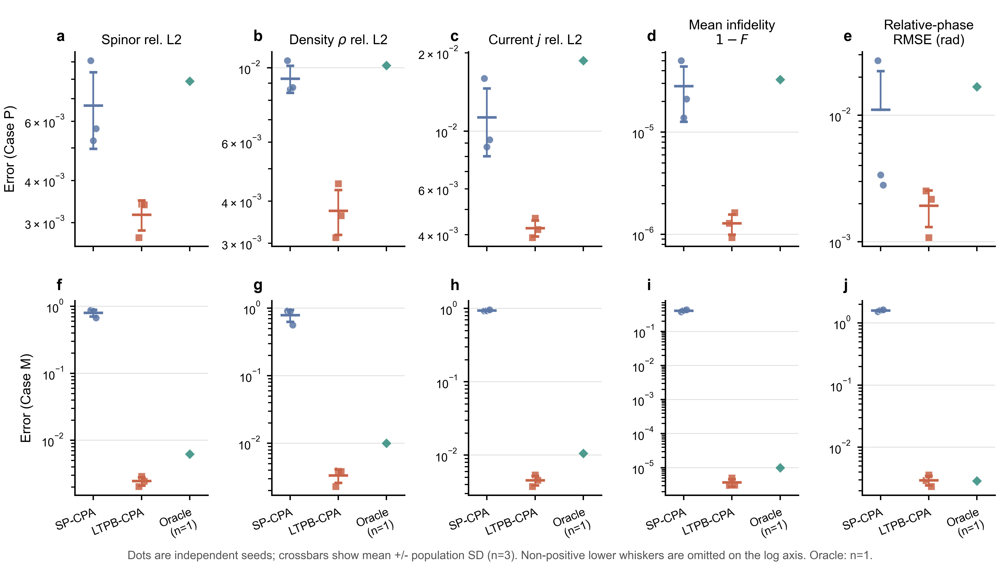
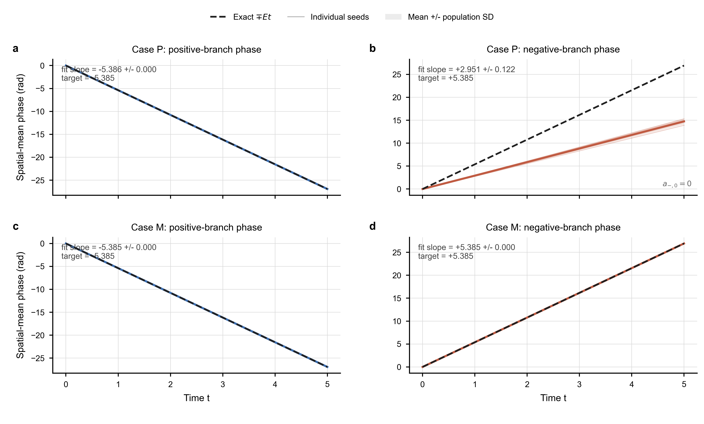
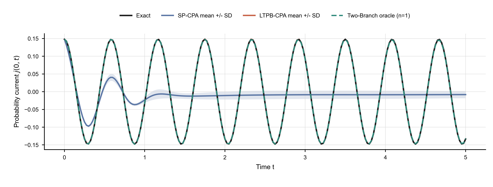
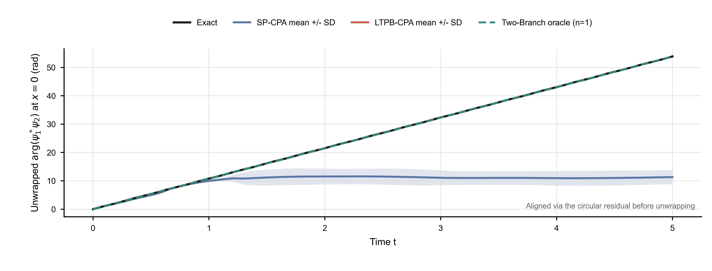
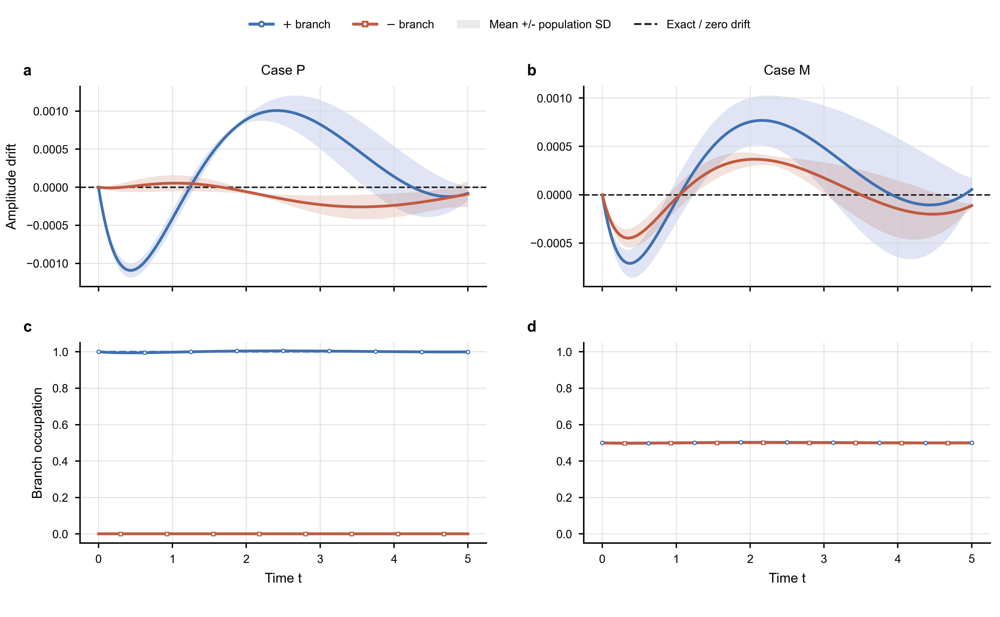
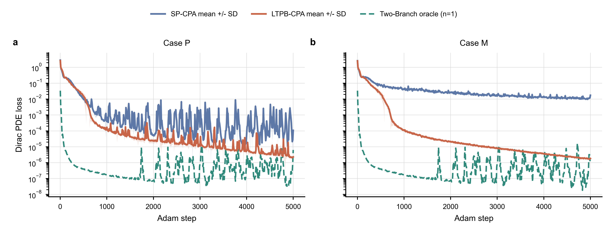

# 可学习正负能支双相位 Dirac-PINN 初步数值实验

## 摘要

本报告在原公共单相位 CPA-to-Dirac 实验的固定配置上，新增 Learned Two-Phase Branch CPA（LTPB-CPA）。正式数据严格包括 Case P/M × seeds `{0,1,2}` 六个 5000-step run；脚本在逐 run 文件、聚合表、原 baseline 表或六组三格式图不全时拒绝生成报告。结论不是按训练 loss 或单个 seed 给出，而由第 4.2 节的固定数值规则产生。

**自动判定：支持。** 按预先编码的数值规则，本试验支持“双能支可学习相位能在固定预算下解决公共单相位载波失配”这一初步假设。

数据入口：[LTPB 聚合 CSV](results/learned_two_phase_pilot_summary.csv)；[原正式 summary.csv](results/summary.csv)；新图 manifest（本地档案）。原报告 [EXPERIMENT_REPORT.md](EXPERIMENT_REPORT.md) 未被覆盖。

## 1. 已有实验结论

原实验已经区分了数学表达能力和有限预算优化效果：

1. Case P 中，SP-CPA 的三 seed 平均 spinor L2 从 Vanilla 的 `0.9228` 降为 `0.0067`，改善 `99.3%`，说明单一正能载波的预条件很有效。
2. Case M 中，同一改善只从 `0.9452` 到 `0.7991`，即 `15.5%`；公共单相位仍有完整表示能力，但不能同时慢化 `exp(-iEt)` 与 `exp(+iEt)`，固定预算优势明显退化。
3. Case M 的 SP-CPA-Conservative 平均 spinor L2 为 `1.0785`。连续性、总范数和总能量只约束总量，对正交能支的相对相位存在盲方向；因此守恒改善不等于概率流、相对相位或旋量恢复。
4. Two-Branch oracle 的 Case M spinor L2 为 `0.0062`，说明给出正确双载波后问题可被高精度优化。但它把精确 `E` 和 `exp(∓iEt)` 写入 forward，只能诊断机制，不能作为新方法。
5. 所以原结论是**载波预条件与优化优势退化**，不是“公共单相位在数学上无法表示混合态”。

## 2. LTPB-CPA 的理论动机和公式

已知自由 Dirac 符号

\[
H_k=k\sigma_x+m\sigma_z
\]

给出正交能支基底 `u_+、u_-`。LTPB-CPA 写作

\[
\widehat\psi(x,t)=e^{ikx}\left[
a_+(x,t)u_+e^{iS_+(x,t)}+a_-(x,t)u_-e^{iS_-(x,t)}
\right].
\]

4×64 `tanh` MLP 的输入为 `[sin(x),cos(x),t/T]`，输出四个实函数 `(r_+,r_-,q_+,q_-)`。令 `tau=t/T`，

\[
a_+=a_{+,0}+\tau r_+,
\qquad a_-=a_{-,0}+\tau r_-,
\]

\[
S_+=\tau q_+,
\qquad S_-=\tau q_-,
\]

\[
a_{+,0}=\frac{1}{\sqrt{2\pi(1+\eta^2)}},
\qquad
a_{-,0}=\frac{\eta}{\sqrt{2\pi(1+\eta^2)}}.
\]

因此 `t=0` 的原旋量初值严格满足。振幅为可取正负的实数，防止快速时间相位藏进任意复振幅；同时仍存在离散的 `(a,S)→(-a,S+pi)` 等价，需要 raw 与 circular phase error 一起检查。

训练只最小化强形式 Dirac PDE 残差

\[
L=L_{PDE}=\operatorname{mean}|i\psi_t+i\sigma_x\psi_x-m\sigma_z\psi|^2.
\]

forward 使用从已知 `H_k` 计算的 `u_±`，但不使用精确能量 `5.3851648071`、目标斜率或解析时间载波。复用的配置快照为可复现性记录了谱本征值；该数值不进入 LTPB 的 forward、loss 或 optimizer，其计算用途仅在训练后评价 phase slope target、解析解和误差。

## 3. 与 Two-Branch oracle 的关键区别

| 项目 | LTPB-CPA | Two-Branch oracle |
|---|---|---|
| 能支基底 | 从已知 `H_k` 计算 `u_±` | 同样使用 `u_±` |
| 时间频率 | `S_±` 由 PDE 残差学习 | forward 硬编码精确 `∓E` |
| 时间载波 | `exp(iS_±)` | 硬编码 `exp(∓iEt)` |
| 振幅 | 两个有符号实函数 | 两个复修正系数 |
| 初值 | 硬满足 | 硬满足 |
| 角色 | 待检验的新参数化 | 机制诊断上界，不参与公平排名 |

LTPB-CPA 即使接近 oracle，也仍依赖已知能支基底这一强物理先验。它检验的是“不给频率时，PDE 能否在该基底中学出两相位”，不是无先验发现正负能支。

## 4. 实验配置、公平性与数值判定规则

### 4.1 固定配置

| 项目 | 值 |
|---|---:|
| `m,k,T` | `5,2,5` |
| dtype | `float64/complex128` |
| 输入 | `[sin(x),cos(x),t/T]` |
| MLP | `4 × 64 tanh`，共享 trunk，输出 4 实数 |
| 初始化 | 所有线性层 Xavier normal，bias=0 |
| 配点 | 每步重新采样 1024 点 |
| optimizer | Adam，`lr=1e-3` |
| steps | `5000` |
| seeds | `{0,1,2}` |
| test grid | `201 × 128 (t × x)` |
| loss | 仅 `L_PDE` |
| 参数量 | LTPB-CPA `12,996`；Vanilla/Two-Branch `12,996`；SP-CPA `13,061` |

生成脚本逐项核对六个 config，并逐 seed 与 SP-CPA 核对区域、`m,k,T`、dtype、网络宽深、学习率、步数、配点数、测试网格、Xavier 初始化以及 collocation/structure 随机源。CPU 线程数和日志频率不进入算法公平性判断。LTPB 没有增加容量，且每个 seed 使用与旧实验相同的配点随机序列。

### 4.2 固定数值规则

为了不事后选择“成功”口径，本脚本使用如下可复现阈值：

1. Case P“不明显差”：`spinor_L2(LTPB)/spinor_L2(SP) <= 1.25`，且 mean fidelity 降幅不超过 `0.01`。
2. Case M“实质改善”：spinor L2、current L2、旋量分量 relative-phase RMSE 三项都至少降低 `25%`，且 mean fidelity 至少提高 `0.05`。
3. “学到 ±E 载波”：Case M 两个平均 slope 的相对误差均不超过 `10%`，且两个线性拟合 mean R2 均不低于 `0.95`。Case P 的 `S_-` 不参与该判定。
4. “接近 oracle”只作描述：三项 Case M 核心误差均不超过 oracle 的 `3` 倍，且 fidelity 绝对差不超过 `0.05`。
5. 所有 `±` 均为三 seed 的 **population SD (`ddof=0`)**。Two-Branch 只有预注册 seed 0，明确标作 `n=1`，不伪装成不确定性估计。

## 5. 六个正式 run 的完整结果

**核心精度指标**

| Case | seed | spinor L2 | final L2 | rho L2 | j L2 | F mean/min/final | 旋量相对相位 MAE/RMSE |
|---|---|---|---|---|---|---|---|
| M | 0 | 0.0020 | 0.0023 | 0.0023 | 0.0037 | 0.999997/0.999994/0.999995 | 0.0024/0.0029 |
| M | 1 | 0.0029 | 0.0024 | 0.0039 | 0.0054 | 0.999995/0.999991/0.999994 | 0.0032/0.0036 |
| M | 2 | 0.0025 | 0.0031 | 0.0038 | 0.0045 | 0.999997/0.999990/0.999990 | 0.0019/0.0023 |
| P | 0 | 0.0027 | 0.0018 | 0.0031 | 0.0039 | 0.999999/0.999997/0.999997 | 0.0019/0.0025 |
| P | 1 | 0.0034 | 0.0017 | 0.0045 | 0.0046 | 0.999999/0.999997/0.999997 | 7.510e-04/0.0011 |
| P | 2 | 0.0034 | 0.0024 | 0.0036 | 0.0042 | 0.999998/0.999994/0.999994 | 0.0016/0.0022 |

**学习到的相位诊断**（RMSE 均为 raw/circular，斜率为 fit/target）

| Case | seed | S+ RMSE | S- RMSE | dS+/dt | dS-/dt | R2 +/− | 支相对相位 RMSE |
|---|---|---|---|---|---|---|---|
| M | 0 | 0.0015/0.0015 | 0.0017/0.0017 | -5.3854 / -5.3852 | 5.3851 / 5.3852 | 1.0000/1.0000 | 0.0029/0.0029 |
| M | 1 | 0.0017/0.0017 | 0.0019/0.0019 | -5.3858 / -5.3852 | 5.3859 / 5.3852 | 1.0000/1.0000 | 0.0035/0.0035 |
| M | 2 | 0.0012/0.0012 | 0.0012/0.0012 | -5.3852 / -5.3852 | 5.3852 / 5.3852 | 1.0000/1.0000 | 0.0023/0.0023 |
| P | 0 | 0.0021/0.0021 | 7.5478/1.7780† | -5.3861 / -5.3852 | 2.7817 / 5.3852† | 1.0000/1.0000† | 7.5465/1.7783† |
| P | 1 | 0.0025/0.0025 | 6.7346/1.8768† | -5.3863 / -5.3852 | 3.0644 / 5.3852† | 1.0000/1.0000† | 6.7328/1.8770† |
| P | 2 | 0.0028/0.0028 | 6.8935/1.8581† | -5.3865 / -5.3852 | 3.0079 / 5.3852† | 1.0000/1.0000† | 6.8917/1.8583† |

† Case P 的精确态没有负能支（`a_{-,0}=0`），故 `S_-` 及其斜率不受 PDE 解唯一决定；数值仅为网络输出，不能解释为学会或未学会 `+E`。

**振幅、能支系数与占据**（振幅漂移为 absolute RMS/relative RMS）

| Case | seed | a+ 漂移 | a- 漂移 | c+/c- abs RMS | n+/n- RMSE | branch coeff. L2 | branch occ. RMSE |
|---|---|---|---|---|---|---|---|
| M | 0 | 3.285e-04/0.0012 | 3.888e-04/0.0014 | 0.0011/0.0012 | 9.691e-04/0.0011 | 0.0017 | 0.0010 |
| M | 1 | 7.960e-04/0.0028 | 3.867e-04/0.0014 | 0.0022/0.0014 | 0.0027/9.153e-04 | 0.0026 | 0.0020 |
| M | 2 | 7.253e-04/0.0026 | 4.478e-04/0.0016 | 0.0017/9.080e-04 | 0.0023/0.0012 | 0.0019 | 0.0018 |
| P | 0 | 6.212e-04/0.0016 | 2.649e-04/N/A（a-,0=0） | 0.0025/6.183e-04 | 0.0029/5.430e-07 | 0.0025 | 0.0020 |
| P | 1 | 8.980e-04/0.0023 | 1.132e-04/N/A（a-,0=0） | 0.0033/1.464e-04 | 0.0043/4.189e-08 | 0.0033 | 0.0030 |
| P | 2 | 7.219e-04/0.0018 | 2.279e-04/N/A（a-,0=0） | 0.0031/5.329e-04 | 0.0032/3.991e-07 | 0.0032 | 0.0023 |

**PDE、守恒诊断与运行信息**

| Case | seed | C normalized RMS | max norm drift | max abs E drift | mode occ. defect | final PDE | params | seconds |
|---|---|---|---|---|---|---|---|---|
| M | 0 | 9.678e-04 | 0.0039 | 0.0024 | 1.333e-06 | 1.607e-06 | 12996 | 957.2 |
| M | 1 | 0.0012 | 0.0052 | 0.0149 | 1.394e-06 | 1.698e-06 | 12996 | 959.6 |
| M | 2 | 0.0015 | 0.0050 | 0.0116 | 2.372e-06 | 2.170e-06 | 12996 | 983.2 |
| P | 0 | 0.0012 | 0.0051 | 0.0272 | 9.023e-07 | 2.409e-06 | 12996 | 857.5 |
| P | 1 | 0.0012 | 0.0066 | 0.0353 | 9.109e-07 | 2.041e-06 | 12996 | 859.6 |
| P | 2 | 0.0014 | 0.0061 | 0.0330 | 1.343e-06 | 2.469e-06 | 12996 | 878.7 |

LTPB-CPA 的训练目标只有 PDE；上表守恒量仅作训练后诊断。`final total=final PDE`，四个结构损失字段均严格为 0。

### 5.1 可复核文件

| Case | seed | 逐 run 文件 |
|---|---|---|
| M | 0 | config（本地档案） / metrics（本地档案） / loss（本地档案） / time series（本地档案） / dense grid（本地档案） / state（本地档案） |
| M | 1 | config（本地档案） / metrics（本地档案） / loss（本地档案） / time series（本地档案） / dense grid（本地档案） / state（本地档案） |
| M | 2 | config（本地档案） / metrics（本地档案） / loss（本地档案） / time series（本地档案） / dense grid（本地档案） / state（本地档案） |
| P | 0 | config（本地档案） / metrics（本地档案） / loss（本地档案） / time series（本地档案） / dense grid（本地档案） / state（本地档案） |
| P | 1 | config（本地档案） / metrics（本地档案） / loss（本地档案） / time series（本地档案） / dense grid（本地档案） / state（本地档案） |
| P | 2 | config（本地档案） / metrics（本地档案） / loss（本地档案） / time series（本地档案） / dense grid（本地档案） / state（本地档案） |

## 6. 均值、population SD 与 baseline 比较

| Case | Model | n | spinor L2 | final L2 | rho L2 | j L2 | F mean | 旋量相对相位 RMSE | branch coeff. L2 | branch occ. RMSE |
|---|---|---|---|---|---|---|---|---|---|---|
| P | Vanilla | 3 | 0.9228 ± 0.0012 | 1.0045 ± 0.0020 | 0.9433 ± 0.0017 | 0.9431 ± 0.0017 | 0.4325 ± 0.0843 | 0.5597 ± 0.1616 | 0.9218 ± 0.0015 | 0.6682 ± 6.197e-04 |
| P | SP-CPA | 3 | 0.0067 ± 0.0017 | 0.0089 ± 0.0036 | 0.0093 ± 8.572e-04 | 0.0113 ± 0.0033 | 1.0000 ± 1.557e-05 | 0.0110 ± 0.0112 | 0.0053 ± 0.0023 | 0.0056 ± 0.0011 |
| P | SP-CPA-Conservative | 3 | 0.0111 ± 0.0018 | 0.0104 ± 0.0023 | 0.0052 ± 5.098e-04 | 0.0047 ± 3.123e-04 | 1.0000 ± 2.162e-05 | 0.0041 ± 0.0021 | 0.0089 ± 0.0011 | 0.0011 ± 8.727e-04 |
| P | LTPB-CPA | 3 | 0.0032 ± 3.249e-04 | 0.0020 ± 3.215e-04 | 0.0037 ± 5.751e-04 | 0.0042 ± 3.004e-04 | 1.0000 ± 2.844e-07 | 0.0019 ± 6.150e-04 | 0.0030 ± 3.275e-04 | 0.0025 ± 4.299e-04 |
| P | Two-Branch oracle | 1 | 0.0079（n=1） | 0.0147（n=1） | 0.0102（n=1） | 0.0187（n=1） | 1.0000（n=1） | 0.0167（n=1） | 0.0055（n=1） | 0.0072（n=1） |
| M | Vanilla | 3 | 0.9452 ± 0.0027 | 1.0104 ± 0.0058 | 0.9564 ± 0.0028 | 0.9693 ± 0.0015 | 0.2254 ± 0.0337 | 1.7658 ± 0.0024 | 0.9436 ± 0.0025 | 0.4796 ± 4.383e-04 |
| M | SP-CPA | 3 | 0.7991 ± 0.0918 | 0.8945 ± 0.1356 | 0.7876 ± 0.1605 | 0.9392 ± 0.0163 | 0.5935 ± 0.0235 | 1.5864 ± 0.0458 | 0.7991 ± 0.0918 | 0.4156 ± 0.0513 |
| M | SP-CPA-Conservative | 3 | 1.0785 ± 0.0428 | 1.1329 ± 0.0762 | 0.5554 ± 0.0184 | 1.0698 ± 0.0243 | 0.1631 ± 0.0243 | 1.7980 ± 0.0104 | 0.9018 ± 0.0337 | 0.4172 ± 0.0160 |
| M | LTPB-CPA | 3 | 0.0025 ± 3.452e-04 | 0.0026 ± 3.664e-04 | 0.0033 ± 7.486e-04 | 0.0046 ± 6.772e-04 | 1.0000 ± 9.240e-07 | 0.0030 ± 5.139e-04 | 0.0021 ± 4.049e-04 | 0.0016 ± 4.327e-04 |
| M | Two-Branch oracle | 1 | 0.0062（n=1） | 0.0122（n=1） | 0.0100（n=1） | 0.0105（n=1） | 1.0000（n=1） | 0.0029（n=1） | 0.0056（n=1） | 0.0048（n=1） |

### 6.1 LTPB 相位与振幅聚合

| Case | S+ raw RMSE | S- raw RMSE | dS+/dt | dS-/dt | R2+ | R2- | a+ rel drift | a- rel drift |
|---|---|---|---|---|---|---|---|---|
| P | 0.0025 ± 2.852e-04 | 不可辨识† | -5.3863 ± 1.829e-04 | 不可辨识† | 1.0000 ± 4.410e-09 | 不可辨识† | 0.0019 ± 2.867e-04 | 不可辨识† |
| M | 0.0015 ± 2.010e-04 | 0.0016 ± 3.184e-04 | -5.3855 ± 2.416e-04 | 5.3854 ± 3.496e-04 | 1.0000 ± 6.889e-09 | 1.0000 ± 1.049e-08 | 0.0022 ± 7.294e-04 | 0.0014 ± 1.005e-04 |

目标斜率为 `dS_+/dt=-E=-5.3851648071`、`dS_-/dt=+E=+5.3851648071`。† Case P 没有负能支，因此不把 `S_-` 数值纳入载波学习判定。

## 7. 学到的两个相位斜率

Case M 的空间平均拟合得到 `dS_+/dt=-5.3855`、`dS_-/dt=5.3854`，目标分别为 `-5.3851648071` 与 `5.3851648071`；相对误差为 `0.01%`、`0.00%`，mean R2 为 `1.0000`、`1.0000`。按第 4.2 节，载波学习门槛**通过**。

Case P 只把 `S_+` 视为可辨识量。由于 `eta=0` 时负支系数恒为零，任意 `S_-` 都不改变 `psi_hat`；报告保留其原始数值供调试，却不拿它与 `+E` 的接近程度支持或反驳模型。

## 8. Case M：概率流与旋量相对相位

与 SP-CPA 相比，LTPB-CPA 的三 seed 平均：

- spinor L2：`0.7991 -> 0.0025`，误差比 `0.0031`；
- current L2：`0.9392 -> 0.0046`，误差比 `0.0048`；
- 旋量分量 relative-phase RMSE：`1.5864 -> 0.0030` rad，误差比 `0.0019`；
- mean fidelity：`0.593479 -> 0.999996`，绝对变化 `+0.4065`。

这里的“旋量分量 relative phase”来自 `arg(conj(psi_1) psi_2)`，不同于模型内部 `S_- - S_+`；二者均已分别诊断。时间曲线见图 3 和图 4，不能由训练 loss 或密度曲线替代。

## 9. 是否支持双能支相位方案

**结论：支持。** 按预先编码的数值规则，本试验支持“双能支可学习相位能在固定预算下解决公共单相位载波失配”这一初步假设。

- Case P 兼容性门槛**通过**：spinor error ratio `0.4744`，fidelity 变化 `+0.0000`。
- Case M 三个核心 error ratios 为 spinor `0.0031`、current `0.0048`、旋量相对相位 `0.0019`；fidelity 变化 `+0.4065`。
- 两个 Case M 相位 slope 的载波门槛**通过**。
- 相对 Two-Branch oracle，三个核心误差倍数为 `0.3945`、`0.4329`、`1.0260`，fidelity 绝对差 `6.174e-06`；因此达到本报告定义的“接近 oracle”门槛。

补充数值诊断（无论门槛是否全部通过均保留）：

- Case M 两个空间平均相位斜率及线性度达到载波门槛；若核心场指标仍不足，失败不能简单归为频率没有学到。
- Case M 的平均相对振幅漂移为 `a+=0.0022`、`a-=0.0014`，branch occupation RMSE 为 `0.0016`，未显示大幅占据重排。
- 最终 PDE loss 的均值 `1.825e-06` 低于 SP-CPA 的 `0.0174`；若物理指标仍差，说明不能用训练损失单独判定成功。
- 本轮没有依据结果调学习率、步数、损失权重或网络宽度，也不做事后择优重跑，因此无法把失败排除为可调参问题。

### 9.1 五类概念必须分开

- **表达能力**：公共单相位乘任意复旋量振幅仍能表示混合态；LTPB 的结果不能反证这一点。LTPB 的实振幅限制反而缩小了表示类，但解析双相位目标仍在该类中。
- **载波预条件**：LTPB 把正负能支放进不同相位通道；只有 slope 和场指标同时改善，才能说这一预条件被 PDE 学会并发挥作用。
- **优化难度**：5000-step Adam 的结果包含长时域 PINN 优化、相位回归、实振幅补偿和随机初始化效应；训练 loss 不能单独定位原因。
- **守恒量盲点**：连续性、总范数和总能量无法唯一识别能支相对相位。LTPB 本轮没训练这些损失，训练后守恒指标仅作诊断。
- **已知 `u_±` 先验**：LTPB 不泄露时间频率，却显式使用自由 Dirac 符号的能支基底；这是重要的结构先验，不能与无先验 PINN 直接等同。

## 10. 当前实验不能推出的结论

1. 不能推出公共单相位在数学上不能表示正负能支混合；现有结果只涉及固定网络和优化预算。
2. 不能推出 LTPB 在多 `k` 波包、外势、非周期边界、更长时间或更大质量下仍有效。
3. 不能推出 PDE 从原始旋量中“自动发现”了能支，因为 `u_±` 已由已知 `H_k` 提供。
4. 不能把 Case P 的 `S_-` 当作可辨识参数，也不能把其偶然接近 `+Et` 当成证据。
5. 不能由小 density/norm error 或小 PDE training loss 单独推出概率流、相对相位和旋量正确。
6. 不能把单个 Two-Branch oracle seed 与三 seed learned models 做统计优越性检验。
7. 不能从本轮判断实振幅限制是最优选择；外势耦合时复分支包络可能是必要的。

## 11. 扩展到多 k 波包和光滑外势的下一步

1. **多 k 分解**：平面波的固定 `u_±(k)` 要扩展成动量依赖投影器或谱通道；必须控制离散 Fourier 分辨率、不同 `k` 的色散相位和波包群速度，而不能给每个训练样本泄露解析 `E(k)` 载波。
2. **光滑外势与分支耦合**：`V(x)` 下动量不守恒，局部能支基底随 `x` 变化并产生基底导数/非绝热耦合。需要决定采用全局谱投影、局部符号投影还是可学习 projector，并把相应连接项纳入 PDE 残差。
3. **规范与可辨识性**：对每个 `k` 或局部基底固定本征矢规范；处理 `(a,S)` 的符号-相位离散冗余、相位 unwrap 和支振幅过零，否则 slope 指标会失真。
4. **实振幅限制**：外势散射会改变支间幅度并可能产生包络相位。下一轮应比较实振幅、受控慢复包络和显式 gauge fixing，防止快速频率再次藏回复振幅。
5. **优化与时间推进**：在不调参追逐有利结果的前提下，预注册比较 causal sampling、time marching、分段时间窗和匹配参数量的双 Fourier-time baseline，区分表示增益与长时 PINN 优化增益。
6. **物理诊断**：继续同时报告 spinor、current、旋量相对相位、能支系数/占据、fidelity 和守恒量；含势时还需反射/透射、正负频转换和局部能量交换指标。

## 12. 图表与可编辑源

### 图 1. 主精度指标：LTPB-CPA 与原正式 baselines 的均值及 population SD。

文件：[PNG](results/figures/learned_two_phase_pilot/01_main_metric_comparison.png) / [PDF](results/figures/learned_two_phase_pilot/01_main_metric_comparison.pdf) / [SVG](results/figures/learned_two_phase_pilot/01_main_metric_comparison.svg)；作图源数据：[01_main_metric_comparison.csv](results/figures/learned_two_phase_pilot/source_data/01_main_metric_comparison.csv)。

### 图 2. 两个学习相位及拟合斜率；Case P 的负支不参与判定。

文件：[PNG](results/figures/learned_two_phase_pilot/02_learned_branch_phases.png) / [PDF](results/figures/learned_two_phase_pilot/02_learned_branch_phases.pdf) / [SVG](results/figures/learned_two_phase_pilot/02_learned_branch_phases.svg)；作图源数据：[02_learned_branch_phases.csv](results/figures/learned_two_phase_pilot/source_data/02_learned_branch_phases.csv), [02_learned_branch_phase_slopes.csv](results/figures/learned_two_phase_pilot/source_data/02_learned_branch_phase_slopes.csv)。

### 图 3. Case M 在 x=0 的概率流时间曲线。

文件：[PNG](results/figures/learned_two_phase_pilot/03_case_M_current_x0.png) / [PDF](results/figures/learned_two_phase_pilot/03_case_M_current_x0.pdf) / [SVG](results/figures/learned_two_phase_pilot/03_case_M_current_x0.svg)；作图源数据：[03_case_M_current_x0.csv](results/figures/learned_two_phase_pilot/source_data/03_case_M_current_x0.csv)。

### 图 4. Case M 在 x=0 的旋量分量相对相位时间曲线。

文件：[PNG](results/figures/learned_two_phase_pilot/04_case_M_relative_phase_x0.png) / [PDF](results/figures/learned_two_phase_pilot/04_case_M_relative_phase_x0.pdf) / [SVG](results/figures/learned_two_phase_pilot/04_case_M_relative_phase_x0.svg)；作图源数据：[04_case_M_relative_phase_x0.csv](results/figures/learned_two_phase_pilot/source_data/04_case_M_relative_phase_x0.csv)。

### 图 5. 实振幅漂移和正负能支占据。

文件：[PNG](results/figures/learned_two_phase_pilot/05_amplitude_and_occupations.png) / [PDF](results/figures/learned_two_phase_pilot/05_amplitude_and_occupations.pdf) / [SVG](results/figures/learned_two_phase_pilot/05_amplitude_and_occupations.svg)；作图源数据：[05_amplitude_and_occupations.csv](results/figures/learned_two_phase_pilot/source_data/05_amplitude_and_occupations.csv)。

### 图 6. PDE-only 训练轨迹；训练损失不替代场精度诊断。

文件：[PNG](results/figures/learned_two_phase_pilot/06_loss_histories.png) / [PDF](results/figures/learned_two_phase_pilot/06_loss_histories.pdf) / [SVG](results/figures/learned_two_phase_pilot/06_loss_histories.svg)；作图源数据：[06_loss_histories.csv](results/figures/learned_two_phase_pilot/source_data/06_loss_histories.csv)。

---

本报告由 `python -m src.build_learned_two_phase_pilot_report` 从六个正式 run、两个汇总 CSV 和图 manifest 确定性生成。生成器会验证聚合数值与逐 run metrics 一致，并在任何要求的数据或图缺失时失败；它不启动训练，也不修改原 `EXPERIMENT_REPORT.md`。
