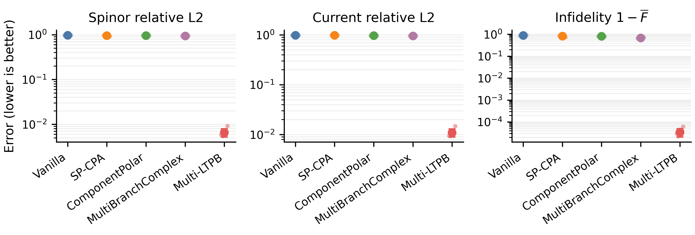
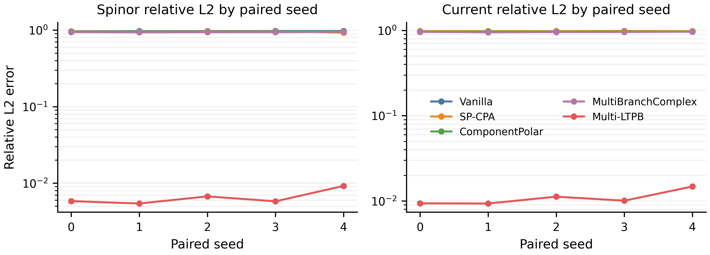
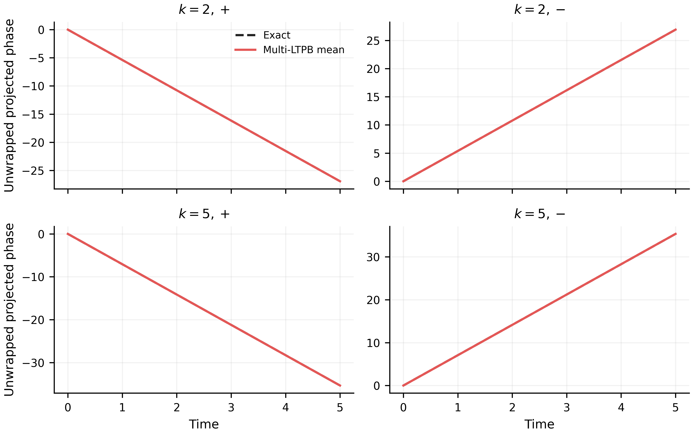
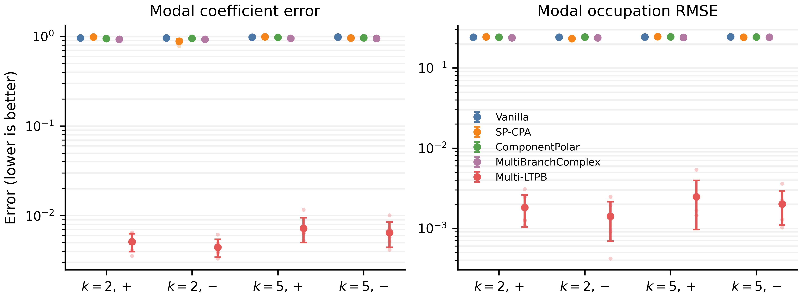
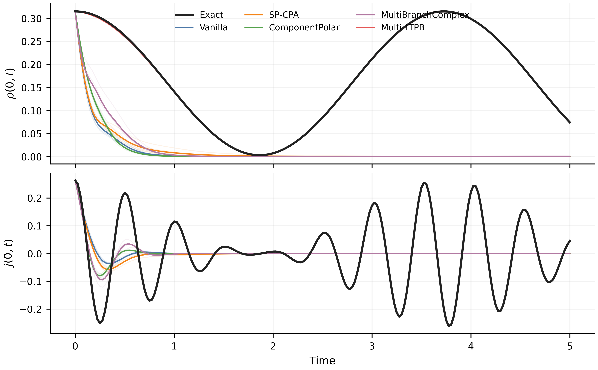
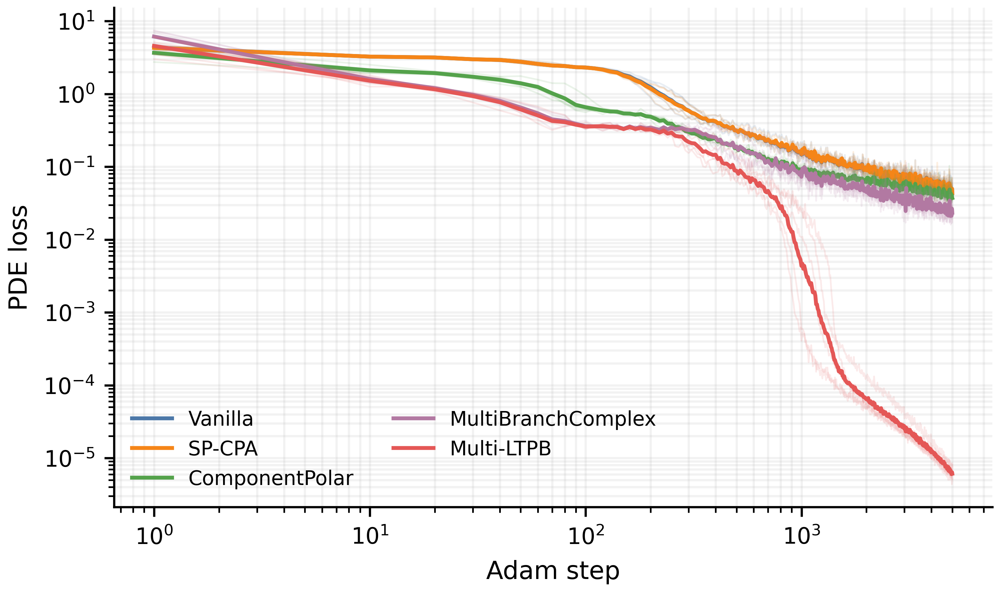
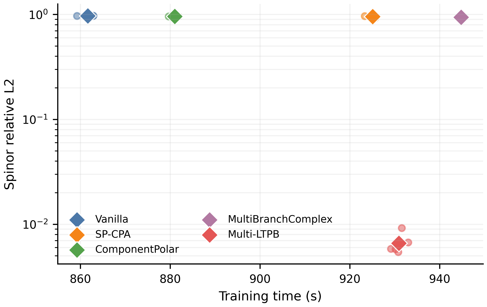

# 双波数正负能支混合 Dirac 方程的 Multi-LTPB 实验报告

> 本报告严格对应正式目录中的 5 个 learned models × 5 个预注册 seeds。Four-carrier oracle 使用精确载频，只是诊断上限，不进入 learned 排名。

## 1. 已有工作与本次问题

此前单动量实验表明：公共单相位 SP-CPA 在纯正能支上有效，但在等权正负能支混合中载波预条件优势退化；总连续性、总范数和总能量不能充分识别相对相位、电流与旋量误差。LTPB 通过能支对齐的两个独立相位恢复了单动量混合态。机制消融进一步提示，本征能支基底和每支独立相位的一一对应都很重要，但单模态结果本身不能说明多个空间载频能否同时被处理。

本实验因此询问：在初值已知包含 `k=2` 与 `k=5` 两个离散 Fourier 模态时，Multi-LTPB 能否只从自由 Dirac PDE 强残差中学习四个时间载频，并同时恢复旋量和概率流？

## 2. 物理问题与精确参考

在 `L=2π, m=5, T=5` 上求解

$$i\partial_t\psi=(-i\sigma_x\partial_x+m\sigma_z)\psi.$$

四通道顺序固定为 `(k=2,+), (k=2,-), (k=5,+), (k=5,-)`，精确参考为

$$\psi(x,t)=\frac{1}{2\sqrt L}\sum_{l=1}^2\left[u_+(k_l)e^{ik_lx-iE_lt}+u_-(k_l)e^{ik_lx+iE_lt}\right],\quad E_l=\sqrt{k_l^2+m^2}.$$

四个空间模态在每个固定时刻的空间 Hilbert 内积下正交；这里没有假定四个非共振时间载波在 `[0,5]` 上正交。归一化空间模态的精确投影系数模长为 `1/2`、占据为 `1/4`；模型内部使用未除以 `sqrt(L)` 的基底，因此内部初始系数为 `1/(2sqrt(L))`。

## 3. 模型与 oracle 的区别

Multi-LTPB 使用

$$\widehat\psi=\sum_l e^{ik_lx}\left[a_{l,+}u_+(k_l)e^{iS_{l,+}}+a_{l,-}u_-(k_l)e^{iS_{l,-}}\right].$$

其中 `a=a0+τr`, `S=τq`, `τ=t/T`，所以初值严格满足。`k_l` 与由已知符号 `H_k` 计算的 `u_±(k_l)` 来自初值结构，可以进入 learned forward；精确 `E_l`、目标斜率和解析时间载波只在训练后评价中出现。MultiBranchComplex 使用相同四通道基底但学习普通复系数；ComponentPolar 不使用能支基底，只在原始两旋量分量上分相位；SP-CPA 只有一个公共相位；Vanilla 使用笛卡尔复旋量修正。

Four-carrier oracle 直接写入 `exp(∓iE_lt)`，因此只回答“精确载波预条件的上限是什么”，不能作为 learned method 的证据。

| 模型 | hidden width | 实输出 | 参数量 | 已知能支基底 | 显式独立相位 |
|---|---:|---:|---:|---|---|
| Vanilla | 64 | 4 | 12,996 | 否 | 否 |
| SP-CPA | 64 | 5 | 13,061 | 否 | 公共单相位 |
| ComponentPolar | 64 | 4 | 12,996 | 否 | 两旋量分量 |
| MultiBranchComplex | 63 | 8 | 12,860 | 是 | 否 |
| Multi-LTPB | 63 | 8 | 12,860 | 是 | 四通道 |

## 4. 预注册、公平性与评价规范

[预注册](MULTIMODE_LTPB_PREREGISTRATION.md) 在正式结果产生前冻结了模型、五个 seeds、5000 steps、1024 个每步重采样配点、Adam `1e-3`、`float64/complex128`、`4×64` 或参数匹配的 `4×63` 网络、128×201 测试网格和自动判据。[预注册与代码 SHA-256](results/multimode_ltpb_preregistration_sha256.json) 提供代码冻结证据；[旧结果保护清单](results/multimode_ltpb_protected_baseline.json) 用于确认本实验没有覆盖既有结果。

同 seed 的五个模型使用相同的显式初始化 seed 协议与完全相同的配点序列；初始化 generator 与配点 generator 分离。全部 learned runs 只优化 Dirac PDE strong residual，没有解析标签、精确能量、相位监督或守恒辅助损失。

相位评价先从总场做 Fourier-能支投影。对旋量和四个投影系数仅移除一个由全时空 overlap 决定的常数整体相位；禁止逐时刻或逐模态对齐，因此不会把共同错误频率从主 spinor 指标或相位斜率中消掉。密度、电流、fidelity、占据和相对相位本身规范不变。

最终审计为 **12/12 PASS**。第一次审计运行曾出现四类审计器假阳性：初始化重建未先设置 `float64`、JSON/CSV 浮点数被要求位级相等、总链接数采用无关的硬编码阈值，以及首次运行时审计 JSON 尚未写出却检查了报告中的自链接。为不改变预注册冻结的训练、评价、聚合或原审计代码，新增了独立的[最终审计修正器](src/finalize_multimode_ltpb_audit.py)，只修正这三类审计语义（后两项合并为链接清单检查），并在 [audit JSON](results/multimode_ltpb_audit.json) 中记录其 SHA-256、修正范围和 `frozen_experiment_code_modified=false`。raw 数据、指标、判据和预注册阈值均未修改。

## 5. 逐 seed 正式结果

| Model | Seed | Spinor rel L2 | Current rel L2 | Fidelity | Density rel L2 | Modal coeff rel L2 | Final PDE loss | Train s |
|---|---:|---:|---:|---:|---:|---:|---:|---:|
| ComponentPolar | 0 | 0.9566 | 0.9668 | 0.190164 | 0.9663 | 0.9564 | 0.0378 | 879.66 |
| ComponentPolar | 1 | 0.9545 | 0.9660 | 0.202920 | 0.9658 | 0.9543 | 0.0341 | 881.43 |
| ComponentPolar | 2 | 0.9589 | 0.9669 | 0.155955 | 0.9664 | 0.9587 | 0.0397 | 881.84 |
| ComponentPolar | 3 | 0.9614 | 0.9685 | 0.153332 | 0.9679 | 0.9611 | 0.0346 | 881.71 |
| ComponentPolar | 4 | 0.9576 | 0.9657 | 0.202175 | 0.9663 | 0.9574 | 0.0400 | 880.35 |
| MultiBranchComplex | 0 | 0.9411 | 0.9606 | 0.335429 | 0.9560 | 0.9411 | 0.0240 | 944.42 |
| MultiBranchComplex | 1 | 0.9342 | 0.9492 | 0.332414 | 0.9461 | 0.9342 | 0.0172 | 945.35 |
| MultiBranchComplex | 2 | 0.9380 | 0.9553 | 0.271142 | 0.9526 | 0.9380 | 0.0206 | 944.43 |
| MultiBranchComplex | 3 | 0.9392 | 0.9567 | 0.367126 | 0.9516 | 0.9391 | 0.0280 | 944.42 |
| MultiBranchComplex | 4 | 0.9466 | 0.9651 | 0.279670 | 0.9585 | 0.9466 | 0.0291 | 945.31 |
| Multi-LTPB | 0 | 0.0058 | 0.0094 | 0.999970 | 0.0049 | 0.0054 | 5.1554e-06 | 929.14 |
| Multi-LTPB | 1 | 0.0054 | 0.0093 | 0.999977 | 0.0060 | 0.0049 | 5.6638e-06 | 930.76 |
| Multi-LTPB | 2 | 0.0067 | 0.0112 | 0.999964 | 0.0067 | 0.0058 | 7.5649e-06 | 932.97 |
| Multi-LTPB | 3 | 0.0058 | 0.0101 | 0.999976 | 0.0066 | 0.0052 | 4.7567e-06 | 930.16 |
| Multi-LTPB | 4 | 0.0092 | 0.0148 | 0.999939 | 0.0104 | 0.0087 | 8.0981e-06 | 931.56 |
| SP-CPA | 0 | 0.9637 | 0.9823 | 0.128549 | 0.9635 | 0.9632 | 0.0407 | 923.30 |
| SP-CPA | 1 | 0.9553 | 0.9820 | 0.210850 | 0.9577 | 0.9546 | 0.0413 | 925.06 |
| SP-CPA | 2 | 0.9643 | 0.9812 | 0.124881 | 0.9638 | 0.9635 | 0.0466 | 925.58 |
| SP-CPA | 3 | 0.9646 | 0.9840 | 0.155617 | 0.9635 | 0.9639 | 0.0394 | 925.77 |
| SP-CPA | 4 | 0.9264 | 0.9788 | 0.248375 | 0.9443 | 0.9255 | 0.0501 | 925.63 |
| Vanilla | 0 | 0.9663 | 0.9813 | 0.124312 | 0.9644 | 0.9657 | 0.0402 | 861.26 |
| Vanilla | 1 | 0.9673 | 0.9804 | 0.134819 | 0.9651 | 0.9668 | 0.0375 | 862.77 |
| Vanilla | 2 | 0.9692 | 0.9801 | 0.095755 | 0.9671 | 0.9682 | 0.0461 | 859.23 |
| Vanilla | 3 | 0.9720 | 0.9838 | 0.112580 | 0.9671 | 0.9713 | 0.0396 | 861.99 |
| Vanilla | 4 | 0.9728 | 0.9815 | 0.103178 | 0.9684 | 0.9721 | 0.0560 | 862.90 |

## 6. 五 seed 均值与 population SD

| Model | Spinor rel L2 | Current rel L2 | Fidelity | Density rel L2 | Modal coeff rel L2 | PDE residual RMS | Train s |
|---|---:|---:|---:|---:|---:|---:|---:|
| Vanilla | 0.9695 ± 0.0026 | 0.9814 ± 0.0013 | 0.1141 ± 0.0141 | 0.9664 ± 0.0015 | 0.9688 ± 0.0025 | 0.2353 ± 0.0055 | 861.6285 ± 1.3362 |
| SP-CPA | 0.9549 ± 0.0146 | 0.9816 ± 0.0017 | 0.1737 ± 0.0484 | 0.9586 ± 0.0075 | 0.9541 ± 0.0148 | 0.2350 ± 0.0056 | 925.0669 ± 0.9172 |
| ComponentPolar | 0.9578 ± 0.0023 | 0.9668 ± 9.6652e-04 | 0.1809 ± 0.0219 | 0.9665 ± 7.2488e-04 | 0.9576 ± 0.0023 | 0.2076 ± 0.0025 | 880.9996 ± 0.8496 |
| MultiBranchComplex | 0.9398 ± 0.0041 | 0.9574 ± 0.0053 | 0.3172 ± 0.0363 | 0.9530 ± 0.0042 | 0.9398 ± 0.0041 | 0.1697 ± 0.0123 | 944.7893 ± 0.4436 |
| Multi-LTPB | 0.0066 ± 0.0014 | 0.0110 ± 0.0020 | 1.0000 ± 1.4075e-05 | 0.0069 ± 0.0018 | 0.0060 ± 0.0014 | 0.0025 ± 2.0246e-04 | 930.9193 ± 1.2951 |

## 7. 四个 learned phases 与模态诊断

成功判据使用总场投影系数的 phase slope，而不是网络内部 `S_{l,s}(x,t)`。后者在允许空间依赖时存在通道重参数化冗余，只作为振幅漂移和相位曲率的辅助诊断。

| Seed | Channel | Learned slope | Target | Relative error | R² | Valid fraction |
|---:|---|---:|---:|---:|---:|---:|
| 0 | `k2_plus` | -5.385918 | -5.385165 | 1.3987e-04 | 1.0000 | 1.000 |
| 0 | `k2_minus` | 5.386358 | 5.385165 | 2.2152e-04 | 1.0000 | 1.000 |
| 0 | `k5_plus` | -7.074009 | -7.071068 | 4.1588e-04 | 1.0000 | 1.000 |
| 0 | `k5_minus` | 7.072911 | 7.071068 | 2.6072e-04 | 1.0000 | 1.000 |
| 1 | `k2_plus` | -5.386600 | -5.385165 | 2.6655e-04 | 1.0000 | 1.000 |
| 1 | `k2_minus` | 5.386789 | 5.385165 | 3.0159e-04 | 1.0000 | 1.000 |
| 1 | `k5_plus` | -7.073206 | -7.071068 | 3.0239e-04 | 1.0000 | 1.000 |
| 1 | `k5_minus` | 7.073393 | 7.071068 | 3.2885e-04 | 1.0000 | 1.000 |
| 2 | `k2_plus` | -5.387180 | -5.385165 | 3.7430e-04 | 1.0000 | 1.000 |
| 2 | `k2_minus` | 5.387197 | 5.385165 | 3.7739e-04 | 1.0000 | 1.000 |
| 2 | `k5_plus` | -7.074084 | -7.071068 | 4.2650e-04 | 1.0000 | 1.000 |
| 2 | `k5_minus` | 7.073740 | 7.071068 | 3.7785e-04 | 1.0000 | 1.000 |
| 3 | `k2_plus` | -5.386928 | -5.385165 | 3.2739e-04 | 1.0000 | 1.000 |
| 3 | `k2_minus` | 5.386772 | 5.385165 | 2.9845e-04 | 1.0000 | 1.000 |
| 3 | `k5_plus` | -7.072542 | -7.071068 | 2.0854e-04 | 1.0000 | 1.000 |
| 3 | `k5_minus` | 7.073622 | 7.071068 | 3.6125e-04 | 1.0000 | 1.000 |
| 4 | `k2_plus` | -5.386966 | -5.385165 | 3.3454e-04 | 1.0000 | 1.000 |
| 4 | `k2_minus` | 5.386721 | 5.385165 | 2.8899e-04 | 1.0000 | 1.000 |
| 4 | `k5_plus` | -7.072556 | -7.071068 | 2.1048e-04 | 1.0000 | 1.000 |
| 4 | `k5_minus` | 7.073745 | 7.071068 | 3.7864e-04 | 1.0000 | 1.000 |

| Channel | Mean absolute relative slope error | Pre-registered `<1%` |
|---|---:|---|
| `k2_plus` | 2.8853e-04 | PASS |
| `k2_minus` | 2.9759e-04 | PASS |
| `k5_plus` | 3.1276e-04 | PASS |
| `k5_minus` | 3.4146e-04 | PASS |

## 8. 密度、概率流与相对相位

`x=0` 的密度和概率流曲线直接检验多个空间/时间载频干涉；只恢复总范数或密度不能替代 current、spinor 和支间/波数间相对相位证据。每个 run 的 `time_series.csv` 保存两个支内与两个跨波数相对相位曲线及 circular errors。

## 9. 预注册自动判定

总判定：**PASS**。完整机器可读证据见 [decision JSON](results/multimode_ltpb_decision.json)。

| 条件 | 实际值 | 阈值 | 结果 |
|---|---:|---:|---|
| Multi-LTPB mean spinor | 0.006594 | `<= 0.05` | PASS |
| Multi-LTPB mean current | 0.010976 | `<= 0.1` | PASS |
| Multi-LTPB mean fidelity | 0.999965 | `>= 0.99` | PASS |
| spinor vs best baseline (MultiBranchComplex) | 142.522× | `>= 10×` | PASS |
| current vs best baseline (MultiBranchComplex) | 87.224× | `>= 10×` | PASS |
| Paired-seed joint 10× advantage | 5/5 | `>=4/5` | PASS |
| Phase-slope channels below 1% | 4/4 | `>=3/4` | PASS |

## 10. 机制解释与失败归因

本实验通过了预注册的联合标准，因此在这个受控自由、双离散动量问题中，证据支持：把独立可学习相位与已知 `(k_l,±)` 能支通道一一对齐，能把单动量的载波预条件机制推广到四载频情形。这个结论同时依赖已知 Fourier 波数和 Dirac 能支基底；它不是“网络从零发现了谱分解”。

- **表达能力：** 单元测试通过手工设置四个 `q=Tω` 且 `r=0` 证明 Multi-LTPB 包含精确解；故数值失败不能直接归因为表示集合不包含目标，但这不等于有限网络容易找到该解。
- **优化收敛：** Multi-LTPB final collocation PDE loss 的五 seed mean 为 `6.2478e-06`；结合 dense PDE residual、训练曲线和 seed 波动判断长期 Adam 优化是否仍是限制。
- **模态可辨识性：** 四个精确初始投影均非零；评价使用物理投影而非内部相位。五 seed 的 90% 有效比例门槛全部满足。内部 `x` 依赖仍可能造成重参数化冗余。
- **参数预算：** 所有 learned models 的参数量差不超过约 1.56%，因此本实验没有以额外容量换取 Multi-LTPB 优势；但这不能证明 4×63 对双动量问题已充分。
- **物理先验：** Multi-LTPB 与 MultiBranchComplex 都获得已知 `k_l` 和 `u_±(k_l)`；若前者更好，差异才可归于显式能支-相位配对与相位载波预条件，而不是仅仅知道能支基底。

## 11. 本实验不能推出的结论

1. 这里的两个整数波数来自已知初值并被显式写入模型；没有学习未知谱，也没有处理连续 Fourier 波包。
2. 自由 Hamiltonian 的每个 `k` 通道彼此解耦；一般外势会在动量间耦合，使固定通道与独立相位不再闭合。
3. 单个质量、两个波数、一个时间区间和 Adam 预算不能证明更长时间、更多模态或其他参数下的稳健性。
4. 即使 PASS，也只能说明已知离散双动量上的机制推广，不是通用 Dirac 求解器，更不是新颖性或世界首次声明。

## 12. 下一步：连续波包与光滑外势

扩展到多 `k` 波包需要解决通道数量随谱分辨率增长、连续谱相位的正则化、相邻 `k` 的共享表示、低占据模态相位不可辨识，以及内部包络导致的跨通道重参数化。加入光滑外势后还需处理动量耦合、局域正负能投影的非唯一性、避免把目标解谱信息泄漏进基底、过零振幅处的相位奇点，并重新设计能够区分局域能支交换的概率流与相对相位诊断。

## 13. 数据、图表与审计索引

- 逐 run CSV（本地档案）、[五 seed 汇总](results/multimode_ltpb_summary.csv)、[baseline 比较](results/multimode_ltpb_comparisons.csv)
- [自动判定](results/multimode_ltpb_decision.json)、[结果审计](results/multimode_ltpb_audit.json)
- Figure manifest（本地档案）、[FIGURE_QA](results/figures/multimode_ltpb/FIGURE_QA.md)
- Oracle config（本地档案）、oracle metrics（本地档案）、oracle time series（本地档案）、oracle dense grid（本地档案）

### 每个 learned run 的六件套

| Model | Seed | Raw artifacts |
|---|---:|---|
| Vanilla | 0 | config.json（本地档案） · metrics.json（本地档案） · loss_history.csv（本地档案） · time_series.csv（本地档案） · dense_grid.npz（本地档案） · model_state.pt（本地档案） |
| Vanilla | 1 | config.json（本地档案） · metrics.json（本地档案） · loss_history.csv（本地档案） · time_series.csv（本地档案） · dense_grid.npz（本地档案） · model_state.pt（本地档案） |
| Vanilla | 2 | config.json（本地档案） · metrics.json（本地档案） · loss_history.csv（本地档案） · time_series.csv（本地档案） · dense_grid.npz（本地档案） · model_state.pt（本地档案） |
| Vanilla | 3 | config.json（本地档案） · metrics.json（本地档案） · loss_history.csv（本地档案） · time_series.csv（本地档案） · dense_grid.npz（本地档案） · model_state.pt（本地档案） |
| Vanilla | 4 | config.json（本地档案） · metrics.json（本地档案） · loss_history.csv（本地档案） · time_series.csv（本地档案） · dense_grid.npz（本地档案） · model_state.pt（本地档案） |
| SP-CPA | 0 | config.json（本地档案） · metrics.json（本地档案） · loss_history.csv（本地档案） · time_series.csv（本地档案） · dense_grid.npz（本地档案） · model_state.pt（本地档案） |
| SP-CPA | 1 | config.json（本地档案） · metrics.json（本地档案） · loss_history.csv（本地档案） · time_series.csv（本地档案） · dense_grid.npz（本地档案） · model_state.pt（本地档案） |
| SP-CPA | 2 | config.json（本地档案） · metrics.json（本地档案） · loss_history.csv（本地档案） · time_series.csv（本地档案） · dense_grid.npz（本地档案） · model_state.pt（本地档案） |
| SP-CPA | 3 | config.json（本地档案） · metrics.json（本地档案） · loss_history.csv（本地档案） · time_series.csv（本地档案） · dense_grid.npz（本地档案） · model_state.pt（本地档案） |
| SP-CPA | 4 | config.json（本地档案） · metrics.json（本地档案） · loss_history.csv（本地档案） · time_series.csv（本地档案） · dense_grid.npz（本地档案） · model_state.pt（本地档案） |
| ComponentPolar | 0 | config.json（本地档案） · metrics.json（本地档案） · loss_history.csv（本地档案） · time_series.csv（本地档案） · dense_grid.npz（本地档案） · model_state.pt（本地档案） |
| ComponentPolar | 1 | config.json（本地档案） · metrics.json（本地档案） · loss_history.csv（本地档案） · time_series.csv（本地档案） · dense_grid.npz（本地档案） · model_state.pt（本地档案） |
| ComponentPolar | 2 | config.json（本地档案） · metrics.json（本地档案） · loss_history.csv（本地档案） · time_series.csv（本地档案） · dense_grid.npz（本地档案） · model_state.pt（本地档案） |
| ComponentPolar | 3 | config.json（本地档案） · metrics.json（本地档案） · loss_history.csv（本地档案） · time_series.csv（本地档案） · dense_grid.npz（本地档案） · model_state.pt（本地档案） |
| ComponentPolar | 4 | config.json（本地档案） · metrics.json（本地档案） · loss_history.csv（本地档案） · time_series.csv（本地档案） · dense_grid.npz（本地档案） · model_state.pt（本地档案） |
| MultiBranchComplex | 0 | config.json（本地档案） · metrics.json（本地档案） · loss_history.csv（本地档案） · time_series.csv（本地档案） · dense_grid.npz（本地档案） · model_state.pt（本地档案） |
| MultiBranchComplex | 1 | config.json（本地档案） · metrics.json（本地档案） · loss_history.csv（本地档案） · time_series.csv（本地档案） · dense_grid.npz（本地档案） · model_state.pt（本地档案） |
| MultiBranchComplex | 2 | config.json（本地档案） · metrics.json（本地档案） · loss_history.csv（本地档案） · time_series.csv（本地档案） · dense_grid.npz（本地档案） · model_state.pt（本地档案） |
| MultiBranchComplex | 3 | config.json（本地档案） · metrics.json（本地档案） · loss_history.csv（本地档案） · time_series.csv（本地档案） · dense_grid.npz（本地档案） · model_state.pt（本地档案） |
| MultiBranchComplex | 4 | config.json（本地档案） · metrics.json（本地档案） · loss_history.csv（本地档案） · time_series.csv（本地档案） · dense_grid.npz（本地档案） · model_state.pt（本地档案） |
| Multi-LTPB | 0 | config.json（本地档案） · metrics.json（本地档案） · loss_history.csv（本地档案） · time_series.csv（本地档案） · dense_grid.npz（本地档案） · model_state.pt（本地档案） |
| Multi-LTPB | 1 | config.json（本地档案） · metrics.json（本地档案） · loss_history.csv（本地档案） · time_series.csv（本地档案） · dense_grid.npz（本地档案） · model_state.pt（本地档案） |
| Multi-LTPB | 2 | config.json（本地档案） · metrics.json（本地档案） · loss_history.csv（本地档案） · time_series.csv（本地档案） · dense_grid.npz（本地档案） · model_state.pt（本地档案） |
| Multi-LTPB | 3 | config.json（本地档案） · metrics.json（本地档案） · loss_history.csv（本地档案） · time_series.csv（本地档案） · dense_grid.npz（本地档案） · model_state.pt（本地档案） |
| Multi-LTPB | 4 | config.json（本地档案） · metrics.json（本地档案） · loss_history.csv（本地档案） · time_series.csv（本地档案） · dense_grid.npz（本地档案） · model_state.pt（本地档案） |
