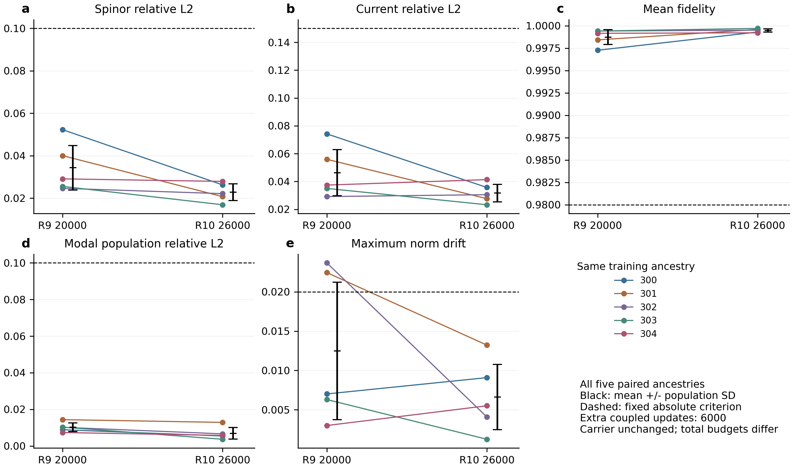
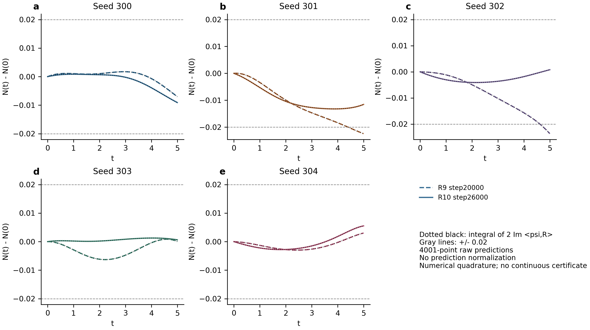
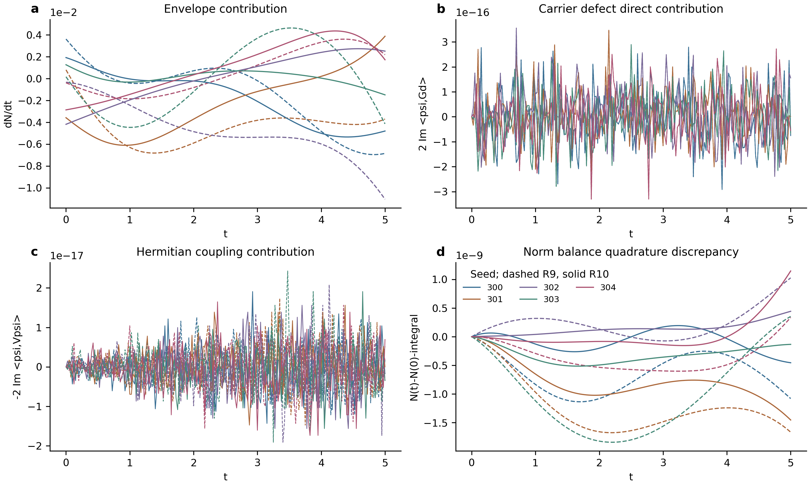
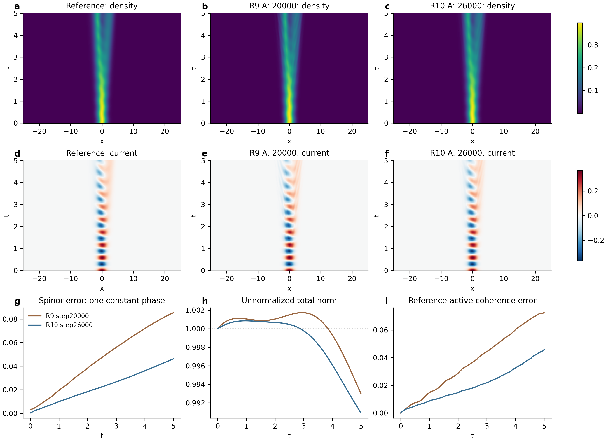
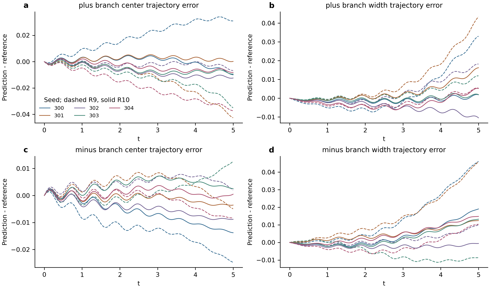
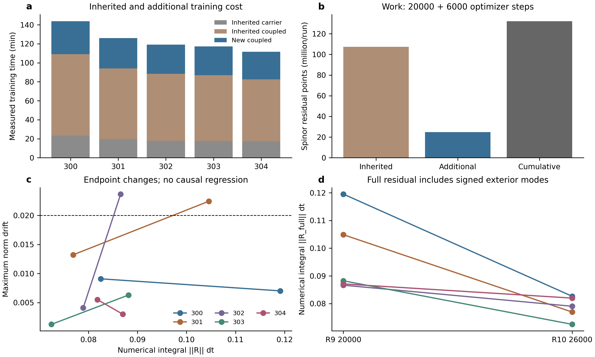

# R10：固定载波的高斯外势耦合预算诊断

实验ID：r10_wavepacket_budget_diagnosis。日期：2026-10-03（Asia/Shanghai）。全部结果为R9同一批五个训练祖先的条件续训，不是新独立重复。

## 1. 结论

**条件续训通过原绝对判据，5/5种子联合通过。** R9第20000步的3/5和未建立完整动力学成功的判定保持不变；R10固定第26000步结果单独归档。没有筛种子、最佳检查点、预测归一化或新补救结构。

| 阶段 | Spinor | Current | Fidelity | Modal population | Max norm drift | 联合通过 | 判据 |
| --- | --- | --- | --- | --- | --- | --- | --- |
| R9 step20000 | 0.034313157 ± 0.01051872 | 0.046358009 ± 0.016557648 | 0.99874309 ± 0.00081955043 | 0.010240286 ± 0.0023435158 | 0.012487291 ± 0.0087428307 | 3/5 | FAIL |
| R10 step26000 | 0.022780561 ± 0.0039384328 | 0.031715971 ± 0.0062907603 | 0.99947397 ± 0.00018103725 | 0.0068998344 ± 0.0031488903 | 0.0066356723 ± 0.0041490887 | 5/5 | PASS |

均值±population SD（ddof=0），n=5配对训练祖先。最大范数漂移先取各seed全时间最大值，再统计五seed。五项均值及至少4/5联合规则同时要求。

## 2. 为什么先做预算诊断

R1–R5建立已知自由能支上的表示优势；R6/R7说明局部空通道切向修复并不保证长期耦合成功；R8成功方案A引入自由载波预训练及复包络。R9迁移高斯初谱后旋量与流误差明显低于总参数匹配C，但两个种子仅在范数项超标。R9旋量和流A/C均值比为0.03651626、0.04948497，不能用新增总容量单独解释优势。

R9参考收敛与物理影响已独立验证；此处先固定物理、参考、表示及损失，增加耦合优化预算，避免同时改变机制和任务。

[完整下一步计划](NEXT_STEP_PLAN_AFTER_R9.md) · [R9报告](R9_WAVEPACKET_PERIODIC_POTENTIAL_REPORT.md) · [R10预注册](docs/experiments/r10_wavepacket_budget_diagnosis/preregistration.md)

## 3. 条件续训协议与公平边界

物理仍为m=5、V=0.2cos(x)、L=16π、T=5，R5固定33模态n=0…32、k=n/8、中心k0=2、σk=0.5归一化高斯初谱和等权±支。截断[-48,80]共129模态，扩展只零填充；q=1为n±8。R9参考及自由诊断完全沿用，无重新选择截断或势强。

五个A的原20000步状态包含6000步载波预训练及14000步耦合训练。逐seed恢复Adam动量、全部RNG和时间采样迹，再追加6000步，固定总26000步（耦合20000）。载波权重逐位一致，时间导数与近似缺陷完整保留。

结构和loss原样继承R8 A/R9 A：4×64 tanh、float64/complex128、Adam lr=10⁻³，每步32新时间×129模态；活动12932、冻结12802、总25734参数。只有完整未加权耦合旋量残差；精确频率与矩阵参考轨迹只进入独立后评价。

R10耦合时间20000步与R9 B/C配对序列逐元素相同；其前14000步等于原A。但R10总预算26000步高于C的20000步，故不作同总预算A/C优势声明。本轮检验同一批祖先的预算敏感性，未隔离预训练的单独因果贡献。

五物理核mask1/2/4/8/16；worker一线程，启动前互斥核验及进程内实际OS affinity一致。监控和报告工作使用另一核，仍共享内存、功耗与缓存资源。

科学冻结manifest SHA-256：da649624ff9a46c60422ed24dbe004d193c0b21d7fb61596c2a52a3385b4eb5f。只做两步维度、初值、梯度、NaN与落盘smoke及精确恢复核验，不按精度调参。

冻结清单（本地档案） · CPU调度（本地档案） · [理论核查](docs/experiments/r10_wavepacket_budget_diagnosis/theory_check.md)

## 4. 全部配对结果

### R9 step20000

| Seed | Spinor | Current | Fidelity | Modal population | Max norm drift | 联合 |
| --- | --- | --- | --- | --- | --- | --- |
| 300 | 0.052277695 | 0.07420991 | 0.99727342 | 0.008892019 | 0.0070187399 | PASS |
| 301 | 0.040022371 | 0.055941955 | 0.99843126 | 0.014413462 | 0.022438177 | FAIL |
| 302 | 0.024639019 | 0.029179386 | 0.99942416 | 0.010218396 | 0.023671886 | FAIL |
| 303 | 0.02553654 | 0.035022031 | 0.99941941 | 0.010304752 | 0.0063028885 | PASS |
| 304 | 0.02909016 | 0.037436763 | 0.99916721 | 0.0073728004 | 0.0030047663 | PASS |

### R10 step26000

| Seed | Spinor | Current | Fidelity | Modal population | Max norm drift | 联合 |
| --- | --- | --- | --- | --- | --- | --- |
| 300 | 0.026266864 | 0.03572743 | 0.99931203 | 0.0054785376 | 0.0090909266 | PASS |
| 301 | 0.020733869 | 0.027671372 | 0.99959978 | 0.012897861 | 0.013223781 | PASS |
| 302 | 0.022123767 | 0.030527207 | 0.99951749 | 0.006642208 | 0.0040907768 | PASS |
| 303 | 0.01689028 | 0.023292045 | 0.99971513 | 0.003694471 | 0.0012590345 | PASS |
| 304 | 0.027888028 | 0.041361803 | 0.99922543 | 0.0057860945 | 0.005513842 | PASS |

差为R10−R9，误差负差或fidelity正差有利；两个阶段同一祖先配对，不作独立样本显著性声明。均值之比与配对比值均值分列。

| 指标 | 配对差均值 | 配对差population SD | 均值比 | 配对比值均值 | 有利配对数 |
| --- | --- | --- | --- | --- | --- |
| spinor_rel_l2_gauge_aligned | -0.011532596 | 0.0096554157 | 0.66390165 | 0.70770269 | 5 |
| current_rel_l2 | -0.014642038 | 0.016510578 | 0.68415301 | 0.75843711 | 3 |
| fidelity_mean | 0.0007308802 | 0.00076811478 | 1.0007318 | 1.0007324 | 5 |
| modal_population_rel_l2 | -0.0033404514 | 0.0018524791 | 0.67379314 | 0.66086033 | 5 |
| max_norm_drift | -0.0058516192 | 0.0081626902 | 0.53139404 | 0.81843558 | 3 |
| density_rel_l2 | -0.0088962399 | 0.0062530969 | 0.66368583 | 0.691008 | 5 |
| active_coherence_rel_l2 | -0.010449787 | 0.00546551 | 0.68133213 | 0.69369943 | 5 |
| branch_population_rel_l2 | -0.004440887 | 0.0014719318 | 0.67157229 | 0.66215619 | 5 |
| branch_complex_coefficient_rel_l2 | -0.011532596 | 0.0096554157 | 0.66390165 | 0.70770269 | 5 |
| residual_integral_fine | -0.018567245 | 0.011961184 | 0.8087522 | 0.82035853 | 5 |
| full_physical_residual_integral | -0.01866002 | 0.012105478 | 0.80818832 | 0.82000832 | 5 |

[逐seed全部指标](results/summary/r10_wavepacket_budget_diagnosis/per_seed_metrics.csv) · [逐seed配对差](results/summary/r10_wavepacket_budget_diagnosis/paired_changes.csv) · [汇总](results/summary/r10_wavepacket_budget_diagnosis/summary_metrics.csv)

## 5. 统一独立评价

Nx=1024、Nt=201，周期端点不重复，Fourier积分不混叠；沿用R9 Parseval/2048点核验。旋量和复谱只消去一个全时空常数相位，raw值另存。参考占据≥10⁻⁶定义活跃mask，预测塌缩仍计入相干。

密度、流、fidelity、总模态及±支占据、复系数、活跃相干、中心/宽度相对同一耦合参考的轨迹全部保存。新增支持仅为原初谱n<0或n>32，不把中心外原有宽谱误称新侧带。

| Seed | Density | ±支占据 | 复支系数 | 活跃相干 | +中心RMSE | −中心RMSE | +宽度L2 | −宽度L2 |
| --- | --- | --- | --- | --- | --- | --- | --- | --- |
| 300 | 0.019648506 | 0.0083303738 | 0.026266864 | 0.023662551 | 0.0033453493 | 0.0074612685 | 0.0013094694 | 0.0074810989 |
| 301 | 0.020875082 | 0.01340407 | 0.020733869 | 0.023058403 | 0.0027619653 | 0.0018051269 | 0.0049386263 | 0.0061359471 |
| 302 | 0.014896776 | 0.0078214287 | 0.022123767 | 0.020292061 | 0.0081449372 | 0.0053202973 | 0.0046372573 | 0.0022396154 |
| 303 | 0.011767681 | 0.0059477845 | 0.01689028 | 0.017563163 | 0.0062619534 | 0.0044597119 | 0.0010882625 | 0.0054897738 |
| 304 | 0.02059161 | 0.0099001957 | 0.027888028 | 0.027135362 | 0.0046749662 | 0.001717165 | 0.0032208747 | 0.0068793681 |

## 6. 范数为何变化：恒等式与数值诊断

$$\dot N=2\operatorname{Im}\langle\psi,R\rangle,\quad R=iF\dot d+Gd-V\psi,\quad G=i\dot F-H_0F.$$

单位模载波使F†F=I，F†G为Hermitian，故载波缺陷的直接全局范数投影为零；实外势Hermitian耦合的全局投影也为零。于是范数直接变化来自包络切向2ReΣd†ḋ。这并不排除不准确载波改变包络优化难度的间接作用。

保存4001点未归一化预测及完整复残差，用投影积分重建N(t)−N(0)，并保存4001/2001数值差；201点保存载波/包络/势分解。离散积分不是严格连续误差认证，也不认证无限谱。

| Seed | 细网格max drift | 范数积分闭合差 | 4001/2001积分差 | 载波直接投影max | 势直接投影max | 包络与完整投影差 |
| --- | --- | --- | --- | --- | --- | --- |
| 300 | 0.0090909266 | 4.5443598e-10 | 3.2432126e-09 | 2.9193673e-16 | 1.9081958e-17 | 2.7929048e-16 |
| 301 | 0.013223783 | 1.4540261e-09 | 9.4865381e-09 | 3.4713948e-16 | 1.5612511e-17 | 3.4867942e-16 |
| 302 | 0.0040907768 | 4.4363743e-10 | 2.143098e-09 | 3.5422475e-16 | 1.5612511e-17 | 3.5258255e-16 |
| 303 | 0.0012590483 | 5.1346978e-10 | 2.3407823e-09 | 2.8976321e-16 | 1.9081958e-17 | 2.8449465e-16 |
| 304 | 0.005513842 | 1.1477814e-09 | 9.4611838e-09 | 3.3059881e-16 | 1.7347235e-17 | 3.3523531e-16 |

载波unit-IVP RMS和相位斜率诊断与R9相同，因为载波张量未改变。最大载波RMS的R9 seed304却具有最小范数漂移，不能把相关量直接写成范数失败的唯一原因。

R10保存145模态全物理残差（129截断内+两侧各8个外模态），外模态R_ext=−0.1边界源项。R9冻结评价器的正耦合源档案和独立负号补充原样保留；R10在其冻结前规定正确复符号。符号修订不改变R9原指标或优化。

| Seed | 截断内残差积分 | 全物理残差积分 | 外残差积分 | 载波单位缺陷RMS |
| --- | --- | --- | --- | --- |
| 300 | 0.08251236 | 0.082634181 | 0.0040596418 | 0.012461869 |
| 301 | 0.076878208 | 0.076949892 | 0.0029838601 | 0.01201309 |
| 302 | 0.078922746 | 0.079038191 | 0.0038841085 | 0.013047851 |
| 303 | 0.072450473 | 0.072508896 | 0.0026052814 | 0.0098711637 |
| 304 | 0.081823764 | 0.081983845 | 0.0044941591 | 0.013726561 |

## 7. 参数、工作量和真实成本

每seed新增6000×32×129=24,768,000旋量残差点，复标量数49,536,000；累计132,096,000旋量点。R9继承107,328,000点。总优化步数不同于残差工作量，活动参数不同于总参数。

下表耗时单位秒。累计训练耗时=原有两阶段+新增耦合，评价是固定最终检查点的完整评价；额外范数诊断forward 516129个旋量点、额外残差调用0，包含在本次评价耗时中。peak RSS为进程20ms采样及OS高水位方法，完整方法字符串保存在metrics。

训练秒数沿用R9逐步计算计时口径，不含检查点I/O；总执行时间另由runtime_plan与执行事件UTC时间保存。不同并发任务的耗时不等同单一算法加速比。

| Seed | 原载波秒 | 原耦合秒 | 新增耦合秒 | 累计训练秒 | 新评价秒 | Peak RSS MiB |
| --- | --- | --- | --- | --- | --- | --- |
| 300 | 1388.626 | 5163.7927 | 2072.8051 | 8625.2237 | 34.969491 | 577.66797 |
| 301 | 1182.5768 | 4465.6003 | 1919.3064 | 7567.4835 | 30.621262 | 589.75391 |
| 302 | 1071.1632 | 4237.736 | 1835.6582 | 7144.5574 | 34.765741 | 589.77344 |
| 303 | 1054.1531 | 4169.6351 | 1816.8507 | 7040.6389 | 36.23047 | 572.49219 |
| 304 | 1043.2348 | 3913.1049 | 1744.5408 | 6700.8806 | 39.696571 | 577.66016 |

[完整成本和残差工作量](results/summary/r10_wavepacket_budget_diagnosis/cost_and_residual_work.csv)

## 8. 图表与source data

### paired_primary_metrics

All five fixed endpoint pairs; conditional continuation and absolute criteria are separate.

[PNG](results/figures/r10_wavepacket_budget_diagnosis/paired_primary_metrics.png) · [SVG](results/figures/r10_wavepacket_budget_diagnosis/paired_primary_metrics.svg) · [PDF](results/figures/r10_wavepacket_budget_diagnosis/paired_primary_metrics.pdf)
[Source CSV](results/figures/r10_wavepacket_budget_diagnosis/source_data/paired_primary_metrics_values.csv)

### norm_balance_all_seeds

Residual projection reconstructs norm change; finite-grid integration is a numerical diagnostic.

[PNG](results/figures/r10_wavepacket_budget_diagnosis/norm_balance_all_seeds.png) · [SVG](results/figures/r10_wavepacket_budget_diagnosis/norm_balance_all_seeds.svg) · [PDF](results/figures/r10_wavepacket_budget_diagnosis/norm_balance_all_seeds.pdf)
Source CSV（本地档案）

### residual_decomposition

Unitary carrier defects and Hermitian coupling have no direct global norm source; no pretraining causal ablation.

[PNG](results/figures/r10_wavepacket_budget_diagnosis/residual_decomposition.png) · [SVG](results/figures/r10_wavepacket_budget_diagnosis/residual_decomposition.svg) · [PDF](results/figures/r10_wavepacket_budget_diagnosis/residual_decomposition.pdf)
[Source CSV](results/figures/r10_wavepacket_budget_diagnosis/source_data/residual_decomposition_decomposition.csv) · Source CSV（本地档案）

### dynamics_seed300

Fixed seed300 physical fields and errors; reference and both stages use common scales.

[PNG](results/figures/r10_wavepacket_budget_diagnosis/dynamics_seed300.png) · [SVG](results/figures/r10_wavepacket_budget_diagnosis/dynamics_seed300.svg) · [PDF](results/figures/r10_wavepacket_budget_diagnosis/dynamics_seed300.pdf)
Source CSV（本地档案） · [Source CSV](results/figures/r10_wavepacket_budget_diagnosis/source_data/dynamics_seed300_series.csv)

### branch_trajectories

Both free-branch center and width trajectories relative to the same coupled reference; all seeds.

[PNG](results/figures/r10_wavepacket_budget_diagnosis/branch_trajectories.png) · [SVG](results/figures/r10_wavepacket_budget_diagnosis/branch_trajectories.svg) · [PDF](results/figures/r10_wavepacket_budget_diagnosis/branch_trajectories.pdf)
[Source CSV](results/figures/r10_wavepacket_budget_diagnosis/source_data/branch_trajectories_series.csv)

### budget_and_residuals

Total optimizer steps and residual work differ; inherited and new measured costs are reported separately.

[PNG](results/figures/r10_wavepacket_budget_diagnosis/budget_and_residuals.png) · [SVG](results/figures/r10_wavepacket_budget_diagnosis/budget_and_residuals.svg) · [PDF](results/figures/r10_wavepacket_budget_diagnosis/budget_and_residuals.pdf)
[Source CSV](results/figures/r10_wavepacket_budget_diagnosis/source_data/budget_and_residuals_costs.csv) · [Source CSV](results/figures/r10_wavepacket_budget_diagnosis/source_data/budget_and_residuals_diagnostics.csv)

[FIGURE_QA](results/figures/r10_wavepacket_budget_diagnosis/FIGURE_QA.md)

## 9. 产物与工程审计

每run保存六件套及Adam/RNG恢复、事件、完整残差、载波诊断、范数闭合和分解。全部源R1–R9文件以SHA保护，R9报告和原失败记录不改写。

- Seed 300: config.json（本地档案） · metrics.json（本地档案） · loss_history.csv（本地档案） · time_series.csv（本地档案） · dense_grid.npz（本地档案） · model_state.pt（本地档案） · recovery_state.pt（本地档案） · execution_events.jsonl（本地档案） · norm_balance.csv（本地档案） · residual_decomposition.csv（本地档案） · residual_by_mode.csv（本地档案） · residual_integral.csv（本地档案） · carrier_diagnostics.csv（本地档案）
- Seed 301: config.json（本地档案） · metrics.json（本地档案） · loss_history.csv（本地档案） · time_series.csv（本地档案） · dense_grid.npz（本地档案） · model_state.pt（本地档案） · recovery_state.pt（本地档案） · execution_events.jsonl（本地档案） · norm_balance.csv（本地档案） · residual_decomposition.csv（本地档案） · residual_by_mode.csv（本地档案） · residual_integral.csv（本地档案） · carrier_diagnostics.csv（本地档案）
- Seed 302: config.json（本地档案） · metrics.json（本地档案） · loss_history.csv（本地档案） · time_series.csv（本地档案） · dense_grid.npz（本地档案） · model_state.pt（本地档案） · recovery_state.pt（本地档案） · execution_events.jsonl（本地档案） · norm_balance.csv（本地档案） · residual_decomposition.csv（本地档案） · residual_by_mode.csv（本地档案） · residual_integral.csv（本地档案） · carrier_diagnostics.csv（本地档案）
- Seed 303: config.json（本地档案） · metrics.json（本地档案） · loss_history.csv（本地档案） · time_series.csv（本地档案） · dense_grid.npz（本地档案） · model_state.pt（本地档案） · recovery_state.pt（本地档案） · execution_events.jsonl（本地档案） · norm_balance.csv（本地档案） · residual_decomposition.csv（本地档案） · residual_by_mode.csv（本地档案） · residual_integral.csv（本地档案） · carrier_diagnostics.csv（本地档案）
- Seed 304: config.json（本地档案） · metrics.json（本地档案） · loss_history.csv（本地档案） · time_series.csv（本地档案） · dense_grid.npz（本地档案） · model_state.pt（本地档案） · recovery_state.pt（本地档案） · execution_events.jsonl（本地档案） · norm_balance.csv（本地档案） · residual_decomposition.csv（本地档案） · residual_by_mode.csv（本地档案） · residual_integral.csv（本地档案） · carrier_diagnostics.csv（本地档案）

[Decision](results/summary/r10_wavepacket_budget_diagnosis/decision.json) · Audit（本地档案） · 历史保护（本地档案） · 全产物SHA（本地档案） · 最终pytest（本地档案） · 链接检查（本地档案）

## 10. 能说明什么，下一步是什么

固定追加6000步后达到绝对标准，支持同一批训练祖先的条件预算恢复。仍需新种子独立重复，不能据此宣布一般预算阈值或预训练单因素因果效果。

接下来应先用新配对种子检验冻结流程的重复性，再用预先固定预算和工作量的载波预训练消融区分预训练与容量/优化贡献。有独立重复证据后才做少量势强和时间跨度的稳健性检验。

本轮只涉及已知有限Fourier高斯初谱、给定弱周期外势和同一批训练祖先；不证明未知连续谱发现、一般外势适用或通用Dirac求解器。
