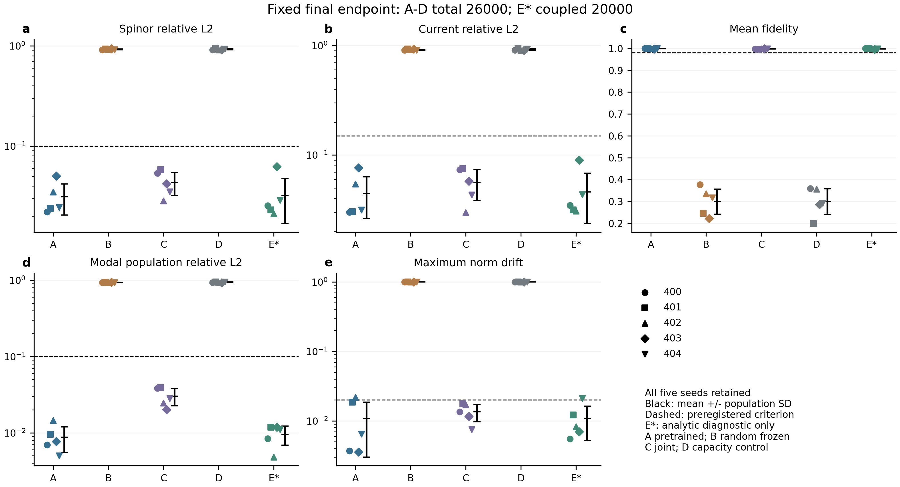
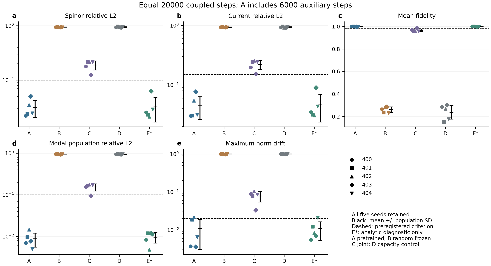
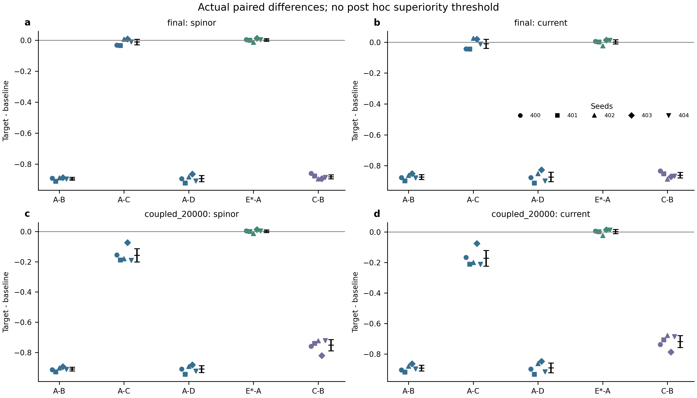
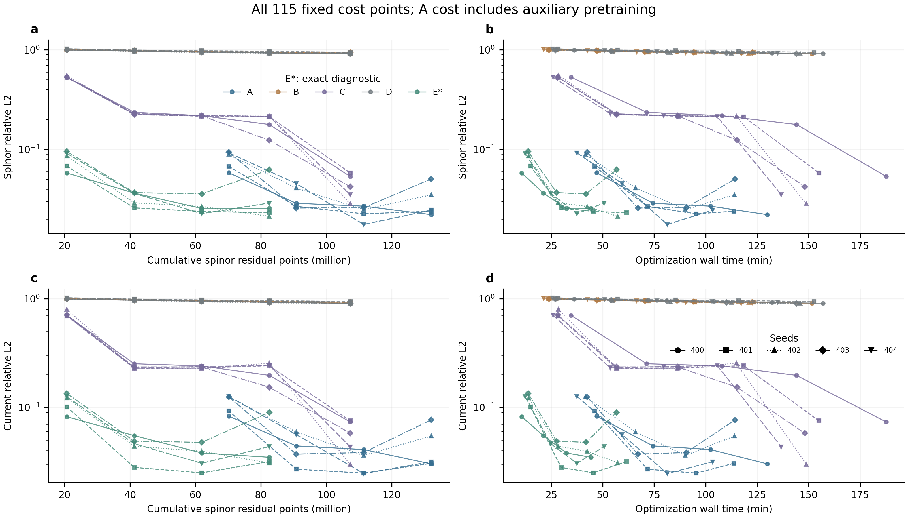
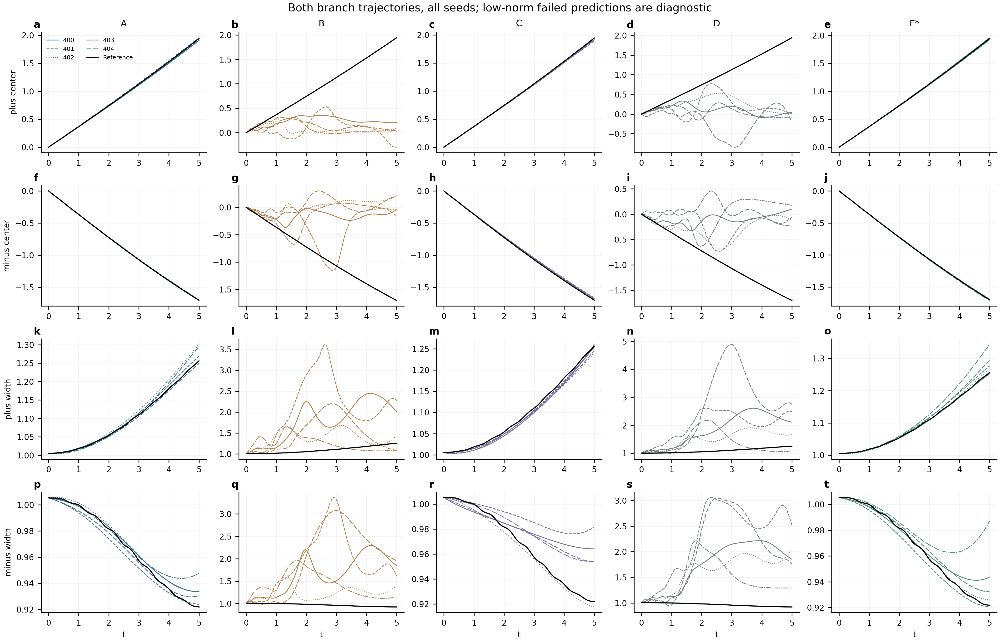
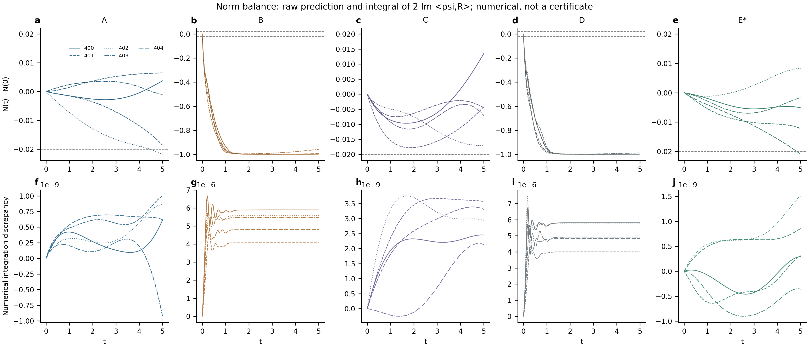
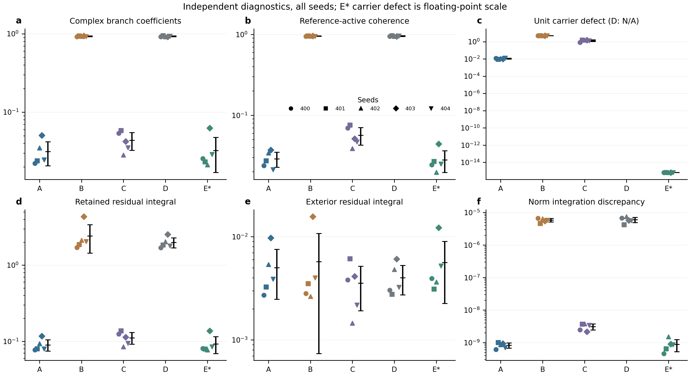
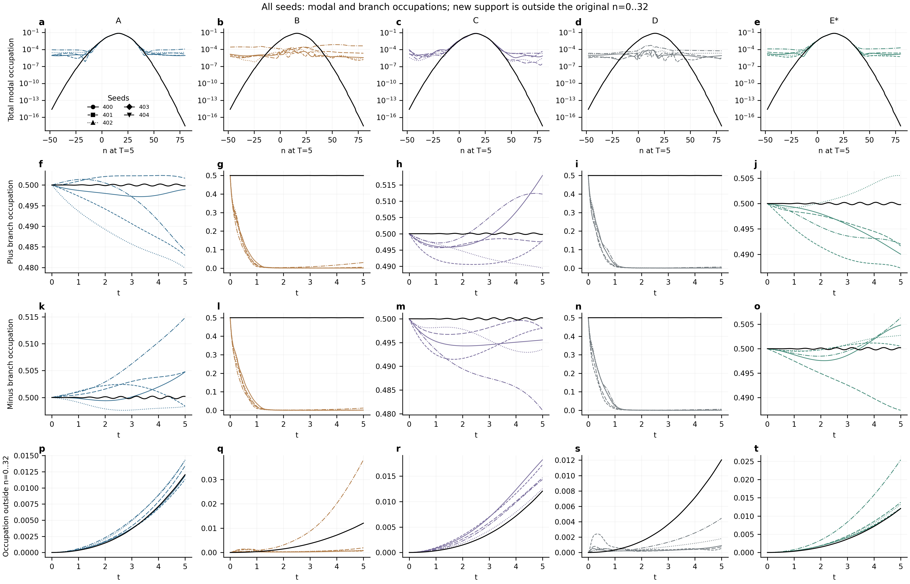
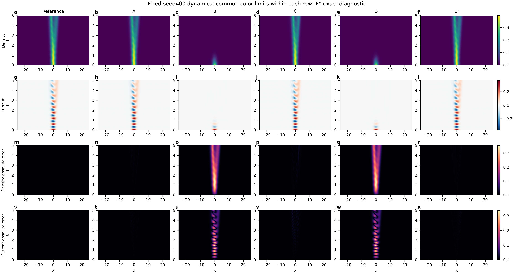

# R11：高斯波包外势问题的独立复现与载波预训练消融

实验ID：r11_independent_replication_ablation。日期：2026-10-04 06:37（本机时间，Asia/Shanghai）。
独立新种子400–404；沿用同一科学实现和参考，不冒充独立代码库、硬件或未知谱发现。

## 1. 主要结果与五个问题

**A 通过预注册独立复现标准，4/5种子联合通过。** 五项均值和至少4/5联合规则均须满足；比较优势与绝对成功分别判断。E始终为精确载波解析诊断，不计作学习方法成果。

| Group | Spinor | Current | Fidelity | Modal | Norm | Joint | Criterion |
| --- | --- | --- | --- | --- | --- | --- | --- |
| A | 0.031198827 ± 0.01061017 | 0.044661832 ± 0.018478052 | 0.99893811 ± 0.00076980307 | 0.0087622113 ± 0.0032270502 | 0.010836924 ± 0.0078176511 | 4/5 | PASS |
| B | 0.92621239 ± 0.0089491234 | 0.91815871 ± 0.0089278203 | 0.29917452 ± 0.05722145 | 0.9370992 ± 0.0048633392 | 0.99839555 ± 0.0013789035 | 0/5 | FAIL |
| C | 0.043454237 ± 0.01109252 | 0.055915078 ± 0.017430681 | 0.99801231 ± 0.00096791283 | 0.030140726 ± 0.0075302614 | 0.01349545 ± 0.0037536309 | 5/5 | PASS |
| D | 0.92546078 ± 0.012170543 | 0.91795032 ± 0.015676552 | 0.2986594 ± 0.058544005 | 0.93824033 ± 0.0085743283 | 0.99908659 ± 0.00045827403 | 0/5 | FAIL |
| E*诊断 | 0.03225488 ± 0.015338419 | 0.046108716 ± 0.022394672 | 0.99874347 ± 0.0013216142 | 0.0095846153 ± 0.0027060334 | 0.010775548 ± 0.0055604915 | 4/5 | PASS |

均值±population SD（ddof=0），n=5。Norm先取每seed在统一201点网格的最大漂移，再跨seed统计；4001点更细诊断另报。A–D主终点总26000步，E为20000步耦合诊断。

1. **A是否独立复现：** 本题给定预算下五新种子达到冻结的绝对规则。平均spinor/current=0.031198827/0.044661832。
2. **学到的载波相对随机冻结载波：** 同20000耦合步数 A/B spinor/current均值比=0.033142827/0.047650227；旋量/流有利配对数=5/5、5/5。两项平均误差均支持辅助预训练得到的载波在这个冻结流程中有益。同耦合比较仍需计入A的辅助成本；主终点A/B也改变了耦合预算。
3. **预训练后冻结与联合训练：** 主终点 A/C spinor/current均值比=0.71796973/0.79874398。C联合通过5/5，绝对规则通过。同一次C轨迹在20000耦合步数为0/5，26000步为5/5；不能忽略额外预算的作用。因此本题在这批新种子和26000步预算下，辅助预训练并非达到完整动力学成功的必要条件。A较低的平均误差与A/C联合通过数4/5、5/5须分开解释。这比较的是两个完整训练流程，同时改变预训练、冻结和耦合步数，不能声称单因素冻结因果效应。从相同随机载波起点的C/B spinor/current均值比=0.046916061/0.060899143，有利配对数=5/5、5/5。B/C只考察从头训练时是否允许载波更新，活动参数也不同，不能外推为预训练载波冻结的单因素效应。
4. **是否超过容量匹配控制：** A/D spinor/current均值比=0.033711668/0.048653866，两项平均误差均较低，支持A的流程优势不能仅用总参数量解释。D总参数比A多约0.505%，但A的活动参数、单位辅助任务及残差工作量不同，不等同等实际计算成本。
5. **精确载波的诊断：** E/A同20000耦合步数spinor/current均值比=1.0338491/1.0323964，E联合通过4/5。精确自由载波没有在两项平均误差上同时改善A，故不能把剩余误差唯一归为载波近似。E改变了解析先验及优化坐标，误差差值不是可加分离的纯载波误差；其效果不算学习成果。

A未联合通过的终点：seed402（max_norm_drift=0.021831067）。全部保留，未替换或追加训练。

E未联合通过的终点：seed404（max_norm_drift=0.020970915）。全部保留，未替换或追加训练。

## 2. 大实验脉络与本轮定位

R1–R5建立已知自由Fourier能支上的表示/训练优势，R6/R7表明空通道局部可优化不保证完整外势耦合。R8成功的是可学习自由载波＋复包络方案A，不能与原始纯实振幅LTPB混同。R9迁移到宽高斯初谱后A平均误差低于容量控制，但两个种子范数项超标，严格联合3/5。R10原五个祖先条件续训达到5/5，仍不属于新随机种子重复。

R11优先检验独立种子复现与预训练/更新策略归因，没有改变物理、损失、网络宽深或添加补救结构。没有时间窗、守恒正则、动态切换、幅值阈值、模态加权或预测归一化。

[R8报告](R8_COUPLING_RECOVERY_REPORT.md) · [R9报告](R9_WAVEPACKET_PERIODIC_POTENTIAL_REPORT.md) · [R10报告](R10_WAVEPACKET_BUDGET_DIAGNOSIS_REPORT.md) · 历史原始表核查（本地档案）

## 3. 物理、初态与参考

$$i\partial_t\psi=[-i\sigma_x\partial_x+5\sigma_z+0.2\cos(x)I_2]\psi,\quad x\in[-8\pi,8\pi),\quad T=5.$$

$$k_n=n/8,\quad g_n=C\exp[-(k_n-2)^2/(4\times0.5^2)],\quad n=0,\ldots,32,\quad\sum_n|g_n|^2=1,\quad c_{n,\pm}(0)=g_n/\sqrt2.$$

所选n=-48,…,80，129模态。扩大谱只对原33个高斯系数零填充，不重新归一化。q=1为n±8，完整残差为

$$R_n=i\partial_t\widetilde\psi_n-(k_n\sigma_x+5\sigma_z)\widetilde\psi_n-0.1(\widetilde\psi_{n-8}+\widetilde\psi_{n+8}).$$

沿用R9预先验证的首个合格截断，R11正式前重验[-48,80]/[-64,96]。复轨迹差=1.4275683e-08，下/上8层最大占据=1.1544937e-12/3.4814478e-15。相对R9原轨迹差=2.5043473e-14。Hermiticity、范数、可逆性及独立expm仍通过；没有根据PINN调整截断或势强。

R9忽略外势自由解的spinor/current约0.300671/0.209617，远高于参考截断误差；本轮外势影响可测。预测边界占据及外残差是预测诊断，不重新选择参考。

[参考核查和轨迹](results/summary/r11_independent_replication_ablation/reference_validation.json) · 201点参考（本地档案） · 4001点参考（本地档案）

## 4. 流程、理论和公平边界

$$p=e^{i\tau q_\theta},\quad d=c_0+\tau z,\quad c=pd,\quad\dot c=\dot p\,d+p(z/T+\tau\dot z).$$

$$F_n=[u_+p_+,u_-p_-],\quadR_n=iF_n\dot d_n+(i\dot F_n-H_nF_n)d_n-0.1(F_{n-8}d_{n-8}+F_{n+8}d_{n+8}).$$

A辅助单位自由IVP与R9原流程相同；冻结只停止参数更新，完整时间导数和缺陷仍进入loss。B载波与A预训练前逐位相同；C载波和包络同时求完整参数梯度。D双独立4×64四实输出网络按和/√2；E自由相位由已知算符解析计算，独立模块明示先验。四层64宽tanh、双精度、Adam lr=.001、每步32新时间×全部129模态和未加权完整PDE保持一致。

时间导数是同一Linear/tanh前向的精确链式实现，已逐参数对照自动微分；无时间差分近似。矩阵参考不进入任何组训练。A–D无显式精确频率；E是用户指定的解析例外。E检查点不存矩阵未来轨迹或频率数组。

| Group | Pre | Coupled | Total | Active | Frozen | Parameters | SpinorPoints |
| --- | --- | --- | --- | --- | --- | --- | --- |
| A_pretrained_frozen | 6000 | 20000 | 26000 | 12932 | 12802 | 25734 | 1.32096e+08 |
| B_random_frozen | 0 | 26000 | 26000 | 12932 | 12802 | 25734 | 1.07328e+08 |
| C_joint | 0 | 26000 | 26000 | 25734 | 0 | 25734 | 1.07328e+08 |
| D_double_complex | 0 | 26000 | 26000 | 25864 | 0 | 25864 | 1.07328e+08 |
| E_exact_carrier_diagnostic | 0 | 20000 | 20000 | 12932 | 0 | 12932 | 82560000 |

A自由阶段活动12802、闲置包络12932；耦合阶段活动12932、冻结12802。C活动25734；D活动25864；E活动12932但含解析信息，不能按可学习参数数目当作无先验公平基线。总步数相同不等于计算成本相同。

初始化流：carrier900000+seed、第一复网络800000+seed、D第二网络830000+seed。采样流：自由910000+seed、耦合920000+seed。A/B/C初始载波逐元素相同；各组同形第一复网络相同，载波两输出不与四输出网络声明配对。所有组耦合20000步公共前缀相同，B/C/D全部26000步相同；独立评价不改变训练随机状态。

五worker实际核mask1/2/4/8/16与控制核128互斥，单线程，按seed串行并固定拉丁轮转组顺序。仍共享缓存、内存、功耗，未隔离系统后台负载；实际耗时不作为隔离硬件算法加速证据。

冻结manifest SHA-256：2678bdbc7379bc0b2b003a67eeb186f6e416a1501d8657394a88cfdef048aa68。正式前30测试及五组工程smoke通过；只验证维度、初值、梯度、NaN与落盘，不按预测精度调参。

[预注册](docs/experiments/r11_independent_replication_ablation/preregistration.md) · [机器协议](results/summary/r11_independent_replication_ablation/protocol.json) · [理论核查](docs/experiments/r11_independent_replication_ablation/theory_check.md) · 冻结清单（本地档案） · CPU执行计划（本地档案）

## 5. 评价规则和全部种子

统一Nx=1024、Nt=201，端点不重复；Fourier双线性误差平方最高指数256<1024，Parseval及2048点验证。只消去一个全时空常数相位，不逐模态或逐时间对齐。活跃mask只按参考支占据≥10⁻⁶，相干塌缩预测仍计入；相位定义覆盖率独立报告。初始支持外仅指n<0或n>32。

branch中心/宽度由圆周矩及展开定义，沿用R9并对同一耦合参考计算；低预测支范数下轨迹只作失败诊断。复系数、密度、流、fidelity、总及±支模态占据、相干和轨迹均保存。

### final

| Group | Seed | Total | Coupled | Spinor | Current | Fidelity | Modal | Norm | Joint |
| --- | --- | --- | --- | --- | --- | --- | --- | --- | --- |
| A | 400 | 26000 | 20000 | 0.022125782 | 0.030140622 | 0.99951411 | 0.0069508918 | 0.00368668 | PASS |
| A | 401 | 26000 | 20000 | 0.023921408 | 0.030493069 | 0.99944334 | 0.0095802328 | 0.018664254 | PASS |
| A | 402 | 26000 | 20000 | 0.034965208 | 0.054409944 | 0.99885501 | 0.014519024 | 0.021831067 | FAIL |
| A | 403 | 26000 | 20000 | 0.05041821 | 0.076728669 | 0.99747186 | 0.0077281924 | 0.0035512593 | PASS |
| A | 404 | 26000 | 20000 | 0.024563525 | 0.031536858 | 0.99940625 | 0.0050327153 | 0.0064513599 | PASS |
| B | 400 | 26000 | 26000 | 0.91357311 | 0.90727907 | 0.37651673 | 0.92961548 | 0.9992296 | FAIL |
| B | 401 | 26000 | 26000 | 0.93564826 | 0.92837286 | 0.24560948 | 0.94317134 | 0.99955087 | FAIL |
| B | 402 | 26000 | 26000 | 0.92421113 | 0.917298 | 0.33514251 | 0.93496125 | 0.99810599 | FAIL |
| B | 403 | 26000 | 26000 | 0.93700305 | 0.92824728 | 0.22217444 | 0.94156776 | 0.99582113 | FAIL |
| B | 404 | 26000 | 26000 | 0.92062637 | 0.90959633 | 0.31642943 | 0.93618019 | 0.99927017 | FAIL |
| C | 400 | 26000 | 26000 | 0.053596354 | 0.073332747 | 0.99714561 | 0.03834189 | 0.013481691 | PASS |
| C | 401 | 26000 | 26000 | 0.058075766 | 0.075252886 | 0.99665996 | 0.03924321 | 0.017799473 | PASS |
| C | 402 | 26000 | 26000 | 0.028397914 | 0.029839931 | 0.99922139 | 0.024654048 | 0.017058391 | PASS |
| C | 403 | 26000 | 26000 | 0.042119059 | 0.057816085 | 0.99826006 | 0.020140428 | 0.011617382 | PASS |
| C | 404 | 26000 | 26000 | 0.035082094 | 0.043333742 | 0.99877455 | 0.028324055 | 0.0075203156 | PASS |
| D | 400 | 26000 | 26000 | 0.91638232 | 0.90752664 | 0.35938243 | 0.93218705 | 0.99930497 | FAIL |
| D | 401 | 26000 | 26000 | 0.94619869 | 0.94253575 | 0.19896719 | 0.95050998 | 0.99942 | FAIL |
| D | 402 | 26000 | 26000 | 0.91715833 | 0.90595426 | 0.35624417 | 0.93267048 | 0.99847926 | FAIL |
| D | 403 | 26000 | 26000 | 0.91501969 | 0.90327659 | 0.28604219 | 0.92928061 | 0.99860407 | FAIL |
| D | 404 | 26000 | 26000 | 0.93254486 | 0.93045837 | 0.29266106 | 0.94655353 | 0.99962468 | FAIL |
| E | 400 | 20000 | 20000 | 0.025509153 | 0.034699471 | 0.99935308 | 0.0083631571 | 0.0055050668 | PASS |
| E | 401 | 20000 | 20000 | 0.023114215 | 0.031629354 | 0.99949312 | 0.011881723 | 0.012188357 | PASS |
| E | 402 | 20000 | 20000 | 0.021245367 | 0.030739872 | 0.99956431 | 0.0048194567 | 0.0082362432 | PASS |
| E | 403 | 20000 | 20000 | 0.062501265 | 0.089980655 | 0.99611239 | 0.011836459 | 0.0069771597 | PASS |
| E | 404 | 20000 | 20000 | 0.028904397 | 0.043494227 | 0.99919442 | 0.01102228 | 0.020970915 | FAIL |

### coupled_20000

| Group | Seed | Total | Coupled | Spinor | Current | Fidelity | Modal | Norm | Joint |
| --- | --- | --- | --- | --- | --- | --- | --- | --- | --- |
| A | 400 | 26000 | 20000 | 0.022125782 | 0.030140622 | 0.99951411 | 0.0069508918 | 0.00368668 | PASS |
| A | 401 | 26000 | 20000 | 0.023921408 | 0.030493069 | 0.99944334 | 0.0095802328 | 0.018664254 | PASS |
| A | 402 | 26000 | 20000 | 0.034965208 | 0.054409944 | 0.99885501 | 0.014519024 | 0.021831067 | FAIL |
| A | 403 | 26000 | 20000 | 0.05041821 | 0.076728669 | 0.99747186 | 0.0077281924 | 0.0035512593 | PASS |
| A | 404 | 26000 | 20000 | 0.024563525 | 0.031536858 | 0.99940625 | 0.0050327153 | 0.0064513599 | PASS |
| B | 400 | 20000 | 20000 | 0.93667542 | 0.93431679 | 0.26411972 | 0.94752049 | 0.99882026 | FAIL |
| B | 401 | 20000 | 20000 | 0.95316293 | 0.94940837 | 0.23575154 | 0.94702494 | 0.9987849 | FAIL |
| B | 402 | 20000 | 20000 | 0.93760608 | 0.93372203 | 0.28641399 | 0.94625438 | 0.99938097 | FAIL |
| B | 403 | 20000 | 20000 | 0.94399884 | 0.93998536 | 0.28690613 | 0.94394906 | 0.99965185 | FAIL |
| B | 404 | 20000 | 20000 | 0.93528055 | 0.92899129 | 0.23160427 | 0.94583009 | 0.9983861 | FAIL |
| C | 400 | 20000 | 20000 | 0.17782876 | 0.19718098 | 0.96987528 | 0.15580505 | 0.088087366 | FAIL |
| C | 401 | 20000 | 20000 | 0.21308253 | 0.24186016 | 0.95699219 | 0.16708511 | 0.078033577 | FAIL |
| C | 402 | 20000 | 20000 | 0.21564157 | 0.25531456 | 0.95661227 | 0.17697869 | 0.1038188 | FAIL |
| C | 403 | 20000 | 20000 | 0.12373756 | 0.15329583 | 0.98489097 | 0.095541485 | 0.032940916 | FAIL |
| C | 404 | 20000 | 20000 | 0.21466303 | 0.24359268 | 0.95650299 | 0.17256579 | 0.085983559 | FAIL |
| D | 400 | 20000 | 20000 | 0.93100741 | 0.92796625 | 0.28524498 | 0.94336083 | 0.9994916 | FAIL |
| D | 401 | 20000 | 20000 | 0.96796956 | 0.96308455 | 0.15049755 | 0.95766883 | 0.99851787 | FAIL |
| D | 402 | 20000 | 20000 | 0.92760637 | 0.9169333 | 0.26911067 | 0.9371094 | 0.9973114 | FAIL |
| D | 403 | 20000 | 20000 | 0.9316806 | 0.92497977 | 0.30198595 | 0.94175521 | 0.99950294 | FAIL |
| D | 404 | 20000 | 20000 | 0.94774899 | 0.94695697 | 0.17681791 | 0.95251784 | 0.99883431 | FAIL |
| E | 400 | 20000 | 20000 | 0.025509153 | 0.034699471 | 0.99935308 | 0.0083631571 | 0.0055050668 | PASS |
| E | 401 | 20000 | 20000 | 0.023114215 | 0.031629354 | 0.99949312 | 0.011881723 | 0.012188357 | PASS |
| E | 402 | 20000 | 20000 | 0.021245367 | 0.030739872 | 0.99956431 | 0.0048194567 | 0.0082362432 | PASS |
| E | 403 | 20000 | 20000 | 0.062501265 | 0.089980655 | 0.99611239 | 0.011836459 | 0.0069771597 | PASS |
| E | 404 | 20000 | 20000 | 0.028904397 | 0.043494227 | 0.99919442 | 0.01102228 | 0.020970915 | FAIL |

A/E的final与coupled_20000引用同一实际快照，不能视作两次独立重复。B/C/D的20000/26000来自同一次轨迹。

## 6. 实际配对优势、冻结与容量

差为target−baseline，误差负差有利、fidelity正差有利；比值均值与均值比均列，无事后倍数门槛或显著性筛选。

| endpoint | target | baseline | metric | paired_difference_mean | paired_difference_population_sd | ratio_of_means | mean_of_paired_ratios | favorable_pair_count |
| --- | --- | --- | --- | --- | --- | --- | --- | --- |
| final | A_pretrained_frozen | B_random_frozen | spinor_rel_l2_gauge_aligned | -0.89501356 | 0.0089158526 | 0.033684312 | 0.033621475 | 5 |
| final | A_pretrained_frozen | B_random_frozen | current_rel_l2 | -0.87349688 | 0.015647339 | 0.048642824 | 0.048542611 | 5 |
| final | A_pretrained_frozen | C_joint | spinor_rel_l2_gauge_aligned | -0.01225541 | 0.018047644 | 0.71796973 | 0.79063906 | 3 |
| final | A_pretrained_frozen | C_joint | current_rel_l2 | -0.011253246 | 0.029449485 | 0.79874398 | 0.93889931 | 3 |
| final | A_pretrained_frozen | D_double_complex | spinor_rel_l2_gauge_aligned | -0.89426195 | 0.019992402 | 0.033711668 | 0.033798142 | 5 |
| final | A_pretrained_frozen | D_double_complex | current_rel_l2 | -0.87328849 | 0.031090895 | 0.048653866 | 0.048892173 | 5 |
| final | E_exact_carrier_diagnostic | A_pretrained_frozen | spinor_rel_l2_gauge_aligned | 0.0010560528 | 0.0084805653 | 1.0338491 | 1.0286326 | 2 |
| final | E_exact_carrier_diagnostic | A_pretrained_frozen | current_rel_l2 | 0.0014468836 | 0.013345209 | 1.0323964 | 1.0610704 | 1 |
| final | C_joint | B_random_frozen | spinor_rel_l2_gauge_aligned | -0.88275815 | 0.013199364 | 0.046916061 | 0.046904212 | 5 |
| final | C_joint | B_random_frozen | current_rel_l2 | -0.86224363 | 0.01790494 | 0.060899143 | 0.060868422 | 5 |
| final | D_double_complex | B_random_frozen | spinor_rel_l2_gauge_aligned | -0.00075160961 | 0.012581251 | 0.99918851 | 0.99924091 | 2 |
| final | D_double_complex | B_random_frozen | current_rel_l2 | -0.00020838699 | 0.016660566 | 0.99977304 | 0.99983932 | 2 |
| coupled_20000 | A_pretrained_frozen | B_random_frozen | spinor_rel_l2_gauge_aligned | -0.91014594 | 0.011959058 | 0.033142827 | 0.033136588 | 5 |
| coupled_20000 | A_pretrained_frozen | B_random_frozen | current_rel_l2 | -0.89262293 | 0.019430207 | 0.047650227 | 0.047644907 | 5 |
| coupled_20000 | A_pretrained_frozen | C_joint | spinor_rel_l2_gauge_aligned | -0.15779186 | 0.04402609 | 0.16508129 | 0.18414392 | 5 |
| coupled_20000 | A_pretrained_frozen | C_joint | current_rel_l2 | -0.17358701 | 0.051203799 | 0.2046372 | 0.22440734 | 5 |
| coupled_20000 | A_pretrained_frozen | D_double_complex | spinor_rel_l2_gauge_aligned | -0.91000376 | 0.022188118 | 0.033147834 | 0.0332411 | 5 |
| coupled_20000 | A_pretrained_frozen | D_double_complex | current_rel_l2 | -0.89132234 | 0.031656438 | 0.04771644 | 0.047947264 | 5 |
| coupled_20000 | E_exact_carrier_diagnostic | A_pretrained_frozen | spinor_rel_l2_gauge_aligned | 0.0010560528 | 0.0084805653 | 1.0338491 | 1.0286326 | 2 |
| coupled_20000 | E_exact_carrier_diagnostic | A_pretrained_frozen | current_rel_l2 | 0.0014468836 | 0.013345209 | 1.0323964 | 1.0610704 | 1 |
| coupled_20000 | C_joint | B_random_frozen | spinor_rel_l2_gauge_aligned | -0.75235407 | 0.036701281 | 0.20076671 | 0.20079822 | 5 |
| coupled_20000 | C_joint | B_random_frozen | current_rel_l2 | -0.71903592 | 0.039544213 | 0.23285222 | 0.23290478 | 5 |
| coupled_20000 | D_double_complex | B_random_frozen | spinor_rel_l2_gauge_aligned | -0.00014217858 | 0.011475685 | 0.99984896 | 0.99982002 | 3 |
| coupled_20000 | D_double_complex | B_random_frozen | current_rel_l2 | -0.0013005973 | 0.014482431 | 0.99861238 | 0.99860056 | 3 |

A/B同耦合步数控制冻结策略、初始化及时间序列，检验预训练获得的载波权重；主终点还混合6000步预算分配。A/C不是冻结单因素消融。B/C才从相同随机载波出发改变是否更新，但也改变活动参数。A/D控制总参数，未控制表示及辅助工作量。E/A同耦合预算但解析先验不同，效果只作诊断。

载波的单位自由IVP误差不是完整场误差：C并未被要求在全部空模态上解单位自由任务，且包络可补偿载波。不能用其全谱单位缺陷单独判定联合训练失败，必须以完整动力学为准。联合训练还允许载波与包络之间再分配相位：p→p exp(if)、d→d exp(−if)，f(k,0)=0时同初态和完整场不变。因此C的好场误差也不能证明其内部载波唯一恢复了自由色散。

[逐seed所有配对差](results/summary/r11_independent_replication_ablation/paired_comparisons.csv) · [比较汇总](results/summary/r11_independent_replication_ablation/comparison_summary.csv)

### 同一轨迹的额外6000步预算作用

B/C/D在20000→26000耦合步数之间保持同一训练祖先、损失及优化器状态，以下为真实配对变化；不能把这三个流程的变化当作A额外预算的反事实。A/E两个终点标签指同一快照，无新增步数。

| model | metric | paired_difference_mean | paired_difference_population_sd | ratio_of_means | mean_of_paired_ratios | favorable_pair_count |
| --- | --- | --- | --- | --- | --- | --- |
| B_random_frozen | spinor_rel_l2_gauge_aligned | -0.015132376 | 0.0052658619 | 0.98392472 | 0.98391904 | 5 |
| B_random_frozen | current_rel_l2 | -0.019126059 | 0.0050635162 | 0.97959419 | 0.97959005 | 5 |
| B_random_frozen | max_norm_drift | -0.0006092641 | 0.0017877279 | 0.99939013 | 0.99939088 | 2 |
| C_joint | spinor_rel_l2_gauge_aligned | -0.14553645 | 0.038800958 | 0.22992793 | 0.24189058 | 5 |
| C_joint | current_rel_l2 | -0.16233376 | 0.047736666 | 0.25619874 | 0.2709942 | 5 |
| C_joint | max_norm_drift | -0.064277392 | 0.023129115 | 0.17352394 | 0.19711882 | 5 |
| D_double_complex | spinor_rel_l2_gauge_aligned | -0.015741808 | 0.003653887 | 0.98327479 | 0.98332228 | 5 |
| D_double_complex | current_rel_l2 | -0.018033849 | 0.0039421821 | 0.98073274 | 0.9807555 | 5 |
| D_double_complex | max_norm_drift | 0.00035497302 | 0.00077655809 | 1.0003554 | 1.0003559 | 2 |

[逐seed预算变化](results/summary/r11_independent_replication_ablation/budget_changes.csv) · [预算变化汇总](results/summary/r11_independent_replication_ablation/budget_change_summary.csv)

## 7. 辅助物理与残差诊断

| model | seed | density_rel_l2 | branch_population_rel_l2 | branch_complex_coefficient_rel_l2 | active_coherence_rel_l2 | plus_center_rmse | minus_center_rmse | plus_width_relative_l2 | minus_width_relative_l2 | phase_defined_reference_active_coverage |
| --- | --- | --- | --- | --- | --- | --- | --- | --- | --- | --- |
| A_pretrained_frozen | 400 | 0.020063782 | 0.0096798392 | 0.022125782 | 0.023765629 | 0.020746532 | 0.0014600406 | 0.0010582055 | 0.0048042167 | 1 |
| A_pretrained_frozen | 401 | 0.020129101 | 0.015682443 | 0.023921408 | 0.027264616 | 0.016290484 | 0.007427394 | 0.0055712499 | 0.0055118295 | 1 |
| A_pretrained_frozen | 402 | 0.031952226 | 0.019035485 | 0.034965208 | 0.034234578 | 0.014432391 | 0.0015320885 | 0.016551263 | 0.0050508547 | 1 |
| A_pretrained_frozen | 403 | 0.034198082 | 0.014312602 | 0.05041821 | 0.037253119 | 0.0020844609 | 0.0023627656 | 0.012357875 | 0.0089161745 | 1 |
| A_pretrained_frozen | 404 | 0.017441858 | 0.0063718231 | 0.024563525 | 0.021265302 | 0.010161822 | 0.0027864421 | 0.003791142 | 0.0034947951 | 1 |
| B_random_frozen | 400 | 0.92155981 | 0.93284322 | 0.91357311 | 0.94509285 | 0.89356517 | 0.89220744 | 0.72860699 | 0.84958749 | 1 |
| B_random_frozen | 401 | 0.93175944 | 0.94573945 | 0.93564826 | 0.95755149 | 1.0456299 | 0.83343652 | 1.1086396 | 1.1927705 | 1 |
| B_random_frozen | 402 | 0.92743441 | 0.93791894 | 0.92421113 | 0.95039841 | 1.0696854 | 1.0834383 | 0.30923995 | 0.3109997 | 1 |
| B_random_frozen | 403 | 0.9314102 | 0.94416378 | 0.93700305 | 0.95715376 | 1.0656445 | 0.98999793 | 0.24945253 | 0.53528688 | 1 |
| B_random_frozen | 404 | 0.92426792 | 0.93900504 | 0.92062637 | 0.94899336 | 1.0111905 | 1.0688069 | 0.50281603 | 1.3343586 | 1 |
| C_joint | 400 | 0.036107903 | 0.041436114 | 0.053596354 | 0.069527598 | 0.0093149362 | 0.016820123 | 0.0080257783 | 0.022106924 | 1 |
| C_joint | 401 | 0.038473139 | 0.05366609 | 0.058075766 | 0.075429246 | 0.019898375 | 0.022595252 | 0.0050403128 | 0.02995784 | 1 |
| C_joint | 402 | 0.016502151 | 0.026038443 | 0.028397914 | 0.038778494 | 0.0047304025 | 0.0019024848 | 0.0095367408 | 0.0034839446 | 1 |
| C_joint | 403 | 0.040422256 | 0.024943968 | 0.042119059 | 0.051255133 | 0.0051953677 | 0.01551569 | 0.0051474569 | 0.017324511 | 1 |
| C_joint | 404 | 0.020862217 | 0.030156714 | 0.035082094 | 0.046972612 | 0.017119289 | 0.0050454074 | 0.0074357726 | 0.017977311 | 1 |
| D_double_complex | 400 | 0.92325334 | 0.93526426 | 0.91638232 | 0.94597655 | 1.0574362 | 0.95577521 | 0.80136318 | 0.93592138 | 1 |
| D_double_complex | 401 | 0.94245806 | 0.95274564 | 0.94619869 | 0.96615238 | 0.97178449 | 0.85901588 | 0.92537125 | 1.5174034 | 1 |
| D_double_complex | 402 | 0.92233022 | 0.93572991 | 0.91715833 | 0.94554618 | 0.93152109 | 0.82518946 | 0.43303678 | 0.75794274 | 1 |
| D_double_complex | 403 | 0.91740869 | 0.93249267 | 0.91501969 | 0.94383334 | 1.0978429 | 1.1098235 | 0.44819706 | 0.62630744 | 1 |
| D_double_complex | 404 | 0.93632575 | 0.94896014 | 0.93254486 | 0.95909154 | 1.3072572 | 1.036843 | 1.7450347 | 1.3281727 | 1 |
| E_exact_carrier_diagnostic | 400 | 0.020194728 | 0.0099428681 | 0.025509153 | 0.024358245 | 0.010525377 | 0.003662109 | 0.0016252142 | 0.0077240096 | 1 |
| E_exact_carrier_diagnostic | 401 | 0.020795596 | 0.015670874 | 0.023114215 | 0.026749812 | 0.010563224 | 0.0078838231 | 0.008361613 | 0.0048464831 | 1 |
| E_exact_carrier_diagnostic | 402 | 0.017078976 | 0.0075373823 | 0.021245367 | 0.019674627 | 0.0056649503 | 0.0029430554 | 0.0036341836 | 0.0015722665 | 1 |
| E_exact_carrier_diagnostic | 403 | 0.049717987 | 0.014521799 | 0.062501265 | 0.044151144 | 0.0090437595 | 0.0089610069 | 0.028790232 | 0.023435642 | 1 |
| E_exact_carrier_diagnostic | 404 | 0.023730716 | 0.011388248 | 0.028904397 | 0.024951736 | 0.0094755104 | 0.0018484857 | 0.012066264 | 0.0054597226 | 1 |

| model | seed | plus_min_predicted_norm | minus_min_predicted_norm | predicted_max_occupation_outside_initial_support | lower_boundary_max_occupation | upper_boundary_max_occupation |
| --- | --- | --- | --- | --- | --- | --- |
| A_pretrained_frozen | 400 | 0.49718552 | 0.49939787 | 0.011868961 | 6.1942037e-05 | 6.4836769e-05 |
| A_pretrained_frozen | 401 | 0.48291105 | 0.4984247 | 0.011325109 | 8.2098977e-05 | 6.7808205e-05 |
| A_pretrained_frozen | 402 | 0.47984617 | 0.49761581 | 0.0142743 | 0.00020871275 | 0.00022800327 |
| A_pretrained_frozen | 403 | 0.48415534 | 0.5 | 0.014337342 | 0.00067411812 | 0.00084481359 |
| A_pretrained_frozen | 404 | 0.4999777 | 0.5 | 0.013425089 | 9.7020173e-05 | 0.00014563873 |
| B_random_frozen | 400 | 0.00034781721 | 0.0004224607 | 0.00076503528 | 9.3247618e-05 | 3.0368167e-05 |
| B_random_frozen | 401 | 0.00020405358 | 0.00019360374 | 0.0013079012 | 0.00010809686 | 1.0747272e-05 |
| B_random_frozen | 402 | 0.00086328451 | 0.0010264787 | 0.00092838784 | 3.6167817e-05 | 2.1239448e-05 |
| B_random_frozen | 403 | 0.002742537 | 0.0013363551 | 0.038046103 | 0.0021665605 | 0.003456976 |
| B_random_frozen | 404 | 0.00046512123 | 0.00025805847 | 0.0019152584 | 4.9756726e-05 | 0.00017896231 |
| C_joint | 400 | 0.49586052 | 0.49428845 | 0.018183683 | 0.00027754656 | 4.648093e-05 |
| C_joint | 401 | 0.49053906 | 0.49146494 | 0.017231911 | 0.00025175948 | 0.00018995581 |
| C_joint | 402 | 0.4894139 | 0.49293872 | 0.012520266 | 1.7155636e-05 | 1.3357392e-05 |
| C_joint | 403 | 0.49718285 | 0.48072875 | 0.014320835 | 0.00010143984 | 0.00017696107 |
| C_joint | 404 | 0.49570965 | 0.49671301 | 0.014666703 | 6.8737963e-05 | 2.5800918e-06 |
| D_double_complex | 400 | 0.00034900018 | 0.00034600748 | 0.0009009828 | 7.2971932e-05 | 5.6771056e-05 |
| D_double_complex | 401 | 0.00032931234 | 0.00024413702 | 0.0024059254 | 4.3423555e-05 | 4.8032004e-05 |
| D_double_complex | 402 | 0.00073384078 | 0.00077622045 | 0.0018010406 | 0.0001343856 | 0.00017244098 |
| D_double_complex | 403 | 0.00055331697 | 0.00072526812 | 0.0044522793 | 0.00016369275 | 0.00046201727 |
| D_double_complex | 404 | 0.00010399162 | 0.0002711851 | 0.00079524138 | 5.0258163e-05 | 4.0928257e-05 |
| E_exact_carrier_diagnostic | 400 | 0.49003059 | 0.49754952 | 0.012086094 | 0.00012345788 | 0.00011223619 |
| E_exact_carrier_diagnostic | 401 | 0.48728724 | 0.4994731 | 0.012139159 | 6.6694476e-05 | 4.6293869e-05 |
| E_exact_carrier_diagnostic | 402 | 0.49911725 | 0.49956982 | 0.013214737 | 0.00010040329 | 0.00010116686 |
| E_exact_carrier_diagnostic | 403 | 0.49202442 | 0.49846391 | 0.025396081 | 0.00099611415 | 0.0014130766 |
| E_exact_carrier_diagnostic | 404 | 0.49164808 | 0.487381 | 0.013744877 | 0.0002432442 | 0.00018789448 |

| model | seed | carrier_free_pde_residual_rms | weighted_carrier_defect_spinor_rms | residual_integral_fine | full_physical_residual_integral | exterior_residual_integral | fine_grid_max_norm_drift | norm_balance_integration_max_abs_discrepancy |
| --- | --- | --- | --- | --- | --- | --- | --- | --- |
| A_pretrained_frozen | 400 | 0.012054925 | 0.00041536067 | 0.076965084 | 0.077026305 | 0.0027225869 | 0.00368668 | 6.1203511e-10 |
| A_pretrained_frozen | 401 | 0.0090565392 | 0.00019047881 | 0.079485794 | 0.079566083 | 0.0032584731 | 0.018664254 | 9.9994613e-10 |
| A_pretrained_frozen | 402 | 0.010962753 | 0.0003063956 | 0.092860851 | 0.093054288 | 0.0053986461 | 0.021831067 | 8.6122136e-10 |
| A_pretrained_frozen | 403 | 0.0099537416 | 0.00033915085 | 0.1172433 | 0.11773673 | 0.0097217505 | 0.003551344 | 9.2557769e-10 |
| A_pretrained_frozen | 404 | 0.012411629 | 0.0003088191 | 0.079616274 | 0.079732632 | 0.0038907068 | 0.0064513599 | 6.9567544e-10 |
| B_random_frozen | 400 | 5.0490543 | 0.093960008 | 1.700575 | 1.7005797 | 0.0028223092 | 0.99922963 | 6.6714685e-06 |
| B_random_frozen | 401 | 5.0234373 | 0.086669431 | 1.8574624 | 1.8574694 | 0.003512535 | 0.99955087 | 4.5978533e-06 |
| B_random_frozen | 402 | 5.0547789 | 0.091322054 | 2.1206177 | 2.12062 | 0.0026448924 | 0.99810608 | 6.5030342e-06 |
| B_random_frozen | 403 | 5.032541 | 0.097926124 | 4.3429136 | 4.3429484 | 0.015668964 | 0.99582113 | 5.5241918e-06 |
| B_random_frozen | 404 | 5.0336631 | 0.091809287 | 2.0507394 | 2.0507454 | 0.0040064949 | 0.9992702 | 5.8110934e-06 |
| C_joint | 400 | 0.80772069 | 0.0040899615 | 0.12469338 | 0.1247782 | 0.0038090482 | 0.013481691 | 2.4561198e-09 |
| C_joint | 401 | 1.4893689 | 0.0064109339 | 0.13700751 | 0.13718207 | 0.0061165477 | 0.017799537 | 3.6733908e-09 |
| C_joint | 402 | 1.5563507 | 0.0087386165 | 0.084710882 | 0.084727565 | 0.0014538771 | 0.017058399 | 3.7581718e-09 |
| C_joint | 403 | 1.4923945 | 0.0056308771 | 0.1129545 | 0.11305487 | 0.0041364859 | 0.011617719 | 2.1706041e-09 |
| C_joint | 404 | 1.2663454 | 0.0071476259 | 0.094227122 | 0.094259867 | 0.002186165 | 0.0075203176 | 3.3891717e-09 |
| D_double_complex | 400 | N/A | N/A | 1.6894802 | 1.6894855 | 0.0030411673 | 0.99930497 | 6.7531864e-06 |
| D_double_complex | 401 | N/A | N/A | 1.8439142 | 1.8439185 | 0.0027668876 | 0.99942004 | 4.231354e-06 |
| D_double_complex | 402 | N/A | N/A | 2.040419 | 2.0404288 | 0.0048294466 | 0.99847926 | 7.4829357e-06 |
| D_double_complex | 403 | N/A | N/A | 2.5320719 | 2.5320826 | 0.0060754575 | 0.99860412 | 5.7754827e-06 |
| D_double_complex | 404 | N/A | N/A | 1.7922737 | 1.79228 | 0.003243417 | 0.99962469 | 5.6348465e-06 |
| E_exact_carrier_diagnostic | 400 | 6.5149431e-16 | 4.1336647e-17 | 0.080790213 | 0.080909697 | 0.0039451561 | 0.0055051811 | 4.5919465e-10 |
| E_exact_carrier_diagnostic | 401 | 6.5149431e-16 | 4.1255335e-17 | 0.079066417 | 0.07913868 | 0.003108004 | 0.012188357 | 6.4136892e-10 |
| E_exact_carrier_diagnostic | 402 | 6.5149431e-16 | 4.150654e-17 | 0.07705106 | 0.077157139 | 0.0036462744 | 0.0082362432 | 1.511187e-09 |
| E_exact_carrier_diagnostic | 403 | 6.5149431e-16 | 4.1475775e-17 | 0.13699162 | 0.13765574 | 0.012252272 | 0.0069771828 | 9.0178812e-10 |
| E_exact_carrier_diagnostic | 404 | 6.5149431e-16 | 4.1248676e-17 | 0.084762307 | 0.084959814 | 0.0052129233 | 0.020970915 | 8.5681886e-10 |

D无载波的对应量为N/A。保存129截断内和两端各8个外模态共145模式的完整复残差，外部R=−0.1边界源项。未加权分模态功率、4001/2001积分差、raw误差和残差积分估计均可复查。数值积分不是严格连续误差认证，也不认证无限谱。

$$\dot N=2\operatorname{Im}\langle\psi,R\rangle,\qquad\|e(t)\|\le\|e(0)\|+\int_0^t\|R(s)\|\,ds.$$

单位模载波使F†G为Hermitian，载波缺陷与Hermitian势耦合的直接全局范数投影为零；载波仍会间接影响包络优化。不能把范数漂移唯一归因载波，也不能把范数良好当作相干正确。积分界对应有限Hermitian系统和raw误差；常数规范对齐误差不替代它。

## 8. 全阶段成本

以下均为每run真实观察值，秒。训练优化墙钟含全部阶段，排除独立评价与主要落盘；会话elapsed还包含日志、监测及其余开销。主要落盘I/O为独立计时，未覆盖的小量初始化/根目录复制开销包含在会话elapsed或执行事件中，不声称理想单线程benchmark。发生恢复时elapsed仅对应本次会话，累计阶段时间在恢复状态内。RSS是20ms native实际进程采样峰值，含持久seed worker的分配器缓存。

| model | seed | carrier_training_seconds | coupled_training_seconds | training_seconds | evaluation_seconds | checkpoint_and_artifact_io_seconds | elapsed_seconds_this_session | peak_rss_mib | training_spinor_residual_points | evaluation_coupled_spinor_residual_points | evaluation_carrier_unit_spinor_residual_points |
| --- | --- | --- | --- | --- | --- | --- | --- | --- | --- | --- | --- |
| A_pretrained_frozen | 400 | 1185.4019 | 6613.7795 | 7799.1814 | 38.120439 | 59.232578 | 7898.9207 | 609.22656 | 1.32096e+08 | 516129 | 51858 |
| A_pretrained_frozen | 401 | 1126.991 | 5695.4858 | 6822.4768 | 27.622742 | 53.319466 | 6905.3784 | 543.5 | 1.32096e+08 | 516129 | 51858 |
| A_pretrained_frozen | 402 | 1048.3644 | 5789.9455 | 6838.3099 | 31.325186 | 54.443366 | 6926.1431 | 526.03906 | 1.32096e+08 | 516129 | 51858 |
| A_pretrained_frozen | 403 | 1061.9784 | 5797.2135 | 6859.1919 | 32.443409 | 54.465732 | 6948.2746 | 477.78516 | 1.32096e+08 | 516129 | 51858 |
| A_pretrained_frozen | 404 | 940.16546 | 5262.6831 | 6202.8486 | 29.585199 | 51.109696 | 6285.3649 | 622.36719 | 1.32096e+08 | 516129 | 51858 |
| B_random_frozen | 400 | 0 | 9098.1602 | 9098.1602 | 70.065223 | 73.82689 | 9244.517 | 520.44141 | 1.07328e+08 | 1032258 | 103716 |
| B_random_frozen | 401 | 0 | 7383.9152 | 7383.9152 | 60.649654 | 63.778166 | 7510.5046 | 607.63672 | 1.07328e+08 | 1032258 | 103716 |
| B_random_frozen | 402 | 0 | 7258.2893 | 7258.2893 | 54.39002 | 63.489208 | 7378.1741 | 528.57422 | 1.07328e+08 | 1032258 | 103716 |
| B_random_frozen | 403 | 0 | 7360.1634 | 7360.1634 | 56.09479 | 63.845936 | 7482.2662 | 526.71875 | 1.07328e+08 | 1032258 | 103716 |
| B_random_frozen | 404 | 0 | 7032.8027 | 7032.8027 | 55.272709 | 63.139645 | 7153.154 | 518.11328 | 1.07328e+08 | 1032258 | 103716 |
| C_joint | 400 | 0 | 11261.66 | 11261.66 | 76.076794 | 83.719229 | 11424.263 | 548 | 1.07328e+08 | 1032258 | 103716 |
| C_joint | 401 | 0 | 9299.0295 | 9299.0295 | 58.960845 | 67.641783 | 9427.8413 | 548.52734 | 1.07328e+08 | 1032258 | 103716 |
| C_joint | 402 | 0 | 8933.6849 | 8933.6849 | 59.597185 | 64.743069 | 9060.2133 | 634.91016 | 1.07328e+08 | 1032258 | 103716 |
| C_joint | 403 | 0 | 8891.1129 | 8891.1129 | 56.477119 | 65.177568 | 9014.8447 | 565.75781 | 1.07328e+08 | 1032258 | 103716 |
| C_joint | 404 | 0 | 8203.3695 | 8203.3695 | 54.894829 | 62.389133 | 8322.6311 | 563.76953 | 1.07328e+08 | 1032258 | 103716 |
| D_double_complex | 400 | 0 | 9420.7939 | 9420.7939 | 52.614987 | 67.701003 | 9543.2814 | 511.83203 | 1.07328e+08 | 1032258 | 0 |
| D_double_complex | 401 | 0 | 9154.7897 | 9154.7897 | 57.448671 | 65.348341 | 9279.7956 | 484.36328 | 1.07328e+08 | 1032258 | 0 |
| D_double_complex | 402 | 0 | 8753.6619 | 8753.6619 | 56.580834 | 63.030409 | 8875.3991 | 495.60156 | 1.07328e+08 | 1032258 | 0 |
| D_double_complex | 403 | 0 | 8646.249 | 8646.249 | 55.856314 | 61.488918 | 8765.6812 | 584.16016 | 1.07328e+08 | 1032258 | 0 |
| D_double_complex | 404 | 0 | 8098.6495 | 8098.6495 | 52.662364 | 60.962517 | 8214.1665 | 497.84766 | 1.07328e+08 | 1032258 | 0 |
| E_exact_carrier_diagnostic | 400 | 0 | 2656.3277 | 2656.3277 | 16.62448 | 39.370121 | 2713.7246 | 494.05859 | 82560000 | 516129 | 51858 |
| E_exact_carrier_diagnostic | 401 | 0 | 3688.7055 | 3688.7055 | 20.305393 | 43.077995 | 3753.8556 | 497.40625 | 82560000 | 516129 | 51858 |
| E_exact_carrier_diagnostic | 402 | 0 | 3438.7796 | 3438.7796 | 20.044069 | 40.502162 | 3501.0675 | 487.58203 | 82560000 | 516129 | 51858 |
| E_exact_carrier_diagnostic | 403 | 0 | 3400.1321 | 3400.1321 | 18.792307 | 40.283574 | 3460.92 | 608.83594 | 82560000 | 516129 | 51858 |
| E_exact_carrier_diagnostic | 404 | 0 | 3038.9503 | 3038.9503 | 18.298817 | 37.817859 | 3096.5582 | 555.05078 | 82560000 | 516129 | 51858 |

115个预定误差—成本点全部保留；A的累计残差工作量按两个单位辅助IVP计数，不能只按26000优化步当作与B/C/D同成本。E的解析先验成本结构独立。成本图同时以实际训练墙钟和旋量残差点为横轴，评价/落盘另列。

[成本和全部残差工作量](results/summary/r11_independent_replication_ablation/cost_and_residual_work.csv) · [全部115成本曲线点](results/summary/r11_independent_replication_ablation/error_cost_curves.csv)

各组观察成本的均值±population SD（n=5）：

| Group | PreSeconds | CoupledSeconds | TrainSeconds | EvalSeconds | PeakRSSMiB |
| --- | --- | --- | --- | --- | --- |
| A | 1072.5802 ± 82.367152 | 5831.8215 ± 437.47354 | 6904.4017 ± 511.06383 | 31.819395 ± 3.5479663 | 555.78359 ± 53.682224 |
| B | 0 ± 0 | 7626.6661 ± 746.13962 | 7626.6661 ± 746.13962 | 59.294479 ± 5.8019272 | 540.29688 ± 33.890389 |
| C | 0 ± 0 | 9317.7715 ± 1034.4571 | 9317.7715 ± 1034.4571 | 61.201355 ± 7.6284024 | 572.19297 ± 32.221647 |
| D | 0 ± 0 | 8814.8288 ± 453.39617 | 8814.8288 ± 453.39617 | 55.032634 ± 2.0187027 | 514.76094 ± 35.782645 |
| E | 0 ± 0 | 3244.579 ± 359.85604 | 3244.579 ± 359.85604 | 18.813013 ± 1.326439 | 528.58672 ± 46.874473 |

## 9. 图表与source data

### primary_metrics_final

Absolute replication and comparison are distinct; all five fresh seeds and fixed endpoints.

[PNG](results/figures/r11_independent_replication_ablation/primary_metrics_final.png) · [SVG](results/figures/r11_independent_replication_ablation/primary_metrics_final.svg) · [PDF](results/figures/r11_independent_replication_ablation/primary_metrics_final.pdf)

[Source CSV](results/figures/r11_independent_replication_ablation/source_data/primary_metrics_final_values.csv)

### primary_metrics_coupled_20000

Absolute replication and comparison are distinct; all five fresh seeds and fixed endpoints.

[PNG](results/figures/r11_independent_replication_ablation/primary_metrics_coupled_20000.png) · [SVG](results/figures/r11_independent_replication_ablation/primary_metrics_coupled_20000.svg) · [PDF](results/figures/r11_independent_replication_ablation/primary_metrics_coupled_20000.pdf)

[Source CSV](results/figures/r11_independent_replication_ablation/source_data/primary_metrics_coupled_20000_values.csv)

### paired_ablation_differences

Paired contrasts separate budgets; A-C does not isolate freezing alone.

[PNG](results/figures/r11_independent_replication_ablation/paired_ablation_differences.png) · [SVG](results/figures/r11_independent_replication_ablation/paired_ablation_differences.svg) · [PDF](results/figures/r11_independent_replication_ablation/paired_ablation_differences.pdf)

[Source CSV](results/figures/r11_independent_replication_ablation/source_data/paired_ablation_differences_pairs.csv)

### error_vs_total_cost

Equal optimizer steps do not mean equal residual work or measured wall time.

[PNG](results/figures/r11_independent_replication_ablation/error_vs_total_cost.png) · [SVG](results/figures/r11_independent_replication_ablation/error_vs_total_cost.svg) · [PDF](results/figures/r11_independent_replication_ablation/error_vs_total_cost.pdf)

[Source CSV](results/figures/r11_independent_replication_ablation/source_data/error_vs_total_cost_curves.csv)

### branch_trajectories_all_seeds

Branch center and width are compared to the same coupled reference, without timewise phase alignment.

[PNG](results/figures/r11_independent_replication_ablation/branch_trajectories_all_seeds.png) · [SVG](results/figures/r11_independent_replication_ablation/branch_trajectories_all_seeds.svg) · [PDF](results/figures/r11_independent_replication_ablation/branch_trajectories_all_seeds.pdf)

[Source CSV](results/figures/r11_independent_replication_ablation/source_data/branch_trajectories_all_seeds_series.csv)

### norm_balance_all_seeds

Full residual projection closes norm numerically, including all failed trajectories.

[PNG](results/figures/r11_independent_replication_ablation/norm_balance_all_seeds.png) · [SVG](results/figures/r11_independent_replication_ablation/norm_balance_all_seeds.svg) · [PDF](results/figures/r11_independent_replication_ablation/norm_balance_all_seeds.pdf)

Source CSV（本地档案）

### complex_carrier_residual_diagnostics

Exact-carrier E is a diagnostic prior; residual quadrature is not continuous certification.

[PNG](results/figures/r11_independent_replication_ablation/complex_carrier_residual_diagnostics.png) · [SVG](results/figures/r11_independent_replication_ablation/complex_carrier_residual_diagnostics.svg) · [PDF](results/figures/r11_independent_replication_ablation/complex_carrier_residual_diagnostics.pdf)

[Source CSV](results/figures/r11_independent_replication_ablation/source_data/complex_carrier_residual_diagnostics_values.csv)

### modal_branch_occupations_all_seeds

Occupations include both branches and all retained modes; new support respects the original broad Gaussian.

[PNG](results/figures/r11_independent_replication_ablation/modal_branch_occupations_all_seeds.png) · [SVG](results/figures/r11_independent_replication_ablation/modal_branch_occupations_all_seeds.svg) · [PDF](results/figures/r11_independent_replication_ablation/modal_branch_occupations_all_seeds.pdf)

[Source CSV](results/figures/r11_independent_replication_ablation/source_data/modal_branch_occupations_all_seeds_series.csv) · [Source CSV](results/figures/r11_independent_replication_ablation/source_data/modal_branch_occupations_all_seeds_final_modal_profiles.csv)

### dynamics_seed400

All five groups and reference at a preregistered seed, with failures visible.

[PNG](results/figures/r11_independent_replication_ablation/dynamics_seed400.png) · [SVG](results/figures/r11_independent_replication_ablation/dynamics_seed400.svg) · [PDF](results/figures/r11_independent_replication_ablation/dynamics_seed400.pdf)

Source CSV（本地档案）

[FIGURE_QA](results/figures/r11_independent_replication_ablation/FIGURE_QA.md)

## 10. 产物、测试与审计

25个正式run全部保留最终六件套、Adam/RNG恢复、初始权重、事件和成本曲线；40个完整评价快照各有六件套与恢复状态，75个中间物理评价快照保存权重/密网格及指标。没有最佳检查点、失败seed替换或追加补救模型。

完整pytest：PASS；详见 pytest_final_result.json（本地档案）。

- A_pretrained_frozen/seed400: config.json（本地档案） · metrics.json（本地档案） · loss_history.csv（本地档案） · time_series.csv（本地档案） · dense_grid.npz（本地档案） · model_state.pt（本地档案） · recovery_state.pt（本地档案） · execution_cost.json（本地档案）

- A_pretrained_frozen/seed401: config.json（本地档案） · metrics.json（本地档案） · loss_history.csv（本地档案） · time_series.csv（本地档案） · dense_grid.npz（本地档案） · model_state.pt（本地档案） · recovery_state.pt（本地档案） · execution_cost.json（本地档案）

- A_pretrained_frozen/seed402: config.json（本地档案） · metrics.json（本地档案） · loss_history.csv（本地档案） · time_series.csv（本地档案） · dense_grid.npz（本地档案） · model_state.pt（本地档案） · recovery_state.pt（本地档案） · execution_cost.json（本地档案）

- A_pretrained_frozen/seed403: config.json（本地档案） · metrics.json（本地档案） · loss_history.csv（本地档案） · time_series.csv（本地档案） · dense_grid.npz（本地档案） · model_state.pt（本地档案） · recovery_state.pt（本地档案） · execution_cost.json（本地档案）

- A_pretrained_frozen/seed404: config.json（本地档案） · metrics.json（本地档案） · loss_history.csv（本地档案） · time_series.csv（本地档案） · dense_grid.npz（本地档案） · model_state.pt（本地档案） · recovery_state.pt（本地档案） · execution_cost.json（本地档案）

- B_random_frozen/seed400: config.json（本地档案） · metrics.json（本地档案） · loss_history.csv（本地档案） · time_series.csv（本地档案） · dense_grid.npz（本地档案） · model_state.pt（本地档案） · recovery_state.pt（本地档案） · execution_cost.json（本地档案）

- B_random_frozen/seed401: config.json（本地档案） · metrics.json（本地档案） · loss_history.csv（本地档案） · time_series.csv（本地档案） · dense_grid.npz（本地档案） · model_state.pt（本地档案） · recovery_state.pt（本地档案） · execution_cost.json（本地档案）

- B_random_frozen/seed402: config.json（本地档案） · metrics.json（本地档案） · loss_history.csv（本地档案） · time_series.csv（本地档案） · dense_grid.npz（本地档案） · model_state.pt（本地档案） · recovery_state.pt（本地档案） · execution_cost.json（本地档案）

- B_random_frozen/seed403: config.json（本地档案） · metrics.json（本地档案） · loss_history.csv（本地档案） · time_series.csv（本地档案） · dense_grid.npz（本地档案） · model_state.pt（本地档案） · recovery_state.pt（本地档案） · execution_cost.json（本地档案）

- B_random_frozen/seed404: config.json（本地档案） · metrics.json（本地档案） · loss_history.csv（本地档案） · time_series.csv（本地档案） · dense_grid.npz（本地档案） · model_state.pt（本地档案） · recovery_state.pt（本地档案） · execution_cost.json（本地档案）

- C_joint/seed400: config.json（本地档案） · metrics.json（本地档案） · loss_history.csv（本地档案） · time_series.csv（本地档案） · dense_grid.npz（本地档案） · model_state.pt（本地档案） · recovery_state.pt（本地档案） · execution_cost.json（本地档案）

- C_joint/seed401: config.json（本地档案） · metrics.json（本地档案） · loss_history.csv（本地档案） · time_series.csv（本地档案） · dense_grid.npz（本地档案） · model_state.pt（本地档案） · recovery_state.pt（本地档案） · execution_cost.json（本地档案）

- C_joint/seed402: config.json（本地档案） · metrics.json（本地档案） · loss_history.csv（本地档案） · time_series.csv（本地档案） · dense_grid.npz（本地档案） · model_state.pt（本地档案） · recovery_state.pt（本地档案） · execution_cost.json（本地档案）

- C_joint/seed403: config.json（本地档案） · metrics.json（本地档案） · loss_history.csv（本地档案） · time_series.csv（本地档案） · dense_grid.npz（本地档案） · model_state.pt（本地档案） · recovery_state.pt（本地档案） · execution_cost.json（本地档案）

- C_joint/seed404: config.json（本地档案） · metrics.json（本地档案） · loss_history.csv（本地档案） · time_series.csv（本地档案） · dense_grid.npz（本地档案） · model_state.pt（本地档案） · recovery_state.pt（本地档案） · execution_cost.json（本地档案）

- D_double_complex/seed400: config.json（本地档案） · metrics.json（本地档案） · loss_history.csv（本地档案） · time_series.csv（本地档案） · dense_grid.npz（本地档案） · model_state.pt（本地档案） · recovery_state.pt（本地档案） · execution_cost.json（本地档案）

- D_double_complex/seed401: config.json（本地档案） · metrics.json（本地档案） · loss_history.csv（本地档案） · time_series.csv（本地档案） · dense_grid.npz（本地档案） · model_state.pt（本地档案） · recovery_state.pt（本地档案） · execution_cost.json（本地档案）

- D_double_complex/seed402: config.json（本地档案） · metrics.json（本地档案） · loss_history.csv（本地档案） · time_series.csv（本地档案） · dense_grid.npz（本地档案） · model_state.pt（本地档案） · recovery_state.pt（本地档案） · execution_cost.json（本地档案）

- D_double_complex/seed403: config.json（本地档案） · metrics.json（本地档案） · loss_history.csv（本地档案） · time_series.csv（本地档案） · dense_grid.npz（本地档案） · model_state.pt（本地档案） · recovery_state.pt（本地档案） · execution_cost.json（本地档案）

- D_double_complex/seed404: config.json（本地档案） · metrics.json（本地档案） · loss_history.csv（本地档案） · time_series.csv（本地档案） · dense_grid.npz（本地档案） · model_state.pt（本地档案） · recovery_state.pt（本地档案） · execution_cost.json（本地档案）

- E_exact_carrier_diagnostic/seed400: config.json（本地档案） · metrics.json（本地档案） · loss_history.csv（本地档案） · time_series.csv（本地档案） · dense_grid.npz（本地档案） · model_state.pt（本地档案） · recovery_state.pt（本地档案） · execution_cost.json（本地档案）

- E_exact_carrier_diagnostic/seed401: config.json（本地档案） · metrics.json（本地档案） · loss_history.csv（本地档案） · time_series.csv（本地档案） · dense_grid.npz（本地档案） · model_state.pt（本地档案） · recovery_state.pt（本地档案） · execution_cost.json（本地档案）

- E_exact_carrier_diagnostic/seed402: config.json（本地档案） · metrics.json（本地档案） · loss_history.csv（本地档案） · time_series.csv（本地档案） · dense_grid.npz（本地档案） · model_state.pt（本地档案） · recovery_state.pt（本地档案） · execution_cost.json（本地档案）

- E_exact_carrier_diagnostic/seed403: config.json（本地档案） · metrics.json（本地档案） · loss_history.csv（本地档案） · time_series.csv（本地档案） · dense_grid.npz（本地档案） · model_state.pt（本地档案） · recovery_state.pt（本地档案） · execution_cost.json（本地档案）

- E_exact_carrier_diagnostic/seed404: config.json（本地档案） · metrics.json（本地档案） · loss_history.csv（本地档案） · time_series.csv（本地档案） · dense_grid.npz（本地档案） · model_state.pt（本地档案） · recovery_state.pt（本地档案） · execution_cost.json（本地档案）

[逐seed完整CSV](results/summary/r11_independent_replication_ablation/per_seed_metrics.csv) · [全部指标统计](results/summary/r11_independent_replication_ablation/summary_metrics.csv) · [decision](results/summary/r11_independent_replication_ablation/decision.json) · 数据审计（本地档案） · 最终审计（本地档案） · 产物索引（本地档案） · [固定快照索引](results/summary/r11_independent_replication_ablation/snapshot_index.csv) · 历史SHA保护（本地档案） · 产物SHA（本地档案） · 完整pytest（本地档案） · 链接检查（本地档案）

## 11. 结论范围

本轮严格区分完整动力学成功、容量影响、辅助预训练、冻结/联合流程差异、预算和优化失败。参考已独立收敛；某模型失败不能直接解释成谱截断失败或数学不可表示。五新种子的可重复性只在这套已知问题、实现和固定预算中成立，不是一般优化成功保证。

即使通过，也只证明已知有限Fourier高斯初谱在该弱周期外势下有效，不能宣称未知连续谱发现、一般外势或通用Dirac求解器。E仅诊断解析自由坐标的影响，不能将其收益归入可学习方案。本轮不追加补救结构；后续物理稳健性应另行预注册。
