# R7：空通道相位释放与因果训练交叉实验报告

实验：`coupled_ltpb_phase_release_r7`；执行日期：2026-10-01。

## 1. 结论先读

原模型的空通道一阶虚部切向限制已在数学和自动微分层面解除。相位释放 LTPB 在两种训练方式下均未通过完整动力学绝对判据。

自动分类：**INCONCLUSIVE_FULL_DYNAMICS**。它是本轮有限自由能支基底、弱外势耦合问题和固定训练预算的结果，不是通用 Dirac 求解器结论。

修正版普通/因果五种子平均 spinor 分别为 0.36783/0.36786，current 为 0.45628/0.45657；完整统计见第7节。

工程完整性与科学成功分开判定；全部 9 次短时和 30 次主实验均保留，主要结论固定采用 step 5000。

## 2. 历史证据与本轮问题

R1–R5 的自由问题显示：公共相位在单正能支载波预条件良好，混合能支时优势退化；共享谱 LTPB 在已知 Fourier 表示的自由波包上通过既定检验。它们不证明未知谱发现或外势耦合也能成功。

R6 首次加入弱周期外势，两种共享谱表示都未达绝对成功；原 LTPB 五种子均值 spinor≈0.3667、current≈0.4561，正式为 INCONCLUSIVE。发现初始空通道虚部导数被硬相位门抑制，是局部结构证据，尚非全程失败的充分解释。

本轮仅修改空初值通道的相位门，另做表示×训练的 3×2 消融。旧 R6 不重写、不覆盖、不拿旧随机采样结果替代本轮普通组。

历史入口：[全课题报告](docs/comprehensive/report.md)；[R6 外势报告](docs/experiments/periodic_potential_coupled_ltpb/report.md)；[自由共享谱波包报告](docs/experiments/wavepacket_shared_spectral_ltpb/report.md)。

## 3. 方程、参考解与冻结

$$i\partial_t\psi=[-i\sigma_x\partial_x+m\sigma_z+V_0\cos(qx)I_2]\psi,$$

$$\psi=L^{-1/2}\sum_{j=-J}^{J}e^{i(k_0+jq)x}\widetilde\psi_j,\quad R_j=i\partial_t\widehat{\widetilde\psi}_j-H(k_j)\widehat{\widetilde\psi}_j-\frac{V_0}{2}(\widehat{\widetilde\psi}_{j-1}+\widehat{\widetilde\psi}_{j+1}),$$

$$H(k)=k\sigma_x+m\sigma_z,\qquad \widetilde\psi_0(0)=(u_+(k_0)+u_-(k_0))/\sqrt2;\quad\widetilde\psi_{j\ne0}(0)=0$$

主问题 L=16π，m=5，k₀=2，q=1，V₀=0.2，T=5，J=6（13 个模态，k∈[−4,8]）。端点外的系数在截断方程中为零，完整物理残差另计相邻截断外泄漏。

采用块三对角 Hermitian Hamiltonian 的矩阵本征演化作参考，并独立与矩阵指数核对。沿用用户已批准的 J=6/8 收敛条件；不重新套用旧 J=4/6 校准，也未按 PINN 结果选物理参数。

| 参考量 | T=5，J=6/8 | 预验证 T=8，J=8/10 |
| --- | --- | --- |
| 最大中心外占据 | 0.3209 | 0.46555 |
| 最大最外层总占据 | 2.1855e-10 | 1.2951e-13 |
| 零填充全复轨迹 relative L2 | 2.19e-07 | 3.6829e-09 |
| 参考最大范数漂移 | 1.6653e-15 | 1.5543e-15 |
| 时间可逆 relative L2 | 1.1106e-15 | 1.2295e-15 |
| Hermiticity max abs | 0 | 0 |

两项参考各含 8001 时间点；T=8 按预设 J=8,10,12 顺序首个合格截断为 J=8。参考矩阵指数最大绝对差：T=5 1.8223e-14，T=8 3.3665e-14。

参考和全部训练后的评价代码与 learned forward/loss 隔离。允许使用自由本征方向和初值；不输入精确能量、时间载波、未来占据或参考轨迹。自由基底不是有外势的完整 Hamiltonian 本征态。

预注册：[冻结协议](docs/experiments/coupled_ltpb_phase_release_r7/preregistration.md)；[图表证据契约](docs/experiments/coupled_ltpb_phase_release_r7/figure_contract.md)；[参考验证](results/summary/coupled_ltpb_phase_release_r7/reference_validation.json)。

冻结清单 SHA-256：`a76873de83e3ca80999b7327c374b1920fa5e022922f63f63fc94379ab5468ab`。正式科学代码与依赖、测试、协议逐文件哈希保存在 冻结清单（本地档案）。

## 4. 表示与理论核查

令 $\tau=t/T_{gate}$。共享网络 $(k_{norm},\tau)\mapsto(r_+,r_-,b_+,b_-)$，通道旋量为 $c_+u_++c_-u_-$。三个模型为：

| 表示 | 每个分支的复系数 | 支持判断 |
| --- | --- | --- |
| Complex | $c=c_0+\tau(r+ib)$ | 不做相位分离 |
| 原 LTPB | $c=(c_0+\tau r)e^{i\tau b}$ | 所有通道相位在初时为零 |
| 相位释放 LTPB | 已占据同原式；空初值 $c=\tau r e^{ib}$ | 只依据精确初值是否为零；不动态切换 |

振幅为有符号实数；未增加混合复包络、幅值阈值正则化、精确载波或监督导数损失。全部通道初时非零的自由回归算例，在同权重下修正前后输出及时间导数逐元素一致。

对空通道，$c'_{old}(0)=r(0)/T_{gate}\in\mathbb R$，而 $c'_{release}(0)=r(0)e^{ib(0)}/T_{gate}$。PDE 要求 $\widetilde\psi'_{\pm1}(0)=-i(V_0/2)\widetilde\psi_0(0)$，投影到固定实基底后也是纯虚导数。

$$D_{(r,b)}(\Re c',\Im c')=\frac1{T_{gate}}\begin{pmatrix}\cos b&-r\sin b\\\sin b&r\cos b\end{pmatrix},\quad\det D=r/T_{gate}^2$$

修正版 r≠0 时输出坐标 Jacobian 秩 2；r=0 仍秩 1。参数自动微分证明原式初始虚部切向敏感度严格为零，修正版可非零；这不是共享网络在所有点条件良好、实际导数学准或长期动力学成功的证明。

令 $e=\widehat\psi-\psi$，常数 Hermitian 截断系统满足 Duhamel 估计：

$$\|e(t)\|_2\le\|e(0)\|_2+\int_0^t\|R(s)\|_2\,ds$$

估计仅用 raw 场和未加权的连续时间谱残差范数；不能把加权训练 loss 直接当成误差证书。本轮用 4001/2001 嵌套网格检验数值积分，仍不是严格连续认证。截断外泄漏另报。端点导数不匹配本身不能推出全时间 L2 误差正下界，因为可形成很窄的初始层。

完整符号、单位、假设及推导：[理论核查](docs/experiments/coupled_ltpb_phase_release_r7/theory_check.md)；自动验证：[局部与梯度检验](results/summary/coupled_ltpb_phase_release_r7/theory_validation.json)。

## 5. 公平训练、评价与预注册判据

| 项目 | 固定设置 |
| --- | --- |
| 网络/参数 | 4×64 tanh，四个实输出，每种表示 12932 参数 |
| 精度/优化 | float64/complex128；Adam 1e−3；不早停，不调整超参 |
| 主预算 | 3 表示×2 训练方式×5 seeds=30 runs；每个 5000 steps |
| 样本 | [0,5] 八段，每段 4 个随机时间；32×13=416 完整耦合谱残差点/step |
| 配对随机流 | 初始化 seed=500000+s；独立时间 seed=600000+s；同 seed 六配置权重/样本序列一致 |
| 检查点 | 固定 1000、2500、5000；仅 5000 判主结果；每 250 steps 可精确恢复状态 |
| 评价网格 | Nx=256,Nt=201；独立早期小正时间网格与 4001 点积分网格 |
| 执行/资源 | 3 独立 CPU 核并发，每进程单线程，核心按 seed 轮换；记录实际训练 wall time 和 peak RSS |

普通损失与 R6 连续目标相同，但采样改为分层，故普通组本轮全部重新训练。训练时间统计优化步骤，不含检查点评价/落盘；run_elapsed_seconds_this_session 另含这些成本。并发仍共享缓存/内存，时间只作本轮实测描述，不声称消除所有硬件偏差。

因果工具来源：[Wang、Sankaran、Perdikaris，2022](https://arxiv.org/abs/2203.07404)，采用累计先前残差的指数权重和 stop-gradient；本轮固定分段、尺度、日程，无原论文权重触发早停，不声称逐项复现或本工具原创。

$$\ell_i=\operatorname{mean}_{t\in I_i,s}\sum_j |R_{j,s}|^2/L,\quad\ell_{scale}=m^2/(2L),\quad w_i=\exp[-\epsilon\sum_{h<i}\operatorname{stopgrad}(\ell_h/\ell_{scale})],\quad\mathcal L=\tfrac18\sum_iw_i\ell_i$$

w₁=1；ε=0.01、0.1、1、10、100 各固定 1000 steps。普通组 wᵢ=1，两组时间点完全相同。训练同时保存各段未加权残差及权重，不能只看加权 loss。

旋量主指标最多消除一个全时空常数相位；同时保留 raw 误差。密度 ρ=ψ†ψ，概率流 j=ψ†σₓψ，模态/分支占据由总预测场投影。有效相位要求参考占据≥10⁻⁶且预测占据≥10⁻¹²，保存 mask/覆盖率；占据、相干误差不会因预测塌缩而剔除参考活跃通道。相干量用 cₐcᵦ*，天然不含整体相位。

绝对成功：五种子均值 spinor≤0.10、current≤0.15、mean fidelity≥0.98、模态占据误差≤0.10、最大范数漂移≤0.02，且≥4/5 seeds 同时满足全部五项。相对优势必须先达到绝对成功，再要求两项核心均值都低于同训练方式对照、且≥4/5 配对双赢。所有 SD 为 population SD（ddof=0）；不做总体显著性声明。

## 6. 短时诊断：9 次全部结果

区间 [0,0.5]，seeds0–2，普通 PDE，1000 steps。时间输入和硬门控仍为 t/5；没有借缩短区间改变参数尺度。smoke 仅验证维度、梯度、NaN 和保存；短时结果未用于调参或筛选种子。

| 模型 | 训练 | seed | spinor | 初始侧带导数误差 | 虚部切向参数敏感度 | 活跃相干误差 |
| --- | --- | --- | --- | --- | --- | --- |
| Complex | 普通 | 0 | 0.038615 | 1.1205 | 0.7413 | 0.076808 |
| Complex | 普通 | 1 | 0.039129 | 1.1823 | 0.75781 | 0.077847 |
| Complex | 普通 | 2 | 0.032934 | 1.2435 | 1.1671 | 0.065447 |
| 原 LTPB | 普通 | 0 | 0.040711 | 1.0001 | 0 | 0.081193 |
| 原 LTPB | 普通 | 1 | 0.040714 | 1.0003 | 0 | 0.081189 |
| 原 LTPB | 普通 | 2 | 0.040713 | 1.0001 | 0 | 0.081194 |
| 相位释放 LTPB | 普通 | 0 | 0.040537 | 1.0318 | 4.4506 | 0.080614 |
| 相位释放 LTPB | 普通 | 1 | 0.028826 | 0.8348 | 5.7975 | 0.056998 |
| 相位释放 LTPB | 普通 | 2 | 0.040524 | 1.0325 | 4.4502 | 0.080589 |

| 模型 | 训练 | spinor 均值 ± SD | 初始导数误差均值 ± SD | 虚部切向敏感度均值 ± SD | 相干误差均值 ± SD |
| --- | --- | --- | --- | --- | --- |
| Complex | 普通 | 0.036893 ± 0.0028071 | 1.1821 ± 0.050212 | 0.88874 ± 0.19695 | 0.073368 ± 0.0056166 |
| 原 LTPB | 普通 | 0.040713 ± 1.0578e-06 | 1.0002 ± 0.00012699 | 0 ± 0 | 0.081192 ± 2.2491e-06 |
| 相位释放 LTPB | 普通 | 0.036629 ± 0.0055177 | 0.96634 ± 0.093011 | 4.8994 ± 0.63505 | 0.072734 ± 0.011127 |

敏感度>0 表示存在可优化方向，不等于已学出正确导数。短时结果保留修正版表现不好的种子：不能用个别改善宣称初始层问题已整体解决。零占据点不解释普通相位。

## 7. 主实验：30 次完整结果与统计

### 7.1 主要指标均值 ± population SD

| 模型 | 训练 | spinor aligned | current | fidelity mean | 模态占据 | 范数最大漂移 |
| --- | --- | --- | --- | --- | --- | --- |
| Complex | 普通 | 0.9655 ± 0.0082706 | 0.98613 ± 0.0034196 | 0.25816 ± 0.040228 | 0.95469 ± 0.0035617 | 0.99969 ± 0.00022001 |
| 原 LTPB | 普通 | 0.36675 ± 0.00032873 | 0.45608 ± 0.00047019 | 0.87252 ± 0.00010535 | 0.21681 ± 0.0022345 | 0.010781 ± 0.0038271 |
| 相位释放 LTPB | 普通 | 0.36783 ± 2.8986e-05 | 0.45628 ± 0.00013211 | 0.87236 ± 6.6439e-05 | 0.22372 ± 0.0007626 | 0.0013661 ± 0.0006017 |
| Complex | 因果 | 2.2832 ± 0.30088 | 13.578 ± 7.1128 | 0.23097 ± 0.020637 | 5.5349 ± 1.412 | 20.211 ± 9.9041 |
| 原 LTPB | 因果 | 0.36684 ± 0.00035694 | 0.45645 ± 0.00050043 | 0.87248 ± 0.00013062 | 0.21701 ± 0.0025305 | 0.01038 ± 0.0047399 |
| 相位释放 LTPB | 因果 | 0.36786 ± 0.00024187 | 0.45657 ± 0.00036865 | 0.87231 ± 9.8469e-05 | 0.22321 ± 0.00097269 | 0.0016948 ± 0.00082555 |

| 配置 | 绝对判据 | 逐 seed 联合合格数 |
| --- | --- | --- |
| Complex·普通 | FAIL | 0/5 |
| 原 LTPB·普通 | FAIL | 0/5 |
| 相位释放 LTPB·普通 | FAIL | 0/5 |
| Complex·因果 | FAIL | 0/5 |
| 原 LTPB·因果 | FAIL | 0/5 |
| 相位释放 LTPB·因果 | FAIL | 0/5 |

### 7.2 辅助精度与动力学

| 模型 | 训练 | raw spinor | final aligned | density | minimum fidelity | 分支占据 | 活跃相干 |
| --- | --- | --- | --- | --- | --- | --- | --- |
| Complex | 普通 | 0.96553 ± 0.0082514 | 0.99694 ± 0.0066819 | 0.96432 ± 0.0028381 | 0.00095548 ± 0.0010378 | 0.95469 ± 0.0035592 | 0.98993 ± 0.0028079 |
| 原 LTPB | 普通 | 0.36675 ± 0.00033166 | 0.5918 ± 0.00058629 | 0.10323 ± 0.001108 | 0.67893 ± 0.00018861 | 0.21681 ± 0.002237 | 0.62057 ± 0.00062022 |
| 相位释放 LTPB | 普通 | 0.36783 ± 2.8911e-05 | 0.59358 ± 0.000381 | 0.10149 ± 2.4876e-05 | 0.67877 ± 0.0001961 | 0.22374 ± 0.00075983 | 0.62267 ± 3.4318e-05 |
| Complex | 因果 | 2.2865 ± 0.30175 | 4.7226 ± 0.97335 | 11.213 ± 5.4239 | 0.0016308 ± 0.0013498 | 5.5712 ± 1.4001 | 8.0693 ± 2.9681 |
| 原 LTPB | 因果 | 0.36684 ± 0.00035767 | 0.59213 ± 0.00062527 | 0.10298 ± 0.0012656 | 0.67863 ± 0.00028825 | 0.21703 ± 0.0025306 | 0.62074 ± 0.00067488 |
| 相位释放 LTPB | 因果 | 0.36786 ± 0.00024187 | 0.59362 ± 0.00028615 | 0.10151 ± 2.6272e-05 | 0.6786 ± 0.00028145 | 0.22324 ± 0.00096625 | 0.62267 ± 0.000405 |

| 模型 | 训练 | 中心占据误差 | 下侧带误差 | 上侧带误差 | 最大中心外占据 | 相位覆盖率 | 有效相位 RMSE/rad |
| --- | --- | --- | --- | --- | --- | --- | --- |
| Complex | 普通 | 0.95396 ± 0.0036248 | 0.99848 ± 0.0024457 | 0.99802 ± 0.0016187 | 0.0021943 ± 0.0016458 | 1 ± 0 | 1.8141 ± 0.0070495 |
| 原 LTPB | 普通 | 0.17765 ± 0.0027565 | 0.99972 ± 0.0001488 | 0.99976 ± 0.00013226 | 0.00037278 ± 0.0002078 | 1 ± 0 | 1.4127 ± 0.0025323 |
| 相位释放 LTPB | 普通 | 0.18614 ± 0.00093096 | 0.99998 ± 1.3633e-05 | 0.99998 ± 1.6134e-05 | 3.7615e-05 ± 3.1346e-05 | 0.99893 ± 0.00061616 | 1.6564 ± 0.0045346 |
| Complex | 因果 | 0.96497 ± 0.39968 | 16.226 ± 24.294 | 48.889 ± 28.764 | 19.075 ± 8.491 | 1 ± 0 | 1.8015 ± 0.011043 |
| 原 LTPB | 因果 | 0.1779 ± 0.0031242 | 0.99972 ± 0.00019814 | 0.99976 ± 0.00016015 | 0.00036817 ± 0.00029485 | 1 ± 0 | 1.4161 ± 0.0047468 |
| 相位释放 LTPB | 因果 | 0.18552 ± 0.001188 | 0.99995 ± 3.6531e-05 | 0.99995 ± 4.2314e-05 | 0.00010457 ± 8.2414e-05 | 0.99967 ± 0.00048011 | 1.6551 ± 0.0053084 |

参考最大中心外占据为 0.3209。高相位覆盖率仅表示预测幅度超过极小定义阈值，不表示占据、相位或相干准确；侧带相对占据误差接近 1 表示几乎未重建，而非正常传播。

### 7.3 所有种子的主要原始值

| 模型 | 训练 | seed | spinor aligned | current | fidelity | 模态占据 | 范数漂移 |
| --- | --- | --- | --- | --- | --- | --- | --- |
| Complex | 因果 | 0 | 2.322 | 15.252 | 0.24586 | 5.2091 | 18.143 |
| Complex | 因果 | 1 | 2.7298 | 25.877 | 0.25694 | 7.6546 | 38.295 |
| Complex | 因果 | 2 | 2.4468 | 12.338 | 0.20629 | 6.4226 | 21.702 |
| Complex | 因果 | 3 | 2.0426 | 10.061 | 0.20718 | 3.4916 | 12.822 |
| Complex | 因果 | 4 | 1.8745 | 4.3594 | 0.23858 | 4.8969 | 10.094 |
| 原 LTPB | 因果 | 0 | 0.36723 | 0.45642 | 0.87249 | 0.22033 | 0.0049224 |
| 原 LTPB | 因果 | 1 | 0.36648 | 0.4555 | 0.87272 | 0.21714 | 0.0095518 |
| 原 LTPB | 因果 | 2 | 0.36726 | 0.45688 | 0.87233 | 0.2186 | 0.0070998 |
| 原 LTPB | 因果 | 3 | 0.3668 | 0.4567 | 0.87243 | 0.21617 | 0.0116 |
| 原 LTPB | 因果 | 4 | 0.36641 | 0.45676 | 0.87244 | 0.2128 | 0.018723 |
| 相位释放 LTPB | 因果 | 0 | 0.3677 | 0.45627 | 0.87236 | 0.22262 | 0.0016419 |
| 相位释放 LTPB | 因果 | 1 | 0.36805 | 0.45648 | 0.87216 | 0.22276 | 0.0011322 |
| 相位释放 LTPB | 因果 | 2 | 0.36821 | 0.45718 | 0.87223 | 0.22491 | 0.0027054 |
| 相位释放 LTPB | 因果 | 3 | 0.36782 | 0.45677 | 0.87236 | 0.22362 | 0.00050009 |
| 相位释放 LTPB | 因果 | 4 | 0.36753 | 0.45616 | 0.87243 | 0.22214 | 0.0024947 |
| Complex | 普通 | 0 | 0.96188 | 0.98495 | 0.25379 | 0.95459 | 0.99983 |
| Complex | 普通 | 1 | 0.95105 | 0.98013 | 0.29226 | 0.949 | 0.99974 |
| Complex | 普通 | 2 | 0.97136 | 0.98835 | 0.21953 | 0.95298 | 0.99933 |
| Complex | 普通 | 3 | 0.96924 | 0.98722 | 0.21076 | 0.9587 | 0.99958 |
| Complex | 普通 | 4 | 0.97398 | 0.99 | 0.31446 | 0.95816 | 0.99996 |
| 原 LTPB | 普通 | 0 | 0.3669 | 0.45638 | 0.87249 | 0.21759 | 0.0098052 |
| 原 LTPB | 普通 | 1 | 0.36654 | 0.45519 | 0.8727 | 0.21741 | 0.0089964 |
| 原 LTPB | 普通 | 2 | 0.36732 | 0.4562 | 0.87242 | 0.22028 | 0.005042 |
| 原 LTPB | 普通 | 3 | 0.36658 | 0.45654 | 0.87243 | 0.21425 | 0.014858 |
| 原 LTPB | 普通 | 4 | 0.3664 | 0.4561 | 0.87257 | 0.21449 | 0.015201 |
| 相位释放 LTPB | 普通 | 0 | 0.36785 | 0.45628 | 0.87238 | 0.22403 | 0.0010259 |
| 相位释放 LTPB | 普通 | 1 | 0.3678 | 0.4564 | 0.87241 | 0.22415 | 0.0012465 |
| 相位释放 LTPB | 普通 | 2 | 0.36786 | 0.45602 | 0.87224 | 0.22248 | 0.0018902 |
| 相位释放 LTPB | 普通 | 3 | 0.36779 | 0.45634 | 0.87235 | 0.2233 | 0.00049625 |
| 相位释放 LTPB | 普通 | 4 | 0.36784 | 0.45635 | 0.87243 | 0.22467 | 0.0021716 |

### 7.4 所有种子的局部与残差诊断

| 模型 | 训练 | seed | 初始导数误差 | 虚部切向敏感度 | 中心外最大占据 | fine 未加权 PDE | 残差积分 | 参数坐标最小奇异值 |
| --- | --- | --- | --- | --- | --- | --- | --- | --- |
| Complex | 因果 | 0 | 1.5581 | 1.5366 | 17.288 | 1.4812 | 46.123 | 0.2 |
| Complex | 因果 | 1 | 2.195 | 1.5892 | 34.269 | 2.0314 | 52.719 | 0.2 |
| Complex | 因果 | 2 | 1.572 | 1.3788 | 21.196 | 1.3838 | 44.336 | 0.2 |
| Complex | 因果 | 3 | 1.4486 | 1.5816 | 12.149 | 1.1578 | 40.39 | 0.2 |
| Complex | 因果 | 4 | 1.204 | 1.3917 | 10.475 | 0.78763 | 30.662 | 0.2 |
| 原 LTPB | 因果 | 0 | 1.0007 | 0 | 0.0001126 | 0.0001985 | 0.70631 | 0 |
| 原 LTPB | 因果 | 1 | 1.001 | 0 | 0.00024607 | 0.00019809 | 0.70556 | 0 |
| 原 LTPB | 因果 | 2 | 1.0008 | 0 | 0.00020653 | 0.00019961 | 0.70826 | 0 |
| 原 LTPB | 因果 | 3 | 1.001 | 0 | 0.00033543 | 0.00019839 | 0.70609 | 0 |
| 原 LTPB | 因果 | 4 | 1.0021 | 0 | 0.00094023 | 0.00019766 | 0.70479 | 0 |
| 相位释放 LTPB | 因果 | 0 | 1.0005 | 4.492 | 9.6086e-06 | 0.00020087 | 0.71048 | 0.00020362 |
| 相位释放 LTPB | 因果 | 1 | 1.0088 | 4.4993 | 0.00023368 | 0.00023658 | 0.7672 | 0.00011872 |
| 相位释放 LTPB | 因果 | 2 | 1.0064 | 4.4781 | 0.00013041 | 0.00021871 | 0.73982 | 0.00035287 |
| 相位释放 LTPB | 因果 | 3 | 0.99916 | 4.4805 | 2.0692e-05 | 0.00020321 | 0.71432 | 0.0001294 |
| 相位释放 LTPB | 因果 | 4 | 0.99625 | 4.4964 | 0.00012845 | 0.00021833 | 0.73891 | 0.00021618 |
| Complex | 普通 | 0 | 1.1892 | 1.5826 | 0.00069391 | 0.0047776 | 1.5821 | 0.2 |
| Complex | 普通 | 1 | 1.7598 | 1.5839 | 0.00075422 | 0.0041413 | 1.6092 | 0.2 |
| Complex | 普通 | 2 | 1.2953 | 1.3684 | 0.0043593 | 0.0057687 | 2.4298 | 0.2 |
| Complex | 普通 | 3 | 1.1597 | 1.5378 | 0.0040364 | 0.0055032 | 2.0334 | 0.2 |
| Complex | 普通 | 4 | 1.0244 | 1.3586 | 0.0011278 | 0.005717 | 1.7079 | 0.2 |
| 原 LTPB | 普通 | 0 | 1.001 | 0 | 0.00033818 | 0.00019839 | 0.70611 | 0 |
| 原 LTPB | 普通 | 1 | 1.001 | 0 | 0.00020287 | 0.00019783 | 0.7051 | 0 |
| 原 LTPB | 普通 | 2 | 1.0007 | 0 | 0.0001072 | 0.00020081 | 0.71038 | 0 |
| 原 LTPB | 普通 | 3 | 1.0013 | 0 | 0.00055871 | 0.00019862 | 0.70649 | 0 |
| 原 LTPB | 普通 | 4 | 1.002 | 0 | 0.00065692 | 0.00019788 | 0.70518 | 0 |
| 相位释放 LTPB | 普通 | 0 | 1.001 | 4.4928 | 9.7433e-06 | 0.00020086 | 0.71042 | 6.0405e-06 |
| 相位释放 LTPB | 普通 | 1 | 0.99664 | 4.4968 | 3.2723e-05 | 0.0002046 | 0.71667 | 5.4092e-05 |
| 相位释放 LTPB | 普通 | 2 | 1.0058 | 4.4765 | 9.5442e-05 | 0.00021375 | 0.73169 | 1.2664e-05 |
| 相位释放 LTPB | 普通 | 3 | 0.99998 | 4.4786 | 1.0019e-05 | 0.00020163 | 0.71168 | 0.00021267 |
| 相位释放 LTPB | 普通 | 4 | 0.99981 | 4.4974 | 4.0147e-05 | 0.00020673 | 0.72041 | 0.0001255 |

最后列取初始两侧带共四个输出坐标 Jacobian 的最小奇异值；非零但很小仍可能病态。参数敏感度具体为 $\|\nabla_\theta\sum_{j=\pm1,s}\Im\widehat{\widetilde\psi}'_{j,s}(0)\|_2$，不是整块参数Jacobian的最小奇异值或物理相位误差。完整全部指标见 [逐运行 CSV](results/summary/coupled_ltpb_phase_release_r7/main_runs.csv)。

## 8. 表示、因果训练与交互作用

### 8.1 同训练方式的表示效应

| 比较 | spinor 均值比 | current 均值比 | spinor 配对差 ± SD | current 配对差 ± SD | 双赢 seeds | 优势判据 |
| --- | --- | --- | --- | --- | --- | --- |
| release_vs_original_ltpb/ordinary | 1.0029 | 1.0004 | 0.0010798 ± 0.00031114 | 0.00019612 ± 0.00052944 | 0/5 | FAIL |
| release_vs_complex/ordinary | 0.38097 | 0.4627 | -0.59768 ± 0.0082602 | -0.52985 ± 0.0034764 | 5/5 | FAIL |
| release_vs_original_ltpb/causal | 1.0028 | 1.0003 | 0.0010243 ± 0.00034947 | 0.00012107 ± 0.00052237 | 0/5 | FAIL |
| release_vs_complex/causal | 0.16112 | 0.033627 | -1.9153 ± 0.30069 | -13.121 ± 7.1127 | 5/5 | FAIL |

比值为修正版/对照的均值之比；差值为修正版−对照。相对低误差或 5/5 双赢但未达绝对成功，仍不能写成解决完整动力学。

### 8.2 同表示的训练效应

| 表示 | spinor 因果/普通 | current 因果/普通 | spinor 配对差 ± SD | current 配对差 ± SD | 两项同时变好 seeds |
| --- | --- | --- | --- | --- | --- |
| Complex | 2.3647 | 13.769 | 1.3177 ± 0.30756 | 12.591 ± 7.1161 | 0/5 |
| 原 LTPB | 1.0002 | 1.0008 | 8.7318e-05 ± 0.00015984 | 0.00036821 ± 0.00025956 | 0/5 |
| 相位释放 LTPB | 1.0001 | 1.0006 | 3.1818e-05 ± 0.00024205 | 0.00029316 ± 0.00047638 | 2/5 |

训练效应为因果−普通；负值只表示本轮配对误差减少。因果训练是已有优化工具，不能将其收益全部归给表示修正。

### 8.3 两因素交互

交互=(修正版因果−原式因果)−(修正版普通−原式普通)。负值表示因果训练下相位修正更有利；这里只做五个配对种子的描述，不声称总体统计显著性。

| 指标 | seed0 | seed1 | seed2 | seed3 | seed4 | 均值 ± population SD |
| --- | --- | --- | --- | --- | --- | --- |
| spinor_rel_l2_gauge_aligned | -0.00047669 | 0.00030308 | 0.00040749 | -0.00018981 | -0.00032157 | -5.55e-05 ± 0.00034905 |
| current_rel_l2 | -5.9237e-05 | -0.00022347 | 0.00047432 | 0.00027707 | -0.00084391 | -7.5046e-05 ± 0.0004559 |

全部逐种子差值/比值：[配对表](results/summary/coupled_ltpb_phase_release_r7/paired_comparisons.csv)；[配对均值与 SD](results/summary/coupled_ltpb_phase_release_r7/paired_summary.csv)；[交互原始值](results/summary/coupled_ltpb_phase_release_r7/factor_interactions.csv)。

## 9. 检查点、未加权残差与成本

1000、2500、5000 三点全部评价，没有按真解误差选最好的 checkpoint；中间结果仅用于解释优化轨迹。完整 90 行见 [固定检查点 CSV](results/summary/coupled_ltpb_phase_release_r7/checkpoint_metrics.csv)。

| 模型 | 训练 | 训练秒 | peak RSS/MB | final 加权 loss | fine 未加权 PDE | 外层泄漏 max norm |
| --- | --- | --- | --- | --- | --- | --- |
| Complex | 普通 | 219.74 ± 19.85 | 360.42 ± 0.65286 | 0.004576 ± 0.0011376 | 0.0051815 ± 0.00062932 | 0.00126 ± 0.00084726 |
| 原 LTPB | 普通 | 230.96 ± 14.435 | 360.56 ± 1.1661 | 0.00019858 ± 8.8935e-07 | 0.00019871 ± 1.0923e-06 | 0.00073319 ± 0.00015628 |
| 相位释放 LTPB | 普通 | 240.92 ± 12.737 | 360.85 ± 0.85121 | 0.00020663 ± 5.1974e-06 | 0.00020551 ± 4.6239e-06 | 0.00023068 ± 0.00010161 |
| Complex | 因果 | 221.59 ± 10.772 | 360.33 ± 0.44917 | 0.0032814 ± 0.0010897 | 1.3684 ± 0.40845 | 0.03405 ± 0.014848 |
| 原 LTPB | 因果 | 231.97 ± 18.681 | 361.62 ± 0.71098 | 0.00015266 ± 4.0989e-07 | 0.00019845 ± 6.487e-07 | 0.00065803 ± 0.00021617 |
| 相位释放 LTPB | 因果 | 238.91 ± 12.32 | 361.85 ± 0.75307 | 0.00015993 ± 1.0212e-05 | 0.00021554 ± 1.2864e-05 | 0.00037347 ± 0.00019867 |

每主 run 恰为 2,080,000 个训练残差点、5000 个优化步骤；检查点和加密诊断的额外残差评价单独保存，不计入训练采样预算。不同表达与权重计算成本实测，步数相同不等于 wall time 相同。

所有主 run 4001/2001 点积分相对差最大值为 4.1289e-06；raw 误差超过数值估计的最大量为 0。积分界若约 O(1)，即使训练 loss 约 10⁻⁴，也无法证明要求的 0.10 旋量精度。

CPU 核绑定、依赖版本、运行环境、权重/时间流哈希均随每个 config 保存。execution_events 中 start/resume/complete 原样保存；metrics 的 interruption_and_resume_events 字段计启动/恢复事件，不应把单次 start 解读为发生一次中断。

### 9.1 失败解释诊断：未耦合中心模态吸引域

此项在查看主结果后增加，仅解释失败，不更改冻结判据、不训练新模型、不参加 learned 排名。构造只含中心模态的精确自由演化（令外势作用被忽略），并与完整耦合参考和各预测场比较。此诊断可使用自由矩阵本征演化，因为它不进入任何 learned forward、loss、optimizer 或checkpoint。

该反事实场范数严格守恒，但一阶侧带残差为 $R_{\pm1}=-(V_0/2)\widetilde\psi_0$，于是未加权目标恰为 $V_0^2/(4L)$。

| 未耦合中心诊断 | 数值 |
| --- | --- |
| spinor aligned | 0.36771 |
| current relative L2 | 0.45601 |
| density relative L2 | 0.10146 |
| mean fidelity | 0.87244 |
| 最大范数漂移 | 1.2212e-15 |
| 未加权残差 loss（解析） | 0.00019894 |
| 中心外占据 | 0 |

| 模型 | 训练 | 到未耦合中心场 raw 距离 | 残差中一阶侧带占比 | 相位坐标切向 min norm | 最后 I8 权重 | 最后未加权/采样 loss |
| --- | --- | --- | --- | --- | --- | --- |
| Complex | 普通 | 0.96562 ± 0.0082113 | 0.011003 ± 0.0055305 | 0.2 ± 0 | 1 ± 0 | 0.004576 ± 0.0011376 |
| 原 LTPB | 普通 | 0.018955 ± 0.0027739 | 0.98546 ± 0.003083 | 0 ± 0 | 1 ± 0 | 0.00019858 ± 8.8935e-07 |
| 相位释放 LTPB | 普通 | 0.011877 ± 0.0021323 | 0.9715 ± 0.019302 | 8.2193e-05 ± 7.7875e-05 | 1 ± 0 | 0.00020663 ± 5.1974e-06 |
| Complex | 因果 | 2.2843 ± 0.30215 | 0.66744 ± 0.12858 | 0.2 ± 0 | 0 ± 0 | 1.4863 ± 0.47874 |
| 原 LTPB | 因果 | 0.017053 ± 0.0034912 | 0.98776 ± 0.0032471 | 0 ± 0 | 0.5719 ± 0.00086233 | 0.00019852 ± 7.1246e-07 |
| 相位释放 LTPB | 因果 | 0.011263 ± 0.002037 | 0.93358 ± 0.04827 | 0.00020416 ± 8.3846e-05 | 0.55809 ± 0.017461 | 0.00021175 ± 1.8909e-05 |

若预测接近这一场、残差主要落在一阶侧带，支持‘学会中心载波但未学会耦合转移’的解释；小范数漂移和小归一化残差不是侧带成功证据。释放相位后的相位坐标切向仍可能因振幅很小而病态。此诊断不是唯一因果证明；Complex失败可能有不同的优化轨迹，不能用它证明全部失败都来自同一结构。

全部逐run后验解释量：[诊断 CSV](results/summary/coupled_ltpb_phase_release_r7/posthoc_failure_diagnostics.csv)；诊断与边界 JSON（本地档案）。

## 10. 较长时间条件实验

T=8 参考预验证已通过，但主实验修正版没有达到任一训练方式的绝对成功条件，故依预注册**不启动**15次附加训练。不能写成‘T=8 learned 模型验证失败’或‘已通过’，也不以延长预算来寻找有利结果。

## 11. 图表证据

统计图包括全部五个配对种子（短时图为全部三个短时种子），误差棒为 population SD；动力学实例固定 seed0。每图均有 PNG、可编辑 SVG、PDF 和源 CSV。

图1：六配置主指标与绝对门槛：相对改善不等于成功。

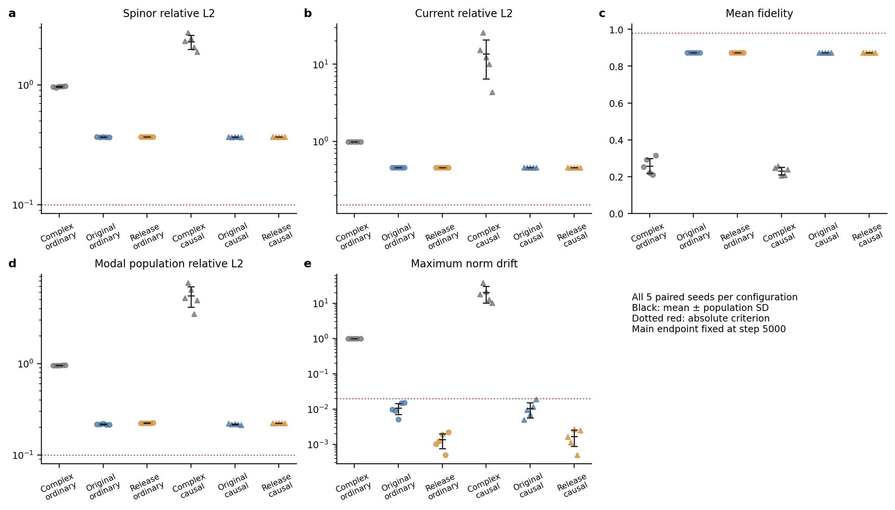

[SVG](results/figures/coupled_ltpb_phase_release_r7/all_seed_primary_metrics.svg) · [PDF](results/figures/coupled_ltpb_phase_release_r7/all_seed_primary_metrics.pdf) · [源数据 all_seed_primary_metrics_runs](results/figures/coupled_ltpb_phase_release_r7/source_data/all_seed_primary_metrics_runs.csv)

图2：全部种子的固定检查点轨迹：不择优选 checkpoint。

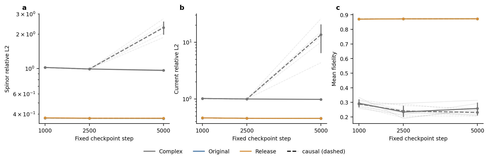

[SVG](results/figures/coupled_ltpb_phase_release_r7/checkpoint_accuracy.svg) · [PDF](results/figures/coupled_ltpb_phase_release_r7/checkpoint_accuracy.pdf) · [源数据 checkpoint_accuracy_checkpoints](results/figures/coupled_ltpb_phase_release_r7/source_data/checkpoint_accuracy_checkpoints.csv)

图3：局部敏感度、导数误差和早期侧带的区别；短时所有种子保留。

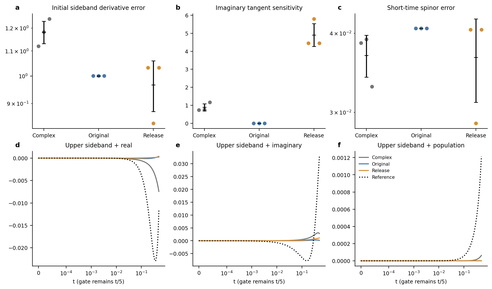

[SVG](results/figures/coupled_ltpb_phase_release_r7/initial_tangent_and_short_dynamics.svg) · [PDF](results/figures/coupled_ltpb_phase_release_r7/initial_tangent_and_short_dynamics.pdf) · [源数据 initial_tangent_and_short_dynamics_metrics](results/figures/coupled_ltpb_phase_release_r7/source_data/initial_tangent_and_short_dynamics_metrics.csv)；[源数据 initial_tangent_and_short_dynamics_early_seed0](results/figures/coupled_ltpb_phase_release_r7/source_data/initial_tangent_and_short_dynamics_early_seed0.csv)

图4：正式五种子的初始切向、所学导数、振幅/相位输出梯度及病态性。

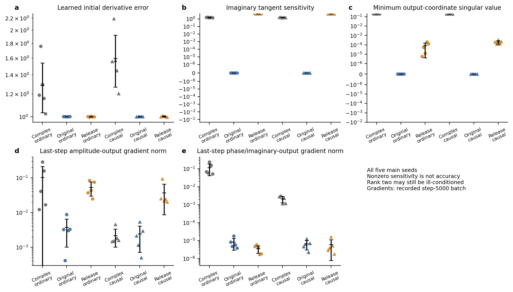

[SVG](results/figures/coupled_ltpb_phase_release_r7/main_initial_tangent.svg) · [PDF](results/figures/coupled_ltpb_phase_release_r7/main_initial_tangent.pdf) · [源数据 main_initial_tangent_metrics_and_gradients](results/figures/coupled_ltpb_phase_release_r7/source_data/main_initial_tangent_metrics_and_gradients.csv)

图5：中心外模态是否真的产生；共用占据尺度，固定 seed0。

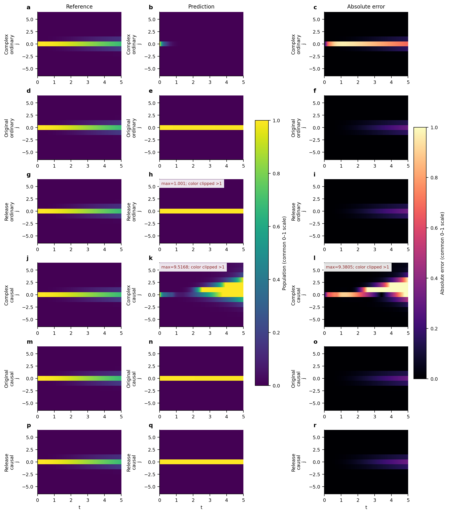

[SVG](results/figures/coupled_ltpb_phase_release_r7/modal_occupation_heatmaps.svg) · [PDF](results/figures/coupled_ltpb_phase_release_r7/modal_occupation_heatmaps.pdf) · [源数据 modal_occupation_heatmaps_grid](results/figures/coupled_ltpb_phase_release_r7/source_data/modal_occupation_heatmaps_grid.csv)

图6：中心和两侧带占据对照；零振幅相位不作普通物理解释。

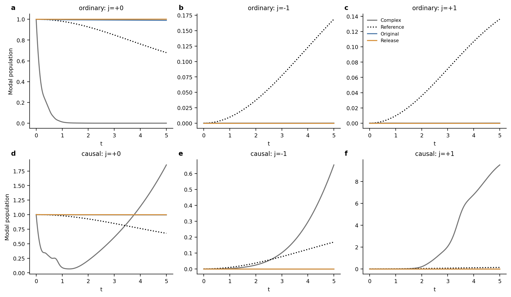

[SVG](results/figures/coupled_ltpb_phase_release_r7/sideband_trajectories.svg) · [PDF](results/figures/coupled_ltpb_phase_release_r7/sideband_trajectories.pdf) · [源数据 sideband_trajectories_trajectories](results/figures/coupled_ltpb_phase_release_r7/source_data/sideband_trajectories_trajectories.csv)

图7：活跃相干误差与预测相位覆盖率，再以物理概率流独立验证。

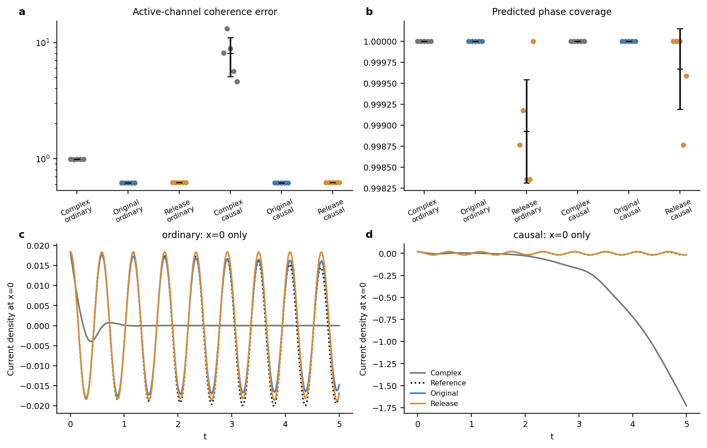

[SVG](results/figures/coupled_ltpb_phase_release_r7/coherence_current.svg) · [PDF](results/figures/coupled_ltpb_phase_release_r7/coherence_current.pdf) · [源数据 coherence_current_metrics](results/figures/coupled_ltpb_phase_release_r7/source_data/coherence_current_metrics.csv)；[源数据 coherence_current_current_seed0](results/figures/coupled_ltpb_phase_release_r7/source_data/coherence_current_current_seed0.csv)

图8：完整空间密度和概率流的参考/预测/误差：单位置时间曲线不代表全场精度。

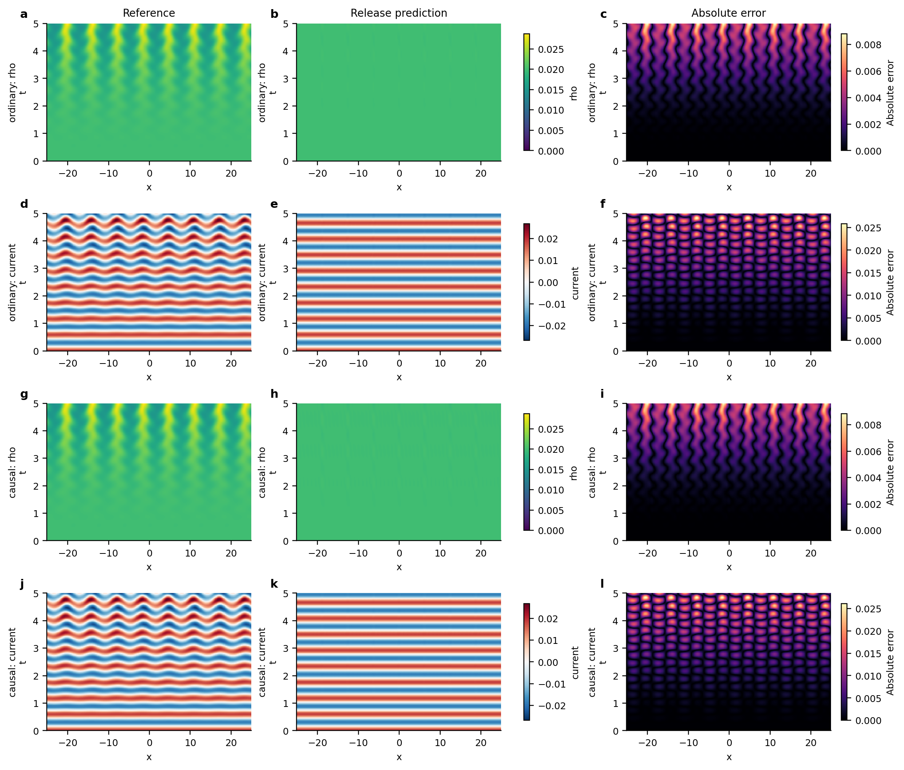

[SVG](results/figures/coupled_ltpb_phase_release_r7/density_current_fields.svg) · [PDF](results/figures/coupled_ltpb_phase_release_r7/density_current_fields.pdf) · 源数据 density_current_fields_physical_grids（本地档案）

图9：因果权重、未加权段残差与 raw 误差积分界，避免小加权 loss 的误导。

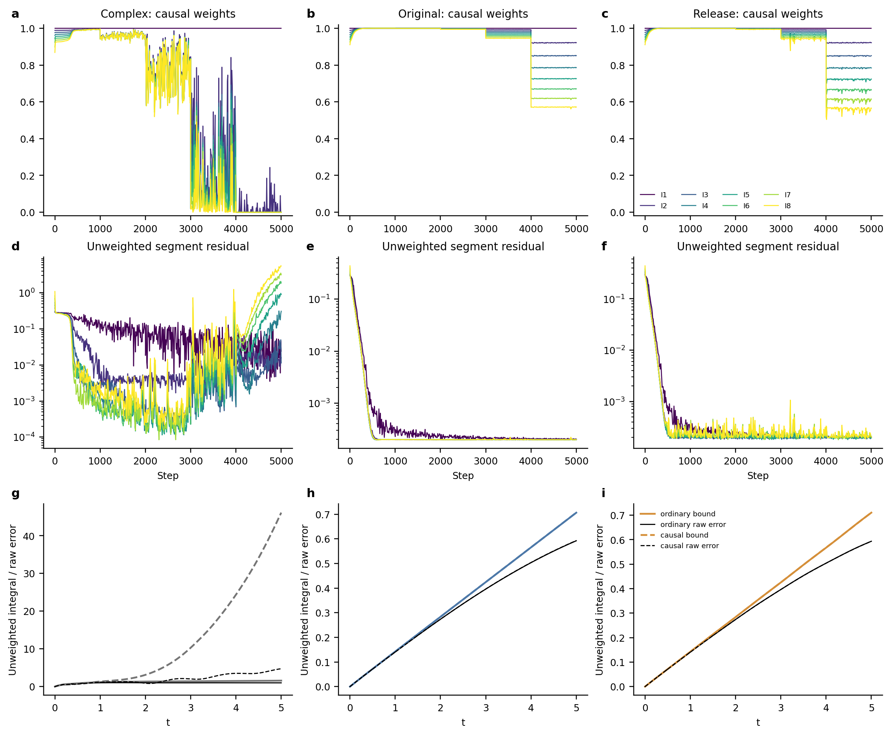

[SVG](results/figures/coupled_ltpb_phase_release_r7/residual_weights.svg) · [PDF](results/figures/coupled_ltpb_phase_release_r7/residual_weights.pdf) · [源数据 residual_weights_causal_history_seed0](results/figures/coupled_ltpb_phase_release_r7/source_data/residual_weights_causal_history_seed0.csv)；源数据 residual_weights_all_seed_history（本地档案）；[源数据 residual_weights_integral_seed0](results/figures/coupled_ltpb_phase_release_r7/source_data/residual_weights_integral_seed0.csv)；[源数据 residual_weights_dense_segment_mode_all_seeds](results/figures/coupled_ltpb_phase_release_r7/source_data/residual_weights_dense_segment_mode_all_seeds.csv)；[源数据 residual_weights_quadrature_metrics](results/figures/coupled_ltpb_phase_release_r7/source_data/residual_weights_quadrature_metrics.csv)

图10：全部种子的精度、实测训练时间、RSS及损失轨迹。

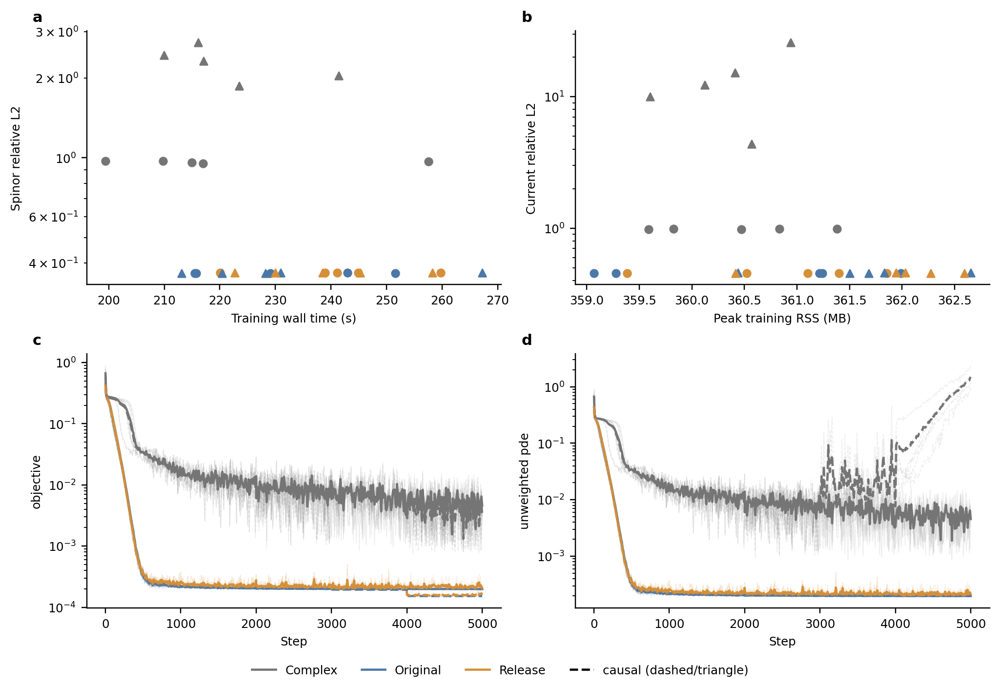

[SVG](results/figures/coupled_ltpb_phase_release_r7/accuracy_cost.svg) · [PDF](results/figures/coupled_ltpb_phase_release_r7/accuracy_cost.pdf) · [源数据 accuracy_cost_runs](results/figures/coupled_ltpb_phase_release_r7/source_data/accuracy_cost_runs.csv)；源数据 accuracy_cost_all_seed_history（本地档案）

图11：表示×训练交互的五个配对原始值；不做显著性推断。

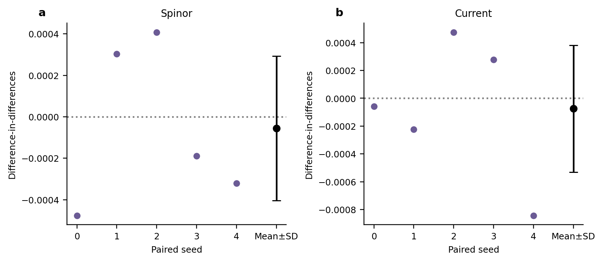

[SVG](results/figures/coupled_ltpb_phase_release_r7/factor_interactions.svg) · [PDF](results/figures/coupled_ltpb_phase_release_r7/factor_interactions.pdf) · [源数据 factor_interactions_interactions](results/figures/coupled_ltpb_phase_release_r7/source_data/factor_interactions_interactions.csv)；[源数据 factor_interactions_paired_effects](results/figures/coupled_ltpb_phase_release_r7/source_data/factor_interactions_paired_effects.csv)

图表 QA：[导出/源数据检查](results/figures/coupled_ltpb_phase_release_r7/FIGURE_QA.md)；[目视审查](results/figures/coupled_ltpb_phase_release_r7/visual_review.md)。

## 12. 六个问题与结论边界

1. **原硬相位缺陷是否解除？** 是，限定在初始空通道的一阶虚部切向：允许非零，r≠0 输出坐标秩2；零幅退化、共享参数条件数及高阶动力学并未因此消失。

2. **是否恢复侧带和相干动力学？** 相位释放 LTPB 在两种训练方式下均未通过完整动力学绝对判据。 必须同时看侧带占据、相干、旋量和流；总范数良好或相位覆盖率高不能替代这些证据。

3. **表示、因果及交互贡献？** 上述配对表分别给出同训练方式表示差、同表示训练差和差中之差；没有把因果工具收益算作相位方法原创或普遍收益。

4. **有绝对成功对照吗？** Complex 和原 LTPB 均未达到本轮绝对判据。 修正版相对优势必须先有自身绝对成功，再看同训练方式均值和≥4/5双赢；对应结果见8.1，不用任意倍数或个别种子替代判据。

5. **较长时间与当前主张？** 未触发 learned T=8 训练；当前只有参考预验证，不能提出长时间求解成功主张。

6. **下一轮方向？** 优先完善耦合动力学的表示/优化与残差尺度诊断，再独立预注册；暂不直接进入稀疏数据约束，否则会混淆纯PDE学习不足与数据补偿效果。

本轮没有训练额外补救结构。若共享 Complex 与修正版共同失败，支持固定预算下共同优化/表示条件性尚未解决，而非单凭零初值就证明 LTPB 表达能力不可能。若修正版失败但同基底 Complex 成功，才构成更强的表示退化对照。

严格区别：**表达能力**是存在参数表示目标；**载波预条件**是将快速相位显式分离；**优化难度**是固定随机初值和预算能否找到目标；**守恒盲点**是小范数漂移不识别侧带/相干错误；**物理先验**是已知有限 Fourier 梯级及自由能支方向，不是已知完整外势动力学。

五种子不是总体显著性证明。仅检验已知初始中心模态、单弱周期势、固定m/L/V₀、有限Hermitian截断；未检验未知谱、通用外势、真实数据、反演、KG或束缚态。不声称首次；最小相位释放的原创性需另行针对性文献核查。

## 13. 实现、测试、审计与完整产物

理论核查与控制变量技能促使本轮分别检验局部切向/全局动力学、统一配对与停止规则；科学作图与PDF检查技能落实源表、全种子、固定seed0、可编辑导出和实际渲染目视QA；学术写作技能按研究问题—证据—边界闭环组织本中文报告。技能未改变用户阈值或训练预算。

完整项目 pytest：169 项，失败/错误 0；记录：final_pytest.xml（本地档案）。

新增测试涵盖：严格硬初值、类型/参数量/配对初始化、原/修正版初始导数、坐标Jacobian秩、参数敏感度、全已占据自由回归、耦合残差、stopgrad/ε日程、参考隔离、独立采样流、恢复Adam及全部RNG、判定完整性。

实际正式优化步骤 159000（9000短时+150000主），另有工程smoke120步；全部39正式run均一次启动完成，没有中断、挑选性重启或失败seed额外预算。冻结后仅修复后处理的UTF-8读取/布尔JSON序列化和图表可读性，详见 后处理修复记录（本地档案）。

历史哈希：3018 个既有文件核对，改动/丢失 0。本目录无Git仓库；没有创建提交、回滚或覆盖旧结果。保护清单：历史保护清单（本地档案）。

自动工程审计：PASS，记录 audit.json（本地档案）。审计包括独立重算指标/mask、Fourier重建、硬初值、数值残差估计、配对权重和时间流、预算/检查点、冻结哈希、历史完整性及报告链接；工程PASS不意味着科学PASS。

入口：[独立运行](src/run_r7_phase_release.py)；[聚合](src/aggregate_r7_phase_release.py)；[作图](src/plot_r7_phase_release.py)；[审计](src/audit_r7_phase_release.py)；[报告生成](src/build_r7_phase_release_report.py)。

统计和判定：[短时逐run](results/summary/coupled_ltpb_phase_release_r7/short_runs.csv) · [短时汇总](results/summary/coupled_ltpb_phase_release_r7/short_summary.csv) · [主逐run](results/summary/coupled_ltpb_phase_release_r7/main_runs.csv) · [主汇总](results/summary/coupled_ltpb_phase_release_r7/main_summary.csv) · [自动科学判定](results/summary/coupled_ltpb_phase_release_r7/decision.json) · 报告/审计代码哈希（本地档案）。

日志/实际命令：日志目录（本地档案）；每run独立 execution_events.jsonl 保留启动/恢复/完成记录，recovery_state.pt 另含优化器、采样及全RNG供精确恢复。

### 13.1 每个运行的原始证据链接

下表六件主产物逐run齐备。每run另含 early_time_series.csv、residual_integral.csv、residual_by_segment_mode.csv；主/长run另含固定检查点目录。

| 运行 | 配置 | 指标 | 损失 | 时间序列 | 密集场 | 权重 | 检查点 |
| --- | --- | --- | --- | --- | --- | --- | --- |
| short/complex/ordinary/s0 | config（本地档案） | metrics（本地档案） | loss（本地档案） | series（本地档案） | dense（本地档案） | model（本地档案） | — |
| short/complex/ordinary/s1 | config（本地档案） | metrics（本地档案） | loss（本地档案） | series（本地档案） | dense（本地档案） | model（本地档案） | — |
| short/complex/ordinary/s2 | config（本地档案） | metrics（本地档案） | loss（本地档案） | series（本地档案） | dense（本地档案） | model（本地档案） | — |
| short/original_ltpb/ordinary/s0 | config（本地档案） | metrics（本地档案） | loss（本地档案） | series（本地档案） | dense（本地档案） | model（本地档案） | — |
| short/original_ltpb/ordinary/s1 | config（本地档案） | metrics（本地档案） | loss（本地档案） | series（本地档案） | dense（本地档案） | model（本地档案） | — |
| short/original_ltpb/ordinary/s2 | config（本地档案） | metrics（本地档案） | loss（本地档案） | series（本地档案） | dense（本地档案） | model（本地档案） | — |
| short/phase_release_ltpb/ordinary/s0 | config（本地档案） | metrics（本地档案） | loss（本地档案） | series（本地档案） | dense（本地档案） | model（本地档案） | — |
| short/phase_release_ltpb/ordinary/s1 | config（本地档案） | metrics（本地档案） | loss（本地档案） | series（本地档案） | dense（本地档案） | model（本地档案） | — |
| short/phase_release_ltpb/ordinary/s2 | config（本地档案） | metrics（本地档案） | loss（本地档案） | series（本地档案） | dense（本地档案） | model（本地档案） | — |
| main/complex/causal/s0 | config（本地档案） | metrics（本地档案） | loss（本地档案） | series（本地档案） | dense（本地档案） | model（本地档案） | 固定检查点（本地档案） |
| main/complex/causal/s1 | config（本地档案） | metrics（本地档案） | loss（本地档案） | series（本地档案） | dense（本地档案） | model（本地档案） | 固定检查点（本地档案） |
| main/complex/causal/s2 | config（本地档案） | metrics（本地档案） | loss（本地档案） | series（本地档案） | dense（本地档案） | model（本地档案） | 固定检查点（本地档案） |
| main/complex/causal/s3 | config（本地档案） | metrics（本地档案） | loss（本地档案） | series（本地档案） | dense（本地档案） | model（本地档案） | 固定检查点（本地档案） |
| main/complex/causal/s4 | config（本地档案） | metrics（本地档案） | loss（本地档案） | series（本地档案） | dense（本地档案） | model（本地档案） | 固定检查点（本地档案） |
| main/complex/ordinary/s0 | config（本地档案） | metrics（本地档案） | loss（本地档案） | series（本地档案） | dense（本地档案） | model（本地档案） | 固定检查点（本地档案） |
| main/complex/ordinary/s1 | config（本地档案） | metrics（本地档案） | loss（本地档案） | series（本地档案） | dense（本地档案） | model（本地档案） | 固定检查点（本地档案） |
| main/complex/ordinary/s2 | config（本地档案） | metrics（本地档案） | loss（本地档案） | series（本地档案） | dense（本地档案） | model（本地档案） | 固定检查点（本地档案） |
| main/complex/ordinary/s3 | config（本地档案） | metrics（本地档案） | loss（本地档案） | series（本地档案） | dense（本地档案） | model（本地档案） | 固定检查点（本地档案） |
| main/complex/ordinary/s4 | config（本地档案） | metrics（本地档案） | loss（本地档案） | series（本地档案） | dense（本地档案） | model（本地档案） | 固定检查点（本地档案） |
| main/original_ltpb/causal/s0 | config（本地档案） | metrics（本地档案） | loss（本地档案） | series（本地档案） | dense（本地档案） | model（本地档案） | 固定检查点（本地档案） |
| main/original_ltpb/causal/s1 | config（本地档案） | metrics（本地档案） | loss（本地档案） | series（本地档案） | dense（本地档案） | model（本地档案） | 固定检查点（本地档案） |
| main/original_ltpb/causal/s2 | config（本地档案） | metrics（本地档案） | loss（本地档案） | series（本地档案） | dense（本地档案） | model（本地档案） | 固定检查点（本地档案） |
| main/original_ltpb/causal/s3 | config（本地档案） | metrics（本地档案） | loss（本地档案） | series（本地档案） | dense（本地档案） | model（本地档案） | 固定检查点（本地档案） |
| main/original_ltpb/causal/s4 | config（本地档案） | metrics（本地档案） | loss（本地档案） | series（本地档案） | dense（本地档案） | model（本地档案） | 固定检查点（本地档案） |
| main/original_ltpb/ordinary/s0 | config（本地档案） | metrics（本地档案） | loss（本地档案） | series（本地档案） | dense（本地档案） | model（本地档案） | 固定检查点（本地档案） |
| main/original_ltpb/ordinary/s1 | config（本地档案） | metrics（本地档案） | loss（本地档案） | series（本地档案） | dense（本地档案） | model（本地档案） | 固定检查点（本地档案） |
| main/original_ltpb/ordinary/s2 | config（本地档案） | metrics（本地档案） | loss（本地档案） | series（本地档案） | dense（本地档案） | model（本地档案） | 固定检查点（本地档案） |
| main/original_ltpb/ordinary/s3 | config（本地档案） | metrics（本地档案） | loss（本地档案） | series（本地档案） | dense（本地档案） | model（本地档案） | 固定检查点（本地档案） |
| main/original_ltpb/ordinary/s4 | config（本地档案） | metrics（本地档案） | loss（本地档案） | series（本地档案） | dense（本地档案） | model（本地档案） | 固定检查点（本地档案） |
| main/phase_release_ltpb/causal/s0 | config（本地档案） | metrics（本地档案） | loss（本地档案） | series（本地档案） | dense（本地档案） | model（本地档案） | 固定检查点（本地档案） |
| main/phase_release_ltpb/causal/s1 | config（本地档案） | metrics（本地档案） | loss（本地档案） | series（本地档案） | dense（本地档案） | model（本地档案） | 固定检查点（本地档案） |
| main/phase_release_ltpb/causal/s2 | config（本地档案） | metrics（本地档案） | loss（本地档案） | series（本地档案） | dense（本地档案） | model（本地档案） | 固定检查点（本地档案） |
| main/phase_release_ltpb/causal/s3 | config（本地档案） | metrics（本地档案） | loss（本地档案） | series（本地档案） | dense（本地档案） | model（本地档案） | 固定检查点（本地档案） |
| main/phase_release_ltpb/causal/s4 | config（本地档案） | metrics（本地档案） | loss（本地档案） | series（本地档案） | dense（本地档案） | model（本地档案） | 固定检查点（本地档案） |
| main/phase_release_ltpb/ordinary/s0 | config（本地档案） | metrics（本地档案） | loss（本地档案） | series（本地档案） | dense（本地档案） | model（本地档案） | 固定检查点（本地档案） |
| main/phase_release_ltpb/ordinary/s1 | config（本地档案） | metrics（本地档案） | loss（本地档案） | series（本地档案） | dense（本地档案） | model（本地档案） | 固定检查点（本地档案） |
| main/phase_release_ltpb/ordinary/s2 | config（本地档案） | metrics（本地档案） | loss（本地档案） | series（本地档案） | dense（本地档案） | model（本地档案） | 固定检查点（本地档案） |
| main/phase_release_ltpb/ordinary/s3 | config（本地档案） | metrics（本地档案） | loss（本地档案） | series（本地档案） | dense（本地档案） | model（本地档案） | 固定检查点（本地档案） |
| main/phase_release_ltpb/ordinary/s4 | config（本地档案） | metrics（本地档案） | loss（本地档案） | series（本地档案） | dense（本地档案） | model（本地档案） | 固定检查点（本地档案） |

### 13.2 可复现入口

在项目根目录执行独立入口的 prepare、smoke、freeze、short、main、聚合、long、聚合；long 依据冻结判定自动触发/跳过。重复调用已完整的run仅验证并返回，不覆盖；未完成run从精确恢复状态继续，不挑选性重启。实际命令已经逐子进程落盘，源版本以冻结清单为准。最后完整pytest、作图、报告、审计并复核报告；报告/图表格式代码与训练冻结代码分开记录哈希。
