# R8：弱周期外势耦合动力学恢复实验报告

实验ID：r8_coupling_recovery。执行始于2026-10-01；具体事件时间以各run的execution_events.jsonl为准。

## 1. 结论先读

A: carrier + complex通过五新种子的完整动力学绝对判据。

自动分类：**COUPLING_RECOVERY_SUCCESS**。工程完整性不替代科学成功；全部探索、验证与条件run保留，没有最佳seed或最佳checkpoint替换固定终点。

本轮论证：在已知有限自由Dirac基底及弱周期动量耦合中，检验学习自由载波、复包络、自由解加修正与时间窗是否恢复真实侧带；结论由冻结预算下全种子旋量、概率流、占据、范数和fidelity共同决定。

## 1.1 关键数值与成功边界

A五个新seed平均spinor/current/fidelity=0.0188781/0.0282747/0.999656。seed100最大范数漂移=0.0259692，超过.02，故不是5/5全成功；仍按冻结的均值及4/5联合规则通过。动力学图固定使用这个未联合通过的seed100，不换最好seed。

通过的是可学习载波＋复包络方案A，不是原始全实振幅LTPB或R7相位释放模型本身恢复了耦合。

## 2. 历史证据与研究问题

R1公共单相位具有一般数学表达能力，但混合支载波预条件优势退化；总范数/能量/连续性无法充分识别相位错误。R2–R5在已知自由能支与Fourier表示下有效，其中共享高斯谱五seed spinor≈0.04104、current≈0.04806，不等于动态空通道也容易学习。

R6原LTPB约0.36670/0.45612；R7空支相位释放普通组仍约0.36783/0.45628。R7证明局部虚部切向可优化，但侧带几乎未生成。两共享谱模型均失败，不能单独归因于极坐标数学不可表示。

[综合报告](docs/comprehensive/report.md)；[R6](docs/experiments/periodic_potential_coupled_ltpb/report.md)；[R7](R7_PHASE_RELEASE_EXPERIMENT_REPORT.md)。旧文件受SHA-256保护。

## 3. 方程、初态、参考与隔离

$$i\partial_t\psi=[-i\sigma_x\partial_x+m\sigma_z+V_0\cos(qx)I_2]\psi,$$

$$R_j=i\partial_t\widehat{\widetilde\psi}_j-H(k_j)\widehat{\widetilde\psi}_j-\frac{V_0}{2}(\widehat{\widetilde\psi}_{j-1}+\widehat{\widetilde\psi}_{j+1}),\quad H(k)=k\sigma_x+m\sigma_z.$$

L=16π,m=5,k0=2,q=1,V0=.2,T=5,J=6；13个动量−4到8。初态仅中心为(u+ + u−)/√2。Fourier展开带1/√L。自由基底并非外势完整Hamiltonian本征态。

参考由块三对角Hermitian矩阵本征演化，独立矩阵指数核验。主J6/J8继承授权条件；所有扩展截断先于训练、按固定J梯级选择，不依PINN精度择优。

| 算例 | 训练J | 比较J | 零填充复轨迹相对差 | 外边缘占据 | 参考范数漂移 |
| --- | --- | --- | --- | --- | --- |
| main | 6 | 8 | 2.18998e-07 | 2.18548e-10 | 1.66533e-15 |
| T8 | 8 | 10 | 3.68289e-09 | 1.29512e-13 | 1.55431e-15 |
| V01 | 6 | 8 | 1.73837e-09 | 5.59193e-14 | 8.88178e-16 |
| V04 | 8 | 10 | 1.41124e-07 | 5.87773e-11 | 1.11022e-15 |

自由回归保持R5的33个k=n/8、k0=2、σk=.5、两支等权高斯谱；更宽矩阵只对同一33初谱零填充，不改变归一化。[完整参考核验](results/summary/r8_coupling_recovery/reference_validation.json)

精确频率和未来参考轨迹不进入learned forward/loss/optimizer/config/checkpoint。自由载波由单位初态原旋量PDE学得，频率只在独立评价计算。H(k)、u±、已知动量、初态与预测交接均为先验，不等于无先验发现色散。

## 4. 模型与理论核查

载波p=exp[i(t/T)qθ(k,t/T)]，同一4×64 tanh网络输出两实相位，p(0)=1、|p|=1。单位模自由演化约束防止预训练零解塌缩，也必须计入方法物理先验。

每个k、每个正/负本征旋量分别作单位非零初态，预训练i∂t(pu)−H(k)(pu)。不改写成含E的对角方程。冻结仅停止权重更新，保留p的时间图。

这些是已知自由算符的辅助单位初态IVP，不是把目标耦合初态的空通道改成非零，也不是未来目标标签；主初态始终仅占据中心。辅助任务对每个自由支提供强物理预训练，需作为额外先验与训练成本明示。数学上，在固定自由本征支中该PDE约束当然包含其色散信息；‘没有E输入’不等于算符本身没有频率信息。

单位模$p=e^{iS}$使自由残差$R_{free}=p[-\dot S\,u-H(k)u]$，故$\|R_{free}\|^2=\|\dot S\,u+H(k)u\|^2$。这在辅助任务中去除了快速指数对残差模长的影响，把自由载波学习转为相位导数约束；不等于MLP参数优化已成为凸问题。实现仍计算原旋量PDE，而非向模型输入解析频率。

$$c_A=p[c_0+\tau(a+ib)],\quad\widehat{\widetilde\psi}_B=\widetilde\psi_{free}^{learned}+V_0t\chi,$$

$$c_A'=p'[c_0+\tau z]+p[z/T+\tau z'],\quad z=a+ib.$$

令$F_j=[u_+(k_j)p_{j,+},u_-(k_j)p_{j,-}]$、$d_j=c_{j,0}+\tau z_j$，则原旋量残差恒等于

$$R_j=iF_j\dot d_j+(i\dot F_j-H_jF_j)d_j-\frac{V_0}{2}(F_{j-1}d_{j-1}+F_{j+1}d_{j+1}).$$

这解释近似自由载波预条件：若自由缺陷小，包络主要承担耦合；缺陷不为零时仍完整计入。实现直接计算原旋量式，不用含精确能量的对角训练方程。单位模载波与正交自由基底形成逐模态幺正坐标变换，不暗中按模态重加权主残差。

完整残差保留载波缺陷；A空支导数z(0)/T、B为V0χ(0)，虚方向可用。B的χ是原始双分量复旋量，主问题V0T=1使V0t=τ，所以本轮不能把该因素解释为新的数值缩放收益。

C窗内已占据复初态用(|c_s|+τwr)exp[i(arg c_s+τwq)]，严格空初态用τwr exp(iq)。D窗内用p(t)/p(s)与c_s+τwz。前窗预测末态投影、detach后作为下一窗初值，不用参考重置、不归一化、不按阈值切换。

连续分片预测的导数可以跳变，连续场不产生delta项。保存交接误差。可用虚切向不等于耦合已学准；相位只在参考活跃区域具有物理定义。

[理论核查](docs/experiments/r8_coupling_recovery/theory_check.md)；[局部梯度验证](results/summary/r8_coupling_recovery/theory_validation.json)；[模型](src/r8_models.py)；[完整残差](src/r8_loss.py)

## 5. 公平协议、成本与冻结

探索六配置×seeds0–2，10000总步；A/B/D=3000自由+7000耦合，C每窗1000、D每窗700。最多两候选独立验证加两个重训控制，新seeds100–104、20000总步；载波6000+14000，C每窗2000、D每窗1400。全部双精度、Adam1e−3，不早停、不调预算、不选择最好检查点。

每步32新排序均匀时间×全部k，载波涉及两个独立单位分支IVP。初始化与时间流独立；四实输出MLP同seed逐元素相同，窗口共享归一随机数而映射不同物理时间。不同载波预算共享耦合公共前缀，不能宣称所有配置全部物理点一致。

单窗12932、载波12802；A/B共25734，十窗C129320、D142122。当前优化参数与全部推理存储参数分列。时间窗收益混合短区间、顺序训练、优化器重置与更大分片容量，不能完全归为同容量训练策略。

训练时间是全部优化步骤的实际墙钟累计，包含预训练、窗口交接和更新，不含检查点落盘与后评价；评价时间另列。run_elapsed_seconds_this_session另存当前进程会话时间，发生恢复时不冒充整个实验总耗时。peak RSS是训练监测区间进程常驻内存峰值，单位MiB。步骤、旋量残差点和复标量分量均计数。

训练残差次数由总步数、虚拟分支数和RNG记录复核；后评价另分完整耦合残差、载波单位残差及仅导数诊断。metrics中继承的evaluation_coupled_spinor_points为旧估算口径，不冒充全部实际残差调用计数；自由回归跳过不适用导数后的实际工作量明确分列。[逐run残差评价工作量](results/summary/r8_coupling_recovery/residual_evaluation_work.csv)

资源执行偏差：原计划三独立核，但冻结的调度公式将各任务seed与slot相加，跨seed批次可能落在同一核。33个非smoke运行位于有核竞争的批次。没有修改冻结代码或选择性重跑；样本、总步数和固定终点更新未变。耗时为真实观察到的运行成本，但不是公平的算法速度比较，不能据此声称加速。偏差明细（本地档案）；[逐run资源上下文](results/summary/r8_coupling_recovery/cost_runtime_context.csv)

冻结manifest SHA-256：1c99b93edad83c890d46dbd1ca708286834e4e07a5a0a5a1146625bd41e8da83。逐文件清单（本地档案）；[预注册](docs/experiments/r8_coupling_recovery/preregistration.md)；[图表契约](docs/experiments/r8_coupling_recovery/figure_contract.md)

## 5.1 冻结后评价兼容修复的明确披露

自由高斯回归A/seed200已完成20000步并保存最终权重，但旧评价器将只适用于中心空侧带的导数误差除以零参考。原R8代码虽计划在free_packet中删除这项诊断，删除时点晚于报错。

新增评价适配器仅对V0=0的预注册free_packet扩展提前跳过该不适用诊断。所有主指标、完整残差、参考、配置、预算、优化器和冻结科学源文件保持原样。其余自由回归统一使用适配器，不能称为冻结后完全没有工程变更。

seed200从已经完成的终点恢复评价，新增优化步为0；原报错日志与首次最终权重保留。独立审计核验恢复前后所有模型张量SHA-256、总步数和训练耗时不变。每个自由回归保存evaluation_adapter_record.json。[修复边界与证据](docs/experiments/r8_coupling_recovery/evaluation_adapter_note.md)；[独立适配器](src/r8_free_packet_evaluation_adapter.py)

## 6. 探索阶段与预定筛选

Q=mean_seed[(spinor/.10 + current/.15 + 第一侧带复系数误差/.10)/3]，从A–D选最低两项。侧带只沿用主常数规范，不独立对齐。Q低不代表成功，不以单个seed或训练loss筛选。

| 候选 | Q | 探索联合合格 | 进入验证 |
| --- | --- | --- | --- |
| A: carrier + complex | 0.224595 | 2/3 | 是 |
| C: release + windows | 5.61151 | 0/3 | 是 |
| D: carrier + windows | 6.66376 | 0/3 | 否 |
| B: free + correction | 7.90964 | 0/3 | 否 |

| 算例 | 配置 | n | spinor_rel_l2_gauge_aligned | current_rel_l2 | fidelity_mean | modal_population_rel_l2 | max_norm_drift | 五项联合合格数 |
| --- | --- | --- | --- | --- | --- | --- | --- | --- |
| main | A: carrier + complex | 3 | 0.0223599 ± 0.00957556 | 0.0303687 ± 0.0105995 | 0.999423 ± 0.000481973 | 0.0063097 ± 0.00251953 | 0.0123743 ± 0.00665513 | 2/3 |
| main | B: free + correction | 3 | 0.747583 ± 0.401237 | 0.937967 ± 0.368315 | 0.67129 ± 0.185685 | 0.223727 ± 5.63199e-05 | 0.00259712 ± 0.000444867 | 0/3 |
| main | C: release + windows | 3 | 0.370502 ± 0.00252823 | 0.46798 ± 0.00707439 | 0.87129 ± 0.00104795 | 0.229675 ± 0.00680473 | 0.0261196 ± 0.0143322 | 0/3 |
| main | Complex | 3 | 0.932718 ± 0.00617982 | 0.967614 ± 0.00251072 | 0.377489 ± 0.00676639 | 0.936675 ± 0.00891345 | 0.999776 ± 0.000205087 | 0/3 |
| main | D: carrier + windows | 3 | 0.542208 ± 0.23835 | 0.739253 ± 0.22545 | 0.738211 ± 0.180819 | 0.263576 ± 0.111193 | 0.0750768 ± 0.0652807 | 0/3 |
| main | Phase release | 3 | 0.367674 ± 0.000348381 | 0.456109 ± 0.000580243 | 0.872389 ± 5.22531e-05 | 0.222646 ± 0.00206237 | 0.00423143 ± 0.000356231 | 0/3 |

| 算例 | 配置 | seed | spinor_rel_l2_gauge_aligned | current_rel_l2 | fidelity_mean | modal_population_rel_l2 | max_norm_drift | sideband_complex_coefficient_rel_l2 | active_coherence_rel_l2 |
| --- | --- | --- | --- | --- | --- | --- | --- | --- | --- |
| main | A: carrier + complex | 0 | 0.0168587 | 0.0243379 | 0.999728 | 0.00524023 | 0.0108974 | 0.0145639 | 0.0263661 |
| main | A: carrier + complex | 1 | 0.0143942 | 0.0214994 | 0.999799 | 0.00390092 | 0.00506287 | 0.0139576 | 0.0218453 |
| main | A: carrier + complex | 2 | 0.0358268 | 0.0452688 | 0.998743 | 0.00978794 | 0.0211626 | 0.0457973 | 0.0637862 |
| main | B: free + correction | 0 | 0.520966 | 0.811786 | 0.755693 | 0.223651 | 0.00202209 | 1.00009 | 0.878386 |
| main | B: free + correction | 1 | 0.41037 | 0.563402 | 0.844439 | 0.223787 | 0.00310569 | 0.999783 | 0.692537 |
| main | B: free + correction | 2 | 1.31141 | 1.43871 | 0.413739 | 0.223741 | 0.0026636 | 1.00012 | 1.37725 |
| main | C: release + windows | 0 | 0.374038 | 0.475491 | 0.869809 | 0.239156 | 0.0370686 | 1.00155 | 0.629078 |
| main | C: release + windows | 1 | 0.369189 | 0.469949 | 0.871977 | 0.226362 | 0.035417 | 0.999236 | 0.623603 |
| main | C: release + windows | 2 | 0.368278 | 0.458501 | 0.872084 | 0.223506 | 0.00587325 | 1.00211 | 0.623286 |
| main | D: carrier + windows | 0 | 0.444069 | 0.722437 | 0.820674 | 0.194216 | 0.0278511 | 0.769019 | 0.754856 |
| main | D: carrier + windows | 1 | 0.312005 | 0.471927 | 0.906606 | 0.176036 | 0.02999 | 0.647824 | 0.530584 |
| main | D: carrier + windows | 2 | 0.870549 | 1.0234 | 0.487353 | 0.420477 | 0.167389 | 1.47542 | 1.15065 |
| main | Complex | 0 | 0.940796 | 0.970811 | 0.386976 | 0.948462 | 0.99949 | 1.00718 | 0.977224 |
| main | Complex | 1 | 0.925791 | 0.964677 | 0.371661 | 0.926912 | 0.999877 | 1.00066 | 0.972388 |
| main | Complex | 2 | 0.931565 | 0.967356 | 0.37383 | 0.93465 | 0.99996 | 1.00152 | 0.973998 |
| main | Phase release | 0 | 0.36741 | 0.455629 | 0.87242 | 0.22098 | 0.00473515 | 0.999921 | 0.621877 |
| main | Phase release | 1 | 0.367445 | 0.455772 | 0.872431 | 0.221405 | 0.00398702 | 0.999865 | 0.621949 |
| main | Phase release | 2 | 0.368166 | 0.456925 | 0.872315 | 0.225552 | 0.00397213 | 1.0004 | 0.6232 |

[冻结公式的筛选记录](results/summary/r8_coupling_recovery/exploration_selection.json)；[全部18次原生指标](results/summary/r8_coupling_recovery/exploration_runs.csv)

## 7. 独立验证与绝对成功判定

五seed均值spinor≤.10,current≤.15,fidelity≥.98,modal-population≤.10,norm-drift≤.02；至少4/5 seeds联合满足五项。相对失败控制更好、单项守恒良好或探索表现好，均不能代替。

| 算例 | 配置 | n | spinor_rel_l2_gauge_aligned | current_rel_l2 | fidelity_mean | modal_population_rel_l2 | max_norm_drift | 五项联合合格数 |
| --- | --- | --- | --- | --- | --- | --- | --- | --- |
| main | A: carrier + complex | 5 | 0.0188781 ± 0.00266788 | 0.0282747 ± 0.00445289 | 0.999656 ± 9.06381e-05 | 0.00861737 ± 0.0047084 | 0.0129478 ± 0.00806992 | 4/5 |
| main | C: release + windows | 5 | 0.366629 ± 0.00162065 | 0.453723 ± 0.00461836 | 0.872539 ± 0.000640547 | 0.216069 ± 0.00914777 | 0.0231059 ± 0.0146856 | 0/5 |
| main | Complex | 5 | 0.875184 ± 0.0205131 | 0.930497 ± 0.0115478 | 0.458392 ± 0.0388334 | 0.901542 ± 0.0158905 | 0.999375 ± 0.000757334 | 0/5 |
| main | Phase release | 5 | 0.367816 ± 0.000156053 | 0.456496 ± 0.000521706 | 0.872409 ± 4.61551e-05 | 0.223998 ± 0.000873833 | 0.00150161 ± 0.00100047 | 0/5 |

| 算例 | 配置 | seed | spinor_rel_l2_gauge_aligned | current_rel_l2 | fidelity_mean | modal_population_rel_l2 | max_norm_drift |
| --- | --- | --- | --- | --- | --- | --- | --- |
| main | A: carrier + complex | 100 | 0.0223391 | 0.0339854 | 0.999562 | 0.0167544 | 0.0259692 |
| main | A: carrier + complex | 101 | 0.0211508 | 0.0317678 | 0.99956 | 0.00889897 | 0.0156152 |
| main | A: carrier + complex | 102 | 0.0191549 | 0.0278458 | 0.999636 | 0.00339 | 0.00533374 |
| main | A: carrier + complex | 103 | 0.0162638 | 0.0266841 | 0.999763 | 0.00948525 | 0.0143127 |
| main | A: carrier + complex | 104 | 0.015482 | 0.0210905 | 0.999762 | 0.00455826 | 0.00350809 |
| main | C: release + windows | 100 | 0.364285 | 0.448484 | 0.872711 | 0.199099 | 0.0495651 |
| main | C: release + windows | 101 | 0.367941 | 0.459619 | 0.872575 | 0.226055 | 0.0112423 |
| main | C: release + windows | 102 | 0.365143 | 0.44941 | 0.873494 | 0.216116 | 0.0142343 |
| main | C: release + windows | 103 | 0.368404 | 0.458645 | 0.871493 | 0.217713 | 0.0118055 |
| main | C: release + windows | 104 | 0.367375 | 0.452456 | 0.872424 | 0.221361 | 0.0286822 |
| main | Complex | 100 | 0.872881 | 0.930126 | 0.421182 | 0.898776 | 0.997866 |
| main | Complex | 101 | 0.856895 | 0.92203 | 0.491336 | 0.886593 | 0.999674 |
| main | Complex | 102 | 0.84949 | 0.914307 | 0.515897 | 0.883194 | 0.999702 |
| main | Complex | 103 | 0.894287 | 0.939874 | 0.444931 | 0.914857 | 0.99977 |
| main | Complex | 104 | 0.902369 | 0.946146 | 0.418615 | 0.92429 | 0.999863 |
| main | Phase release | 100 | 0.367551 | 0.455868 | 0.872476 | 0.222652 | 0.000979985 |
| main | Phase release | 101 | 0.36799 | 0.456469 | 0.872408 | 0.225377 | 0.00346556 |
| main | Phase release | 102 | 0.367933 | 0.456107 | 0.872355 | 0.224242 | 0.00135801 |
| main | Phase release | 103 | 0.367863 | 0.457384 | 0.872363 | 0.223799 | 0.000928219 |
| main | Phase release | 104 | 0.367741 | 0.456654 | 0.872443 | 0.22392 | 0.000776261 |

| 配置 | 绝对成功 | 逐seed联合通过 |
| --- | --- | --- |
| A: carrier + complex | PASS | 4/5 |
| C: release + windows | FAIL | 0/5 |
| Complex | FAIL | 0/5 |
| Phase release | FAIL | 0/5 |

完整辅助精度：

| 算例 | 配置 | seed | spinor_rel_l2_raw | final_spinor_rel_l2_gauge_aligned | density_rel_l2 | fidelity_min | branch_population_rel_l2 | sideband_complex_coefficient_rel_l2 | active_coherence_rel_l2 |
| --- | --- | --- | --- | --- | --- | --- | --- | --- | --- |
| main | A: carrier + complex | 100 | 0.0223629 | 0.0412884 | 0.0241414 | 0.998486 | 0.0184071 | 0.0322428 | 0.0332965 |
| main | A: carrier + complex | 101 | 0.0211525 | 0.0376253 | 0.0241645 | 0.99864 | 0.0096863 | 0.0362395 | 0.0304672 |
| main | A: carrier + complex | 102 | 0.0191558 | 0.0339833 | 0.0175535 | 0.998858 | 0.00764027 | 0.0280679 | 0.0268948 |
| main | A: carrier + complex | 103 | 0.0167173 | 0.0276839 | 0.0199129 | 0.999301 | 0.0113501 | 0.0235892 | 0.0252932 |
| main | A: carrier + complex | 104 | 0.01549 | 0.0264841 | 0.0127865 | 0.999308 | 0.00543464 | 0.0227787 | 0.020829 |
| main | C: release + windows | 100 | 0.364287 | 0.582867 | 0.106661 | 0.682443 | 0.199445 | 0.998286 | 0.616022 |
| main | C: release + windows | 101 | 0.367944 | 0.59404 | 0.103831 | 0.679332 | 0.226616 | 0.998853 | 0.622231 |
| main | C: release + windows | 102 | 0.365143 | 0.588569 | 0.101549 | 0.682323 | 0.216246 | 0.995569 | 0.617919 |
| main | C: release + windows | 103 | 0.368404 | 0.593837 | 0.104268 | 0.678561 | 0.217936 | 1.00227 | 0.622787 |
| main | C: release + windows | 104 | 0.367375 | 0.590187 | 0.102622 | 0.681229 | 0.221669 | 0.99617 | 0.620977 |
| main | Complex | 100 | 0.872889 | 0.973021 | 0.918364 | 0.000171004 | 0.89878 | 1.00814 | 0.943912 |
| main | Complex | 101 | 0.857049 | 0.996372 | 0.91186 | 0.0106563 | 0.886783 | 1.00276 | 0.936662 |
| main | Complex | 102 | 0.849491 | 1.00504 | 0.909225 | 0.00297494 | 0.883371 | 1.00146 | 0.930891 |
| main | Complex | 103 | 0.894291 | 1.02256 | 0.933944 | 4.50631e-05 | 0.914859 | 0.999956 | 0.951291 |
| main | Complex | 104 | 0.90237 | 1.00123 | 0.941247 | 0.0141696 | 0.924292 | 1.00406 | 0.956633 |
| main | Phase release | 100 | 0.367551 | 0.594817 | 0.101542 | 0.677346 | 0.222892 | 0.999103 | 0.621927 |
| main | Phase release | 101 | 0.36799 | 0.593839 | 0.101566 | 0.67895 | 0.22538 | 1.00016 | 0.622936 |
| main | Phase release | 102 | 0.367933 | 0.593355 | 0.101472 | 0.679116 | 0.224261 | 1.00038 | 0.622799 |
| main | Phase release | 103 | 0.367863 | 0.595171 | 0.101512 | 0.677277 | 0.223959 | 0.999244 | 0.622559 |
| main | Phase release | 104 | 0.367742 | 0.594241 | 0.101476 | 0.678165 | 0.223961 | 0.999615 | 0.62248 |

侧带、局部与残差诊断：

| 算例 | 配置 | seed | lower_sideband_occupation_rel_l2 | upper_sideband_occupation_rel_l2 | max_outside_center_occupation | initial_sideband_time_derivative_rel_l2 | initial_sideband_imaginary_tangent_parameter_sensitivity | fine_unweighted_pde_loss | residual_integral_fine |
| --- | --- | --- | --- | --- | --- | --- | --- | --- | --- |
| main | A: carrier + complex | 100 | 0.0081721 | 0.0075805 | 0.320888 | 0.0855757 | 1.86002 | 2.34739e-06 | 0.0760461 |
| main | A: carrier + complex | 101 | 0.0795946 | 0.0267873 | 0.302727 | 0.098373 | 2.07458 | 2.20952e-06 | 0.074022 |
| main | A: carrier + complex | 102 | 0.0156196 | 0.015742 | 0.322312 | 0.100588 | 2.18678 | 2.08114e-06 | 0.0718953 |
| main | A: carrier + complex | 103 | 0.0375425 | 0.0145971 | 0.315462 | 0.0773579 | 2.44265 | 1.91363e-06 | 0.0688491 |
| main | A: carrier + complex | 104 | 0.0133162 | 0.0142077 | 0.316643 | 0.0798162 | 2.69454 | 1.90909e-06 | 0.0687986 |
| main | C: release + windows | 100 | 0.999711 | 0.999782 | 0.00123806 | 0.986229 | 13.4677 | 0.00022999 | 0.75811 |
| main | C: release + windows | 101 | 0.998228 | 0.99842 | 0.00299157 | 1.04945 | 15.1079 | 0.000228755 | 0.756287 |
| main | C: release + windows | 102 | 0.999886 | 0.999842 | 0.000194681 | 0.998916 | 14.5879 | 0.00020254 | 0.713284 |
| main | C: release + windows | 103 | 0.999253 | 0.999249 | 0.00175008 | 0.976407 | 15.5634 | 0.000233582 | 0.765515 |
| main | C: release + windows | 104 | 0.999476 | 0.999576 | 0.00346729 | 1.01082 | 13.249 | 0.000236561 | 0.768866 |
| main | Complex | 100 | 0.995908 | 0.994596 | 0.0104538 | 1.01518 | 0.750262 | 0.00314135 | 2.53407 |
| main | Complex | 101 | 0.999811 | 0.999403 | 0.000395821 | 1.02624 | 0.814989 | 0.00165523 | 1.35357 |
| main | Complex | 102 | 0.999188 | 0.999868 | 0.000387395 | 1.08978 | 1.35823 | 0.0014094 | 1.30262 |
| main | Complex | 103 | 0.999398 | 0.999702 | 0.000729419 | 1.01261 | 1.33569 | 0.00180157 | 1.39882 |
| main | Complex | 104 | 0.999959 | 0.998039 | 0.000925585 | 0.987869 | 0.74847 | 0.00206772 | 1.33296 |
| main | Phase release | 100 | 0.999696 | 0.99965 | 0.000689424 | 0.985355 | 4.43622 | 0.000299042 | 0.85328 |
| main | Phase release | 101 | 0.999978 | 0.999975 | 4.93805e-05 | 1.00215 | 4.43331 | 0.000206195 | 0.719618 |
| main | Phase release | 102 | 0.999963 | 0.999958 | 8.31182e-05 | 1.00493 | 4.43444 | 0.000210992 | 0.727018 |
| main | Phase release | 103 | 0.999802 | 0.999772 | 0.000450417 | 0.988096 | 4.42006 | 0.000265716 | 0.808668 |
| main | Phase release | 104 | 0.999955 | 0.999948 | 0.000103194 | 0.994332 | 4.42704 | 0.000214396 | 0.732396 |

只消去一个全时空常数相位，raw误差另存。参考占据≥10⁻⁶评价相位/相干，预测相位另需≥10⁻¹²。塌缩预测不从相干误差删除；有效mask保存在dense_grid。

## 8. 侧带、配对贡献与成本

参考最大中心外占据0.3209004147。真正生成需联合核对中心向侧带转移、复系数与相干，不把小非零噪声当成成功。

明确标记的忽略外势自由oracle只作训练后诊断，不进入learned排名。它相对耦合参考的spinor/current/fidelity=0.367706/0.456012/0.872438，侧带占据为零，完整耦合残差范数均值=0.141421。diagnostic_uncoupled_free.json（本地档案）

| 配置 | n | 到自由oracle的spinor距离 ± SD | 到耦合参考的spinor误差 ± SD |
| --- | --- | --- | --- |
| A: carrier + complex | 5 | 0.364952 ± 0.0027847 | 0.0188781 ± 0.00266788 |
| C: release + windows | 5 | 0.0244685 ± 0.00738406 | 0.366629 ± 0.00162065 |
| Complex | 5 | 0.87353 ± 0.0211107 | 0.875184 ± 0.0205131 |
| Phase release | 5 | 0.00941014 ± 0.00480743 | 0.367816 ± 0.000156053 |

| 算例 | 配置 | n | sideband_complex_coefficient_rel_l2 | active_coherence_rel_l2 | lower_sideband_occupation_rel_l2 | upper_sideband_occupation_rel_l2 | max_outside_center_occupation | 五项联合合格数 |
| --- | --- | --- | --- | --- | --- | --- | --- | --- |
| main | A: carrier + complex | 5 | 0.0285836 ± 0.00511681 | 0.0273561 ± 0.00429041 | 0.030849 ± 0.026361 | 0.0157829 ± 0.00620105 | 0.315606 ± 0.00692576 | 4/5 |
| main | C: release + windows | 5 | 0.998229 ± 0.00236704 | 0.619987 ± 0.0026021 | 0.999311 ± 0.000582132 | 0.999374 ± 0.000519985 | 0.00192833 ± 0.00118428 | 0/5 |
| main | Complex | 5 | 1.00328 ± 0.00278878 | 0.943878 ± 0.00936354 | 0.998853 ± 0.00149839 | 0.998322 ± 0.00197107 | 0.0025784 ± 0.00394301 | 0/5 |
| main | Phase release | 5 | 0.9997 ± 0.000498644 | 0.62254 ± 0.000347396 | 0.999879 ± 0.000111414 | 0.999861 ± 0.000128209 | 0.000275107 ± 0.000252887 | 0/5 |

| 比较 | n | spinor差 ± SD | current差 ± SD | 侧带复系数差 ± SD | 配对spinor比均值 | 配对current比均值 | 两项联合胜出 |
| --- | --- | --- | --- | --- | --- | --- | --- |
| ablation/A_carrier_complex_minus_A_identity_carrier | 5 | -0.896249 ± 0.010344 | -0.926272 ± 0.00832049 | -0.975135 ± 0.00610504 | 0.0206451 | 0.0296356 | 5/5 |
| validation/A_carrier_complex_minus_complex | 5 | -0.856306 ± 0.0225271 | -0.902222 ± 0.0146294 | -0.974693 ± 0.00481708 | 0.0216335 | 0.0304261 | 5/5 |
| validation/A_carrier_complex_minus_phase_release | 5 | -0.348938 ± 0.00269905 | -0.428222 ± 0.00474631 | -0.971117 ± 0.00499165 | 0.0513255 | 0.0619444 | 5/5 |
| validation/C_release_windows_minus_complex | 5 | -0.508555 ± 0.019847 | -0.476774 ± 0.0116365 | -0.00504788 ± 0.00418013 | 0.419128 | 0.487677 | 5/5 |
| validation/C_release_windows_minus_phase_release | 5 | -0.00118614 ± 0.00153947 | -0.00277357 ± 0.00424371 | -0.00147167 ± 0.00267103 | 0.996774 | 0.993917 | 3/5 |

差为target−baseline，误差负差有利。所有比值/逐seed差见[paired_comparisons.csv](results/summary/r8_coupling_recovery/paired_comparisons.csv)及[comparison_summary.csv](results/summary/r8_coupling_recovery/comparison_summary.csv)。population SD(ddof=0)不是SEM或置信区间，不作小样本普遍显著性声明。

固定Nx=256评价口径未变。另以有限谱双线性量的完整Fourier系数复算空间L2，检查扩展J8时最高双线性频率到达Nyquist的数值影响；这只作积分诊断，不替换预定成功指标。全部非smoke run密度/流误差最大绝对差分别为5.46271e-09/1.25877e-08。[physical_quadrature_check.csv](results/summary/r8_coupling_recovery/physical_quadrature_check.csv)

| 算例 | 配置 | seed | parameter_count | active_trainable_parameter_count | carrier_steps | coupled_steps | residual_training_batches | residual_training_spinor_points | training_seconds | peak_rss_mb | evaluation_seconds |
| --- | --- | --- | --- | --- | --- | --- | --- | --- | --- | --- | --- |
| main | A: carrier + complex | 100 | 25734 | 12932 | 6000 | 14000 | 20000 | 1.0816e+07 | 1318.92 | 355.719 | 4.9864 |
| main | A: carrier + complex | 101 | 25734 | 12932 | 6000 | 14000 | 20000 | 1.0816e+07 | 1293.32 | 356.566 | 5.16416 |
| main | A: carrier + complex | 102 | 25734 | 12932 | 6000 | 14000 | 20000 | 1.0816e+07 | 1974.02 | 355.156 | 4.707 |
| main | A: carrier + complex | 103 | 25734 | 12932 | 6000 | 14000 | 20000 | 1.0816e+07 | 1255.45 | 355.652 | 4.76106 |
| main | A: carrier + complex | 104 | 25734 | 12932 | 6000 | 14000 | 20000 | 1.0816e+07 | 1380.11 | 356.562 | 5.50967 |
| main | C: release + windows | 100 | 129320 | 12932 | 0 | 20000 | 20000 | 8.32e+06 | 841.076 | 355.078 | 2.94759 |
| main | C: release + windows | 101 | 129320 | 12932 | 0 | 20000 | 20000 | 8.32e+06 | 1750.4 | 352.289 | 5.86858 |
| main | C: release + windows | 102 | 129320 | 12932 | 0 | 20000 | 20000 | 8.32e+06 | 903.397 | 352.977 | 3.04044 |
| main | C: release + windows | 103 | 129320 | 12932 | 0 | 20000 | 20000 | 8.32e+06 | 843.383 | 353.297 | 3.03174 |
| main | C: release + windows | 104 | 129320 | 12932 | 0 | 20000 | 20000 | 8.32e+06 | 1678.32 | 352.398 | 5.78773 |
| main | Complex | 100 | 12932 | 12932 | 0 | 20000 | 20000 | 8.32e+06 | 819.984 | 352.625 | 2.64713 |
| main | Complex | 101 | 12932 | 12932 | 0 | 20000 | 20000 | 8.32e+06 | 1457.3 | 349.508 | 4.80847 |
| main | Complex | 102 | 12932 | 12932 | 0 | 20000 | 20000 | 8.32e+06 | 811.624 | 349.672 | 2.61483 |
| main | Complex | 103 | 12932 | 12932 | 0 | 20000 | 20000 | 8.32e+06 | 875.176 | 353.27 | 2.69813 |
| main | Complex | 104 | 12932 | 12932 | 0 | 20000 | 20000 | 8.32e+06 | 720.775 | 355.473 | 2.35703 |
| main | Phase release | 100 | 12932 | 12932 | 0 | 20000 | 20000 | 8.32e+06 | 1749.94 | 349.664 | 4.15272 |
| main | Phase release | 101 | 12932 | 12932 | 0 | 20000 | 20000 | 8.32e+06 | 872.535 | 351.977 | 2.83029 |
| main | Phase release | 102 | 12932 | 12932 | 0 | 20000 | 20000 | 8.32e+06 | 835.658 | 351.848 | 2.62586 |
| main | Phase release | 103 | 12932 | 12932 | 0 | 20000 | 20000 | 8.32e+06 | 1679.07 | 350.602 | 4.52384 |
| main | Phase release | 104 | 12932 | 12932 | 0 | 20000 | 20000 | 8.32e+06 | 912.074 | 349.984 | 2.81911 |

## 9. 载波缺陷与未加权残差积分

载波p仍可能不准；后评价取实际p′相位斜率和原旋量自由PDE残差，不以内部q直接代替物理解。复包络可修正载波缺陷，不能称learned p为精确oracle。

| 算例 | 配置 | n | carrier_free_pde_residual_rms | carrier_phase_slope_mean_relative_error | carrier_phase_slope_max_relative_error | 五项联合合格数 |
| --- | --- | --- | --- | --- | --- | --- |
| main | A: carrier + complex | 5 | 0.00221086 ± 0.000368323 | 0.000397746 ± 7.37635e-05 | 0.00235736 ± 0.00052177 | 4/5 |

载波斜率属于模恒为1的辅助自由IVP，在所有k上有定义；它不是目标耦合初态中空通道的物理相位。目标旋量的物理相位与相干指标只使用总预测场的自由能支投影及保存的参考占据有效mask。

$$\|e(t)\|_2\le\|e(0)\|_2+\int_0^t\|R(s)\|_2ds.$$

raw场和未加权全部模态残差用于Duhamel数值估计，完整物理残差另计边缘外耦合。4001/2001积分差只是数值核验，不是严格连续认证，也不把随机末批loss作为误差证书。

该积分界针对所选有限Hermitian梯级与同一截断参考；外层泄漏单独报告，不能据有限梯级积分界认证无限谱或连续物理系统。

| 算例 | 配置 | seed | raw_final_spinor_error_norm | residual_integral_fine | residual_integral_coarse | residual_integral_quadrature_relative_difference | residual_estimate_max_numerical_violation | exterior_residual_leakage_max_l2_norm |
| --- | --- | --- | --- | --- | --- | --- | --- | --- |
| main | A: carrier + complex | 100 | 0.041351 | 0.0760461 | 0.0760461 | 2.46865e-07 | 0 | 0.00117772 |
| main | A: carrier + complex | 101 | 0.0376119 | 0.074022 | 0.0740221 | 5.55929e-07 | 0 | 0.00118996 |
| main | A: carrier + complex | 102 | 0.033976 | 0.0718953 | 0.0718953 | 4.677e-07 | 0 | 0.00115099 |
| main | A: carrier + complex | 103 | 0.0285774 | 0.0688491 | 0.0688492 | 5.23705e-07 | 0 | 0.00069516 |
| main | A: carrier + complex | 104 | 0.026531 | 0.0687986 | 0.0687986 | 4.05822e-07 | 0 | 0.00108359 |
| main | C: release + windows | 100 | 0.582879 | 0.75811 | 0.758219 | 0.00014318 | 0 | 0.00146891 |
| main | C: release + windows | 101 | 0.594033 | 0.756287 | 0.756354 | 8.94405e-05 | 0 | 0.00188223 |
| main | C: release + windows | 102 | 0.588569 | 0.713284 | 0.71334 | 7.8465e-05 | 0 | 0.000413459 |
| main | C: release + windows | 103 | 0.593837 | 0.765515 | 0.765595 | 0.000103358 | 0 | 0.00201633 |
| main | C: release + windows | 104 | 0.590186 | 0.768866 | 0.768909 | 5.55791e-05 | 0 | 0.00205452 |
| main | Complex | 100 | 0.972929 | 2.53407 | 2.53408 | 3.30242e-06 | 0 | 0.00377887 |
| main | Complex | 101 | 0.996439 | 1.35357 | 1.35358 | 6.2794e-06 | 0 | 0.000731933 |
| main | Complex | 102 | 1.00503 | 1.30262 | 1.30263 | 6.16945e-06 | 0 | 0.000677269 |
| main | Complex | 103 | 1.02258 | 1.39882 | 1.39883 | 5.9055e-06 | 0 | 0.000520706 |
| main | Complex | 104 | 1.00125 | 1.33296 | 1.33297 | 6.44581e-06 | 0 | 0.000374722 |
| main | Phase release | 100 | 0.594817 | 0.85328 | 0.853281 | 1.87683e-08 | 0 | 0.00107192 |
| main | Phase release | 101 | 0.593839 | 0.719618 | 0.719618 | 5.73762e-10 | 0 | 0.000286974 |
| main | Phase release | 102 | 0.593356 | 0.727018 | 0.727018 | 2.43933e-09 | 0 | 0.000372187 |
| main | Phase release | 103 | 0.595171 | 0.808668 | 0.808668 | 1.59706e-08 | 0 | 0.000869126 |
| main | Phase release | 104 | 0.594241 | 0.732396 | 0.732396 | 7.6775e-09 | 0 | 0.000414945 |

逐模态/时段未加权残差、初始导数与输出梯度全部落盘，阶段/窗口切换不删除。

## 9.1 时间窗交接的坐标条件诊断

对非零交接$c_s=\rho e^{i\alpha}$，$\dot c(s)=e^{i\alpha}(r+i\rho q)/\Delta t$。相位输出方向尺度为$\rho/\Delta t$，振幅方向为$1/\Delta t$；Complex两方向则都为$1/\Delta t$。

由预测交接态的原耦合PDE计算所需导数$v$，对应$q_{required}=\Delta t\operatorname{Im}(e^{-i\alpha}v)/\rho$。当预测振幅很小且源方向不与它共线时，局部相位坐标可要求很大数值。

只在参考占据≥10⁻⁶且预测交接严格非零的通道列出该q约束；它是局部输出/导数坐标诊断，不是零振幅处的物理相位误差，不作训练标签。所需v来自预测态与已知H，而非参考未来轨迹。条件数仅涉及两个局部输出方向，不等于完整MLP Jacobian或Hessian条件数。

| 配置 | seed | 有效第一侧带交接数 | 坐标条件比中位数 | 最大所需|q| | 最大实际|q| | 平均交接初导数绝对误差 |
| --- | --- | --- | --- | --- | --- | --- |
| C: release + windows | 100 | 36 | 390.395 | 3671.68 | 2.7128 | 0.0704334 |
| C: release + windows | 101 | 36 | 218.831 | 36.4913 | 2.72123 | 0.0699849 |
| C: release + windows | 102 | 36 | 593.956 | 321.478 | 2.71496 | 0.0699335 |
| C: release + windows | 103 | 36 | 203.251 | 474.765 | 2.75941 | 0.070713 |
| C: release + windows | 104 | 36 | 241.673 | 142.264 | 2.70702 | 0.0712855 |

这些数据支持检查近零振幅的优化条件，但不能单独证明C的失败由极坐标造成；还混有短窗预算、顺序误差和容量差异。相同窗口Complex训练对照仅在C正式成功时触发。[全部通道及有效性标记](results/summary/r8_coupling_recovery/window_coordinate_conditioning.csv)；[逐seed汇总](results/summary/r8_coupling_recovery/window_coordinate_summary.csv)

## 10. 条件最小机制消融

主验证成功后才启动，五配对seed、20000总步。移除p的组仍完整预训练但不在forward使用，保留闲置开销。移除载波也减少有效表示结构，消融不能独自排除所有容量解释。

本轮实际触发的消融：A: carrier removed。其余成功条件未满足的消融没有执行，未训练不能写成失败或通过。

| 算例 | 配置 | n | spinor_rel_l2_gauge_aligned | current_rel_l2 | fidelity_mean | modal_population_rel_l2 | max_norm_drift | 五项联合合格数 |
| --- | --- | --- | --- | --- | --- | --- | --- | --- |
| main | A: carrier removed | 5 | 0.915127 ± 0.00869729 | 0.954546 ± 0.00491926 | 0.338789 ± 0.0479379 | 0.924694 ± 0.00846186 | 0.998222 ± 0.00275116 | 0/5 |

| 算例 | 配置 | seed | spinor_rel_l2_gauge_aligned | current_rel_l2 | fidelity_mean | modal_population_rel_l2 | max_norm_drift | sideband_complex_coefficient_rel_l2 | active_coherence_rel_l2 |
| --- | --- | --- | --- | --- | --- | --- | --- | --- | --- |
| main | A: carrier removed | 100 | 0.911571 | 0.952979 | 0.3735 | 0.923966 | 0.999514 | 0.99761 | 0.961733 |
| main | A: carrier removed | 101 | 0.915549 | 0.955352 | 0.259391 | 0.914859 | 0.992734 | 1.01677 | 0.965559 |
| main | A: carrier removed | 102 | 0.905277 | 0.948066 | 0.374008 | 0.918713 | 0.999828 | 1.00121 | 0.95834 |
| main | A: carrier removed | 103 | 0.912025 | 0.953184 | 0.380239 | 0.926326 | 0.99976 | 0.997571 | 0.962488 |
| main | A: carrier removed | 104 | 0.931213 | 0.963151 | 0.306806 | 0.939604 | 0.999274 | 1.00543 | 0.970744 |

配对效应见第8节。Window Complex只在C成功时才触发；D与A同时改变时间范围和分片容量，不能把差异全部归为优化顺序。失败救援未触发。

## 11. 条件扩展与成功范围

成功候选与Complex用新seeds200–202，每次20000总步，完成T8、V0=.1/.4及自由高斯谱回归。n=3范围诊断用同五项均值/≥2/3联合通过，不代替n=5主验证。固定参考J与失败全部保留。

每个扩展算例从头进行固定预算的自由预训练及耦合训练，是同一方法的重新训练范围验证；不是把主问题checkpoint直接零样本外推到新T或新势强。

| 算例 | 配置 | n | spinor_rel_l2_gauge_aligned | current_rel_l2 | fidelity_mean | modal_population_rel_l2 | max_norm_drift | 五项联合合格数 |
| --- | --- | --- | --- | --- | --- | --- | --- | --- |
| free_packet | A: carrier + complex | 3 | 0.0057037 ± 0.000778355 | 0.00588778 ± 0.000653381 | 0.999967 ± 8.6037e-06 | 0.000709366 ± 0.000363325 | 0.00144202 ± 0.000976671 | 3/3 |
| free_packet | Complex | 3 | 0.902745 ± 0.001682 | 0.886499 ± 0.00128925 | 0.432878 ± 0.0394467 | 0.933307 ± 0.00100363 | 0.999747 ± 8.58529e-05 | 0/3 |
| T8 | A: carrier + complex | 3 | 0.0187443 ± 0.000965692 | 0.0281366 ± 0.000440093 | 0.999676 ± 2.82858e-05 | 0.00783218 ± 0.00170711 | 0.0150459 ± 0.00847875 | 2/3 |
| T8 | Complex | 3 | 0.970921 ± 0.00384687 | 0.99135 ± 0.000863461 | 0.298419 ± 0.0210538 | 0.95999 ± 0.00159541 | 0.999955 ± 2.40179e-05 | 0/3 |
| V01 | A: carrier + complex | 3 | 0.0165095 ± 0.00283788 | 0.0247672 ± 0.00413195 | 0.999731 ± 9.34954e-05 | 0.00524514 ± 0.00248759 | 0.0101741 ± 0.00584735 | 3/3 |
| V01 | Complex | 3 | 0.871441 ± 0.0216044 | 0.924746 ± 0.0113356 | 0.475841 ± 0.051583 | 0.910842 ± 0.0119355 | 0.99976 ± 9.10556e-05 | 0/3 |
| V04 | A: carrier + complex | 3 | 0.0221362 ± 0.0018941 | 0.0346192 ± 0.0029015 | 0.99956 ± 8.17955e-05 | 0.0144826 ± 0.000919363 | 0.0210322 ± 0.0118366 | 2/3 |
| V04 | Complex | 3 | 0.897448 ± 0.0158946 | 0.945172 ± 0.00850374 | 0.366558 ± 0.0608848 | 0.871424 ± 0.0129916 | 0.999073 ± 0.0011456 | 0/3 |

| 算例 | 配置 | seed | spinor_rel_l2_gauge_aligned | current_rel_l2 | fidelity_mean | modal_population_rel_l2 | max_norm_drift | sideband_complex_coefficient_rel_l2 | active_coherence_rel_l2 |
| --- | --- | --- | --- | --- | --- | --- | --- | --- | --- |
| T8 | A: carrier + complex | 200 | 0.0200962 | 0.0285872 | 0.999641 | 0.0100267 | 0.0269106 | 0.0260953 | 0.0311603 |
| T8 | A: carrier + complex | 201 | 0.0182362 | 0.028283 | 0.999677 | 0.00586347 | 0.00761211 | 0.0225955 | 0.0261048 |
| T8 | A: carrier + complex | 202 | 0.0179005 | 0.0275395 | 0.99971 | 0.00760637 | 0.0106149 | 0.0251114 | 0.0252773 |
| T8 | Complex | 200 | 0.971977 | 0.992178 | 0.273272 | 0.961264 | 0.999921 | 0.999905 | 0.994816 |
| T8 | Complex | 201 | 0.975014 | 0.991714 | 0.324799 | 0.960966 | 0.999969 | 1.00002 | 0.994404 |
| T8 | Complex | 202 | 0.965771 | 0.990159 | 0.297187 | 0.95774 | 0.999974 | 0.999901 | 0.993088 |
| V01 | A: carrier + complex | 200 | 0.0182317 | 0.0270925 | 0.999678 | 0.00626946 | 0.0117535 | 0.0365936 | 0.021043 |
| V01 | A: carrier + complex | 201 | 0.0187878 | 0.0282471 | 0.999652 | 0.00181831 | 0.00235469 | 0.0404834 | 0.0222255 |
| V01 | A: carrier + complex | 202 | 0.012509 | 0.0189619 | 0.999862 | 0.00764764 | 0.016414 | 0.0283311 | 0.0152968 |
| V01 | Complex | 200 | 0.860971 | 0.918395 | 0.508722 | 0.905457 | 0.999861 | 1.00122 | 0.924161 |
| V01 | Complex | 201 | 0.901534 | 0.940668 | 0.403007 | 0.927389 | 0.99964 | 1.01214 | 0.945174 |
| V01 | Complex | 202 | 0.851819 | 0.915173 | 0.515796 | 0.899681 | 0.99978 | 0.998328 | 0.921156 |
| V04 | A: carrier + complex | 200 | 0.0220647 | 0.0344152 | 0.99962 | 0.0150792 | 0.0371817 | 0.0207648 | 0.036357 |
| V04 | A: carrier + complex | 201 | 0.0244909 | 0.0382705 | 0.999445 | 0.0151847 | 0.0167718 | 0.0226272 | 0.0355288 |
| V04 | A: carrier + complex | 202 | 0.0198529 | 0.0311721 | 0.999617 | 0.0131838 | 0.00914298 | 0.0125968 | 0.0297906 |
| V04 | Complex | 200 | 0.907333 | 0.951014 | 0.286332 | 0.882909 | 0.997453 | 1.00228 | 0.966275 |
| V04 | Complex | 201 | 0.90999 | 0.951356 | 0.379591 | 0.878101 | 0.999906 | 1.00039 | 0.96638 |
| V04 | Complex | 202 | 0.875022 | 0.933148 | 0.43375 | 0.853262 | 0.99986 | 1.00022 | 0.954558 |
| free_packet | A: carrier + complex | 200 | 0.00655329 | 0.00681087 | 0.999957 | 0.000710457 | 0.00075724 | 0.00558848 | 0.00941494 |
| free_packet | A: carrier + complex | 201 | 0.00588504 | 0.00546212 | 0.999966 | 0.0011538 | 0.00282322 | 0.00646761 | 0.00850855 |
| free_packet | A: carrier + complex | 202 | 0.00467277 | 0.00539035 | 0.999978 | 0.000263841 | 0.000745589 | 0.00384499 | 0.0067297 |
| free_packet | Complex | 200 | 0.904658 | 0.886818 | 0.419315 | 0.934414 | 0.999691 | 0.905404 | 0.936089 |
| free_packet | Complex | 201 | 0.903014 | 0.887894 | 0.486523 | 0.933522 | 0.999869 | 0.901776 | 0.935936 |
| free_packet | Complex | 202 | 0.900564 | 0.884785 | 0.392798 | 0.931984 | 0.999683 | 0.900761 | 0.934181 |

| 算例 | 配置 | 三seed范围判据 | 联合合格数 | 均值条件未通过项 |
| --- | --- | --- | --- | --- |
| T8 | A: carrier + complex | PASS | 2/3 | 无 |
| T8 | Complex | FAIL | 0/3 | spinor_rel_l2_gauge_aligned、current_rel_l2、fidelity_mean、modal_population_rel_l2、max_norm_drift |
| V01 | A: carrier + complex | PASS | 3/3 | 无 |
| V01 | Complex | FAIL | 0/3 | spinor_rel_l2_gauge_aligned、current_rel_l2、fidelity_mean、modal_population_rel_l2、max_norm_drift |
| V04 | A: carrier + complex | FAIL | 2/3 | max_norm_drift |
| V04 | Complex | FAIL | 0/3 | spinor_rel_l2_gauge_aligned、current_rel_l2、fidelity_mean、modal_population_rel_l2、max_norm_drift |
| free_packet | A: carrier + complex | PASS | 3/3 | 无 |
| free_packet | Complex | FAIL | 0/3 | spinor_rel_l2_gauge_aligned、current_rel_l2、fidelity_mean、modal_population_rel_l2、max_norm_drift |

[范围诊断分类](results/summary/r8_coupling_recovery/extension_decision.json)。自由回归仅检验已知33初谱；未重复R5的未训练k中点，不据此宣布连续谱泛化。

## 11.1 自由波包的分裂传播回归

沿用R5的圆周中心、圆周宽度及全时间线性速度定义，直接从总预测场的自由能支投影重建分支密度，不以内部载波相位替代。该附加物理回归诊断不更改预注册成功门槛。低占据塌缩控制的中心/宽度只作失败诊断，不能解释为正常波包。

自由回归V0=0，33个高斯模态在初态中均已非零。通用原始指标名中的sideband指中心相邻k的系数探针，outside_center是原有多模态占据，均不表示自由系统产生了新的耦合侧带；只有主周期外势实验的初始空侧带可支持动态生成的结论。

| 配置 | seed | 最小分支范数 | +支速度/参考 | −支速度/参考 | +支中心RMSE | −支中心RMSE | +支宽度L2 | −支宽度L2 |
| --- | --- | --- | --- | --- | --- | --- | --- | --- |
| A: carrier + complex | 200 | 0.497013 | 0.367388/0.367332 | -0.367393/-0.367332 | 0.000719553 | 0.000821285 | 0.00202727 | 0.00215273 |
| A: carrier + complex | 201 | 0.496831 | 0.368409/0.367332 | -0.367466/-0.367332 | 0.00281004 | 0.000929712 | 0.000737872 | 0.000108049 |
| A: carrier + complex | 202 | 0.499971 | 0.366829/0.367332 | -0.368347/-0.367332 | 0.000869823 | 0.00285702 | 0.00211687 | 0.000408033 |
| Complex | 200 | 0.000116408 | 0.0150507/0.367332 | 0.0669535/-0.367332 | 0.879869 | 1.07485 | 0.867812 | 0.783037 |
| Complex | 201 | 4.53316e-05 | 0.0240727/0.367332 | 0.0253064/-0.367332 | 0.88625 | 0.915563 | 0.971465 | 1.05366 |
| Complex | 202 | 9.18069e-05 | -0.0705845/0.367332 | -0.0296373/-0.367332 | 1.16337 | 0.957608 | 0.89535 | 1.0706 |

[回归附加指标](results/summary/r8_coupling_recovery/free_packet_regression_metrics.csv)；[分支轨迹](results/summary/r8_coupling_recovery/free_packet_regression_series.csv)。

## 12. 归因、局限与术语

A: carrier + complex：五新seed的spinor/current/fidelity均值=0.0188781/0.0282747/0.999656；联合合格4/5；第一侧带复系数误差=0.0285836，最大中心外占据均值=0.315606（reference=0.3209）。通过的是本轮完整模型及训练流程，不等于原R6/R7极坐标模型已自动修复。

C: release + windows：五新seed的spinor/current/fidelity均值=0.366629/0.453723/0.872539；联合合格0/5；第一侧带复系数误差=0.998229，最大中心外占据均值=0.00192833（reference=0.3209）。该配置未达联合绝对条件，局部梯度或个别改善不能改称完整成功。

机制配对：A: carrier + complex相对A: carrier removed的平均spinor/current误差比=0.020629/0.0296211；该消融联合合格0/5。数值贡献以完整配对差与SD判断，不设事后倍数成功门槛。

未进入五seed验证的B: free + correction、D: carrier + windows只完成三seed探索；不能把探索失败提升为其在20,000步预算下一定失败，也不能据此排除所有窗口协同可能。

表达能力：普通Complex并未被证明数学不可表示。局部相位切向可用与全程求解成功分开，有限预算失败不是表示不可能定理。

载波预条件：A把已知自由能支旋转交给非监督单位PDE预训练p，让复包络处理耦合与载波误差。若A优于B且通过消融，支持对侧带也作预条件，而非只分离中心自由部分；须按实际数据判断，不能先验宣称因果。

A与B同时改变修正项的载波预条件及输出基底（分支系数/原始旋量），不是严格单因素消融；其比较只能提示机制。单因素证据优先来自预定的移除载波或相同窗口Complex组。

本轮最小消融检验的是是否使用已学载波。它没有独立训练‘同一载波＋纯实极坐标包络’或把辅助单位IVP迁给普通Complex的对照，因此不能把全部贡献唯一分配给复包络、辅助任务或函数类容量。支持的是本预算下完整载波预条件流程，以及移除载波后的退化，不是一般必要性定理。

训练/容量：窗口同时缩短时间、顺序传递初态、重置Adam并增加存储参数。D与A不是完全同容量消融，不能把时间窗效果全算在相位释放上。

守恒量：范数或密度正确可伴随错误相干与流；本轮五项联合门槛与复侧带避免此误判。零振幅处相位未定义，不报告无物理含义的普通相位误差。

先验：k梯级、自由u±、H(k)、已知初谱、单位模载波与预测交接均是先验；外势完整Hamiltonian的通道仍耦合。

边界：有限已知谱、特定初态、周期电势与预算；不涵盖未知谱发现、一般外势、非周期散射、场量子化或通用Dirac求解器。扩展失败不事后调参。

外势主验证及T8/V0扩展仍采用只占据中心的平面波初态。高斯波包回归的V0严格为0；两类结果合在一起，也不能推出‘外势作用下的连续高斯波包已求解成功’。该交叉推广需要下一轮独立预注册。

本问题已有可靠的直接矩阵演化解。本轮针对PINN的表示和优化机制，不证明神经方法比矩阵指数/本征分解更快或更适合这一小型线性系统。

## 13. 完成后原创性评估

本节在全部预定训练结束后撰写，检索截止日期为 **2026-10-02**。结论是：R8有可复核的耦合恢复和失效机制证据，但不能把“相位—复包络、自由载波预条件、预训练或时间窗”单独宣称为新发明，更不能据本次有限检索宣称首创。

### 已有方法与重合边界

| 已核实的原始来源 | 与本课题重合的部分 | 本次能够确认的差别与限制 |
| --- | --- | --- |
| Lorin、Yang，2022，[Time-dependent Dirac Equation with Physics-Informed Neural Networks](https://arxiv.org/abs/2204.02959)，期刊DOI 10.1016/j.cpc.2022.108474 | 用PINN求含时间的Dirac方程，自动微分构造物理残差 | “Dirac-PINN”本身不是新方法；该记录不建立R8的载波预训练与动态侧带恢复证据 |
| Balac等，2016，[Interaction Picture method](https://www.numdam.org/item/M2AN_2016__50_4_945_0/)，DOI 10.1051/m2an/2015060 | 分离已知线性演化以减轻剩余动力学的数值困难 | 相互作用绘景及相应预条件思想是已有工具。R8用自由PDE学习近似载波，并保留其缺陷项，不等同于写入精确自由传播算子 |
| Liu等，2024，[Preconditioning for Physics-Informed Neural Networks](https://arxiv.org/abs/2402.00531) | 用条件数解释、缓解PINN训练困难 | PINN预条件与条件性分析已有先例；R8的局部输出坐标条件数不是该文的完整网络条件数或其定理 |
| Wang等，[Respecting causality](https://arxiv.org/abs/2203.07404)，2022预印本、2024期刊 DOI 10.1016/j.cma.2024.116813 | 尊重时间因果结构以改善PINN训练 | R8的固定十窗顺序训练不是该文因果加权损失；不能以“按时间训练”作独立首创点 |
| Penwarden等，2023，[Causal sweeping strategies and temporal decompositions](https://arxiv.org/abs/2302.14227)，DOI 10.1016/j.jcp.2023.112464 | 时间推进、分域、上一窗预测作为下一窗初态 | C、D采用这些常见训练思想。本轮C未成功；不把时间窗包装成R8成功的必要机制 |
| Kumar等，2026，[Conservative phase-amplitude PINNs](https://www.sciencedirect.com/science/article/pii/S0377042726002505)，DOI 10.1016/j.cam.2026.117607 | 相位—振幅表示与守恒约束，正是早期课题的出发点 | 本课题已将其作为来源；不能把CPA表示重新命名后宣称原创 |
| [A deep learning WKB-PINNs framework](https://www.sciencedirect.com/science/article/pii/S1007570426010075)，DOI 10.1016/j.cnsns.2026.110653；[WKB-PINNs for highly oscillatory Schrödinger-type equations](https://www.sciencedirect.com/science/article/pii/S0167278926002903)，DOI 10.1016/j.physd.2026.135394 | 学习相位并分离快速振荡与包络；后者的可检索摘要明确含复振幅 | 与“学习相位＋复包络”存在实质方法邻近性，不能称该组合本身全新。可读摘要未给出本轮Dirac耦合、零初始侧带、独立种子验证的同一证据链；受访问限制，未做这两篇全文代码的逐项等价审查 |
| Misumi，2026-07-16，[Lattice fermion formulation via PINNs](https://journals.aps.org/prd/abstract/10.1103/756m-stz5) | Dirac算符相关的物理约束学习 | 问题是格点费米子算符/Ginsparg–Wilson关系，不是本轮的含时侧带动力学 |
| Giotis等，[A unified Python framework for solving Schrödinger and Dirac equations in exotic lepton–antilepton atoms](https://www.sciencedirect.com/science/article/abs/pii/S0010465526003176)，DOI 10.1016/j.cpc.2026.110335 | Dirac相关PINN、结构与优化消融 | 已检索摘要/结论讨论径向束缚态ODE及能量估计，不是本轮的周期耦合含时问题；不借此否定其成果 |

上述2026年CPA及两篇WKB论文的Crossref记录未提供精确published-online日期。CPA卷期为2026年10月，两篇WKB卷期为2026年11月；WKB DOI记录created日期分别为8月4日、9月2日，**created不等于首次公开日期**。这些论文现在可被索引检索，应纳入相关工作，但不能仅以未来卷期排除，也不能把DOI创建时间当成“三个月内发表”或优先权证据。

### 本课题可主张什么

可主张的是一个**限定物理问题上的诊断与恢复证据链**：自由问题的相位载波优势，在动量耦合及零初始占据下遭遇失效；相位释放解决局部梯度缺陷而不恢复完整动力学；由非零单位自由初态进行PDE载波预训练、冻结但保留时间导数，再用复包络学习完整耦合方程，在预注册预算和五个独立新种子中恢复真实侧带。载波移除消融支持“实际使用载波预条件”在该预算中的贡献。

这不是“原纯实振幅LTPB已经被证明普遍正确”，也不是对每个部件独立贡献的完整证明。尚缺少相同总容量的端到端双网络控制、精确载波只作诊断时的进一步定量分解、更一般动量耦合与外势下的跨算例验证，以及与成熟谱积分器的统一误差—总成本比较。R8也没有证明新训练轨迹优于所有已发表方法。

### 检索范围与可复核性

采用学术检索技能的多源工作流：当前会话没有学术MCP连接，改用技能自带OpenAlex检索脚本发现条目，再到arXiv、原始期刊页面/数学文献库和Crossref元数据核实；以技能自带转换器导出10条去重文献的BibTeX。PubMed、Crossref、arXiv公开端点预检均可达，但本课题不依赖PubMed的医学主题覆盖。

历史方法检索不限年份；近期补充检索以2026年为召回范围，并关注2026-07-02至2026-10-02的相关条目。**年份过滤、搜索引擎相对日期和DOI创建日期均不能替代精确发表日期**。已查看的有限条目中，没有核实到与上面整条证据链完全相同的工作；这不是无重复工作的证明。未覆盖Scopus、Web of Science、CNKI的授权全文，也未完成所有术语、语言与未索引预印本的穷尽检索。

过程与访问限制见[检索记录](docs/experiments/r8_coupling_recovery/literature_search_record.json)；可导入文献管理器的[去重BibTeX](docs/experiments/r8_coupling_recovery/references/references.bib)。这些文件只供研究定位，不进入训练配置或检查点。

## 14. 工程核验与产物

全项目旧/新pytest：211项，失败/错误/跳过合计0。测试记录（本地档案）

工程审计：PASS_WITH_TIMING_DEVIATION。历史保护5178文件，变化/缺失0。科学分类单独判断。

非smoke训练67 runs，总优化1160000步（自由预训练159000）；smoke另6×40步。训练旋量残差点672352000，不含后评价/参考。

[all_runs.csv](results/summary/r8_coupling_recovery/all_runs.csv) · [all_summary.csv](results/summary/r8_coupling_recovery/all_summary.csv) · run_artifact_index.csv（本地档案） · [decision.json](results/summary/r8_coupling_recovery/decision.json) · [mechanism_summary.json](results/summary/r8_coupling_recovery/mechanism_summary.json) · data_audit.json（本地档案） · audit.json（本地档案） · protected_history.json（本地档案）

## 15. 图表证据

### 图1：01_exploration

Joint physical accuracy, not loss-only or best-seed evidence. Seed范围：exploration, n=3 paired seeds。

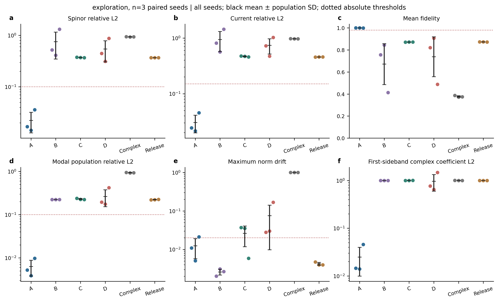

[SVG](results/figures/r8_coupling_recovery/01_exploration.svg) · [PDF](results/figures/r8_coupling_recovery/01_exploration.pdf) · [Source 1](results/figures/r8_coupling_recovery/source_data/01_exploration_runs.csv)

### 图2：02_validation

Joint physical accuracy, not loss-only or best-seed evidence. Seed范围：independent validation, n=5 new paired seeds。

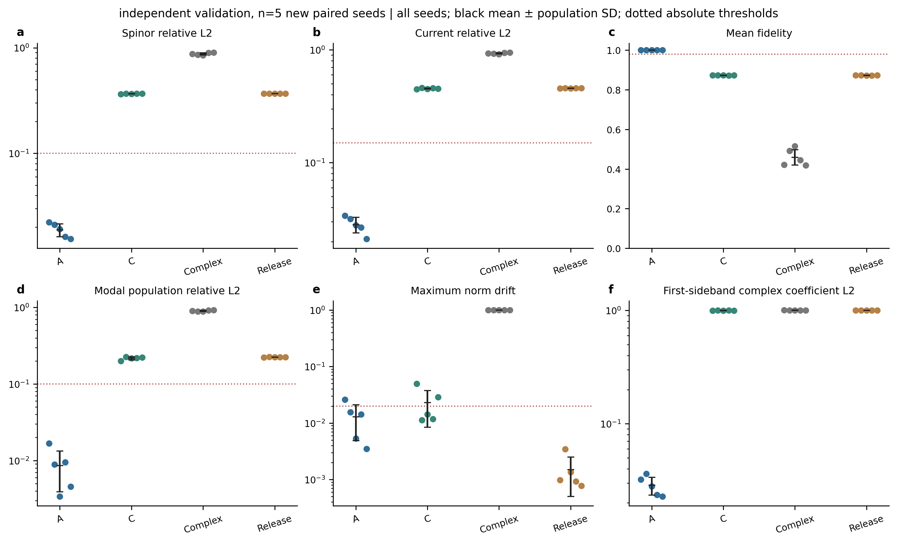

[SVG](results/figures/r8_coupling_recovery/02_validation.svg) · [PDF](results/figures/r8_coupling_recovery/02_validation.pdf) · [Source 1](results/figures/r8_coupling_recovery/source_data/02_validation_runs.csv)

### 图3：03_modal_dynamics

Fixed seed 100 tests actual sideband generation and center depletion on common population scales. Seed范围：independent validation, fixed seed 100。

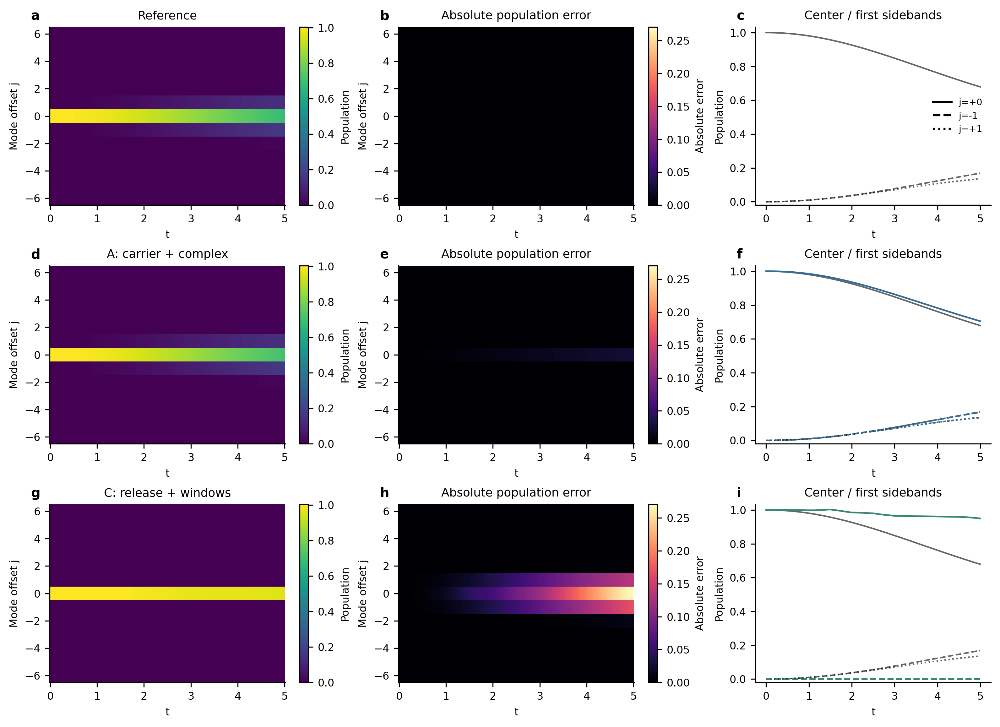

[SVG](results/figures/r8_coupling_recovery/03_modal_dynamics.svg) · [PDF](results/figures/r8_coupling_recovery/03_modal_dynamics.pdf) · [Source 1](results/figures/r8_coupling_recovery/source_data/03_modal_dynamics_modal_grid.csv)

### 图4：04_branch_coherence

Complex sidebands and gauge-invariant coherences; reference-inactive phase samples are not scored. Seed范围：fixed seed 100; all five seeds in source metrics。

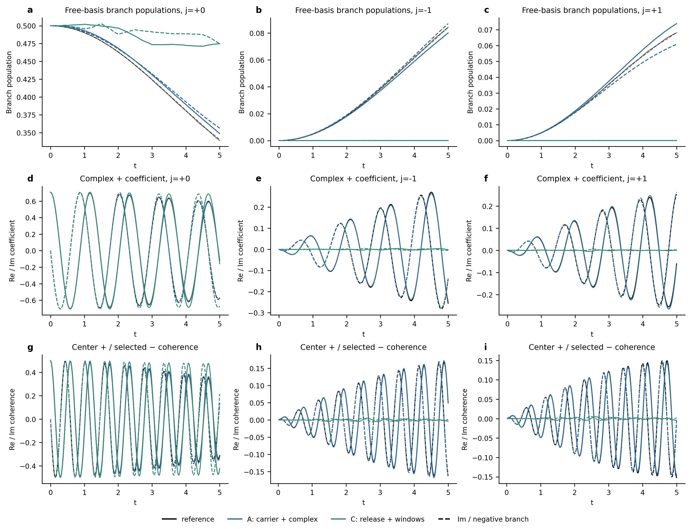

[SVG](results/figures/r8_coupling_recovery/04_branch_coherence.svg) · [PDF](results/figures/r8_coupling_recovery/04_branch_coherence.pdf) · [Source 1](results/figures/r8_coupling_recovery/source_data/04_branch_coherence_complex_and_mask.csv) · [Source 2](results/figures/r8_coupling_recovery/source_data/04_branch_coherence_all_seed_metrics.csv)

### 图5：05_density_current

Reference, predictions and absolute field errors, fixed seed 100 with shared scales. Seed范围：fixed seed 100。

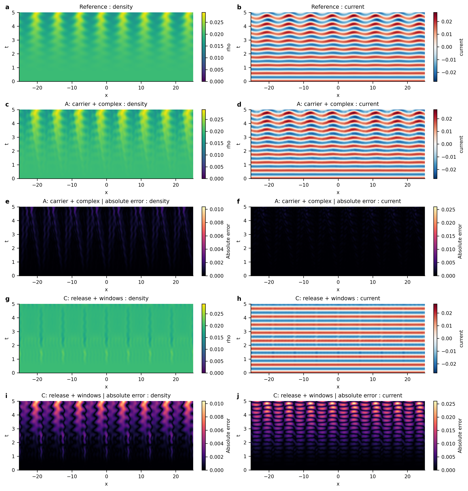

[SVG](results/figures/r8_coupling_recovery/05_density_current.svg) · [PDF](results/figures/r8_coupling_recovery/05_density_current.pdf) · Source 1（本地档案）

### 图6：06_carrier_gradient

Frozen learned carriers retain time derivatives; carrier error is evaluated independently and included in full residuals. Seed范围：all five validation seeds; slope curves fixed seed100。

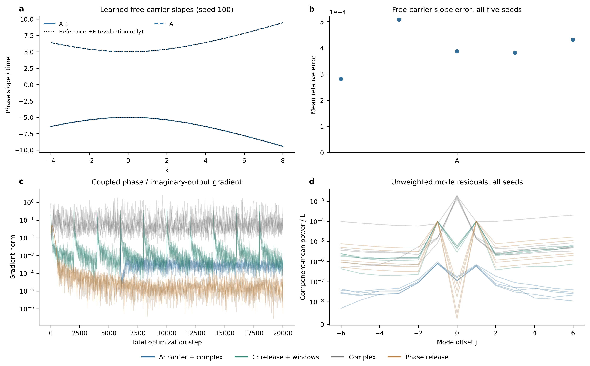

[SVG](results/figures/r8_coupling_recovery/06_carrier_gradient.svg) · [PDF](results/figures/r8_coupling_recovery/06_carrier_gradient.pdf) · [Source 1](results/figures/r8_coupling_recovery/source_data/06_carrier_gradient_all_seed_metrics.csv) · [Source 2](results/figures/r8_coupling_recovery/source_data/06_carrier_gradient_gradients.csv) · [Source 3](results/figures/r8_coupling_recovery/source_data/06_carrier_gradient_mode_residuals.csv) · [Source 4](results/figures/r8_coupling_recovery/source_data/06_carrier_gradient_carrier_slopes.csv)

### 图7：07_residual_bound

Hermitian-system raw error estimate uses unweighted residuals, not a continuous certificate or weighted training loss. Seed范围：all five validation seeds。

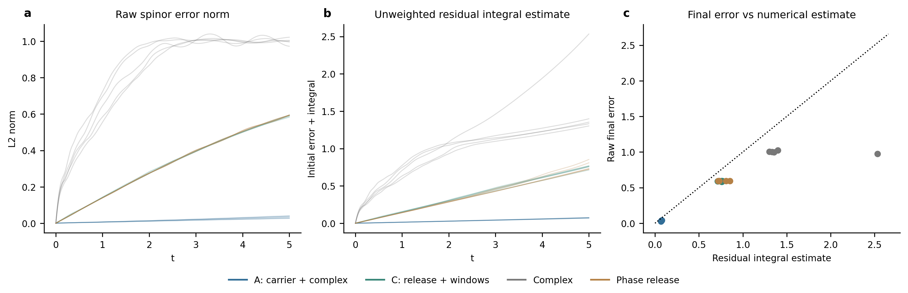

[SVG](results/figures/r8_coupling_recovery/07_residual_bound.svg) · [PDF](results/figures/r8_coupling_recovery/07_residual_bound.pdf) · Source 1（本地档案） · [Source 2](results/figures/r8_coupling_recovery/source_data/07_residual_bound_all_seed_metrics.csv)

### 图8：08_learning_cost

Equal steps do not imply equal cost or capacity. Some mixed-seed cohorts share CPU cores: time is observed wall cost, not evidence of algorithmic speedup. Seed范围：all five validation seeds。

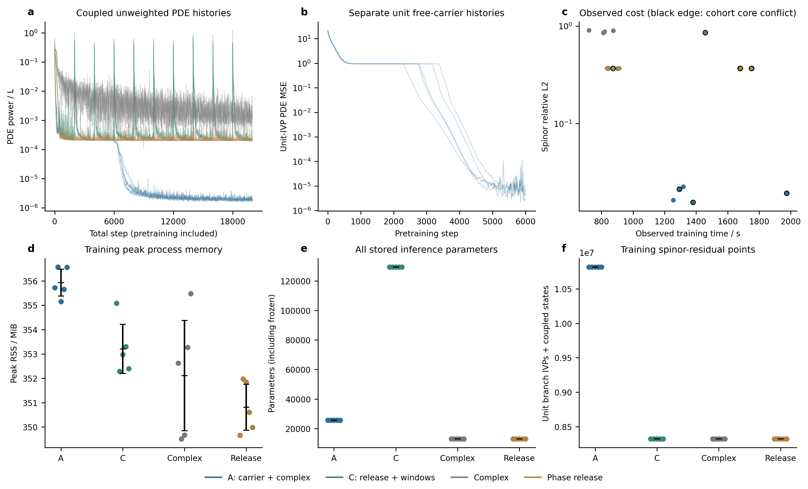

[SVG](results/figures/r8_coupling_recovery/08_learning_cost.svg) · [PDF](results/figures/r8_coupling_recovery/08_learning_cost.pdf) · Source 1（本地档案） · [Source 2](results/figures/r8_coupling_recovery/source_data/08_learning_cost_costs.csv)

### 图9：09_conditional_comparison

Predeclared single-factor comparison; negative differences favor target. Rescue remains exploratory. Seed范围：five paired validation seeds, conditional mechanism ablations。

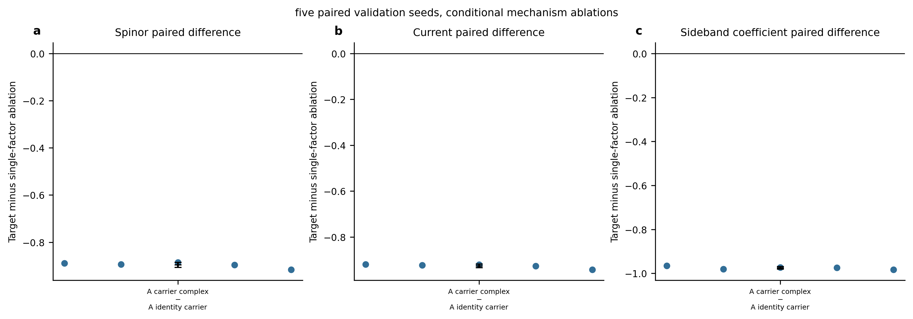

[SVG](results/figures/r8_coupling_recovery/09_conditional_comparison.svg) · [PDF](results/figures/r8_coupling_recovery/09_conditional_comparison.pdf) · [Source 1](results/figures/r8_coupling_recovery/source_data/09_conditional_comparison_paired.csv) · [Source 2](results/figures/r8_coupling_recovery/source_data/09_conditional_comparison_ablation_runs.csv)

### 图10：10_extensions

Independent new-case three-seed scope diagnostics; no general-potential claim. Seed范围：all three extension seeds 200–202 per case。

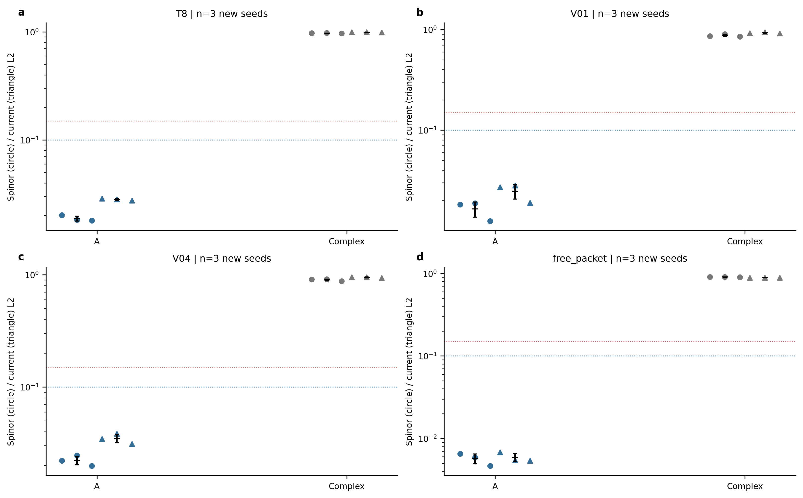

[SVG](results/figures/r8_coupling_recovery/10_extensions.svg) · [PDF](results/figures/r8_coupling_recovery/10_extensions.pdf) · [Source 1](results/figures/r8_coupling_recovery/source_data/10_extensions_all_runs.csv)

### 图11：11_free_packet_regression

R5 circular center/width definitions, reconstructed from projected total fields. Low-norm controls are failed packets, not reliable propagation centers. Seed范围：all three new free-regression seeds 200–202。

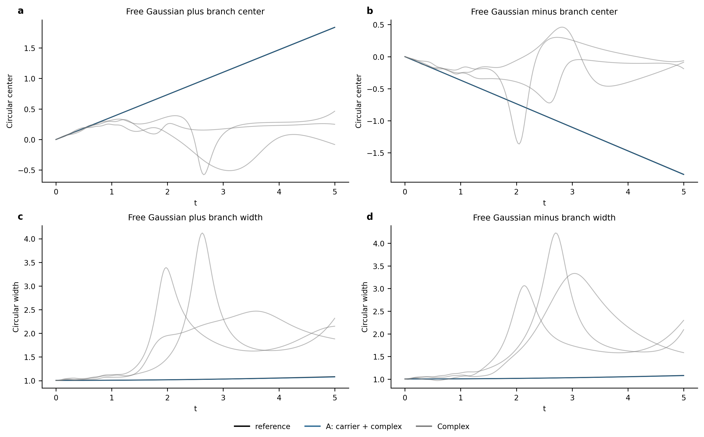

[SVG](results/figures/r8_coupling_recovery/11_free_packet_regression.svg) · [PDF](results/figures/r8_coupling_recovery/11_free_packet_regression.pdf) · [Source 1](results/figures/r8_coupling_recovery/source_data/11_free_packet_regression_series.csv) · [Source 2](results/figures/r8_coupling_recovery/source_data/11_free_packet_regression_metrics.csv)

### 图12：12_window_conditioning

Only reference-active, predicted-nonzero first-sideband handoffs are shown. Small polar amplitudes suppress the phase tangent; local-output conditioning is not the full network Hessian or proof of the failure cause. Seed范围：all five independent validation seeds 100–104。

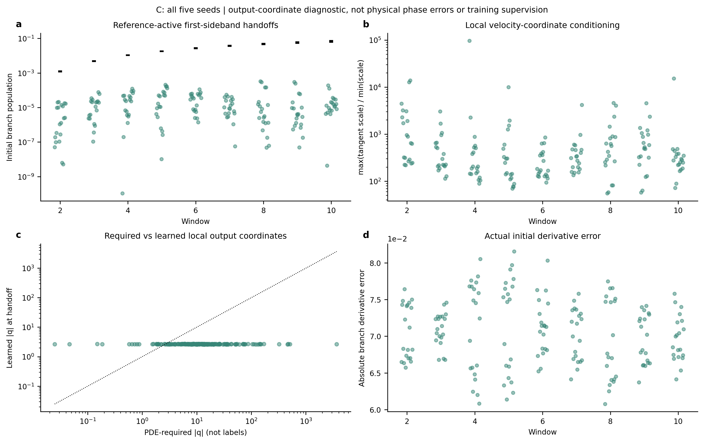

[SVG](results/figures/r8_coupling_recovery/12_window_conditioning.svg) · [PDF](results/figures/r8_coupling_recovery/12_window_conditioning.pdf) · [Source 1](results/figures/r8_coupling_recovery/source_data/12_window_conditioning_all_channels.csv) · [Source 2](results/figures/r8_coupling_recovery/source_data/12_window_conditioning_per_seed_summary.csv)

[最终QA](results/figures/r8_coupling_recovery/FIGURE_QA.md)；[实际目视记录](results/figures/r8_coupling_recovery/visual_review.md)

## 附录A：全部原始运行产物

不删失败、探索与条件run；checkpoint均为固定终点。恢复、预训练载波、交接与额外诊断保存在同run目录。

| stage | case | 配置 | seed | config | metrics | loss | series | dense | checkpoint |
| --- | --- | --- | --- | --- | --- | --- | --- | --- | --- |
| ablation | main | A: carrier removed | 100 | config.json（本地档案） | metrics.json（本地档案） | loss_history.csv（本地档案） | time_series.csv（本地档案） | dense_grid.npz（本地档案） | model_state.pt（本地档案） |
| ablation | main | A: carrier removed | 101 | config.json（本地档案） | metrics.json（本地档案） | loss_history.csv（本地档案） | time_series.csv（本地档案） | dense_grid.npz（本地档案） | model_state.pt（本地档案） |
| ablation | main | A: carrier removed | 102 | config.json（本地档案） | metrics.json（本地档案） | loss_history.csv（本地档案） | time_series.csv（本地档案） | dense_grid.npz（本地档案） | model_state.pt（本地档案） |
| ablation | main | A: carrier removed | 103 | config.json（本地档案） | metrics.json（本地档案） | loss_history.csv（本地档案） | time_series.csv（本地档案） | dense_grid.npz（本地档案） | model_state.pt（本地档案） |
| ablation | main | A: carrier removed | 104 | config.json（本地档案） | metrics.json（本地档案） | loss_history.csv（本地档案） | time_series.csv（本地档案） | dense_grid.npz（本地档案） | model_state.pt（本地档案） |
| exploration | main | A: carrier + complex | 0 | config.json（本地档案） | metrics.json（本地档案） | loss_history.csv（本地档案） | time_series.csv（本地档案） | dense_grid.npz（本地档案） | model_state.pt（本地档案） |
| exploration | main | A: carrier + complex | 1 | config.json（本地档案） | metrics.json（本地档案） | loss_history.csv（本地档案） | time_series.csv（本地档案） | dense_grid.npz（本地档案） | model_state.pt（本地档案） |
| exploration | main | A: carrier + complex | 2 | config.json（本地档案） | metrics.json（本地档案） | loss_history.csv（本地档案） | time_series.csv（本地档案） | dense_grid.npz（本地档案） | model_state.pt（本地档案） |
| exploration | main | B: free + correction | 0 | config.json（本地档案） | metrics.json（本地档案） | loss_history.csv（本地档案） | time_series.csv（本地档案） | dense_grid.npz（本地档案） | model_state.pt（本地档案） |
| exploration | main | B: free + correction | 1 | config.json（本地档案） | metrics.json（本地档案） | loss_history.csv（本地档案） | time_series.csv（本地档案） | dense_grid.npz（本地档案） | model_state.pt（本地档案） |
| exploration | main | B: free + correction | 2 | config.json（本地档案） | metrics.json（本地档案） | loss_history.csv（本地档案） | time_series.csv（本地档案） | dense_grid.npz（本地档案） | model_state.pt（本地档案） |
| exploration | main | C: release + windows | 0 | config.json（本地档案） | metrics.json（本地档案） | loss_history.csv（本地档案） | time_series.csv（本地档案） | dense_grid.npz（本地档案） | model_state.pt（本地档案） |
| exploration | main | C: release + windows | 1 | config.json（本地档案） | metrics.json（本地档案） | loss_history.csv（本地档案） | time_series.csv（本地档案） | dense_grid.npz（本地档案） | model_state.pt（本地档案） |
| exploration | main | C: release + windows | 2 | config.json（本地档案） | metrics.json（本地档案） | loss_history.csv（本地档案） | time_series.csv（本地档案） | dense_grid.npz（本地档案） | model_state.pt（本地档案） |
| exploration | main | D: carrier + windows | 0 | config.json（本地档案） | metrics.json（本地档案） | loss_history.csv（本地档案） | time_series.csv（本地档案） | dense_grid.npz（本地档案） | model_state.pt（本地档案） |
| exploration | main | D: carrier + windows | 1 | config.json（本地档案） | metrics.json（本地档案） | loss_history.csv（本地档案） | time_series.csv（本地档案） | dense_grid.npz（本地档案） | model_state.pt（本地档案） |
| exploration | main | D: carrier + windows | 2 | config.json（本地档案） | metrics.json（本地档案） | loss_history.csv（本地档案） | time_series.csv（本地档案） | dense_grid.npz（本地档案） | model_state.pt（本地档案） |
| exploration | main | Complex | 0 | config.json（本地档案） | metrics.json（本地档案） | loss_history.csv（本地档案） | time_series.csv（本地档案） | dense_grid.npz（本地档案） | model_state.pt（本地档案） |
| exploration | main | Complex | 1 | config.json（本地档案） | metrics.json（本地档案） | loss_history.csv（本地档案） | time_series.csv（本地档案） | dense_grid.npz（本地档案） | model_state.pt（本地档案） |
| exploration | main | Complex | 2 | config.json（本地档案） | metrics.json（本地档案） | loss_history.csv（本地档案） | time_series.csv（本地档案） | dense_grid.npz（本地档案） | model_state.pt（本地档案） |
| exploration | main | Phase release | 0 | config.json（本地档案） | metrics.json（本地档案） | loss_history.csv（本地档案） | time_series.csv（本地档案） | dense_grid.npz（本地档案） | model_state.pt（本地档案） |
| exploration | main | Phase release | 1 | config.json（本地档案） | metrics.json（本地档案） | loss_history.csv（本地档案） | time_series.csv（本地档案） | dense_grid.npz（本地档案） | model_state.pt（本地档案） |
| exploration | main | Phase release | 2 | config.json（本地档案） | metrics.json（本地档案） | loss_history.csv（本地档案） | time_series.csv（本地档案） | dense_grid.npz（本地档案） | model_state.pt（本地档案） |
| extension | T8 | A: carrier + complex | 200 | config.json（本地档案） | metrics.json（本地档案） | loss_history.csv（本地档案） | time_series.csv（本地档案） | dense_grid.npz（本地档案） | model_state.pt（本地档案） |
| extension | T8 | A: carrier + complex | 201 | config.json（本地档案） | metrics.json（本地档案） | loss_history.csv（本地档案） | time_series.csv（本地档案） | dense_grid.npz（本地档案） | model_state.pt（本地档案） |
| extension | T8 | A: carrier + complex | 202 | config.json（本地档案） | metrics.json（本地档案） | loss_history.csv（本地档案） | time_series.csv（本地档案） | dense_grid.npz（本地档案） | model_state.pt（本地档案） |
| extension | T8 | Complex | 200 | config.json（本地档案） | metrics.json（本地档案） | loss_history.csv（本地档案） | time_series.csv（本地档案） | dense_grid.npz（本地档案） | model_state.pt（本地档案） |
| extension | T8 | Complex | 201 | config.json（本地档案） | metrics.json（本地档案） | loss_history.csv（本地档案） | time_series.csv（本地档案） | dense_grid.npz（本地档案） | model_state.pt（本地档案） |
| extension | T8 | Complex | 202 | config.json（本地档案） | metrics.json（本地档案） | loss_history.csv（本地档案） | time_series.csv（本地档案） | dense_grid.npz（本地档案） | model_state.pt（本地档案） |
| extension | V01 | A: carrier + complex | 200 | config.json（本地档案） | metrics.json（本地档案） | loss_history.csv（本地档案） | time_series.csv（本地档案） | dense_grid.npz（本地档案） | model_state.pt（本地档案） |
| extension | V01 | A: carrier + complex | 201 | config.json（本地档案） | metrics.json（本地档案） | loss_history.csv（本地档案） | time_series.csv（本地档案） | dense_grid.npz（本地档案） | model_state.pt（本地档案） |
| extension | V01 | A: carrier + complex | 202 | config.json（本地档案） | metrics.json（本地档案） | loss_history.csv（本地档案） | time_series.csv（本地档案） | dense_grid.npz（本地档案） | model_state.pt（本地档案） |
| extension | V01 | Complex | 200 | config.json（本地档案） | metrics.json（本地档案） | loss_history.csv（本地档案） | time_series.csv（本地档案） | dense_grid.npz（本地档案） | model_state.pt（本地档案） |
| extension | V01 | Complex | 201 | config.json（本地档案） | metrics.json（本地档案） | loss_history.csv（本地档案） | time_series.csv（本地档案） | dense_grid.npz（本地档案） | model_state.pt（本地档案） |
| extension | V01 | Complex | 202 | config.json（本地档案） | metrics.json（本地档案） | loss_history.csv（本地档案） | time_series.csv（本地档案） | dense_grid.npz（本地档案） | model_state.pt（本地档案） |
| extension | V04 | A: carrier + complex | 200 | config.json（本地档案） | metrics.json（本地档案） | loss_history.csv（本地档案） | time_series.csv（本地档案） | dense_grid.npz（本地档案） | model_state.pt（本地档案） |
| extension | V04 | A: carrier + complex | 201 | config.json（本地档案） | metrics.json（本地档案） | loss_history.csv（本地档案） | time_series.csv（本地档案） | dense_grid.npz（本地档案） | model_state.pt（本地档案） |
| extension | V04 | A: carrier + complex | 202 | config.json（本地档案） | metrics.json（本地档案） | loss_history.csv（本地档案） | time_series.csv（本地档案） | dense_grid.npz（本地档案） | model_state.pt（本地档案） |
| extension | V04 | Complex | 200 | config.json（本地档案） | metrics.json（本地档案） | loss_history.csv（本地档案） | time_series.csv（本地档案） | dense_grid.npz（本地档案） | model_state.pt（本地档案） |
| extension | V04 | Complex | 201 | config.json（本地档案） | metrics.json（本地档案） | loss_history.csv（本地档案） | time_series.csv（本地档案） | dense_grid.npz（本地档案） | model_state.pt（本地档案） |
| extension | V04 | Complex | 202 | config.json（本地档案） | metrics.json（本地档案） | loss_history.csv（本地档案） | time_series.csv（本地档案） | dense_grid.npz（本地档案） | model_state.pt（本地档案） |
| extension | free_packet | A: carrier + complex | 200 | config.json（本地档案） | metrics.json（本地档案） | loss_history.csv（本地档案） | time_series.csv（本地档案） | dense_grid.npz（本地档案） | model_state.pt（本地档案） |
| extension | free_packet | A: carrier + complex | 201 | config.json（本地档案） | metrics.json（本地档案） | loss_history.csv（本地档案） | time_series.csv（本地档案） | dense_grid.npz（本地档案） | model_state.pt（本地档案） |
| extension | free_packet | A: carrier + complex | 202 | config.json（本地档案） | metrics.json（本地档案） | loss_history.csv（本地档案） | time_series.csv（本地档案） | dense_grid.npz（本地档案） | model_state.pt（本地档案） |
| extension | free_packet | Complex | 200 | config.json（本地档案） | metrics.json（本地档案） | loss_history.csv（本地档案） | time_series.csv（本地档案） | dense_grid.npz（本地档案） | model_state.pt（本地档案） |
| extension | free_packet | Complex | 201 | config.json（本地档案） | metrics.json（本地档案） | loss_history.csv（本地档案） | time_series.csv（本地档案） | dense_grid.npz（本地档案） | model_state.pt（本地档案） |
| extension | free_packet | Complex | 202 | config.json（本地档案） | metrics.json（本地档案） | loss_history.csv（本地档案） | time_series.csv（本地档案） | dense_grid.npz（本地档案） | model_state.pt（本地档案） |
| smoke | main | A: carrier + complex | 0 | config.json（本地档案） | metrics.json（本地档案） | loss_history.csv（本地档案） | time_series.csv（本地档案） | dense_grid.npz（本地档案） | model_state.pt（本地档案） |
| smoke | main | B: free + correction | 0 | config.json（本地档案） | metrics.json（本地档案） | loss_history.csv（本地档案） | time_series.csv（本地档案） | dense_grid.npz（本地档案） | model_state.pt（本地档案） |
| smoke | main | C: release + windows | 0 | config.json（本地档案） | metrics.json（本地档案） | loss_history.csv（本地档案） | time_series.csv（本地档案） | dense_grid.npz（本地档案） | model_state.pt（本地档案） |
| smoke | main | D: carrier + windows | 0 | config.json（本地档案） | metrics.json（本地档案） | loss_history.csv（本地档案） | time_series.csv（本地档案） | dense_grid.npz（本地档案） | model_state.pt（本地档案） |
| smoke | main | Complex | 0 | config.json（本地档案） | metrics.json（本地档案） | loss_history.csv（本地档案） | time_series.csv（本地档案） | dense_grid.npz（本地档案） | model_state.pt（本地档案） |
| smoke | main | Phase release | 0 | config.json（本地档案） | metrics.json（本地档案） | loss_history.csv（本地档案） | time_series.csv（本地档案） | dense_grid.npz（本地档案） | model_state.pt（本地档案） |
| validation | main | A: carrier + complex | 100 | config.json（本地档案） | metrics.json（本地档案） | loss_history.csv（本地档案） | time_series.csv（本地档案） | dense_grid.npz（本地档案） | model_state.pt（本地档案） |
| validation | main | A: carrier + complex | 101 | config.json（本地档案） | metrics.json（本地档案） | loss_history.csv（本地档案） | time_series.csv（本地档案） | dense_grid.npz（本地档案） | model_state.pt（本地档案） |
| validation | main | A: carrier + complex | 102 | config.json（本地档案） | metrics.json（本地档案） | loss_history.csv（本地档案） | time_series.csv（本地档案） | dense_grid.npz（本地档案） | model_state.pt（本地档案） |
| validation | main | A: carrier + complex | 103 | config.json（本地档案） | metrics.json（本地档案） | loss_history.csv（本地档案） | time_series.csv（本地档案） | dense_grid.npz（本地档案） | model_state.pt（本地档案） |
| validation | main | A: carrier + complex | 104 | config.json（本地档案） | metrics.json（本地档案） | loss_history.csv（本地档案） | time_series.csv（本地档案） | dense_grid.npz（本地档案） | model_state.pt（本地档案） |
| validation | main | C: release + windows | 100 | config.json（本地档案） | metrics.json（本地档案） | loss_history.csv（本地档案） | time_series.csv（本地档案） | dense_grid.npz（本地档案） | model_state.pt（本地档案） |
| validation | main | C: release + windows | 101 | config.json（本地档案） | metrics.json（本地档案） | loss_history.csv（本地档案） | time_series.csv（本地档案） | dense_grid.npz（本地档案） | model_state.pt（本地档案） |
| validation | main | C: release + windows | 102 | config.json（本地档案） | metrics.json（本地档案） | loss_history.csv（本地档案） | time_series.csv（本地档案） | dense_grid.npz（本地档案） | model_state.pt（本地档案） |
| validation | main | C: release + windows | 103 | config.json（本地档案） | metrics.json（本地档案） | loss_history.csv（本地档案） | time_series.csv（本地档案） | dense_grid.npz（本地档案） | model_state.pt（本地档案） |
| validation | main | C: release + windows | 104 | config.json（本地档案） | metrics.json（本地档案） | loss_history.csv（本地档案） | time_series.csv（本地档案） | dense_grid.npz（本地档案） | model_state.pt（本地档案） |
| validation | main | Complex | 100 | config.json（本地档案） | metrics.json（本地档案） | loss_history.csv（本地档案） | time_series.csv（本地档案） | dense_grid.npz（本地档案） | model_state.pt（本地档案） |
| validation | main | Complex | 101 | config.json（本地档案） | metrics.json（本地档案） | loss_history.csv（本地档案） | time_series.csv（本地档案） | dense_grid.npz（本地档案） | model_state.pt（本地档案） |
| validation | main | Complex | 102 | config.json（本地档案） | metrics.json（本地档案） | loss_history.csv（本地档案） | time_series.csv（本地档案） | dense_grid.npz（本地档案） | model_state.pt（本地档案） |
| validation | main | Complex | 103 | config.json（本地档案） | metrics.json（本地档案） | loss_history.csv（本地档案） | time_series.csv（本地档案） | dense_grid.npz（本地档案） | model_state.pt（本地档案） |
| validation | main | Complex | 104 | config.json（本地档案） | metrics.json（本地档案） | loss_history.csv（本地档案） | time_series.csv（本地档案） | dense_grid.npz（本地档案） | model_state.pt（本地档案） |
| validation | main | Phase release | 100 | config.json（本地档案） | metrics.json（本地档案） | loss_history.csv（本地档案） | time_series.csv（本地档案） | dense_grid.npz（本地档案） | model_state.pt（本地档案） |
| validation | main | Phase release | 101 | config.json（本地档案） | metrics.json（本地档案） | loss_history.csv（本地档案） | time_series.csv（本地档案） | dense_grid.npz（本地档案） | model_state.pt（本地档案） |
| validation | main | Phase release | 102 | config.json（本地档案） | metrics.json（本地档案） | loss_history.csv（本地档案） | time_series.csv（本地档案） | dense_grid.npz（本地档案） | model_state.pt（本地档案） |
| validation | main | Phase release | 103 | config.json（本地档案） | metrics.json（本地档案） | loss_history.csv（本地档案） | time_series.csv（本地档案） | dense_grid.npz（本地档案） | model_state.pt（本地档案） |
| validation | main | Phase release | 104 | config.json（本地档案） | metrics.json（本地档案） | loss_history.csv（本地档案） | time_series.csv（本地档案） | dense_grid.npz（本地档案） | model_state.pt（本地档案） |

## 附录B：下一轮原则

优先按独立验证与消融决策，不按最好图片。成功者先解决失败边界、载波成本和容量混杂；全部失败时依据梯度与未加权模态残差开展新的单因素验证。不把局部修复或小样本救援提高为完整动力学成功。
