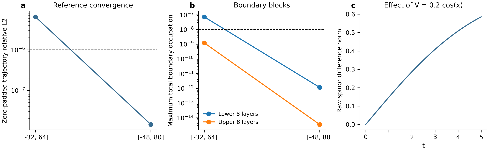
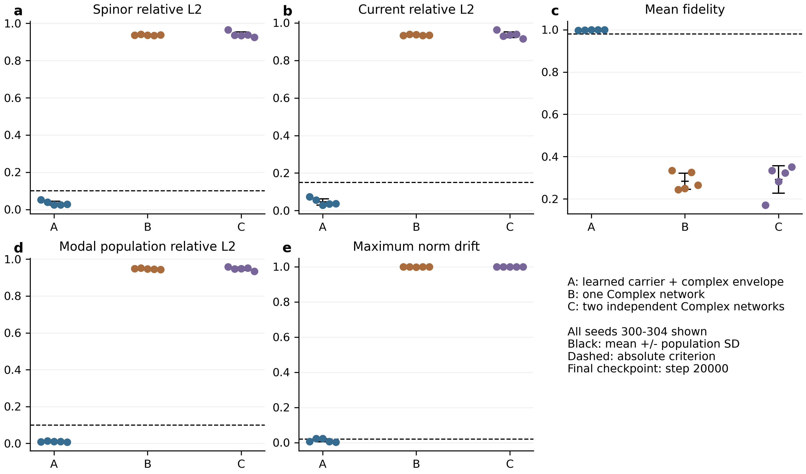
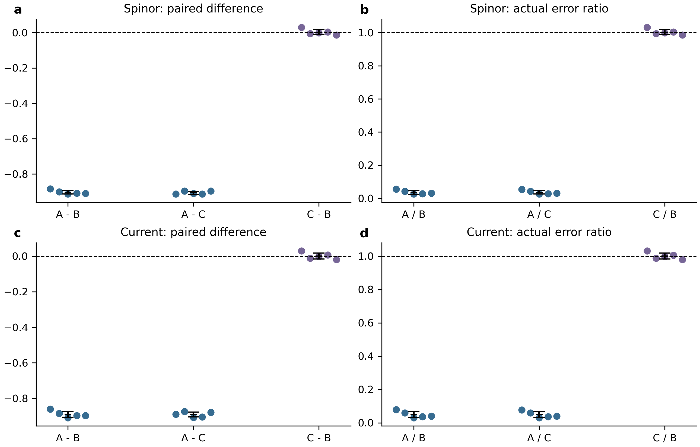
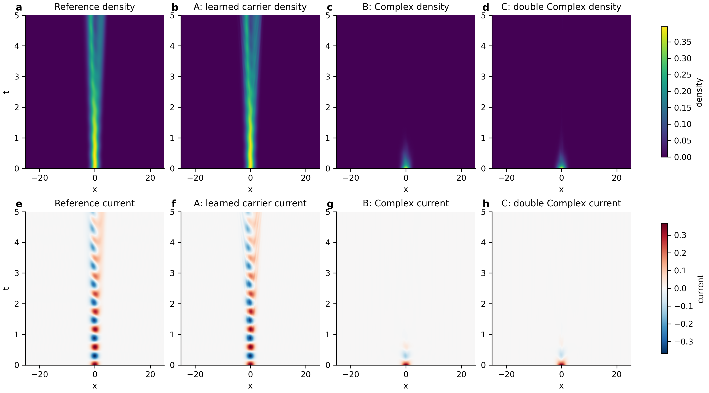
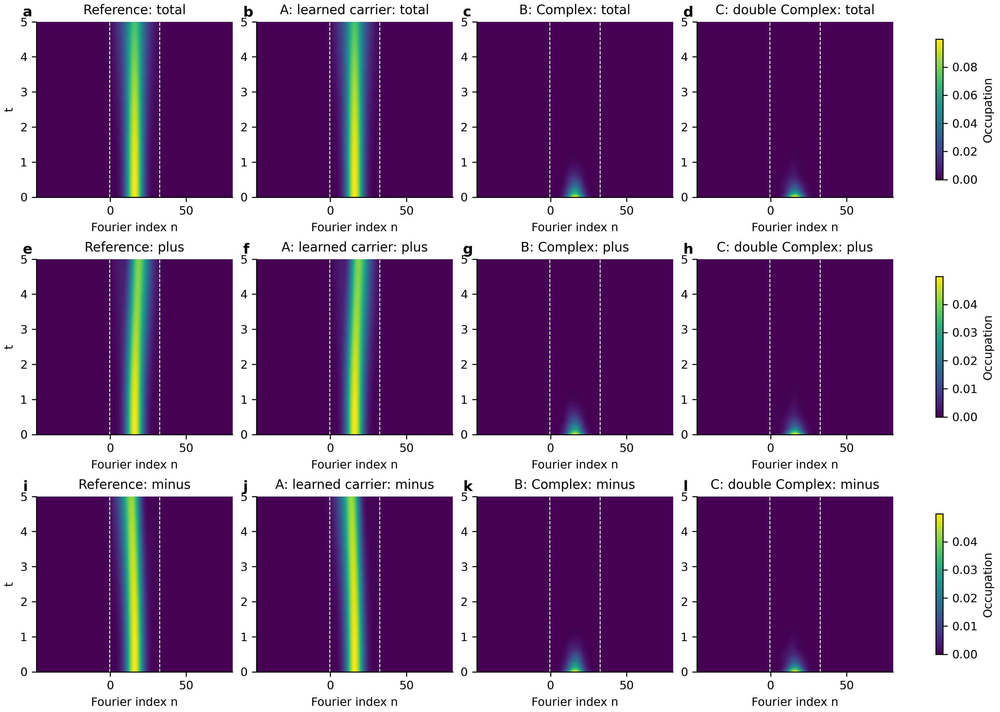
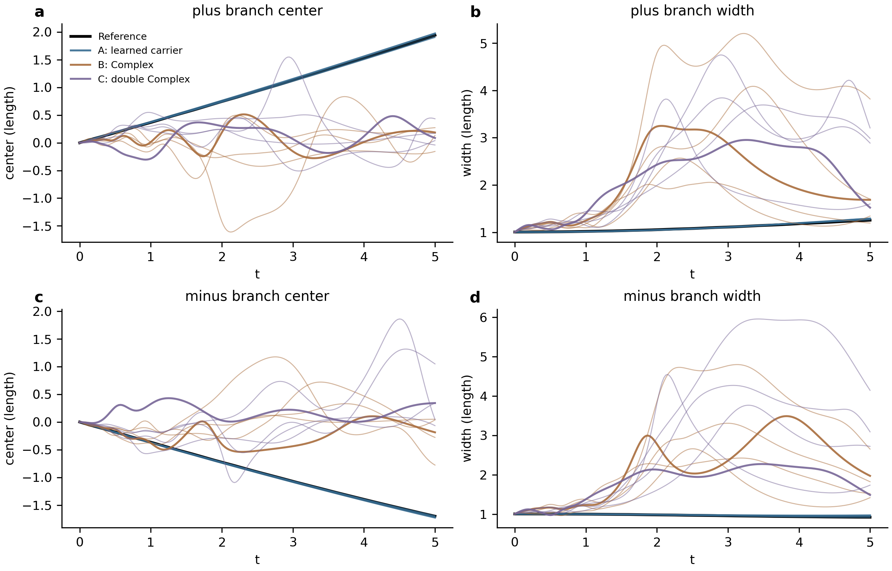
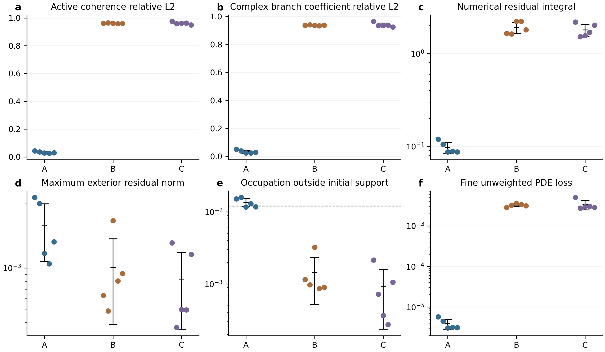
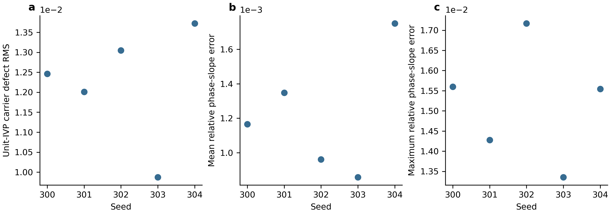
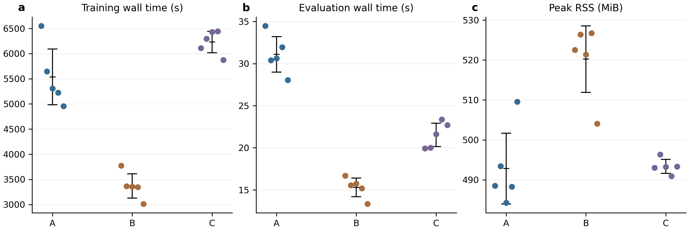

# R9：弱周期外势下高斯波包的可学习载波＋复包络验证

实验ID：`r9_wavepacket_periodic_potential`。日期：2026-10-03（Asia/Shanghai）。独立R9目录，历史结果保持原貌。

## 1. 主要结论

**A未通过预注册完整动力学标准**。A的平均旋量与概率流误差仍低于总参数匹配C。绝对成功与相对优势分别判断；全部15个正式run保留，不追加补救模型。

| 模型 | Spinor | Current | Fidelity | Modal population | Max norm drift | 联合通过 | 绝对标准 |
| --- | --- | --- | --- | --- | --- | --- | --- |
| A：载波＋复包络 | 0.03431316 ± 0.01051872 | 0.04635801 ± 0.01655765 | 0.9987431 ± 0.0008195504 | 0.01024029 ± 0.002343516 | 0.01248729 ± 0.008742831 | 3/5 | FAIL |
| B：Complex | 0.9371984 ± 0.002260362 | 0.9356546 ± 0.002741467 | 0.2836803 ± 0.03846159 | 0.9471651 ± 0.002454915 | 0.9992499 ± 0.0004387742 | 0/5 | FAIL |
| C：双网络Complex | 0.9396679 ± 0.01360767 | 0.9368099 ± 0.01554949 | 0.2922083 ± 0.0647451 | 0.9479038 ± 0.0081791 | 0.9995877 ± 0.0002312236 | 0/5 | FAIL |

均值±population SD（ddof=0），n=5，非SEM/CI。Norm项先对每seed取全时间最大漂移，再在五seed间统计；至少4/5种子五项联合通过才成功。

A/C实际均值误差比：spinor=0.036516261，current=0.049484969；逐seed两项联合胜出5/5。未事后添加优势倍数阈值。

## 2. 历史依据与本轮范围

六轮综合报告区分自由载频优势与原始实振幅LTPB外势失败；R5通过自由高斯已知初谱验证，R6/R7没有完整恢复空通道耦合。R8成功的是辅助自由载波预训练＋复包络A，不是原始纯实振幅LTPB。

本轮只检验R8 A迁移到同一R5高斯初谱的给定外势问题，以及总参数匹配控制。没有时间窗、守恒正则、动态切换、幅值阈值或模态权重。

[六轮综合报告](DIRAC_LTPB_COMPREHENSIVE_EXPERIMENT_REPORT.md) · [R5](WAVEPACKET_SHARED_SPECTRAL_LTPB_REPORT.md) · [R6](PERIODIC_POTENTIAL_COUPLED_LTPB_REPORT.md) · [R7](R7_PHASE_RELEASE_EXPERIMENT_REPORT.md) · [R8](R8_COUPLING_RECOVERY_REPORT.md)

## 3. 固定物理、初态与参考

$$i\partial_t\psi=[-i\sigma_x\partial_x+5\sigma_z+0.2\cos(x)I_2]\psi,\quad x\in[-8\pi,8\pi),\quad T=5.$$

$$k_n=n/8,\quad g_n=C\exp[-(k_n-2)^2/(4\times0.5^2)],\quad n=0,\ldots,32,\quad\sum_n|g_n|^2=1.$$

$$\widetilde\psi_n(0)=g_n(u_++u_-)/\sqrt2,\qquad\psi=L^{-1/2}\sum_n e^{ik_nx}\widetilde\psi_n.$$

扩大截断只零填充同一33系数，不重新归一化。q=1移动n±8；势乘I₂。自由能支不是外势完整Hamiltonian的独立能级。

$$R_n=i\partial_t\widehat{\widetilde\psi}_n-(k_n\sigma_x+5\sigma_z)\widehat{\widetilde\psi}_n-0.1(\widehat{\widetilde\psi}_{n-8}+\widehat{\widetilde\psi}_{n+8}).$$

块带状Hermitian Hamiltonian本征演化与独立矩阵指数交叉验证。第二组首个通过，选较小截断[-48,80]，129模态、258×258矩阵。第三组无需执行，不写成已验证。

| 较小截断 | 较大截断 | 全复轨迹零填充差 | 下8层占据 | 上8层占据 | 通过 |
| --- | --- | --- | --- | --- | --- |
| [-32, 64] | [-48, 80] | 6.516901e-06 | 7.18956e-08 | 1.233799e-09 | False |
| [-48, 80] | [-64, 96] | 1.427568e-08 | 1.154494e-12 | 3.481448e-15 | True |

选中参考Hermiticity误差=0，范数漂移=1.55431e-15，时间逆转误差=2.79428e-14，独立expm最大相对差=2.8158e-14；4001点谱PDE残差RMS范数=1.1634e-14。截断依据参考选定，先于任何正式PINN结果。

### 外势可测性

忽略外势的同初態自由解相对耦合参考：常数规范spinor=0.30067112（raw=0.37269555），current=0.20961738，density=0.11081516，fidelity=0.92335651，modal population=0.15328374。远大于参考截断差，外势影响确实可测；该自由诊断不进入learned排名。

参考初始支持外最大占据=0.012041059。新增支持只指n<0或n>32，不能把中心n=16外都称为新侧带，因为初态已有宽谱。

[参考校准](results/summary/r9_wavepacket_periodic_potential/reference_validation.json) · 参考测试轨迹（本地档案） · 自由诊断（本地档案） · 自由轨迹（本地档案）

## 4. 模型、理论与公平预算

A直接使用R8 LearnedCarrier，p=exp[iτqθ]、c=p(c₀+τz)；每保留k、正负支分别作非零单位本征旋量自由IVP。B为c=c₀+τz。C为c=c₀+τ(z₁+z₂)/√2。所有网络4×64 tanh、float64/complex128、Adam 10⁻³，输入沿用R8规则[(k−2)/8,t/5]。

A=6000自由＋14000耦合；B/C=20000耦合，每run共20000优化步。每步32个新时间×全部129模态；载波每样本两个独立单位旋量。主loss仅完整未加权旋量残差，不改为含E(k)的对角方程。

$$F_n=[u_+p_+,u_-p_-],\quad d_n=c_{n,0}+\tau z_n,\quad R_n=iF_n\dot d_n+(i\dot F_n-H_nF_n)d_n-0.1(F_{n-8}d_{n-8}+F_{n+8}d_{n+8}).$$

冻结权重仍保留p_t及载波近似缺陷。时间导数采用精确Linear/tanh链式内核，保留参数图；状态、时间导数、残差与全部参数梯度独立对照原自动微分。这只是同一前向和损失的计算实现，无时间差分、无频率标签。

| 模型 | 耦合活动参数 | 冻结参数 | 总参数 | 自由/耦合步数 | 旋量残差评价点 | 复标量残差评价数 |
| --- | --- | --- | --- | --- | --- | --- |
| A：载波＋复包络 | 12932 | 12802 | 25734 | 6000/14000 | 107328000 | 214656000 |
| B：Complex | 12932 | 0 | 12932 | 0/20000 | 82560000 | 165120000 |
| C：双网络Complex | 25864 | 0 | 25864 | 0/20000 | 82560000 | 165120000 |

A预训练活动12802、闲置包络12932；耦合活动12932、冻结12802。C比A总参数多130即0.5052%，但耦合活动参数约为A两倍。每run后评价4001×129完整耦合残差点；A另201×129×2单位载波旋量残差点。步数、活动参数、总存储容量及实际计算成本必须分别理解。

seeds300–304。A/B/C第一四输出网络逐元素配对，C第二网络独立；两输出载波不与四输出网络宣称逐元素配对。初始化、自由时间、耦合时间流独立；A/B/C共享14000步耦合公共前缀，B/C全部20000步相同。完整采样迹、Adam和RNG恢复状态保存。

固定五物理核slot，mask1/2/4/8/16；不使用seed＋slot索引。启动前互斥检查，worker检查实际OS affinity，一线程，同seed依次A/B/C。没有沿用R8调度缺陷。仍共享缓存、内存及功耗资源，报告真实成本，不作跨硬件或单一算法加速声明。

[理论核查](docs/experiments/r9_wavepacket_periodic_potential/theory_check.md) · [模型](src/r9_models.py) · [完整残差](src/r9_loss.py) · [时间导数](src/r9_time_derivative.py) · 核分配（本地档案）

## 5. 冻结与评价口径

冻结manifest SHA-256：`9cec983ea2fc033afd73aa7da3d5b36e9978fd79b9ce4b69c7cbdd8a72d9909f`。正式前完成参考和维度/初值/梯度/NaN/落盘smoke、恢复与链式导数测试，没有按精度调参。固定第20000步最终检查点，不选最好checkpoint、不选择性重跑。

物理网格Nx=1024端点不重复、Nt=201。129模态跨度128，双线性误差平方最高整数频率256；Fourier求积不混叠，并核验Parseval与Nx=2048一致性。旋量、复系数只消去一个全时空常数相位，不逐时间或逐模态对齐；raw误差另存。

参考相位mask=支占据≥10⁻⁶；预测相位定义另需占据≥10⁻¹²并报覆盖率。相干C_ab=c_ac_b*按两端参考活跃非对角通道统计，塌缩预测仍计入。保存完整参考通道mask及复系数，pair mask由两端参考mask与非对角规则确定。

从总旋量投影重建正负自由支，圆周一阶矩z定义中心L unwrap(arg z)/(2π)、宽度L√(−2ln|z|)/(2π)。全轨迹相对同一耦合参考，不用自由直线或内部载波相位替代。低预测支范数另存，其中心/宽度只作失败诊断。

五seed均值spinor≤.10、current≤.15、fidelity≥.98、modal population≤.10、maximum norm drift≤.02，并至少4/5五项联合通过。优势另报实际比、配对差及population SD，不增加事后倍数阈值。

[预注册](docs/experiments/r9_wavepacket_periodic_potential/preregistration.md) · 冻结清单（本地档案） · [机器协议](results/summary/r9_wavepacket_periodic_potential/protocol.json) · [独立评价](src/r9_evaluate.py)

## 6. 全部逐seed结果

| 模型 | Seed | Spinor | Current | Fidelity | Modal | Max norm drift | 联合 |
| --- | --- | --- | --- | --- | --- | --- | --- |
| A：载波＋复包络 | 300 | 0.0522777 | 0.07420991 | 0.9972734 | 0.008892019 | 0.00701874 | PASS |
| A：载波＋复包络 | 301 | 0.04002237 | 0.05594196 | 0.9984313 | 0.01441346 | 0.02243818 | FAIL |
| A：载波＋复包络 | 302 | 0.02463902 | 0.02917939 | 0.9994242 | 0.0102184 | 0.02367189 | FAIL |
| A：载波＋复包络 | 303 | 0.02553654 | 0.03502203 | 0.9994194 | 0.01030475 | 0.006302889 | PASS |
| A：载波＋复包络 | 304 | 0.02909016 | 0.03743676 | 0.9991672 | 0.0073728 | 0.003004766 | PASS |
| B：Complex | 300 | 0.9360412 | 0.9338715 | 0.3346244 | 0.9484684 | 0.9995234 | FAIL |
| B：Complex | 301 | 0.9409933 | 0.9399729 | 0.2438587 | 0.9512376 | 0.9996866 | FAIL |
| B：Complex | 302 | 0.9365742 | 0.9376607 | 0.2501237 | 0.9465853 | 0.9985764 | FAIL |
| B：Complex | 303 | 0.9342695 | 0.9325426 | 0.3252101 | 0.9448468 | 0.9988832 | FAIL |
| B：Complex | 304 | 0.9381139 | 0.9342254 | 0.2645847 | 0.9446875 | 0.99958 | FAIL |
| C：双网络Complex | 300 | 0.9651651 | 0.9635007 | 0.1708272 | 0.9586093 | 0.9991611 | FAIL |
| C：双网络Complex | 301 | 0.9356487 | 0.9292782 | 0.3338676 | 0.9466805 | 0.9998227 | FAIL |
| C：双网络Complex | 302 | 0.9349644 | 0.9362901 | 0.282517 | 0.949133 | 0.9997408 | FAIL |
| C：双网络Complex | 303 | 0.9382365 | 0.9390191 | 0.3227816 | 0.9514785 | 0.9995525 | FAIL |
| C：双网络Complex | 304 | 0.9243247 | 0.9159615 | 0.3510481 | 0.9336176 | 0.9996614 | FAIL |

| 模型 | Seed | Density | Min fidelity | Final spinor | 支占据 | 复支系数 | 活跃相干 | 相位覆盖率 |
| --- | --- | --- | --- | --- | --- | --- | --- | --- |
| A：载波＋复包络 | 300 | 0.03924825 | 0.9927227 | 0.08536186 | 0.01286528 | 0.0522777 | 0.04296641 | 1 |
| A：载波＋复包络 | 301 | 0.03200061 | 0.9949771 | 0.07142566 | 0.0154835 | 0.04002237 | 0.03527333 | 1 |
| A：载波＋复包络 | 302 | 0.02053071 | 0.9984223 | 0.04139547 | 0.01251926 | 0.02463902 | 0.02873609 | 1 |
| A：载波＋复包络 | 303 | 0.01887578 | 0.9983318 | 0.04321071 | 0.012651 | 0.02553654 | 0.02736204 | 1 |
| A：载波＋复包络 | 304 | 0.02160551 | 0.997666 | 0.04894778 | 0.01408925 | 0.02909016 | 0.02962261 | 1 |
| B：Complex | 300 | 0.9430105 | 0.0003057828 | 1.002505 | 0.9508312 | 0.9360412 | 0.9610487 | 1 |
| B：Complex | 301 | 0.9421217 | 8.606118e-05 | 0.9960113 | 0.9534365 | 0.9409933 | 0.9640745 | 1 |
| B：Complex | 302 | 0.9398401 | 0.0004802743 | 0.9882044 | 0.9490074 | 0.9365742 | 0.9621108 | 1 |
| B：Complex | 303 | 0.9362184 | 0.0004047652 | 1.009272 | 0.9473541 | 0.9342695 | 0.9590918 | 1 |
| B：Complex | 304 | 0.9384153 | 0.0002248814 | 0.9864181 | 0.9472202 | 0.9381139 | 0.9602411 | 1 |
| C：双网络Complex | 300 | 0.9517936 | 0.0001149719 | 1.006403 | 0.9604501 | 0.9651651 | 0.9754525 | 1 |
| C：双网络Complex | 301 | 0.939408 | 0.00143935 | 0.995376 | 0.9490707 | 0.9356487 | 0.9589791 | 1 |
| C：双网络Complex | 302 | 0.944084 | 9.889454e-05 | 0.998876 | 0.9514173 | 0.9349644 | 0.9620074 | 1 |
| C：双网络Complex | 303 | 0.9459561 | 0.0003432125 | 0.9943916 | 0.9536843 | 0.9382365 | 0.9635656 | 1 |
| C：双网络Complex | 304 | 0.9255254 | 4.720595e-06 | 1.023019 | 0.9367172 | 0.9243247 | 0.9504467 | 1 |

## 7. 真实配对优势与容量

| Target | Baseline | 指标 | 配对差均值 | 配对差population SD | 均值误差比 | 配对比值均值 | 有利种子数 |
| --- | --- | --- | --- | --- | --- | --- | --- |
| A：载波＋复包络 | B：Complex | spinor_rel_l2_gauge_aligned | -0.9028853 | 0.01022822 | 0.03661248 | 0.03660636 | 5 |
| A：载波＋复包络 | B：Complex | current_rel_l2 | -0.8892966 | 0.01671992 | 0.04954607 | 0.0495453 | 5 |
| A：载波＋复包络 | B：Complex | modal_population_rel_l2 | -0.9369248 | 0.001623685 | 0.01081151 | 0.01080664 | 5 |
| A：载波＋复包络 | B：Complex | active_coherence_rel_l2 | -0.9285213 | 0.005427691 | 0.03411176 | 0.03410832 | 5 |
| A：载波＋复包络 | C：双网络Complex | spinor_rel_l2_gauge_aligned | -0.9053547 | 0.008154272 | 0.03651626 | 0.03639636 | 5 |
| A：载波＋复包络 | C：双网络Complex | current_rel_l2 | -0.8904519 | 0.01339807 | 0.04948497 | 0.04931067 | 5 |
| A：载波＋复包络 | C：双网络Complex | modal_population_rel_l2 | -0.9376635 | 0.007983589 | 0.01080309 | 0.01079891 | 5 |
| A：载波＋复包络 | C：双网络Complex | active_coherence_rel_l2 | -0.9292982 | 0.005945063 | 0.03408422 | 0.0340529 | 5 |
| C：双网络Complex | B：Complex | spinor_rel_l2_gauge_aligned | 0.002469454 | 0.01452406 | 1.002635 | 1.002653 | 3 |
| C：双网络Complex | B：Complex | current_rel_l2 | 0.001155298 | 0.01651051 | 1.001235 | 1.001257 | 3 |
| C：双网络Complex | B：Complex | modal_population_rel_l2 | 0.0007386517 | 0.007666673 | 1.00078 | 1.000779 | 2 |
| C：双网络Complex | B：Complex | active_coherence_rel_l2 | 0.0007769015 | 0.008323119 | 1.000808 | 1.000812 | 3 |

差为target−baseline，误差负差有利，fidelity正差有利；均值之比和配对比值均值分列。不以n=5作总体显著性声明。

A/C同时涉及表示、辅助单位IVP、活动参数与耦合步数。若A仍优于C，支持优势不能仅由总参数量解释；若没有优势，则A/B比较不足以排除容量解释。C/B真实结果单独保留。

本轮没有独立消融预训练、纯实包络或随机载波，不能唯一分配预训练的单独因果贡献。R8移除载波历史结果提供背景，不能冒充R9单因素证据。比较的是整个冻结载波＋复包络流程。

[全部配对差](results/summary/r9_wavepacket_periodic_potential/paired_comparisons.csv) · [比较汇总](results/summary/r9_wavepacket_periodic_potential/comparison_summary.csv)

## 8. 波包、模态及分支轨迹

| 模型 | Seed | 新增支持占据 | +中心RMSE | −中心RMSE | +宽度L2 | −宽度L2 | +最小支范数 | −最小支范数 |
| --- | --- | --- | --- | --- | --- | --- | --- | --- |
| A：载波＋复包络 | 300 | 0.01515473 | 0.02173275 | 0.0135147 | 0.01049333 | 0.02008304 | 0.5 | 0.4923534 |
| A：载波＋复包络 | 301 | 0.01588589 | 0.01742593 | 0.005052541 | 0.01376423 | 0.01983192 | 0.4939723 | 0.4813826 |
| A：载波＋复包络 | 302 | 0.01165319 | 0.002481859 | 0.00509167 | 0.006411465 | 0.003407732 | 0.487956 | 0.4883721 |
| A：载波＋复包络 | 303 | 0.01302661 | 0.01452932 | 0.004329161 | 0.003776172 | 0.007370404 | 0.4981885 | 0.4955084 |
| A：载波＋复包络 | 304 | 0.01172579 | 0.02117541 | 0.003491755 | 0.002963247 | 0.004763334 | 0.4926972 | 0.5 |
| B：Complex | 300 | 0.001149788 | 1.064793 | 0.8760953 | 1.114534 | 1.518528 | 0.0001791578 | 0.0001567128 |
| B：Complex | 301 | 0.0009748853 | 1.439452 | 1.261857 | 2.478794 | 2.637482 | 0.000157166 | 0.0001550991 |
| B：Complex | 302 | 0.003232181 | 0.9950517 | 1.078444 | 0.5349796 | 1.052866 | 0.000719202 | 0.0005094093 |
| B：Complex | 303 | 0.0008642599 | 1.273891 | 1.02028 | 0.5813226 | 0.7790064 | 0.000652846 | 0.0004560758 |
| B：Complex | 304 | 0.0009017744 | 1.090882 | 1.198209 | 1.43908 | 1.501126 | 0.000174684 | 0.000226574 |
| C：双网络Complex | 300 | 0.002142476 | 0.9922551 | 1.167544 | 1.125409 | 0.9881195 | 0.0002754278 | 0.0005464665 |
| C：双网络Complex | 301 | 0.0007203886 | 1.026802 | 1.606561 | 1.824102 | 2.283877 | 7.130857e-05 | 0.0001049876 |
| C：双网络Complex | 302 | 0.0003633737 | 1.208991 | 1.360745 | 1.52534 | 3.46212 | 0.0001440026 | 0.0001037744 |
| C：双网络Complex | 303 | 0.000273269 | 0.8928642 | 0.9400847 | 1.478931 | 1.619632 | 0.0001978681 | 0.0002407709 |
| C：双网络Complex | 304 | 0.001056747 | 1.037031 | 0.9708576 | 0.9330978 | 1.383011 | 0.0001922931 | 0.0001450394 |

所有种子的中心/宽度轨迹曲线与数据保存；动力学与模态图固定seed300，显示参考与三个模型。初始支持外占据才表示新增支持，不把中心外原有高斯占据误称新增侧带。

## 9. 载波缺陷、未加权残差及外泄漏

| Seed | 单位IVP载波缺陷RMS | 斜率平均相对误差 | 斜率最大相对误差 |
| --- | --- | --- | --- |
| 300 | 0.01246187 | 0.00116507 | 0.01559781 |
| 301 | 0.01201309 | 0.001347842 | 0.01427614 |
| 302 | 0.01304785 | 0.0009613512 | 0.01717025 |
| 303 | 0.009871164 | 0.0008575693 | 0.01335303 |
| 304 | 0.01372656 | 0.001750671 | 0.01554527 |

辅助载波初态在所有k、每支非零，因此其全部斜率可诊断；这不是目标空通道物理相位。精确自由频率只在独立后评价出现，不进入forward/loss/optimizer/checkpoint。载波仍近似，缺陷完整进入耦合PDE。

$$\|e(t)\|\le\|e(0)\|+\int_0^t\|R(s)\|\,ds.$$

此理论针对所选有限Hermitian系统及raw场误差。保存4001点完整复残差、未加权分模态功率、两端各八个截断外残差、4001/2001梯形积分差。数值积分不是严格连续误差认证，也不认证无限谱。有限截断内估计与完整物理残差、外泄漏分别报告。

| 模型 | Seed | Fine PDE loss | 数值残差积分 | 积分相对差 | 数值违例 | 外泄漏范数 | 完整物理积分 |
| --- | --- | --- | --- | --- | --- | --- | --- |
| A：载波＋复包络 | 300 | 5.675869e-06 | 0.119129 | 7.77879e-09 | 0 | 0.00329573 | 0.1195416 |
| A：载波＋复包络 | 301 | 4.437126e-06 | 0.1045495 | 1.705983e-07 | 0 | 0.002966257 | 0.1048777 |
| A：载波＋复包络 | 302 | 3.041669e-06 | 0.08657177 | 1.230908e-07 | 0 | 0.001281957 | 0.08664722 |
| A：载波＋复包络 | 303 | 3.132363e-06 | 0.08817661 | 2.380859e-07 | 0 | 0.001074117 | 0.08823751 |
| A：载波＋复包络 | 304 | 3.049098e-06 | 0.08699684 | 2.696255e-07 | 0 | 0.001556255 | 0.08711108 |
| B：Complex | 300 | 0.002839143 | 1.652381 | 5.301922e-06 | 0 | 0.0006273367 | 1.652383 |
| B：Complex | 301 | 0.003252913 | 1.624984 | 4.975439e-06 | 0 | 0.000484299 | 1.624985 |
| B：Complex | 302 | 0.003603267 | 2.223913 | 3.619218e-06 | 0 | 0.002224837 | 2.223924 |
| B：Complex | 303 | 0.003354231 | 2.222742 | 3.606292e-06 | 0 | 0.0008026728 | 2.222745 |
| B：Complex | 304 | 0.003146414 | 1.802385 | 5.185898e-06 | 0 | 0.0009086195 | 1.80239 |
| C：双网络Complex | 300 | 0.005049131 | 2.187412 | 3.399787e-06 | 0 | 0.001530326 | 2.18742 |
| C：双网络Complex | 301 | 0.002735334 | 1.518848 | 5.286682e-06 | 0 | 0.0003657325 | 1.518849 |
| C：双网络Complex | 302 | 0.002947024 | 1.563922 | 5.099836e-06 | 0 | 0.00049309 | 1.563923 |
| C：双网络Complex | 303 | 0.003040974 | 1.692237 | 5.175645e-06 | 0 | 0.0004929327 | 1.692239 |
| C：双网络Complex | 304 | 0.002854815 | 2.025488 | 4.150494e-06 | 0 | 0.001258398 | 2.025492 |

参考截断已经收敛；远大于参考差的learned误差不能归为谱截断失败。载波缺陷、包络耦合优化及控制塌缩/有限预算失败分开判断。低loss或范数接近1不代替复旋量与概率流动力学准确性。

### 冻结后的外侧复残差归档修正

冻结评价代码的截断外复数归档保存了正号耦合源；按R=i∂tψ−Hψ定义，零延拓场的外侧PDE残差应为该源的负值。这个符号不影响范数、残差积分或五项主指标。原六件套、评价数据和科学代码全部原样保留，另存full_physical_residual.npz，包含145模态完整未加权复残差及正确负号的外侧项。

此项只补齐诊断归档，未增加优化步、改变模型、参考、评价口径或成功判据。逐run记录原产物SHA-256、补档额外forward工作量与耗时；独立物理空间算子测试验证符号。额外后处理成本与原训练、评价成本分列。

全部15 run的归档修正记录（本地档案）

## 10. 真实资源成本

| 模型 | 预训练秒 | 耦合秒 | 总优化秒 | 评价秒 | Peak RSS MiB |
| --- | --- | --- | --- | --- | --- |
| A：载波＋复包络 | 1147.951 ± 130.2177 | 4389.974 ± 425.1222 | 5537.925 ± 553.3044 | 31.10192 ± 2.108515 | 492.8188 ± 8.862911 |
| B：Complex | 0 ± 0 | 3370.252 ± 241.1901 | 3370.252 ± 241.1901 | 15.2975 ± 1.103317 | 520.2188 ± 8.333101 |
| C：双网络Complex | 0 ± 0 | 6231.705 ± 214.8408 | 6231.705 ± 214.8408 | 21.52468 ± 1.385334 | 493.3727 ± 1.739706 |

训练时间累计每步loss/梯度/Adam与阶段转换实际工作，不含恢复检查点、CSV落盘及后评价；评价另计，进程会话耗时另存。训练期RSS与含评价的peak RSS分别保存，native采样方法落盘。步数相同不等于成本相同。

| 模型 | Seed | 预训练秒 | 耦合秒 | 评价秒 | 训练RSS MiB | 总RSS MiB | 核mask |
| --- | --- | --- | --- | --- | --- | --- | --- |
| A：载波＋复包络 | 300 | 1388.626 | 5163.793 | 34.48403 | 412.1953 | 488.5352 | 1 |
| A：载波＋复包络 | 301 | 1182.577 | 4465.6 | 30.39826 | 416.1758 | 493.4414 | 2 |
| A：载波＋复包络 | 302 | 1071.163 | 4237.736 | 30.61356 | 416.5078 | 484.2461 | 4 |
| A：载波＋复包络 | 303 | 1054.153 | 4169.635 | 31.96374 | 420.9062 | 488.3125 | 8 |
| A：载波＋复包络 | 304 | 1043.235 | 3913.105 | 28.05002 | 422.332 | 509.5586 | 16 |
| B：Complex | 300 | 0 | 3771.881 | 16.68436 | 394.6758 | 522.5117 | 1 |
| B：Complex | 301 | 0 | 3365.025 | 15.53689 | 400.7305 | 526.3594 | 2 |
| B：Complex | 302 | 0 | 3355.404 | 15.75368 | 393.4375 | 521.375 | 4 |
| B：Complex | 303 | 0 | 3347.579 | 15.18618 | 394.9961 | 526.7578 | 8 |
| B：Complex | 304 | 0 | 3011.371 | 13.32637 | 369.8516 | 504.0898 | 16 |
| C：双网络Complex | 300 | 0 | 6109.073 | 19.93888 | 397.2734 | 493.0273 | 1 |
| C：双网络Complex | 301 | 0 | 6297.617 | 20.00962 | 399.9375 | 496.3789 | 2 |
| C：双网络Complex | 302 | 0 | 6432.255 | 21.6079 | 397.293 | 493.2266 | 4 |
| C：双网络Complex | 303 | 0 | 6443.37 | 23.36933 | 395.2227 | 490.9336 | 8 |
| C：双网络Complex | 304 | 0 | 5876.209 | 22.69769 | 392.6094 | 493.2969 | 16 |

[分阶段成本及残差工作量](results/summary/r9_wavepacket_periodic_potential/cost_and_residual_work.csv)

[归档符号补正的独立后处理成本](results/summary/r9_wavepacket_periodic_potential/postfreeze_archival_cost.csv)

## 11. 全部图表及source data

统计图全部五seed，误差棒population SD；动力学seed300。SVG文本可编辑、PDF TrueType、PNG300dpi，共享色标，无平滑、删除失败点或每模型单独色标归一化。

### 图1：参考截断校准及可测外势效应



[SVG](results/figures/r9_wavepacket_periodic_potential/reference_calibration.svg) · [PDF](results/figures/r9_wavepacket_periodic_potential/reference_calibration.pdf) · [Source CSV 1](results/figures/r9_wavepacket_periodic_potential/source_data/reference_calibration_truncation.csv) · [Source CSV 2](results/figures/r9_wavepacket_periodic_potential/source_data/reference_calibration_free_difference.csv)

### 图2：全部种子五项绝对标准



[SVG](results/figures/r9_wavepacket_periodic_potential/all_seed_primary_metrics.svg) · [PDF](results/figures/r9_wavepacket_periodic_potential/all_seed_primary_metrics.pdf) · [Source CSV 1](results/figures/r9_wavepacket_periodic_potential/source_data/all_seed_primary_metrics_all_seeds.csv)

### 图3：实际配对差及误差比



[SVG](results/figures/r9_wavepacket_periodic_potential/paired_comparisons.svg) · [PDF](results/figures/r9_wavepacket_periodic_potential/paired_comparisons.pdf) · [Source CSV 1](results/figures/r9_wavepacket_periodic_potential/source_data/paired_comparisons_all_pairs.csv)

### 图4：固定seed300密度与概率流



[SVG](results/figures/r9_wavepacket_periodic_potential/dynamics_seed300.svg) · [PDF](results/figures/r9_wavepacket_periodic_potential/dynamics_seed300.pdf) · Source CSV 1（本地档案）

### 图5：总模态与正负支占据，虚线为初始支持边界



[SVG](results/figures/r9_wavepacket_periodic_potential/modal_branch_seed300.svg) · [PDF](results/figures/r9_wavepacket_periodic_potential/modal_branch_seed300.pdf) · Source CSV 1（本地档案）

### 图6：全部种子分支中心及宽度轨迹



[SVG](results/figures/r9_wavepacket_periodic_potential/branch_center_width.svg) · [PDF](results/figures/r9_wavepacket_periodic_potential/branch_center_width.pdf) · [Source CSV 1](results/figures/r9_wavepacket_periodic_potential/source_data/branch_center_width_all_seed_trajectories.csv)

### 图7：相干、复谱、残差积分与外泄漏



[SVG](results/figures/r9_wavepacket_periodic_potential/diagnostics_all_seeds.svg) · [PDF](results/figures/r9_wavepacket_periodic_potential/diagnostics_all_seeds.pdf) · [Source CSV 1](results/figures/r9_wavepacket_periodic_potential/source_data/diagnostics_all_seeds_all_seeds.csv)

### 图8：全部载波缺陷与评价斜率



[SVG](results/figures/r9_wavepacket_periodic_potential/carrier_defects_all_seeds.svg) · [PDF](results/figures/r9_wavepacket_periodic_potential/carrier_defects_all_seeds.pdf) · [Source CSV 1](results/figures/r9_wavepacket_periodic_potential/source_data/carrier_defects_all_seeds_all_seeds.csv)

### 图9：全部种子时间与RSS



[SVG](results/figures/r9_wavepacket_periodic_potential/training_costs.svg) · [PDF](results/figures/r9_wavepacket_periodic_potential/training_costs.pdf) · [Source CSV 1](results/figures/r9_wavepacket_periodic_potential/source_data/training_costs_all_costs.csv)

## 12. 测试、审计和完整证据

完整pytest：PASS。新增测试覆盖n±8、参考收敛、R5高斯归一化、硬初值、载波时间导数和缺陷、参数量、随机流、原步恢复、无频率泄漏、Fourier积分、相干mask及产物完整性。

工程完整性与科学成功独立。审计从每run原始复谱和物理网格独立重算五项主指标，并核验单一常数相位、模态占据和保存场的一致性。最终状态以audit.json、link_check和FIGURE_QA为准。历史保护清单覆盖7372文件；科学冻结与最终产物SHA-256分别保存。

[Decision](results/summary/r9_wavepacket_periodic_potential/decision.json) · Audit（本地档案） · 链接（本地档案） · [FIGURE_QA](results/figures/r9_wavepacket_periodic_potential/FIGURE_QA.md) · [图QA JSON](results/figures/r9_wavepacket_periodic_potential/FIGURE_QA.json) · 完整pytest（本地档案） · [逐seed](results/summary/r9_wavepacket_periodic_potential/per_seed_metrics.csv) · [汇总SD](results/summary/r9_wavepacket_periodic_potential/summary_metrics.csv) · 产物索引（本地档案） · 历史保护（本地档案） · 产物SHA-256（本地档案）

### 每run六件套及恢复状态

| 模型 | Seed | 证据 |
| --- | --- | --- |
| A：载波＋复包络 | 300 | config.json（本地档案） · metrics.json（本地档案） · loss_history.csv（本地档案） · time_series.csv（本地档案） · dense_grid.npz（本地档案） · model_state.pt（本地档案） · recovery_state.pt（本地档案） · full_physical_residual.npz（本地档案） · full_physical_residual_archival_record.json（本地档案） |
| A：载波＋复包络 | 301 | config.json（本地档案） · metrics.json（本地档案） · loss_history.csv（本地档案） · time_series.csv（本地档案） · dense_grid.npz（本地档案） · model_state.pt（本地档案） · recovery_state.pt（本地档案） · full_physical_residual.npz（本地档案） · full_physical_residual_archival_record.json（本地档案） |
| A：载波＋复包络 | 302 | config.json（本地档案） · metrics.json（本地档案） · loss_history.csv（本地档案） · time_series.csv（本地档案） · dense_grid.npz（本地档案） · model_state.pt（本地档案） · recovery_state.pt（本地档案） · full_physical_residual.npz（本地档案） · full_physical_residual_archival_record.json（本地档案） |
| A：载波＋复包络 | 303 | config.json（本地档案） · metrics.json（本地档案） · loss_history.csv（本地档案） · time_series.csv（本地档案） · dense_grid.npz（本地档案） · model_state.pt（本地档案） · recovery_state.pt（本地档案） · full_physical_residual.npz（本地档案） · full_physical_residual_archival_record.json（本地档案） |
| A：载波＋复包络 | 304 | config.json（本地档案） · metrics.json（本地档案） · loss_history.csv（本地档案） · time_series.csv（本地档案） · dense_grid.npz（本地档案） · model_state.pt（本地档案） · recovery_state.pt（本地档案） · full_physical_residual.npz（本地档案） · full_physical_residual_archival_record.json（本地档案） |
| B：Complex | 300 | config.json（本地档案） · metrics.json（本地档案） · loss_history.csv（本地档案） · time_series.csv（本地档案） · dense_grid.npz（本地档案） · model_state.pt（本地档案） · recovery_state.pt（本地档案） · full_physical_residual.npz（本地档案） · full_physical_residual_archival_record.json（本地档案） |
| B：Complex | 301 | config.json（本地档案） · metrics.json（本地档案） · loss_history.csv（本地档案） · time_series.csv（本地档案） · dense_grid.npz（本地档案） · model_state.pt（本地档案） · recovery_state.pt（本地档案） · full_physical_residual.npz（本地档案） · full_physical_residual_archival_record.json（本地档案） |
| B：Complex | 302 | config.json（本地档案） · metrics.json（本地档案） · loss_history.csv（本地档案） · time_series.csv（本地档案） · dense_grid.npz（本地档案） · model_state.pt（本地档案） · recovery_state.pt（本地档案） · full_physical_residual.npz（本地档案） · full_physical_residual_archival_record.json（本地档案） |
| B：Complex | 303 | config.json（本地档案） · metrics.json（本地档案） · loss_history.csv（本地档案） · time_series.csv（本地档案） · dense_grid.npz（本地档案） · model_state.pt（本地档案） · recovery_state.pt（本地档案） · full_physical_residual.npz（本地档案） · full_physical_residual_archival_record.json（本地档案） |
| B：Complex | 304 | config.json（本地档案） · metrics.json（本地档案） · loss_history.csv（本地档案） · time_series.csv（本地档案） · dense_grid.npz（本地档案） · model_state.pt（本地档案） · recovery_state.pt（本地档案） · full_physical_residual.npz（本地档案） · full_physical_residual_archival_record.json（本地档案） |
| C：双网络Complex | 300 | config.json（本地档案） · metrics.json（本地档案） · loss_history.csv（本地档案） · time_series.csv（本地档案） · dense_grid.npz（本地档案） · model_state.pt（本地档案） · recovery_state.pt（本地档案） · full_physical_residual.npz（本地档案） · full_physical_residual_archival_record.json（本地档案） |
| C：双网络Complex | 301 | config.json（本地档案） · metrics.json（本地档案） · loss_history.csv（本地档案） · time_series.csv（本地档案） · dense_grid.npz（本地档案） · model_state.pt（本地档案） · recovery_state.pt（本地档案） · full_physical_residual.npz（本地档案） · full_physical_residual_archival_record.json（本地档案） |
| C：双网络Complex | 302 | config.json（本地档案） · metrics.json（本地档案） · loss_history.csv（本地档案） · time_series.csv（本地档案） · dense_grid.npz（本地档案） · model_state.pt（本地档案） · recovery_state.pt（本地档案） · full_physical_residual.npz（本地档案） · full_physical_residual_archival_record.json（本地档案） |
| C：双网络Complex | 303 | config.json（本地档案） · metrics.json（本地档案） · loss_history.csv（本地档案） · time_series.csv（本地档案） · dense_grid.npz（本地档案） · model_state.pt（本地档案） · recovery_state.pt（本地档案） · full_physical_residual.npz（本地档案） · full_physical_residual_archival_record.json（本地档案） |
| C：双网络Complex | 304 | config.json（本地档案） · metrics.json（本地档案） · loss_history.csv（本地档案） · time_series.csv（本地档案） · dense_grid.npz（本地档案） · model_state.pt（本地档案） · recovery_state.pt（本地档案） · full_physical_residual.npz（本地档案） · full_physical_residual_archival_record.json（本地档案） |

### 可复现入口

```powershell
python -m src.run_r9_wavepacket prepare
python -m src.run_r9_wavepacket smoke
python -m src.run_r9_wavepacket freeze
python -m src.run_r9_wavepacket formal
python -m src.r9_full_residual_archive
python -m src.aggregate_r9_wavepacket
python -m src.plot_r9_wavepacket
python -m src.build_r9_wavepacket_report
python -m pytest
python -m src.audit_r9_wavepacket
```

已完成run不会重训，未完成仅从原模型、Adam、RNG原步续跑；科学文件变更会被拒绝。图表视觉核验记录须完成后执行最终审计。

## 13. 归因与解释边界

完整动力学以五项均值及4/5联合规则判断；容量作用以C/B和A/C数据判断；预训练单独因果未在本轮隔离。控制失败不证明Complex数学不可表示，A失败也不证明所有载波方法不可行。参考已收敛，不把优化失败写成谱截断失败。

即使通过，也仅证明已知有限Fourier高斯初谱在此弱周期外势、固定预算与所选有限截断下有效。不能宣称未知连续谱发现、一般外势或通用Dirac求解器，也未证明任意新问题零样本迁移。
