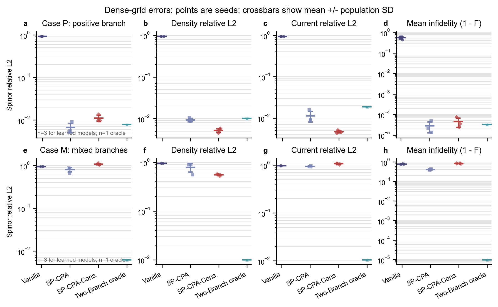
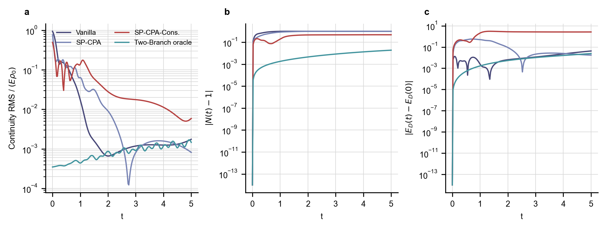
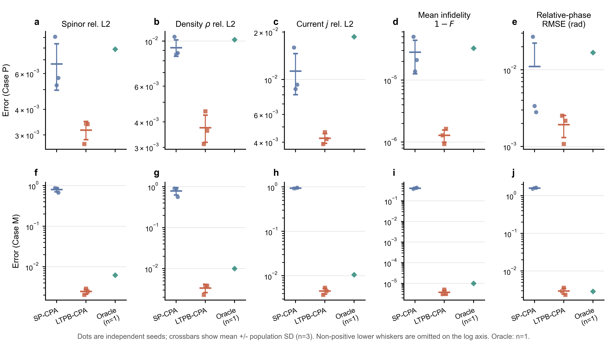
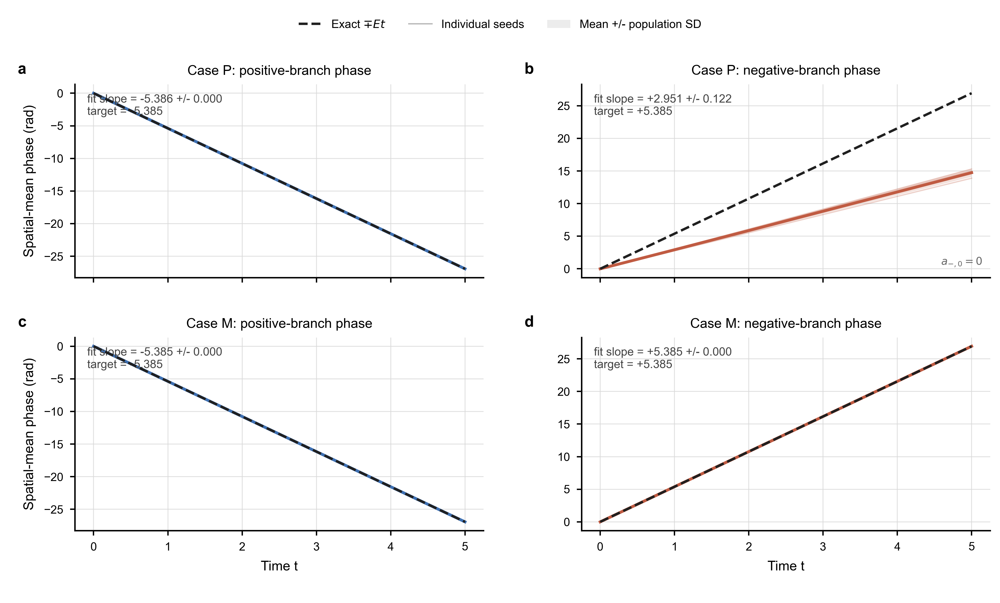
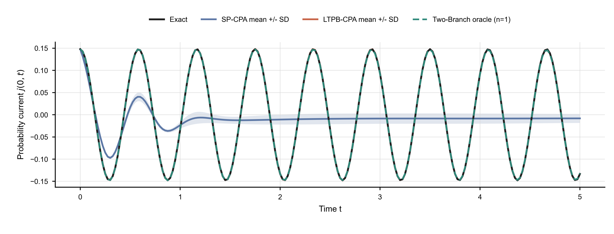
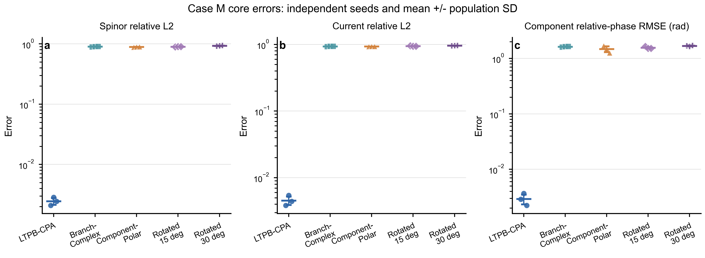
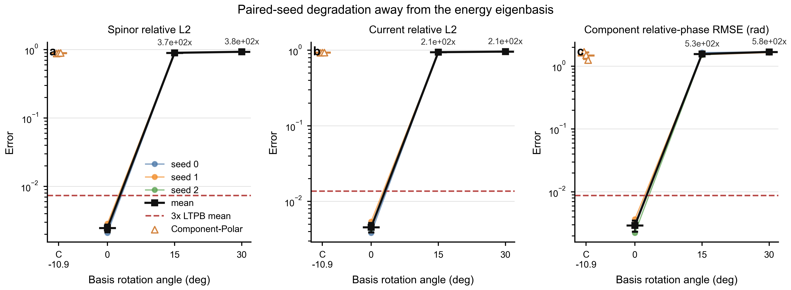

# 从 CPA-PINN 的 Dirac 迁移退化到能支双相位网络

## 开题论证、三轮实验与阶段性结论

> 更新日期：2026 年 8 月 31 日  
> 研究范围：一维自由含时 Dirac 方程、周期边界、固定训练预算下的 PINN 表示与优化机制

## 摘要

本研究考察为半经典 Schrödinger/NLS 问题设计的公共相位 CPA-PINN 能否直接迁移至含时 Dirac 方程。理论分析表明，Dirac 概率流由旋量分量或正、负能支之间的相对相位决定，而公共相位在密度和概率流中完全抵消；连续性、范数和能量约束也不能单独识别这一相对相位。第一轮实验进一步发现：公共单相位表示在纯正能支上有效，但在等权正、负能支混合时明显退化，附加守恒损失不能恢复旋量、概率流和相对相位。基于该失效机制，第二轮提出能支对齐的可学习双相位网络（Learned Two-Phase Branch-aligned PINN, LTPB-PINN），在不写入精确频率的条件下自行学习两支相反的时间载频，并将混合支旋量误差由 `0.7991` 降至 `0.0025`。第三轮等参数消融表明，显著收益来自“能支对齐”与“逐支相位分解”的共同作用，而非网络参数量或一般极坐标参数化；但预注册的逐级旋转退化强判据未完全通过，因此当前证据只支持单模自由 Dirac 基准上的固定预算结论，尚不足以宣称普适优越性。

## 1. 研究主线

核心问题不是“PINN 能否表示 Dirac 解”，而是：

> 当 Dirac 解同时含有正、负能支且可观测量依赖支间相干时，公共单相位参数化是否仍能形成有效的优化预条件；若不能，能否构造与 Dirac 谱结构一致、载频可学习且初值严格满足的新参数化？

研究过程形成了连续的四个阶段：

| 阶段 | 研究问题 | 方法或证据 | 阶段结果 |
|---|---|---|---|
| 开题论证 | 公共相位为何可能不适合 Dirac 旋量 | 概率流、残差与正负能支分析 | 得到“相对相位盲点”假设 |
| 实验一 | 直接迁移是否确实退化 | 纯支/混合支对照、守恒增强、解析载频 oracle | 混合支优势显著下降，守恒项不能修复 |
| 实验二 | 分支独立相位能否修复 | LTPB-PINN，无精确频率泄漏 | 混合支误差下降约两个至三个数量级 |
| 实验三 | 收益来自何种结构 | 等参数、配对随机种子的机制消融 | 能支对齐与逐支相位分解需同时存在；旋转规律仍需细化 |

开题阶段曾将候选方法概括为“旋量双相位/特征通道分解”。首轮失效实验表明，最小困难直接对应自由 Dirac 哈密顿量的正、负能载频，因此后续将方法具体化为**能支对齐的可学习双相位分解**，而非直接实现更宽泛的特征通道方案。

## 2. 理论出发点

### 2.1 一维含时 Dirac 方程

考虑

$$
i\hbar\partial_t\psi
=\left(-i\hbar c\sigma_x\partial_x+mc^2\sigma_z+V(x,t)I_2\right)\psi,
\qquad \psi=(\psi_1,\psi_2)^\mathsf{T}.
$$

概率密度和概率流为

$$
\rho=\psi^\dagger\psi,
\qquad
j=c\psi^\dagger\sigma_x\psi,
\qquad
\partial_t\rho+\partial_xj=0.
$$

若将 CPA 形式直接写成

$$
\psi=A\exp\!\left(\frac{iS}{\hbar}\right),
\qquad A\in\mathbb{C}^2,
$$

则

$$
\rho=A^\dagger A,
\qquad
j=cA^\dagger\sigma_xA.
$$

公共相位 $S$ 在两个可观测量中均被消去。该结论只说明密度和概率流不能直接约束公共相位，并不构成“CPA 无法表示 Dirac 解”的表示性定理；复振幅 $A$ 仍可隐藏全部快速相位，但这会削弱显式相位分解原本应提供的频谱预条件作用。

### 2.2 守恒约束为何不足

记 Dirac 残差为

$$
R_D=i\hbar\partial_t\psi-H_D\psi.
$$

可得精确恒等式

$$
\partial_t\rho+\partial_xj
=\frac{2}{\hbar}\operatorname{Im}(\psi^\dagger R_D).
$$

因此连续性残差是 PDE 残差的一个投影，而非独立决定旋量相位的方程。若写成分量相位形式

$$
\psi_1=a_1e^{iS_1/\hbar},
\qquad
\psi_2=a_2e^{iS_2/\hbar},
$$

则

$$
\rho=a_1^2+a_2^2,
\qquad
j=2ca_1a_2\cos\!\left(\frac{S_2-S_1}{\hbar}\right).
$$

Dirac 概率流直接依赖相对相位 $S_2-S_1$。范数、能量和连续性即使数值上接近正确，也不必然恢复这一局部相干信息。

### 2.3 最小混合支基准

以下实验采用自然单位 $\hbar=c=1$，自由哈密顿量为

$$
H(k)=k\sigma_x+m\sigma_z,
\qquad
H(k)u_\pm=\pm E_k u_\pm,
\qquad
E_k=\sqrt{k^2+m^2}.
$$

构造归一化精确解

$$
\psi_\eta(x,t)=
\frac{e^{ikx}}{\sqrt{L(1+\eta^2)}}
\left(u_+e^{-iE_kt}+\eta u_-e^{+iE_kt}\right).
$$

- `Case P`：$\eta=0$，仅含正能支，只有一个主要时间载频；
- `Case M`：$\eta=1$，正、负能支等权叠加，需要同时学习 $\mp E_k$。

取 $m=5$、$k=2$、$L=2\pi$ 时，$E_k=\sqrt{29}=5.3851648$。Case M 的密度保持不变，但概率流为

$$
j_M(t)=\frac{m}{LE_k}\cos(2E_kt),
$$

其振幅为 `0.1477717`，周期为 `0.5833791`。该基准排除了复杂势、边界散射和多波数混合，专门检验正、负能支相对相位及其拍频。

## 3. 统一实验口径

| 项目 | 设置 |
|---|---|
| 方程与区域 | 一维自由 Dirac 方程，周期空间区间，$t\in[0,5]$ |
| 数值精度 | `float64` |
| 主干网络 | 4 层、每层 64 个神经元、`tanh` |
| 周期输入 | $[\sin x,\cos x,t/T]$ |
| 初值 | 通过参数化硬约束 |
| 训练 | Adam，学习率 $10^{-3}$，5000 步，每步 1024 个配置点 |
| 测试网格 | $201\times128$ 时空点 |
| 重复实验 | learned model 通常为 3 个种子；oracle 为 1 次诊断运行 |
| 参数量 | Vanilla/LTPB/主要消融模型均为 12996；SP-CPA 为 13061 |
| 主指标 | 旋量相对 $L^2$ 误差 |
| 辅助指标 | 密度、概率流、fidelity、相对相位、分支系数、守恒量与训练残差 |

三轮实验保持网络规模、训练步数和主要采样配置一致。第三轮还对不同模型使用同一初始 MLP 权重与同一配置点序列，从而减少随机初始化和采样噪声对机制比较的影响。

## 4. 实验一：CPA 直接迁移与失效定位

### 4.1 比较模型

| 模型 | 结构 | 用途 |
|---|---|---|
| Vanilla | 笛卡尔形式直接输出复旋量 | 普通 PINN 基线 |
| SP-CPA | 复旋量振幅乘公共相位 | 检验 CPA 的直接迁移 |
| SP-CPA-Conservative | SP-CPA 加连续性、范数和能量损失 | 检验守恒约束能否补足相位信息 |
| Two-Branch oracle | 显式写入 $e^{\mp iE_kt}$ | 诊断载频分解是否足以恢复精度，不参与公平排名 |

### 4.2 主要结果

下表给出三种 learned model 的三种子均值；oracle 为单次诊断结果。

| 模型 | Case P 旋量误差 | Case M 旋量误差 | Case M 密度误差 | Case M 流误差 | Case M fidelity | Case M 相对相位 RMSE |
|---|---:|---:|---:|---:|---:|---:|
| Vanilla | 0.9228 | 0.9452 | 0.9564 | 0.9693 | 0.2254 | 1.7658 |
| SP-CPA | 0.0067 | 0.7991 | 0.7876 | 0.9392 | 0.5935 | 1.5864 |
| SP-CPA-Conservative | 0.0111 | 1.0785 | 0.5554 | 1.0698 | 0.1631 | 1.7980 |
| Two-Branch oracle | 0.0079 | 0.0062 | 0.0100 | 0.0105 | 1.0000 | 0.0029 |

*图 1　公共单相位在纯支 Case P 上显著有效，但其优势在混合支 Case M 上大幅下降；显式双载频 oracle 恢复了精度。*

SP-CPA 相对 Vanilla 在 Case P 上将旋量误差降低 `99.3%`，在 Case M 上仅降低 `15.5%`。这说明公共相位并非普遍无效，而是没有将混合支中的两种相反载频同时变为慢变量。oracle 的 Case M 旋量误差比 SP-CPA 小约 `128` 倍，进一步将困难定位到载波/分支预条件，而非解析解、自动微分或评估代码。

### 4.3 守恒损失未恢复相对相位

| 模型 | 连续性归一化 RMS | 最大范数漂移 | 最大绝对能量漂移 | 旋量误差 | 流误差 |
|---|---:|---:|---:|---:|---:|
| SP-CPA | 0.0883 | 0.8680 | 1.3010 | 0.7991 | 0.9392 |
| SP-CPA-Conservative | 0.0830 | 0.5181 | 2.7662 | 1.0785 | 1.0698 |

连续性和范数指标有所改善，但能量漂移、旋量、概率流和 fidelity 均未同步改善。更强的守恒权重在单个诊断种子上可同时降低三项守恒误差，旋量误差仍升至 `1.4492`，fidelity 仅为 `0.062512`。Case M 中 PDE 损失梯度与结构损失梯度的平均余弦相似度为 `-0.5293`，`88.89%` 的采样检查点呈负值，表明固定权重下存在明显优化冲突。

*图 2　附加守恒损失可以改善部分积分或投影量，但没有恢复混合支的场、流和相对相位。*

另构造了一个解析 wrong-phase 场：其连续性、范数和能量误差接近机器精度，但旋量误差为 `0.33684`、概率流误差为 `0.46978`、Dirac PDE RMS 为 `0.09087`。该反例说明守恒量存在相位盲方向；它不说明错误场满足完整 Dirac 方程，也不替代 learned-model 对照。

**第一轮结论：** 在当前单模、长时间、固定训练预算下，CPA 公共相位对纯能支有效，但在正、负能支相干时显著退化；仅增加守恒项不能解决支间相位学习问题。

## 5. 实验二：能支对齐的可学习双相位网络

### 5.1 方法

针对第一轮定位出的双载频困难，采用

$$
\widehat\psi(x,t)=e^{ikx}
\left[
a_+(x,t)u_+e^{iS_+(x,t)}
+a_-(x,t)u_-e^{iS_-(x,t)}
\right].
$$

网络输出 $r_+,r_-,q_+,q_-$，并令

$$
a_\pm=a_{\pm,0}+\tau r_\pm,
\qquad
S_\pm=\tau q_\pm,
\qquad
\tau=t/T.
$$

该构造具有三点约束：

1. 使用已知自由 Dirac 能支向量 $u_\pm$ 对齐物理通道；
2. 两个分支具有独立可学习相位，允许出现相反载频；
3. 通过 $\tau=0$ 硬满足初值，且前向、损失和优化器均不写入精确能量 $E_k$ 或精确相位 $\mp E_kt$。

振幅限定为有符号实函数，避免网络再次把快速相位隐藏在复振幅中。训练仍只使用 Dirac PDE 残差。

### 5.2 精度提升

| 模型 | Case P 旋量误差 | Case M 旋量误差 | Case M 流误差 | Case M fidelity | Case M 相对相位 RMSE |
|---|---:|---:|---:|---:|---:|
| Vanilla | 0.9228 | 0.9452 | 0.9693 | 0.2254 | 1.7658 |
| SP-CPA | 0.0067 | 0.7991 | 0.9392 | 0.5935 | 1.5864 |
| SP-CPA-Conservative | 0.0111 | 1.0785 | 1.0698 | 0.1631 | 1.7980 |
| LTPB-PINN | **0.0032** | **0.0025** | **0.0046** | **0.999996** | **0.0030** |
| Two-Branch oracle | 0.0079 | 0.0062 | 0.0105 | 0.999990 | 0.0029 |

*图 3　LTPB 在未写入精确频率的条件下同时解决纯支和混合支问题，并达到与解析载频 oracle 同一误差量级。*

相对 SP-CPA，LTPB 在 Case M 上的旋量、概率流和相对相位误差分别改善约 `320`、`204` 和 `529` 倍。三个种子的混合支旋量误差为 `0.0025 ± 0.000345`，说明结果不是单次随机运行造成。

### 5.3 网络确实学习了物理载频

Case M 的目标相位斜率为

$$
\frac{dS_+}{dt}=-E_k=-5.3851648,
\qquad
\frac{dS_-}{dt}=+E_k=+5.3851648.
$$

网络学习到的平均斜率分别为 `-5.3855` 和 `+5.3854`，线性拟合 $R^2$ 接近 1；两支振幅漂移仅约 `0.22%` 和 `0.14%`。因此主要时间振荡被放入显式相位，而非重新隐藏到振幅中。

*图 4　两支相位从 PDE 残差中自行形成相反且近线性的时间斜率。*

*图 5　LTPB 重建了由正、负能支相干产生的 $2E_k$ 概率流振荡，公共单相位基线未能跟随该动力学。*

**第二轮结论：** 在最小自由 Dirac 基准中，对每个能支设置独立的可学习相位足以恢复混合支动力学；其效果不是依赖精确频率硬编码得到的。

## 6. 实验三：LTPB 机制消融

### 6.1 消融设计

为区分能支基底、极坐标参数化和模型容量的作用，构造五个均为 4 输出、12996 参数的模型，并采用配对随机种子：

| 模型 | 能支对齐 | 逐通道振幅/相位分解 | 检验目的 |
|---|:---:|:---:|---|
| LTPB | 是 | 是 | 完整方法 |
| BranchComplex | 是 | 否 | 仅保留能支基底 |
| ComponentPolar | 否 | 是 | 仅保留逐分量极坐标形式 |
| Rotated LTPB $15^\circ$ | 部分 | 是 | 轻度破坏能支对齐 |
| Rotated LTPB $30^\circ$ | 部分 | 是 | 进一步破坏能支对齐 |

### 6.2 结果

| 模型 | 旋量误差 | 流误差 | fidelity | 相对相位 RMSE | 最终 PDE 损失 |
|---|---:|---:|---:|---:|---:|
| LTPB | **0.0025** | **0.0045** | **1.0000** | **0.0029** | **1.86e-6** |
| BranchComplex | 0.9014 | 0.9342 | 0.5681 | 1.6268 | 0.0128 |
| ComponentPolar | 0.8907 | 0.9309 | 0.6343 | 1.4802 | 0.0126 |
| Rotated LTPB $15^\circ$ | 0.8996 | 0.9426 | 0.6042 | 1.5579 | 0.0142 |
| Rotated LTPB $30^\circ$ | 0.9306 | 0.9590 | 0.4525 | 1.6830 | 0.0256 |

*图 6　仅使用能支基底或仅使用极坐标参数化均不足以获得 LTPB 精度，二者必须协同。*

BranchComplex 与 LTPB 使用相同能支基底和参数量，但前者误差接近 1；ComponentPolar 保留双相位形式，却在标准旋量分量中学习，同样失败。匹配控制结果支持**能支对齐与逐支相位分解二者缺一不可**，并排除了参数量增加或一般极坐标表示这两种简单解释；是否足以作更强的因果归因，还取决于下述预注册旋转判据。

### 6.3 基底旋转的理论解释与预注册结果

将能支基底旋转角度 $\theta$ 后，即使原解只含两种纯载频，每个新通道也同时包含二者：

$$
d_1=A\left(\cos\theta\,e^{-iE_kt}+\sin\theta\,e^{+iE_kt}\right),
$$

$$
d_2=A\left(-\sin\theta\,e^{-iE_kt}+\cos\theta\,e^{+iE_kt}\right).
$$

因此任意非零旋转都会使单通道由“近常振幅 + 近线性相位”变为含拍频的复杂振幅和非线性相位，破坏 LTPB 的慢变量结构。

*图 7　从精确能支基底旋转至 $15^\circ$ 时误差突增；$15^\circ$ 至 $30^\circ$ 继续恶化，但增幅进入高误差平台。*

预注册判据的误差比结果如下：

| 比较 | 旋量误差比 | 流误差比 | 相对相位误差比 | 判定 |
|---|---:|---:|---:|---|
| LTPB / BranchComplex | 0.0027 | 0.0049 | 0.0018 | 通过 |
| LTPB / ComponentPolar | 0.0028 | 0.0049 | 0.0020 | 通过 |
| Rotated $15^\circ$ / LTPB | 366 | 207 | 533 | 通过 |
| Rotated $30^\circ$ / Rotated $15^\circ$ | 1.0345 | 1.0175 | 1.0803 | **未达到每步至少 1.25 的阈值** |
| Rotated $30^\circ$ / LTPB | 379 | 211 | 576 | 通过 |

因此，预注册的整体强判据必须记为**未通过**。现有数据更符合阈值型或快速饱和行为：轻度失配已使优化落入接近单位误差的平台，继续增大角度时相对误差难以再按固定比例增长。该解释具有理论合理性，但仍需更密集的小角度实验验证，不能用事后解释替代预注册结论。

**第三轮结论：** 在当前受控基准中，分支对齐的相位因子化相对等参数控制模型降低了两个至三个数量级的固定预算优化误差；粗粒度旋转实验支持基底敏感性，但没有证明预先设定的逐级单调退化规律。

## 7. 综合结论与证据边界

### 7.1 已得到支持的结论

| 命题 | 状态 | 依据 |
|---|---|---|
| 公共相位不能直接编码 Dirac 流所需的相对相位 | 理论成立 | $\rho$、$j$ 中公共相位消去；$j$ 依赖分量或分支相对相位 |
| 守恒量不足以唯一约束局部相干信息 | 理论与实验支持 | 残差投影恒等式、wrong-phase 反例、守恒增强实验 |
| CPA 直接迁移在混合正负能支时明显退化 | 当前基准支持 | Case P 与 Case M 的配对比较 |
| LTPB 可在不硬编码 $E_k$ 时学习两支载频 | 当前基准强支持 | 三种子误差、相位斜率、振幅漂移和概率流 |
| 匹配控制下，仅能支基底或仅极坐标分解均不能复现 LTPB 精度 | 当前消融支持 | BranchComplex 与 ComponentPolar 对照；不等于完整强因果归因 |

### 7.2 尚不能宣称的结论

1. 不能将“固定预算下明显退化”表述为 CPA 在数学上无法表示混合支 Dirac 解。
2. 不能由单个自由单模问题推出 LTPB 对多波数、外势、散射或高维 Dirac 方程普遍有效。
3. 不能声称误差会随基底旋转角严格按预注册比例增长；该强判据已经失败。
4. 不能声称 LTPB 在纯正向求解中优于谱方法、分裂算子法或 Crank--Nicolson 等成熟数值算法。
5. 不能仅凭当前实验确认方法的文献原创性或达到投稿标准；仍需持续检索、通用性实验和完整基线比较。

当前最稳健的阶段性表述为：

> 在一维自由 Dirac 单模混合支基准和统一训练预算下，公共单相位 CPA 的优化优势显著下降；与 Dirac 正、负能谱对齐的可学习双相位分解能够自行识别相反载频，并相对等参数控制模型将场、流和相位误差降低两个至三个数量级。该优势在当前证据中由能支对齐与逐支相位分解共同产生，其跨波数、外势和数据约束情形的有效性仍待验证。

## 8. 下一步研究路径

### 8.1 近期机制闭环

1. 在 $\theta=0^\circ,0.5^\circ,1^\circ,2^\circ,5^\circ,10^\circ,15^\circ$ 上预注册并执行细角度扫描，判断退化是连续、阈值型还是由优化分岔造成。
2. 增加完整二因素消融，将“能支/旋转基底”和“复系数/振幅相位”组成全因子设计，分离基底选择与参数化的主效应和交互效应。
3. 将随机种子由 3 增至至少 5，并报告置信区间、配对效应量、失败率和收敛时间，而不只比较均值。

### 8.2 从单模走向可投稿基准

| 层级 | 新问题 | 方法必须解决的困难 | 关键指标 |
|---|---|---|---|
| B1 | 两个离散波数、正负能支混合 | 一个固定 $k$ 基底不再充分 | 各模态系数、流谱、全场误差 |
| B2 | 连续波包与长时间传播 | 连续频谱、群速度、相位累积 | 波包中心/宽度、fidelity、长时流误差 |
| B3 | 平滑时空势或势垒散射 | 局域能支变化、支间转换与反射/透射 | 反射率、透射率、局部守恒和相位 |
| B4 | 稀疏或含噪观测约束 | PDE 与真实数据的联合反演 | 参数误差、噪声鲁棒性、置信区间 |

进入 B1 后，现有固定 $u_\pm(k)$ 的方法需要扩展为多模态能支字典、谱投影或随局部算符变化的可学习分支基底；这一步决定 LTPB 是单例技巧还是可推广算法。

### 8.3 完整比较框架

后续实验应同时包括：

- PINN 基线：Vanilla、SP-CPA、守恒增强、BranchComplex、ComponentPolar，以及至少一种现代自适应采样或损失平衡方法；
- 传统数值参考：傅里叶谱法、分裂算子法或 Crank--Nicolson，用于生成高精度参考解并比较精度与成本；
- 公平性：相近参数量、相同配置点预算、相同随机流、统一停止准则和硬件计时；
- 结果指标：旋量、密度、概率流、fidelity、相对相位、PDE 残差、守恒漂移、运行时间和显存；
- 数据约束：在稀疏、含噪密度或流观测下检验参数反演与状态重建，而不是只做纯正向求解。

在扩展基准中，若 LTPB 仍能在多数种子和多类物理条件下稳定取得至少一个数量级的场/流误差改善，并能通过消融确认机制、通过传统算法校核精度，才形成面向 SCI 二区至三区或 CCF-B 水准投稿的完整证据链。传统算法应作为可信参考与成本基线，不宜预设 PINN 会在简单正向问题上全面胜出。

## 9. 当前完成度

| 工作项 | 状态 |
|---|---|
| 公共相位盲点与守恒投影推导 | 已完成 |
| CPA 直接迁移的纯支/混合支实验 | 已完成 |
| LTPB 最小可行方法与三种子验证 | 已完成 |
| 等参数机制消融 | 已完成 |
| 预注册旋转强判据 | 已执行，整体未通过 |
| 细角度机制实验 | 待完成 |
| 多波数、波包和外势推广 | 待完成 |
| 稀疏真实数据或实验数据约束 | 待完成 |
| 现代 PINN 与传统求解器完整 benchmark | 待完成 |
| 可投稿级统计、复杂度与鲁棒性分析 | 待完成 |

## 10. 报告与数据索引

- [开题报告](../CPA_PINN%E6%8E%A8%E5%B9%BF%E8%87%B3Dirac%E6%96%B9%E7%A8%8B%E7%9A%84%E5%B1%80%E9%99%90%E4%B8%8E%E6%97%8B%E9%87%8F%E5%8F%8C%E7%9B%B8%E4%BD%8D%E6%96%B9%E6%B3%95_%E5%BC%80%E9%A2%98%E6%8A%A5%E5%91%8A.md)
- [CPA 直接迁移实验报告](EXPERIMENT_REPORT.md)
- [LTPB 初步实验报告](LEARNED_TWO_PHASE_PILOT_REPORT.md)
- [LTPB 机制消融预注册](LTPB_MECHANISM_ABLATION_PREREGISTRATION.md)
- [LTPB 机制消融报告](LTPB_MECHANISM_ABLATION_REPORT.md)
- [第一轮图表源数据](results/figures/cpa_transfer/source_data/)
- [LTPB 初步实验图表源数据](results/figures/learned_two_phase_pilot/source_data/)
- [机制消融图表源数据](results/figures/ltpb_mechanism_ablation/source_data/)

三轮实验的自动化测试共 `51` 项通过；机制消融完成 `15` 个训练运行，并通过结果文件与图表产物审计。上述测试证明实现和产物的一致性，不等同于证明方法对更一般 Dirac 问题有效。
