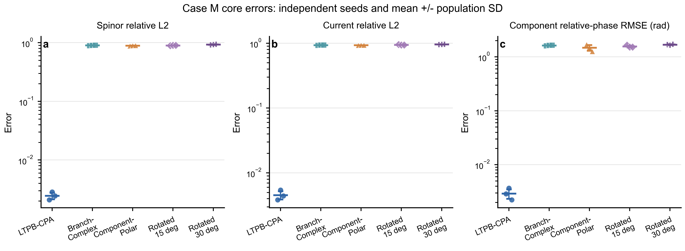
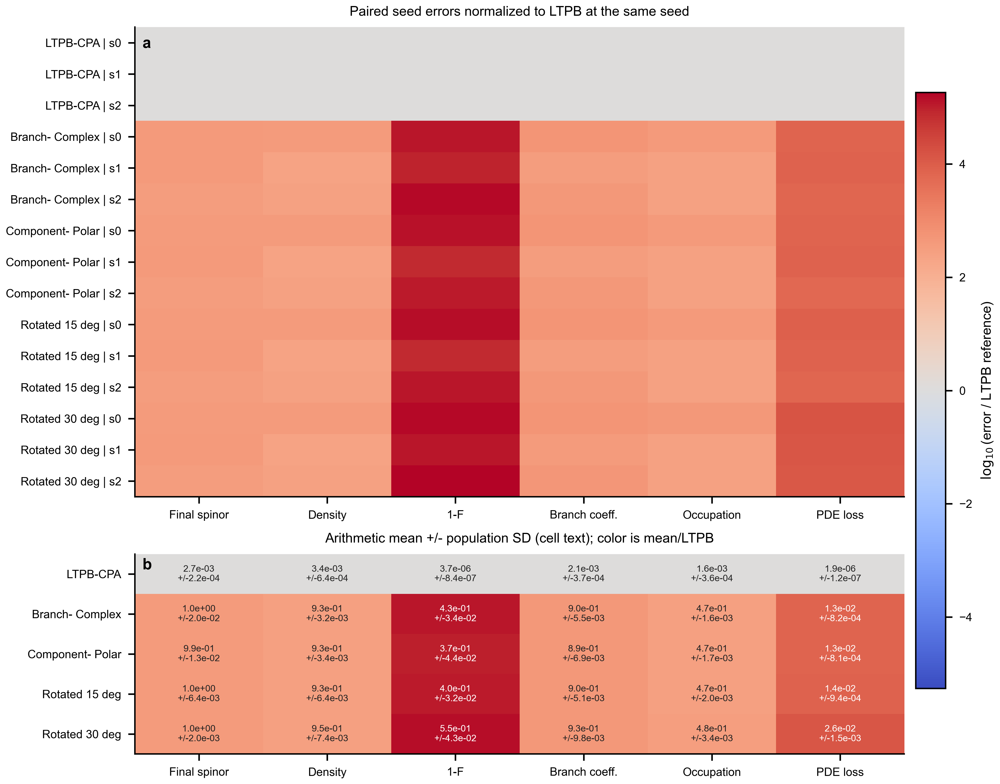
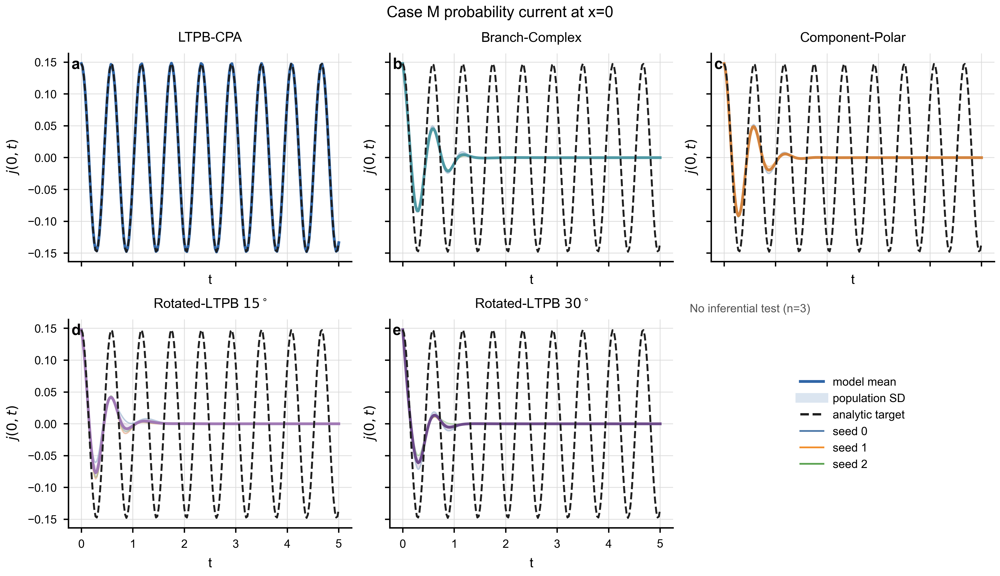
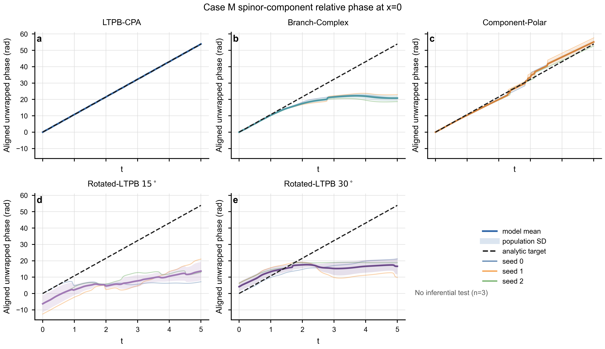
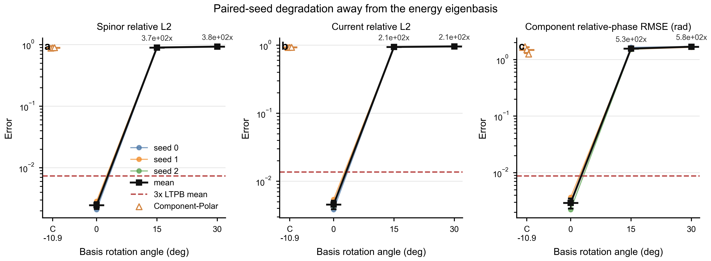
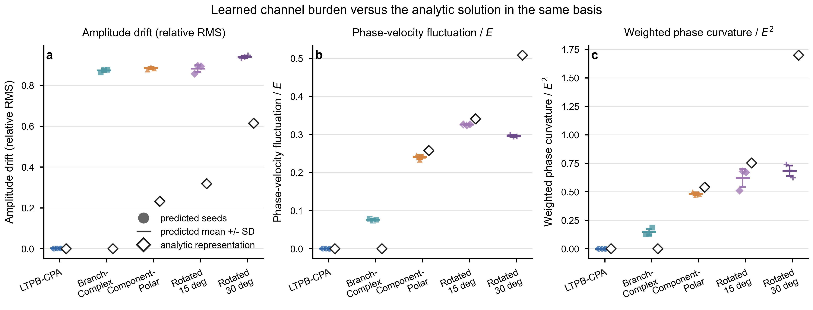
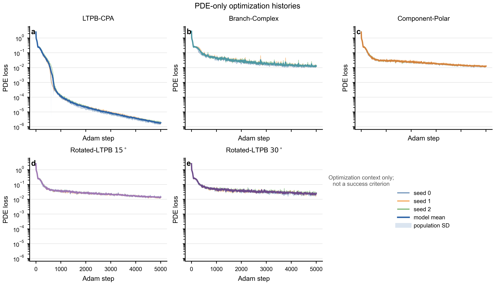

# LTPB-CPA 机制归因消融实验报告

## 摘要与结论

本实验在自由一维 Dirac 方程的单动量、正负能等权混合 Case M 上，对五个四输出模型完成了 seeds 0、1、2 共 15 个正式 5000-step run。所有模型共享完全相同的 PDE 强残差、硬初值、4×64 tanh MLP、float64/complex128、Adam 1e-3、每步重新采样 1024 个配点以及逐 seed 配点序列。

**自动判定：未通过预注册强机制支持判据。** 因此本实验不能把 LTPB 的优势强归因于“本征能量支与独立相位一一对应”；下面按失败子判据保留更弱、条件化的解释。

这一结论只涉及当前自由、固定 k=2、m=5、T=5 的受控问题和给定优化预算。它不是通用 Dirac 求解器结论，不涉及“世界首次”，也不否定其他表示在不同优化器、预算、波包或外势下的可能性。

数据入口：[15-run CSV](../../../results/summary/ltpb_mechanism_ablation/runs.csv)；[mean 与 population SD](../../../results/summary/ltpb_mechanism_ablation/summary.csv)；[相对 LTPB 比较表](../../../results/summary/ltpb_mechanism_ablation/comparisons.csv)；[预判据 JSON](../../../results/summary/ltpb_mechanism_ablation/decision.json)；图 manifest（本地档案）；[旧结果逐文件保护基线](../../../results/summary/ltpb_mechanism_ablation/protected_baseline.json)；[最终机器审计](../../../results/summary/ltpb_mechanism_ablation/audit.json)。

正式指标出现前固定的运行集与判据见 [控制记录](preregistration.md)，图证据链见 [figure contract](figure_contract.md)。

## 1. 已有工作与本次研究问题

原实验报告 [EXPERIMENT_REPORT.md](../cpa_transfer/report.md) 说明公共单相位 SP-CPA 在纯正能支 Case P 中有效，但在 Case M 中其有限预算优势明显退化；连续性、总范数和总能量也不能充分识别正负能相对相位错误。随后 [LEARNED_TWO_PHASE_PILOT_REPORT.md](../learned_two_phase_pilot/report.md) 表明 LTPB-CPA 能在不给定精确时间载波的条件下学习相反的能支相位并恢复 Case M。

然而 LTPB 同时改变了两件事：使用已知正负能本征基底，并为每个通道设置独立实振幅和相位。本次消融检验性能主要来自：

1. 已知能量本征基底；
2. 一般双通道极坐标表示；
3. 本征能量支与独立相位的一一对齐。

## 2. 物理问题

自然单位下求解

    i ∂t ψ = (-i σx ∂x + m σz) ψ,

其中 x∈[0,2π]、t∈[0,5]、m=5、k=2、η=1。初值为

    ψ(x,0) = exp(ikx) (u+ + u-) / sqrt(4π).

自由符号 Hk=kσx+mσz 的归一化本征旋量 u+、u- 属于已知物理算符先验。精确能量 E=sqrt(m²+k²) 只用于训练后的解析评价；训练目标中没有解析标签、相位标签或精确载波。

## 3. 五个比较模型

五个模型都由同一个 3→64→64→64→64→4 tanh MLP 产生四个实输出，并用 τ=t/T 硬满足初值。

### 3.1 LTPB-CPA

    ψhat = exp(ikx) [a+ u+ exp(iS+) + a- u- exp(iS-)]

其中 a±=a±,0+τr±，S±=τq±。它使用能量本征基底和显式独立相位，但 forward 不使用 E。

### 3.2 Branch-Complex

    ψhat = exp(ikx) (c+ u+ + c- u-)

其中 c±=c±,0+τ(δc±,R+iδc±,I)。它保留相同能量本征基底，却不显式分离振幅和相位。因此 LTPB 与 Branch-Complex 的差异主要检验显式极坐标参数化，而不是基底。

### 3.3 Component-Polar

    ψhat = exp(ikx) [b1 exp(iS1), b2 exp(iS2)]ᵀ

其中 bj=bj,0+τrj，Sj=τqj。其初始 bj,0 由 (u++u-)/sqrt(4π) 的两个实分量精确给出，允许有符号振幅；它使用双极坐标但不显式使用能量支基底。

### 3.4 Rotated-LTPB 15° 与 30°

令

    v1 = cosθ u+ + sinθ u-,
    v2 = -sinθ u+ + cosθ u-,

并使用

    ψhat = exp(ikx) [b1 v1 exp(iS1) + b2 v2 exp(iS2)].

初始能量基系数 α0=(1,1)ᵀ/sqrt(4π) 通过正交变换 β0=Rθᵀα0 精确计算。15°、30° 两个角度的通道初始振幅均非零。

### 3.5 Component-Polar 是旋转族的特例

在当前确定性实规范下 U=(u+,u-)=Rφ，其中

    φ = 0.5 atan2(k,m) = 10.9007047432°.

因此原始分量基 I=U R(-φ)，Component-Polar 数学上等价于 θ=-10.9007° 的 Rotated-LTPB，而不是与旋转族完全独立的第五种机制。若 Component-Polar 接近 LTPB，只能说明当前轻度失配的原始分量基足够，不能推出任意双分量极坐标都足够。

## 4. 公平性、随机源与无能量泄漏

- 五个模型均为四个实输出、12,996 个可训练参数；没有通过增加容量获得优势。
- 旧 pilot 使用 `[-π,π]`，本任务明确指定 `[0,2π]`。两者描述同一周期环但配点坐标和 `[sin x, cos x, t/T]` 输入逐点不同，因此没有复用旧 LTPB 指标；五个模型的 15 个 run 均在新域上重新训练。
- 训练配置为 float64/complex128、4×64 tanh、Adam 1e-3、5000 steps、每步 1024 个重新采样配点。
- 对每个 seed，五模型的 trainable initialization SHA-256 完全相同。
- 模型初始化使用 seed；配点使用独立的 100000+seed Generator。因此相同 seed 的五模型获得相同配点序列，且配点随机源不受模型构造消耗的全局 RNG 影响。
- 每个正式 run 只有 PDE loss；loss history 中 total=PDE，continuity/norm/energy/structure 均为 0。
- 五模型配置均声明并经测试验证 forward 不读取已存储 E，也不含 exp(∓iEt) 载波。配置快照记录谱本征值仅用于可复现性；解析解、能量目标和通道精确复杂度只在训练完成后计算。
- 自动测试另行验证硬初值、输出 dtype/shape、参数量、基变换正交性、精确初始系数、无 E 泄漏、解析表示和机器精度 PDE residual。
- 项目路径中的 `.git` 缺少有效仓库元数据，`git status` 返回 `not a git repository`，因此不能把 Git 当作保护证据。正式写入新目录前已对 268 个既有 raw、figure、summary、audit 与两份正式报告保存逐文件 SHA-256；最终独立 audit 会重新比较路径集合、大小和内容哈希。

首次正式启动使用前台 worker，三个 seed 均在首个 LTPB run 尚未完成时因宿主会话中断；当时没有任何 `metrics.json`、评价结果或 completed run。随后三者均以完全相同的固定代码、初始化 seed 和配点 seed 从 step 1 确定性重启，未使用 `--force`、未观察可供筛选的正式指标，也没有选择性保留或重跑。完整 worker 日志与恢复记录保存在 `results/logs/ltpb_mechanism_ablation/`，只有重启后完整完成的 15 个 run 进入统计。

统计均使用三个独立 seeds 的算术均值和 population SD（ddof=0）。n=3 只支持描述性稳定性判断，不作总体显著性检验。

## 5. 每个 seed 的完整结果

### 5.1 场精度、能支精度与计算量

| 模型 | seed | spinor L2 | final L2 | rho L2 | current L2 | fidelity | relative-phase RMSE | branch coeff. L2 | branch occ. RMSE | params | time (s) | final PDE |
| --- | --- | --- | --- | --- | --- | --- | --- | --- | --- | --- | --- | --- |
| LTPB-CPA | 0 | 0.0021 | 0.0026 | 0.0025 | 0.0038 | 0.999997 | 0.0029 | 0.0017 | 0.0011 | 12996 | 718.23 | 1.779e-06 |
| LTPB-CPA | 1 | 0.0029 | 0.0024 | 0.0039 | 0.0054 | 0.999995 | 0.0037 | 0.0026 | 0.0019 | 12996 | 717.98 | 1.770e-06 |
| LTPB-CPA | 2 | 0.0024 | 0.0030 | 0.0037 | 0.0044 | 0.999997 | 0.0022 | 0.0020 | 0.0018 | 12996 | 717.90 | 2.030e-06 |
| Branch-Complex | 0 | 0.8937 | 1.0267 | 0.9267 | 0.9288 | 0.611722 | 1.6021 | 0.8937 | 0.4634 | 12996 | 660.28 | 0.0120 |
| Branch-Complex | 1 | 0.9038 | 0.9890 | 0.9327 | 0.9357 | 0.563388 | 1.6363 | 0.9038 | 0.4664 | 12996 | 660.58 | 0.0139 |
| Branch-Complex | 2 | 0.9066 | 0.9808 | 0.9341 | 0.9379 | 0.529046 | 1.6420 | 0.9065 | 0.4671 | 12996 | 660.59 | 0.0125 |
| Component-Polar | 0 | 0.8819 | 0.9917 | 0.9262 | 0.9259 | 0.576438 | 1.6907 | 0.8819 | 0.4631 | 12996 | 741.52 | 0.0119 |
| Component-Polar | 1 | 0.8914 | 0.9746 | 0.9344 | 0.9349 | 0.642456 | 1.4959 | 0.8914 | 0.4672 | 12996 | 741.75 | 0.0137 |
| Component-Polar | 2 | 0.8987 | 1.0054 | 0.9321 | 0.9319 | 0.684029 | 1.2539 | 0.8987 | 0.4661 | 12996 | 741.46 | 0.0121 |
| Rotated-LTPB 15° | 0 | 0.8928 | 0.9990 | 0.9228 | 0.9512 | 0.558911 | 1.6407 | 0.8928 | 0.4639 | 12996 | 952.95 | 0.0155 |
| Rotated-LTPB 15° | 1 | 0.9008 | 0.9900 | 0.9357 | 0.9374 | 0.630093 | 1.5201 | 0.9008 | 0.4678 | 12996 | 953.41 | 0.0140 |
| Rotated-LTPB 15° | 2 | 0.9052 | 1.0057 | 0.9368 | 0.9391 | 0.623447 | 1.5129 | 0.9052 | 0.4685 | 12996 | 953.71 | 0.0132 |
| Rotated-LTPB 30° | 0 | 0.9200 | 1.0030 | 0.9428 | 0.9528 | 0.508798 | 1.6903 | 0.9199 | 0.4727 | 12996 | 784.09 | 0.0273 |
| Rotated-LTPB 30° | 1 | 0.9284 | 1.0037 | 0.9488 | 0.9591 | 0.404801 | 1.6436 | 0.9283 | 0.4754 | 12996 | 784.62 | 0.0237 |
| Rotated-LTPB 30° | 2 | 0.9436 | 0.9990 | 0.9607 | 0.9651 | 0.443933 | 1.7150 | 0.9436 | 0.4809 | 12996 | 784.44 | 0.0260 |

### 5.2 内部通道诊断

| 模型 | seed | amp drift pred. | amp drift exact | slope fluct. pred. | slope fluct. exact | curvature pred. | curvature exact | slope 1 pred. | slope 1 exact | slope 2 pred. | slope 2 exact |
| --- | --- | --- | --- | --- | --- | --- | --- | --- | --- | --- | --- |
| LTPB-CPA | 0 | 0.0014 | 2.717e-16 | 0.0030 | 4.311e-14 | 0.0108 | 3.074e-12 | -5.3850 | -5.3852 | 5.3850 | 5.3852 |
| LTPB-CPA | 1 | 0.0021 | 2.717e-16 | 0.0025 | 4.311e-14 | 0.0075 | 3.074e-12 | -5.3852 | -5.3852 | 5.3852 | 5.3852 |
| LTPB-CPA | 2 | 0.0021 | 2.717e-16 | 0.0020 | 4.311e-14 | 0.0085 | 3.074e-12 | -5.3851 | -5.3852 | 5.3851 | 5.3852 |
| Branch-Complex | 0 | 0.8637 | 2.717e-16 | 0.4258 | 4.311e-14 | 3.7175 | 3.074e-12 | -5.1473 | -5.3852 | 5.1865 | 5.3852 |
| Branch-Complex | 1 | 0.8765 | 2.717e-16 | 0.4000 | 4.311e-14 | 3.7566 | 3.074e-12 | -5.1644 | -5.3852 | 5.0106 | 5.3852 |
| Branch-Complex | 2 | 0.8765 | 2.717e-16 | 0.4132 | 4.311e-14 | 5.4290 | 3.074e-12 | -5.1037 | -5.3852 | 4.9579 | 5.3852 |
| Component-Polar | 0 | 0.8770 | 0.2331 | 1.3242 | 1.3905 | 14.4880 | 15.6836 | -4.9657 | -4.9896 | 4.8916 | 5.0193 |
| Component-Polar | 1 | 0.8900 | 0.2331 | 1.2590 | 1.3905 | 13.7025 | 15.6836 | -5.0008 | -4.9896 | 4.7824 | 5.0193 |
| Component-Polar | 2 | 0.8830 | 0.2331 | 1.3167 | 1.3905 | 13.9486 | 15.6836 | -4.9476 | -4.9896 | 4.8531 | 5.0193 |
| Rotated-LTPB 15° | 0 | 0.8573 | 0.3189 | 1.7603 | 1.8404 | 14.8536 | 21.8526 | -5.0009 | -4.6903 | 3.4869 | 4.6529 |
| Rotated-LTPB 15° | 1 | 0.8955 | 0.3189 | 1.7455 | 1.8404 | 19.7340 | 21.8526 | -4.5016 | -4.6903 | 4.6730 | 4.6529 |
| Rotated-LTPB 15° | 2 | 0.8935 | 0.3189 | 1.7610 | 1.8404 | 19.4754 | 21.8526 | -4.5419 | -4.6903 | 4.5758 | 4.6529 |
| Rotated-LTPB 30° | 0 | 0.9324 | 0.6142 | 1.6133 | 2.7367 | 21.4647 | 49.2608 | -0.2121 | -2.7324 | 3.9952 | 2.6942 |
| Rotated-LTPB 30° | 1 | 0.9388 | 0.6142 | 1.5868 | 2.7367 | 19.9314 | 49.2608 | -0.1775 | -2.7324 | 4.0585 | 2.6942 |
| Rotated-LTPB 30° | 2 | 0.9469 | 0.6142 | 1.5885 | 2.7367 | 18.1403 | 49.2608 | -0.6672 | -2.7324 | 3.3574 | 2.6942 |

内部相位诊断不是直接读取可能受 (b,S)→(-b,S+π) 影响的 raw S，而是从物理复通道系数构造振幅加权相位链接。近零振幅位置不贡献相位统计，并单独保存有效覆盖率。正负能分支系数误差仍统一投影到 u± 上，未被模型自身旋转通道替代。

## 6. 均值与 population SD

### 6.1 主要误差

| 模型 | n | spinor L2 | final L2 | rho L2 | current L2 | fidelity | relative-phase RMSE | branch coeff. L2 | branch occ. RMSE | time (s) | final PDE |
| --- | --- | --- | --- | --- | --- | --- | --- | --- | --- | --- | --- |
| LTPB-CPA | 3 | 0.0025 ± 3.131e-04 | 0.0027 ± 2.215e-04 | 0.0034 ± 6.442e-04 | 0.0045 ± 6.568e-04 | 1.0000 ± 8.443e-07 | 0.0029 ± 5.877e-04 | 0.0021 ± 3.693e-04 | 0.0016 ± 3.611e-04 | 718.0348 ± 0.140 | 1.860e-06 ± 1.205e-07 |
| Branch-Complex | 3 | 0.9014 ± 0.006 | 0.9988 ± 0.020 | 0.9312 ± 0.003 | 0.9342 ± 0.004 | 0.5681 ± 0.034 | 1.6268 ± 0.018 | 0.9013 ± 0.006 | 0.4656 ± 0.002 | 660.4846 ± 0.142 | 0.0128 ± 8.157e-04 |
| Component-Polar | 3 | 0.8907 ± 0.007 | 0.9906 ± 0.013 | 0.9309 ± 0.003 | 0.9309 ± 0.004 | 0.6343 ± 0.044 | 1.4802 ± 0.179 | 0.8907 ± 0.007 | 0.4655 ± 0.002 | 741.5746 ± 0.126 | 0.0126 ± 8.091e-04 |
| Rotated-LTPB 15° | 3 | 0.8996 ± 0.005 | 0.9982 ± 0.006 | 0.9318 ± 0.006 | 0.9426 ± 0.006 | 0.6042 ± 0.032 | 1.5579 ± 0.059 | 0.8996 ± 0.005 | 0.4667 ± 0.002 | 953.3557 ± 0.315 | 0.0142 ± 9.393e-04 |
| Rotated-LTPB 30° | 3 | 0.9306 ± 0.010 | 1.0019 ± 0.002 | 0.9508 ± 0.007 | 0.9590 ± 0.005 | 0.4525 ± 0.043 | 1.6830 ± 0.030 | 0.9306 ± 0.010 | 0.4763 ± 0.003 | 784.3839 ± 0.220 | 0.0256 ± 0.001 |

### 6.2 预测内部复杂度与解析固有复杂度

| 模型 | amp drift pred. | amp drift exact | slope fluct. pred. | slope fluct. exact | curvature pred. | curvature exact | mean slope ch.1 | mean slope ch.2 |
| --- | --- | --- | --- | --- | --- | --- | --- | --- |
| LTPB-CPA | 0.0019 ± 3.539e-04 | 2.717e-16 ± 0 | 0.0025 ± 4.050e-04 | 4.311e-14 ± 0 | 0.0089 ± 0.001 | 3.074e-12 ± 0 | -5.3851 ± 7.861e-05 | 5.3851 ± 6.513e-05 |
| Branch-Complex | 0.8722 ± 0.006 | 2.717e-16 ± 0 | 0.4130 ± 0.011 | 4.311e-14 ± 0 | 4.3010 ± 0.798 | 3.074e-12 ± 0 | -5.1385 ± 0.026 | 5.0517 ± 0.098 |
| Component-Polar | 0.8833 ± 0.005 | 0.2331 ± 0 | 1.3000 ± 0.029 | 1.3905 ± 0 | 14.0464 ± 0.328 | 15.6836 ± 0 | -4.9714 ± 0.022 | 4.8424 ± 0.045 |
| Rotated-LTPB 15° | 0.8821 ± 0.018 | 0.3189 ± 0 | 1.7556 ± 0.007 | 1.8404 ± 0 | 18.0210 ± 2.242 | 21.8526 ± 0 | -4.6815 ± 0.226 | 4.2452 ± 0.538 |
| Rotated-LTPB 30° | 0.9394 ± 0.006 | 0.6142 ± 0 | 1.5962 ± 0.012 | 2.7367 ± 0 | 19.8454 ± 1.359 | 49.2608 ± 0 | -0.3523 ± 0.223 | 3.8037 ± 0.317 |

LTPB 的两个能量对齐通道学得平均相位斜率分别为 `-5.3851 ± 7.861e-05` 与 `5.3851 ± 6.513e-05`，训练后评价目标为 `-E=-5.3851648071` 与 `+E=5.3851648071`。这里的 E 只在评价阶段用于解释斜率，未进入 forward、loss 或优化器。

振幅漂移、相位斜率波动和加权相位曲率在旋转基底中并不以零为解析目标：一个旋转通道同时含 exp(-iEt) 与 exp(+iEt)，其解析振幅和瞬时相位速度本来就随时间变化。因此上表将 predicted 与 exact intrinsic complexity 并列；predicted 较大不自动等于误差，predicted 与 exact 的失配才反映学习不足。对能量对齐的 LTPB/Branch-Complex，解析通道则为恒振幅、线性相位，固有斜率波动和曲率应接近数值零。

## 7. 预注册机制判据

### 预判据 1：LTPB 同时优于 Branch-Complex 与 Component-Polar

每项要求两个 LTPB/control 误差比均不超过 0.2000。

| 核心指标 | LTPB / Branch-Complex | LTPB / Component-Polar | 结果 |
| --- | --- | --- | --- |
| 全时空 spinor relative L2 | 0.0027 | 0.0028 | PASS |
| current relative L2 | 0.0049 | 0.0049 | PASS |
| 分量 relative-phase RMSE | 0.0018 | 0.0020 | PASS |

整体：**PASS**。

### 预判据 2：旋转后至少两项核心误差随角度明显增大

实现为每一角度步均至少 1.2500 倍，且两个步长分别至少有 2/3 个 paired seeds 增大。

| 核心指标 | 15° / 0° | 30° / 15° | 0→15 增大 seeds | 15→30 增大 seeds | 结果 |
| --- | --- | --- | --- | --- | --- |
| 全时空 spinor relative L2 | 366.0492 | 1.0345 | 3 | 3 | FAIL |
| current relative L2 | 207.3018 | 1.0175 | 3 | 3 | FAIL |
| 分量 relative-phase RMSE | 533.2144 | 1.0803 | 3 | 3 | FAIL |

通过指标数：0/3；整体：**FAIL**。

### 预判据 3：30° 至少两项达到 LTPB 的 3 倍

| 核心指标 | 30° / LTPB | 结果 |
| --- | --- | --- |
| 全时空 spinor relative L2 | 378.6785 | PASS |
| current relative L2 | 210.9203 | PASS |
| 分量 relative-phase RMSE | 576.0198 | PASS |

通过指标数：3/3；整体：**PASS**。

### 7.1 强机制总判定

**未通过预注册强机制支持判据：FAIL。** 因此本实验不能把 LTPB 的优势强归因于“本征能量支与独立相位一一对应”；下面按失败子判据保留更弱、条件化的解释。

### 7.2 Branch-Complex 与 Component-Polar 的接近性解释

Branch-Complex 接近性判定为 **FAIL**：其 spinor/current/relative-phase 误差相对 LTPB 的倍数为 366.7648、205.4530、556.8009，fidelity 绝对差为 0.4319。

Component-Polar 接近性判定为 **FAIL**：其三个误差倍数为 362.4211、204.7370、506.6217，fidelity 绝对差为 0.3657。

两个控制均未接近 LTPB，结合旋转趋势才能进一步判断是否支持本征能量支与独立相位的一一对应。

## 8. 概率流与旋量相对相位

Case M 的概率流来自正负能支干涉，是本征支相对相位的敏感量；旋量分量 relative phase 则直接检查两分量相位关系，而不会被密度正确所替代。

current relative L2 从低到高为：LTPB-CPA (0.0045) < Component-Polar (0.9309) < Branch-Complex (0.9342) < Rotated-LTPB 15° (0.9426) < Rotated-LTPB 30° (0.9590)。

分量 relative-phase RMSE 从低到高为：LTPB-CPA (0.0029) < Component-Polar (1.4802) < Rotated-LTPB 15° (1.5579) < Branch-Complex (1.6268) < Rotated-LTPB 30° (1.6830)。

x=0 的完整 current 与 relative-phase 时间曲线保存在每个 run 的 time_series.csv，并在图中同时显示逐 seed、均值和 population SD。判定仍以全时空 current L2 和带掩膜的 circular relative-phase RMSE 为核心，不凭训练 loss 或单条曲线下结论。

## 9. 失败子判据、未调参与如实解释

- 严格逐角度退化条件不足两项；未通过的指标为：current relative L2、分量 relative-phase RMSE、全时空 spinor relative L2。

- smoke test 仅用于排除 NaN 和流水线错误；正式配置在查看结果前固定为 5000 steps、Adam 1e-3 和每步 1024 个配点。正式目录对应预先列出的 15 个模型—seed 组合，本报告未按结果改变学习率、步数或挑选 seed，也未为有利结果选择性重跑。

若 Branch-Complex 接近 LTPB，最直接解释是已知能量基底已把 PDE 近似解耦，显式相位并非主要来源。若 Component-Polar 接近 LTPB，则当前轻度旋转的原始分量极坐标可能已足够。若旋转不随角度退化，则不能声称能量支对齐关键。无论总判定为何，本报告都不把 density、norm 或单独 final PDE loss 的改善替代 spinor、current 和 relative phase。

为避免概念混淆，本实验只作如下分层归因：

- **表达能力**：自动测试用各模型自身通道精确重建解析解并得到机器精度 Dirac residual；因此误差差异不能写成控制模型“数学上不能表示”。
- **载波预条件**：LTPB 把目标化为近恒振幅和近线性独立相位；旋转/分量基的解析目标本身需要振幅调制与非线性相位，Branch-Complex 则仍需直接拟合快速复振荡。
- **优化难度**：所有排名只说明固定 5000-step Adam、固定容量和固定随机流下的可达精度，不说明无限预算极限。
- **守恒量盲点**：本轮故意只用 PDE loss；已有实验关于连续性、总范数和总能量不能唯一识别能支相对相位的结论是背景证据，不是本轮新增守恒消融。
- **已知能支基底先验**：u± 来自已知 Hk，LTPB 不是无先验地发现能支；即使最终支持对齐机制，也必须把这项物理先验与“未硬编码 E 时间载波”同时陈述。

## 10. 局限性与不能推出的结论

1. 这里只研究自由、周期、单一 k=2、固定 m=5、有限 T=5 的平面波混合态，不能推广为波包、外势、散射、非周期边界或长时间 Dirac 求解器。
2. LTPB 和 Branch-Complex 显式使用已知 Hk 的 u±；即使无 E 时间载波，也不是从原始数据无先验发现能支。
3. 这不是完整析因设计：缺少例如 Component-Complex、Rotated-Complex 以及不同角度与不同 m/k 的全交叉组合，不能无条件分离所有基底—参数化交互。
4. Component-Polar 只对应 -10.9007° 的轻度旋转；当前 m/k 使标准分量基天然接近能量基。
5. 三个 seeds 只能估计当前初始化和配点随机性的有限波动，不能给出可靠总体显著性或失败概率。
6. 5000-step Adam 比较反映表达、载波预条件和优化难度的联合结果；一次消融不能证明某表示在无限优化预算下不可达。
7. 内部通道相位在振幅接近零时不可辨识。虽然本实验选择的解析初始系数非零并采用振幅权重与覆盖率，但学习轨迹仍可能接近零。
8. 不使用总连续性、总范数或总能量损失是为了隔离表示机制；本实验不评价这些约束在其他问题上的实用价值。
9. 本报告不声称世界首次，也不声称公共单相位在数学上不能表示混合态。
10. 三个 seed worker 并行运行并共享 CPU；各模型的训练时间仅作资源记录，不用于声称某种参数化具有更高计算效率。

## 11. 原始数据与可复现链接

### 11.1 十五个正式 run

| 模型 | seed | 逐 run 原始文件 |
| --- | --- | --- |
| LTPB-CPA | 0 | config.json（本地档案）；metrics.json（本地档案）；loss_history.csv（本地档案）；time_series.csv（本地档案）；dense_grid.npz（本地档案）；model_state.pt（本地档案） |
| LTPB-CPA | 1 | config.json（本地档案）；metrics.json（本地档案）；loss_history.csv（本地档案）；time_series.csv（本地档案）；dense_grid.npz（本地档案）；model_state.pt（本地档案） |
| LTPB-CPA | 2 | config.json（本地档案）；metrics.json（本地档案）；loss_history.csv（本地档案）；time_series.csv（本地档案）；dense_grid.npz（本地档案）；model_state.pt（本地档案） |
| Branch-Complex | 0 | config.json（本地档案）；metrics.json（本地档案）；loss_history.csv（本地档案）；time_series.csv（本地档案）；dense_grid.npz（本地档案）；model_state.pt（本地档案） |
| Branch-Complex | 1 | config.json（本地档案）；metrics.json（本地档案）；loss_history.csv（本地档案）；time_series.csv（本地档案）；dense_grid.npz（本地档案）；model_state.pt（本地档案） |
| Branch-Complex | 2 | config.json（本地档案）；metrics.json（本地档案）；loss_history.csv（本地档案）；time_series.csv（本地档案）；dense_grid.npz（本地档案）；model_state.pt（本地档案） |
| Component-Polar | 0 | config.json（本地档案）；metrics.json（本地档案）；loss_history.csv（本地档案）；time_series.csv（本地档案）；dense_grid.npz（本地档案）；model_state.pt（本地档案） |
| Component-Polar | 1 | config.json（本地档案）；metrics.json（本地档案）；loss_history.csv（本地档案）；time_series.csv（本地档案）；dense_grid.npz（本地档案）；model_state.pt（本地档案） |
| Component-Polar | 2 | config.json（本地档案）；metrics.json（本地档案）；loss_history.csv（本地档案）；time_series.csv（本地档案）；dense_grid.npz（本地档案）；model_state.pt（本地档案） |
| Rotated-LTPB 15° | 0 | config.json（本地档案）；metrics.json（本地档案）；loss_history.csv（本地档案）；time_series.csv（本地档案）；dense_grid.npz（本地档案）；model_state.pt（本地档案） |
| Rotated-LTPB 15° | 1 | config.json（本地档案）；metrics.json（本地档案）；loss_history.csv（本地档案）；time_series.csv（本地档案）；dense_grid.npz（本地档案）；model_state.pt（本地档案） |
| Rotated-LTPB 15° | 2 | config.json（本地档案）；metrics.json（本地档案）；loss_history.csv（本地档案）；time_series.csv（本地档案）；dense_grid.npz（本地档案）；model_state.pt（本地档案） |
| Rotated-LTPB 30° | 0 | config.json（本地档案）；metrics.json（本地档案）；loss_history.csv（本地档案）；time_series.csv（本地档案）；dense_grid.npz（本地档案）；model_state.pt（本地档案） |
| Rotated-LTPB 30° | 1 | config.json（本地档案）；metrics.json（本地档案）；loss_history.csv（本地档案）；time_series.csv（本地档案）；dense_grid.npz（本地档案）；model_state.pt（本地档案） |
| Rotated-LTPB 30° | 2 | config.json（本地档案）；metrics.json（本地档案）；loss_history.csv（本地档案）；time_series.csv（本地档案）；dense_grid.npz（本地档案）；model_state.pt（本地档案） |

每个 run 均包含 config.json、metrics.json、loss_history.csv、time_series.csv、dense_grid.npz 和 model_state.pt。聚合与判定文件见报告摘要的数据入口。

### 11.2 图、三格式导出与源数据

### 图 1. 三项核心误差比较

导出：[PNG](../../../results/figures/ltpb_mechanism_ablation/01_core_error_comparison.png)；[PDF](../../../results/figures/ltpb_mechanism_ablation/01_core_error_comparison.pdf)；[SVG](../../../results/figures/ltpb_mechanism_ablation/01_core_error_comparison.svg)。源数据：[01_core_error_comparison.csv](../../../results/figures/ltpb_mechanism_ablation/source_data/01_core_error_comparison.csv)。

研究问题：能量对齐的 LTPB 是否在 spinor、current 和相对相位三项核心误差上同时优于匹配容量的控制模型？

图结论：完整的预先固定强机制规则未通过；图中保留每个 seed 与各子判据，未在观察结果后改变阈值。

统计说明：三个独立 seeds；中心为算术均值，离散为 population SD（ddof=0）；不作推断性显著性检验。

说明：对数轴上若 mean-SD 不为正，则不绘制无定义的下侧误差臂；源 CSV 仍保存未截断的 population SD。

### 图 2. 逐 seed 与辅助指标汇总

导出：[PNG](../../../results/figures/ltpb_mechanism_ablation/02_per_seed_summary.png)；[PDF](../../../results/figures/ltpb_mechanism_ablation/02_per_seed_summary.pdf)；[SVG](../../../results/figures/ltpb_mechanism_ablation/02_per_seed_summary.svg)。源数据：[02_per_seed_summary.csv](../../../results/figures/ltpb_mechanism_ablation/source_data/02_per_seed_summary.csv)。

研究问题：模型差异是否在每个 seed 以及场、能支和最终 PDE 辅助指标上都可见？

图结论：图中保留全部 seed 值；汇总只报告算术均值与 population SD，不声称统计显著性。

统计说明：同 seed 比值按预先固定的随机流配对；模型汇总 n=3，离散为 population SD。

### 图 3. Case M 在 x=0 的概率流

导出：[PNG](../../../results/figures/ltpb_mechanism_ablation/03_current_x0.png)；[PDF](../../../results/figures/ltpb_mechanism_ablation/03_current_x0.pdf)；[SVG](../../../results/figures/ltpb_mechanism_ablation/03_current_x0.svg)。源数据：[03_current_x0.csv](../../../results/figures/ltpb_mechanism_ablation/source_data/03_current_x0.csv)。

研究问题：各表示是否恢复 Case M 的快速概率流振荡？

图结论：图中并列解析轨迹、三个 seed 和模型均值；不以标量训练 loss 代替 current 精度。

统计说明：三个独立 seeds；粗线为算术均值，阴影为 population SD。

### 图 4. Case M 在 x=0 的旋量分量相对相位

导出：[PNG](../../../results/figures/ltpb_mechanism_ablation/04_relative_phase_x0.png)；[PDF](../../../results/figures/ltpb_mechanism_ablation/04_relative_phase_x0.pdf)；[SVG](../../../results/figures/ltpb_mechanism_ablation/04_relative_phase_x0.svg)。源数据：[04_relative_phase_x0.csv](../../../results/figures/ltpb_mechanism_ablation/source_data/04_relative_phase_x0.csv)。

研究问题：各表示是否恢复旋量两分量的相对相位时间轨迹？

图结论：预测先按圆周差对齐解析分支再沿时间展开；原始角度、圆周误差和跨 seed 的 2π 显示平移均保存在源数据。

统计说明：三个独立 seeds；粗线为算术均值，阴影为 population SD；不作假设检验。

### 图 5. 误差随基底旋转角的退化

导出：[PNG](../../../results/figures/ltpb_mechanism_ablation/05_rotation_degradation.png)；[PDF](../../../results/figures/ltpb_mechanism_ablation/05_rotation_degradation.pdf)；[SVG](../../../results/figures/ltpb_mechanism_ablation/05_rotation_degradation.svg)。源数据：[05_rotation_degradation.csv](../../../results/figures/ltpb_mechanism_ablation/source_data/05_rotation_degradation.csv)。

研究问题：匹配的双极坐标通道偏离能量本征基后，三项核心误差是否按预判据随角度退化？

图结论：通过严格逐角度趋势的指标为 0/3；30° 达到至少 3 倍的指标为 3/3。Component-Polar 仅作为精确有效角 -10.9007° 的特例显示，不进入 0/15/30 的预判路径。

统计说明：同 seed 轨迹作描述性配对；中心为算术均值，离散为 population SD；不作推断性检验。

说明：对数轴上若 mean-SD 不为正，则不绘制无定义的下侧误差臂；源 CSV 保留完整 population SD。

### 图 6. 振幅漂移与内部相位复杂度

导出：[PNG](../../../results/figures/ltpb_mechanism_ablation/06_amplitude_phase_complexity.png)；[PDF](../../../results/figures/ltpb_mechanism_ablation/06_amplitude_phase_complexity.pdf)；[SVG](../../../results/figures/ltpb_mechanism_ablation/06_amplitude_phase_complexity.svg)。源数据：[06_amplitude_phase_complexity.csv](../../../results/figures/ltpb_mechanism_ablation/source_data/06_amplitude_phase_complexity.csv)。

研究问题：模型退化是否伴随失配基底对解析解本身引入的振幅和相位复杂度？

图结论：预测复杂度与同一模型基底中的解析固有复杂度并列显示；旋转基底所必需的解析调制不被误判为训练误差。

统计说明：预测值来自三个独立 seeds，报告算术均值与 population SD；解析表示值是训练后确定性参照。

### 图 7. PDE-only 训练轨迹

导出：[PNG](../../../results/figures/ltpb_mechanism_ablation/07_loss_histories.png)；[PDF](../../../results/figures/ltpb_mechanism_ablation/07_loss_histories.pdf)；[SVG](../../../results/figures/ltpb_mechanism_ablation/07_loss_histories.svg)。源数据：[07_loss_histories.csv](../../../results/figures/ltpb_mechanism_ablation/source_data/07_loss_histories.csv)。

研究问题：不同表示的最终精度排序与其 PDE-only 优化轨迹有何对应？

图结论：loss history 只提供优化背景，不替代 spinor、current 或相对相位精度判定。

统计说明：三个独立 seeds；粗线为算术均值，阴影为 population SD；当 mean-SD 不为正时不在对数轴上绘制该阴影下臂；不作推断性检验。

## 12. 复现命令

在项目根目录执行：

    python -m src.run_ltpb_mechanism_ablation --mode smoke --smoke-steps 20
    python -m src.run_ltpb_mechanism_ablation --mode full
    python -m src.run_ltpb_mechanism_ablation --mode aggregate
    python -m src.plot_ltpb_mechanism_ablation
    python -m src.build_ltpb_mechanism_ablation_report

正式并行运行时可以按 model/seed 拆分并使用 --no-aggregate，但最终 aggregate、plot 与本报告构建必须在全部 15 个 run 完成后执行。报告构建器会重新核对逐 run 配置、六件套、聚合均值与 population SD、比较比值、预判据 JSON、七个固定图组及其非空有限源数据；独立 audit 还会从原始工件重算图源统计并核验格式与旧结果保护。任一必需项缺失或不一致都会使相应阶段失败。
