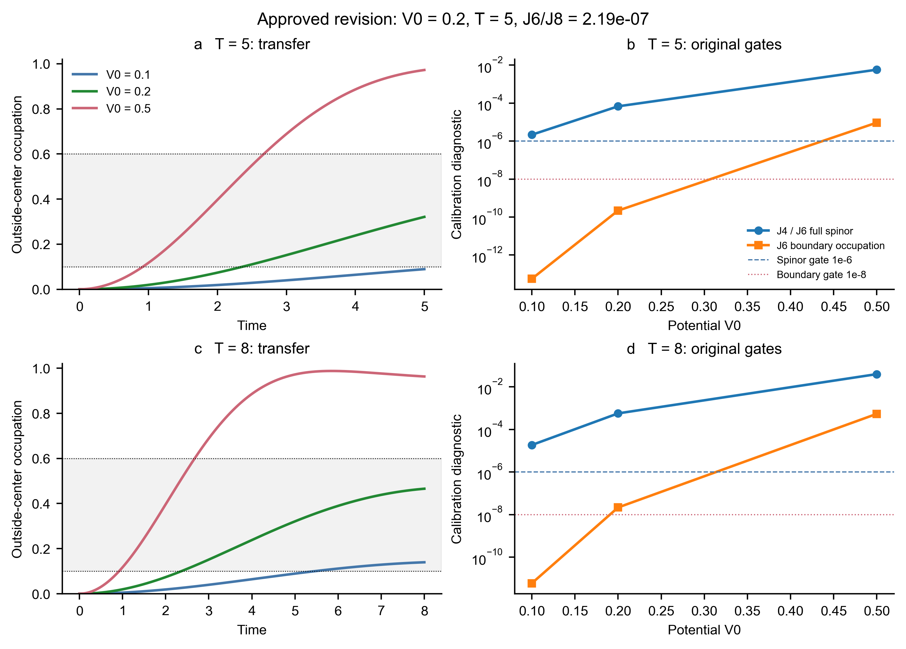
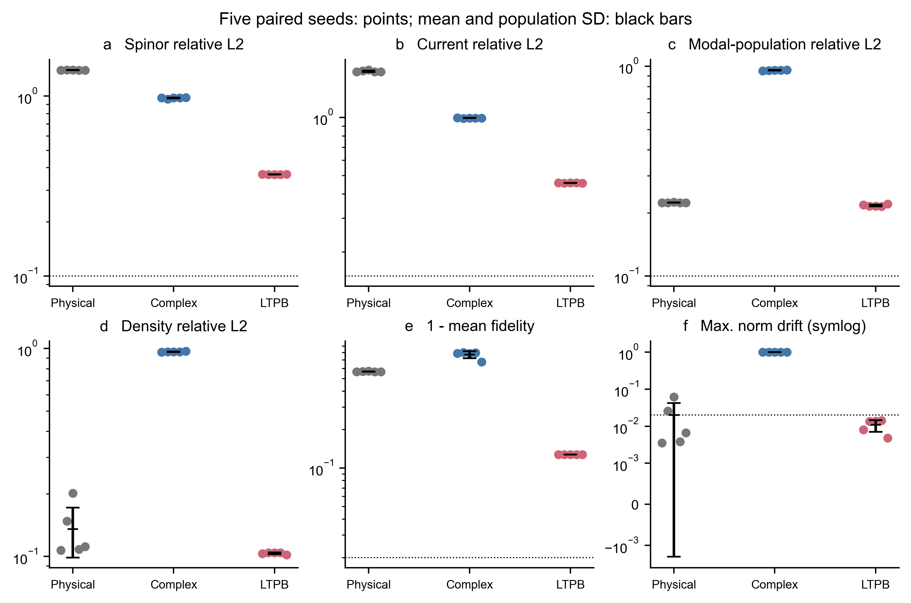
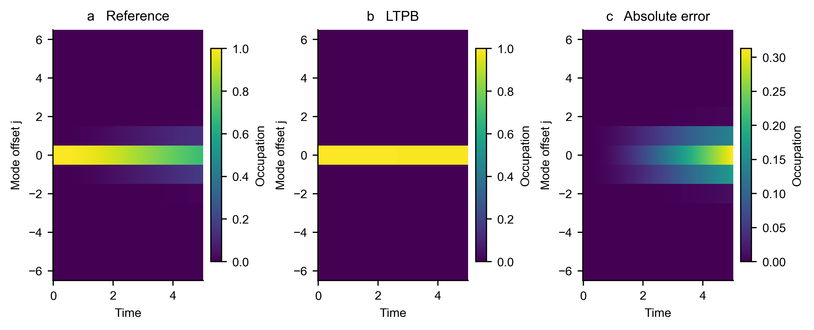
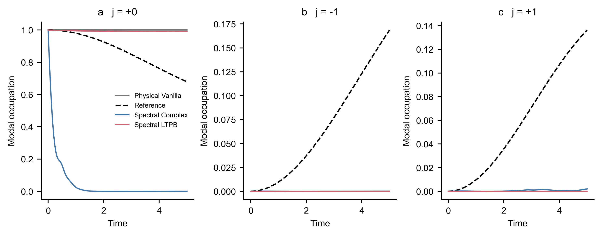
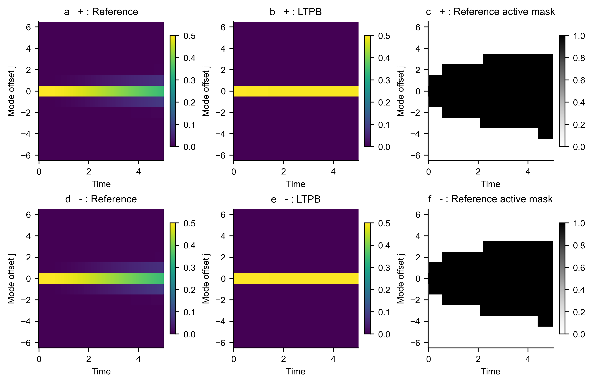
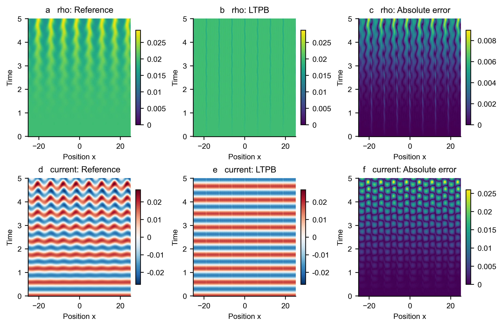
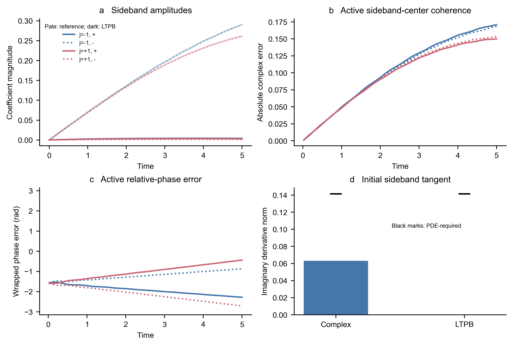
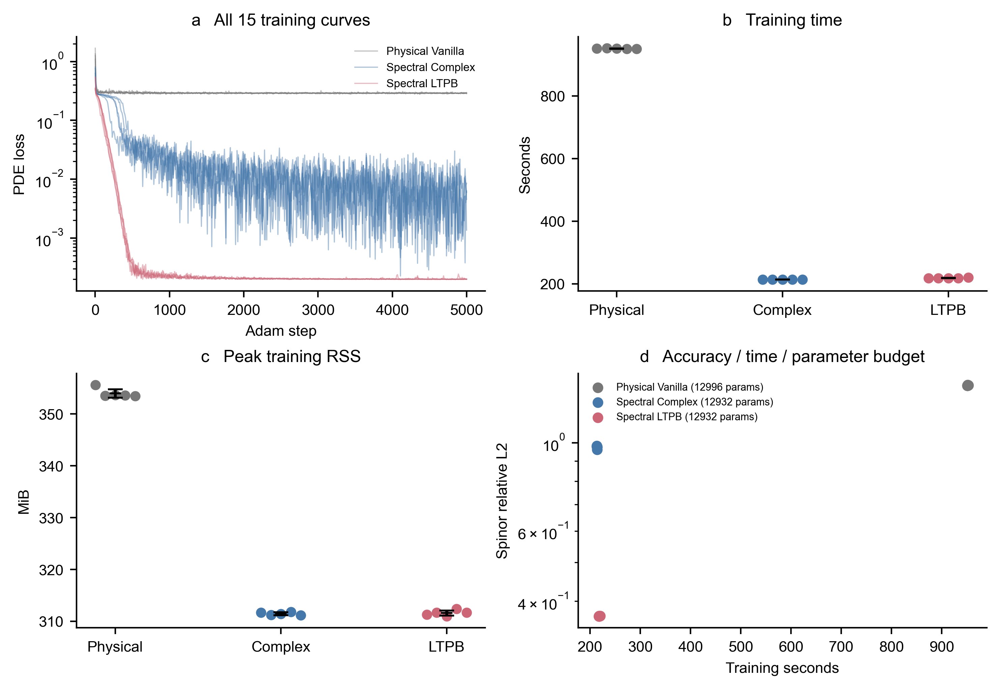

# 弱周期外势下的耦合谱 LTPB 迁移实验报告

自动分类：**INCONCLUSIVE**。两种共享谱模型均未达到绝对迁移标准。当前固定预算对照不足以把失败单独归因于 LTPB；仍须区分共同优化失败与表示限制。

LTPB 五 seed 平均 spinor error = 0.366703，current error = 0.456121，mean fidelity = 0.872527。逐 seed 五项绝对条件同时通过 0/5；对同基底 Complex 的 spinor/current 同时获胜 5/5。

## 1. 问题、已有工作与本轮范围

[已有自由波包报告](../wavepacket_shared_spectral_ltpb/report.md)记录了无动量耦合时 Shared-Spectral-LTPB 的成功，[单动量试验](../learned_two_phase_pilot/report.md)与[机制消融](../ltpb_mechanism_ablation/report.md)支持能支对齐和独立载波的优化作用。本轮改变的是 PDE 的耦合结构：初态只占中心动量，外势动态产生原来零占据的侧带。它不是上一轮高斯初谱的直接复跑。

研究对象为 $i\partial_t\psi=[-i\sigma_x\partial_x+m\sigma_z+V_0\cos(qx)I_2]\psi$，$x\in[-8\pi,8\pi)$，$m=5,k_0=2,q=1$。谱系数采用 $1/\sqrt L$ 的正交 Fourier 归一化。初态中心为 $(u_++u_-)/\sqrt2$，其余模态严格零。

## 2. 校准失败、授权修订与参考可靠性

原要求的六个候选均无法同时满足耦合强度和 J4/J6 旋量收敛门槛。原始记录没有覆盖，完整结果如下：

| T | V₀ | 最大侧带占据 | J6 最大边界占据 | J4/J6 完整旋量差 | 原门槛 |
|---|---|---|---|---|---|
| 5 | 0.1 | 0.0891852 | 5.59193e-14 | 2.15509e-06 | FAIL |
| 5 | 0.2 | 0.3209 | 2.18548e-10 | 6.76012e-05 | FAIL |
| 5 | 0.5 | 0.972215 | 9.34629e-06 | 0.00574057 | FAIL |
| 8 | 0.1 | 0.13941 | 5.91958e-12 | 1.84599e-05 | FAIL |
| 8 | 0.2 | 0.465551 | 2.14858e-08 | 0.000563215 | FAIL |
| 8 | 0.5 | 0.987672 | 0.000534827 | 0.0393184 | FAIL |

用户在正式神经网络训练前明确授权只将截断比较改为 J6/J8。[修订 01](amendment_01.md)固定 V₀=0.2、T=5、训练 J=6（13 模态），所有成功阈值、种子和训练预算保留。

修订后的完整复旋量收敛误差为 2.189977762e-07（8001 时间点，J6 零填充到 J8）。最大侧带占据 0.3209004147；J6 两端总占据最大值 2.185481782e-10。

参考 Hamiltonian 是 26×26 块三对角 Hermitian 矩阵。选中 J6 的 Hermiticity 最大误差 0，范数最大漂移 1.44e-15，时间逆转相对误差 1.11e-15；全部候选与独立 scipy 矩阵指数的最大差为 1.52e-14。

本实验训练和评价使用 J6 的有限阶梯；已保存 J6/J8 截断诊断。占据收敛和公共模态切片收敛均不冒充完整旋量收敛。

校准 JSON（本地档案） · 校准 CSV（本地档案） · 独立验证（本地档案） · 正式物理选择（本地档案）

## 3. 模型、物理先验和公平性

本报告中的简称与原始模型 ID 一一对应：

| 报告/图表简称 | 原始模型 ID | 表示 |
|---|---|---|
| Physical Vanilla | `physical_vanilla` | 物理空间笛卡尔旋量 |
| Spectral Complex / Complex | `coupled_shared_spectral_complex` | 自由能支基底中的共享复系数 |
| Spectral LTPB / LTPB | `coupled_shared_spectral_ltpb` | 自由能支基底中的共享实振幅和独立相位 |

Physical-Vanilla 以 $\psi_0+\tau\Delta\psi$ 硬编码初值；两个共享谱网络都接收 $((k-k_0)/(Jq),t/T)$ 并输出四个实数。Complex 使用 $c_\pm=c_{\pm,0}+\tau(r_\pm+iq_\pm)$；LTPB 使用 $a_\pm=c_{\pm,0}+\tau r_\pm,S_\pm=\tau q_\pm$，$\widetilde\psi=\sum_\pm a_\pm u_\pm e^{iS_\pm}$。实振幅允许有符号值。

自由 $H(k)$ 的本征子空间是已知表示基底，既不是有外势完整 Hamiltonian 的本征态，也不取消动量耦合。训练直接计算 $R_j=i\partial_t\widetilde\psi_j-H(k_j)\widetilde\psi_j-(V_0/2)(\widetilde\psi_{j-1}+\widetilde\psi_{j+1})$。精确能量、本征演化相位、参考占据和传播解不进入 learned forward、loss、optimizer 或 checkpoint。

三个模型均为 4×64 tanh、float64/complex128、Adam lr=1e-3、5000 steps、seeds 0–4，唯一损失为 PDE 强残差。谱模型每步 32 个新时间×13 模态=416 点，物理模型同批 32 时间×32 新位置=1024 点。初始化、时间和位置流分别为 500000+s、600000+s、700000+s；共享谱对的初始权重逐元素相同，时间流哈希逐 seed 相同。两共享谱模型各 12932 参数，物理基线 12996，差约 0.49%。CPU 每 run 单线程，固定 5 个并发进程，队列无重试。

谱损失为 $\operatorname{mean}_{t,s}\sum_j|R_j|^2/L$。Parseval 把保留 Fourier 投影的残差范数对应到物理空间；密集物理 PDE 诊断还保留边缘预测向阶梯外生成的两项残差，因此不把截断后的内部残差误认为完整物理残差。

## 4. 评价定义与预注册判定

Nx=256、Nt=201，物理 x 网格不重复周期端点。主旋量误差仅移除一项全时间/全空间共同的常数相位。对谱模型，该误差通过 Parseval 等于全保留模态误差；物理模型使用完整场误差，并另报保留阶梯投影误差和阶梯外占据。不逐模态或逐时间对齐。fidelity 每时刻按预测/参考范数归一化，另报范数漂移，避免 fidelity 掩盖振幅塌缩。

仅在参考分支占据 ≥1e-6 时评价通道相干量；成对相干需双方都活跃。相位自身还需预测占据 ≥1e-12，报告覆盖率，所有 mask 和无效相位 NaN 均保存。相干量误差不排除预测塌缩为零的通道。

绝对成功需要五 seed mean spinor≤0.10、current≤0.15、fidelity≥0.98、modal-population≤0.10、norm drift≤0.02，且至少 4/5 seeds 各自同时满足这五项。比较优势还需要 target 两项 mean error 均更小且至少 4/5 配对 seeds 两项同时胜出。Complex 成功而 LTPB 失败才进入 REPRESENTATION_FAILURE；二者共同失败进入 INCONCLUSIVE。

[预注册](preregistration.md) · 冻结哈希（本地档案） · [自动判定 JSON](../../../results/summary/periodic_potential_coupled_ltpb/decision.json)

冻结时间（UTC）：`2026-09-29T14:09:13.326642+00:00`；冻结 manifest SHA-256：`b0e6680c160651036646220c9e5f6314c9726b3a9a72e4d1f626867d42b5e5a3`。科学代码/评价/判据在训练前冻结；输出用绘图和报告脚本另有源文件哈希，不改写原始指标。

## 5. 全部 seeds 与统计结果

下表为均值 ± population SD（ddof=0），无选择性剔除、重跑或最佳 seed 汇报。

| 模型 | Spinor | Current | Density | Fidelity | Modal population | Norm drift |
|---|---|---|---|---|---|---|
| Physical Vanilla | 1.39344 ± 0.00225 | 1.73708 ± 0.0157 | 0.13515 ± 0.0364 | 0.432817 ± 0.00272 | 0.22378 ± 0.00044 | 0.0201949 ± 0.0222 |
| Spectral Complex | 0.974201 ± 0.00698 | 0.991955 ± 0.00247 | 0.964767 ± 0.00261 | 0.230814 ± 0.0471 | 0.955278 ± 0.00315 | 0.999563 ± 0.000264 |
| Spectral LTPB | 0.366703 ± 0.00022 | 0.456121 ± 0.000663 | 0.103431 ± 0.00104 | 0.872527 ± 0.000127 | 0.216503 ± 0.00227 | 0.0108665 ± 0.00377 |

### 5.1 逐 seed 主指标

| model | seed | spinor_rel_l2_gauge_aligned | density_rel_l2 | current_rel_l2 | fidelity_mean | fidelity_min |
|---|---|---|---|---|---|---|
| Physical Vanilla | 0 | 1.39173 | 0.107102 | 1.72554 | 0.434803 | 2.94354e-07 |
| Physical Vanilla | 1 | 1.39409 | 0.147838 | 1.74163 | 0.433032 | 2.87665e-07 |
| Physical Vanilla | 2 | 1.39759 | 0.201247 | 1.76586 | 0.427526 | 2.30953e-07 |
| Physical Vanilla | 3 | 1.39179 | 0.108125 | 1.72454 | 0.434085 | 2.79034e-07 |
| Physical Vanilla | 4 | 1.39202 | 0.111438 | 1.72784 | 0.434636 | 2.71219e-07 |
| Spectral Complex | 0 | 0.975593 | 0.961255 | 0.994677 | 0.214883 | 0.00155135 |
| Spectral Complex | 1 | 0.961129 | 0.963683 | 0.987284 | 0.197971 | 5.81681e-05 |
| Spectral Complex | 2 | 0.974849 | 0.965493 | 0.992641 | 0.210745 | 8.85426e-05 |
| Spectral Complex | 3 | 0.977511 | 0.964194 | 0.992704 | 0.20617 | 0.00071297 |
| Spectral Complex | 4 | 0.981924 | 0.969208 | 0.992469 | 0.324302 | 0.000957451 |
| Spectral LTPB | 0 | 0.36696 | 0.102996 | 0.456649 | 0.872466 | 0.678689 |
| Spectral LTPB | 1 | 0.366338 | 0.104044 | 0.455724 | 0.872647 | 0.679002 |
| Spectral LTPB | 2 | 0.366638 | 0.104264 | 0.45641 | 0.872438 | 0.678934 |
| Spectral LTPB | 3 | 0.366682 | 0.104267 | 0.456801 | 0.872377 | 0.678462 |
| Spectral LTPB | 4 | 0.366899 | 0.101582 | 0.455019 | 0.872707 | 0.679704 |

### 5.2 逐 seed 耦合动力学与占据

| model | seed | modal_population_rel_l2 | branch_population_rel_l2 | max_norm_drift | center_occupation_rel_l2 | lower_sideband_occupation_rel_l2 | upper_sideband_occupation_rel_l2 |
|---|---|---|---|---|---|---|---|
| Physical Vanilla | 0 | 0.223547 | 0.223548 | 0.0035332 | 0.185954 | 1 | 1 |
| Physical Vanilla | 1 | 0.223606 | 0.22364 | 0.025531 | 0.185954 | 1 | 1 |
| Physical Vanilla | 2 | 0.224659 | 0.224983 | 0.0614654 | 0.185954 | 1 | 1 |
| Physical Vanilla | 3 | 0.223558 | 0.223559 | 0.00379972 | 0.185954 | 1 | 1 |
| Physical Vanilla | 4 | 0.223531 | 0.223544 | 0.00664538 | 0.185954 | 1 | 1 |
| Spectral Complex | 0 | 0.95087 | 0.950873 | 0.999743 | 0.950123 | 0.99949 | 0.991006 |
| Spectral Complex | 1 | 0.953793 | 0.953796 | 0.999488 | 0.953056 | 0.999413 | 0.996506 |
| Spectral Complex | 2 | 0.955999 | 0.956 | 0.999762 | 0.95531 | 0.995986 | 0.999742 |
| Spectral Complex | 3 | 0.955228 | 0.955232 | 0.999076 | 0.954511 | 0.998794 | 0.998061 |
| Spectral Complex | 4 | 0.960503 | 0.960503 | 0.999748 | 0.959868 | 0.999874 | 0.997558 |
| Spectral LTPB | 0 | 0.217803 | 0.217813 | 0.00810861 | 0.178881 | 0.999792 | 0.999862 |
| Spectral LTPB | 1 | 0.21499 | 0.21502 | 0.0133706 | 0.175409 | 0.99962 | 0.999595 |
| Spectral LTPB | 2 | 0.214908 | 0.21491 | 0.0137889 | 0.175305 | 0.999603 | 0.999668 |
| Spectral LTPB | 3 | 0.214438 | 0.214445 | 0.0142862 | 0.174722 | 0.99957 | 0.999618 |
| Spectral LTPB | 4 | 0.220377 | 0.220423 | 0.00477789 | 0.182052 | 0.999868 | 0.999879 |

### 5.3 相干、有效相位和残差

| model | seed | active_coherence_rel_l2 | active_branch_phase_circular_rmse | active_branch_phase_coverage | dense_physical_pde_residual_rms | final_loss_pde |
|---|---|---|---|---|---|---|
| Physical Vanilla | 0 | 1.35236 | 1.78168 | 0.312886 | 0.537568 | 0.29005 |
| Physical Vanilla | 1 | 1.35837 | 1.78755 | 0.312886 | 0.53917 | 0.296901 |
| Physical Vanilla | 2 | 1.37336 | 1.78705 | 0.312886 | 0.541216 | 0.286365 |
| Physical Vanilla | 3 | 1.35258 | 1.78514 | 0.312886 | 0.53755 | 0.289089 |
| Physical Vanilla | 4 | 1.35329 | 1.78062 | 0.312886 | 0.537755 | 0.283974 |
| Spectral Complex | 0 | 0.995701 | 1.78155 | 1 | 0.0802616 | 0.00852456 |
| Spectral Complex | 1 | 0.990412 | 1.79967 | 1 | 0.0737461 | 0.00595807 |
| Spectral Complex | 2 | 0.994485 | 1.77021 | 1 | 0.0794557 | 0.00627125 |
| Spectral Complex | 3 | 0.994784 | 1.79233 | 1 | 0.0833076 | 0.0045085 |
| Spectral Complex | 4 | 0.994719 | 1.86296 | 1 | 0.0830862 | 0.00135703 |
| Spectral LTPB | 0 | 0.62088 | 1.41369 | 1 | 0.0140787 | 0.000199022 |
| Spectral LTPB | 1 | 0.619838 | 1.41425 | 1 | 0.0140813 | 0.000197481 |
| Spectral LTPB | 2 | 0.620319 | 1.41397 | 1 | 0.0140946 | 0.000201103 |
| Spectral LTPB | 3 | 0.62041 | 1.41419 | 1 | 0.0140883 | 0.000198412 |
| Spectral LTPB | 4 | 0.620895 | 1.38438 | 1 | 0.0142698 | 0.000199915 |

final_loss_pde 是第 5000 步最后一批随机配点在参数更新前的 PDE loss；dense_physical_pde_residual_rms 是最终参数在统一密集网格上的后评价。两者作用不同，成功判定不使用随机训练 loss。

### 5.4 资源与末时刻旋量误差

| model | seed | parameter_count | training_seconds | peak_rss_mb | peak_rss_increment_mb | final_spinor_rel_l2_gauge_aligned |
|---|---|---|---|---|---|---|
| Physical Vanilla | 0 | 12996 | 951.31 | 355.621 | 60.6797 | 1.52551 |
| Physical Vanilla | 1 | 12996 | 952.516 | 353.551 | 59.1172 | 1.53078 |
| Physical Vanilla | 2 | 12996 | 951.361 | 353.645 | 59.2109 | 1.55482 |
| Physical Vanilla | 3 | 12996 | 950.777 | 353.602 | 59.1289 | 1.52746 |
| Physical Vanilla | 4 | 12996 | 950.59 | 353.504 | 59.1602 | 1.52804 |
| Spectral Complex | 0 | 12932 | 213.979 | 311.684 | 17.0781 | 1.01279 |
| Spectral Complex | 1 | 12932 | 213.954 | 311.238 | 17.0547 | 0.991909 |
| Spectral Complex | 2 | 12932 | 214.144 | 311.387 | 17.0586 | 1.01127 |
| Spectral Complex | 3 | 12932 | 213.774 | 311.828 | 17.082 | 1.0093 |
| Spectral Complex | 4 | 12932 | 213.652 | 311.129 | 17.0547 | 1.02053 |
| Spectral LTPB | 0 | 12932 | 218.033 | 311.312 | 17.3594 | 0.592434 |
| Spectral LTPB | 1 | 12932 | 217.524 | 311.695 | 17.3203 | 0.591317 |
| Spectral LTPB | 2 | 12932 | 218.13 | 310.961 | 17.1875 | 0.591327 |
| Spectral LTPB | 3 | 12932 | 218.41 | 312.418 | 17.293 | 0.59174 |
| Spectral LTPB | 4 | 12932 | 220.338 | 311.656 | 17.3047 | 0.591864 |

RSS 为进程原生常驻内存峰值，增量以监测开始时为基准；训练时间不含后评价。时间/内存受固定并发调度和共享机器影响，不能作为跨硬件结论。

[逐 run CSV](../../../results/summary/periodic_potential_coupled_ltpb/runs.csv) · [完整均值/SD CSV](../../../results/summary/periodic_potential_coupled_ltpb/summary.csv) · [配对差 CSV](../../../results/summary/periodic_potential_coupled_ltpb/paired_comparisons.csv) · [比值与差值不确定性](../../../results/summary/periodic_potential_coupled_ltpb/comparison_summary.csv)

### 5.5 LTPB 对同基底 Complex 的实际优势

| metric | ltpb_mean | complex_mean | ltpb_over_complex | complex_over_ltpb | paired_difference_mean | paired_difference_population_sd |
|---|---|---|---|---|---|---|
| spinor_rel_l2_gauge_aligned | 0.366703 | 0.974201 | 0.376414 | 2.65665 | -0.607498 | 0.00679708 |
| current_rel_l2 | 0.456121 | 0.991955 | 0.45982 | 2.17476 | -0.535834 | 0.00227411 |

| seed | spinor_rel_l2_gauge_aligned_ltpb_minus_complex | spinor_rel_l2_gauge_aligned_ltpb_over_complex | current_rel_l2_ltpb_minus_complex | current_rel_l2_ltpb_over_complex | joint_win |
|---|---|---|---|---|---|
| 0 | -0.608633 | 0.37614 | -0.538028 | 0.459093 | 1 |
| 1 | -0.594791 | 0.381154 | -0.531559 | 0.461594 | 1 |
| 2 | -0.608211 | 0.376097 | -0.536231 | 0.459794 | 1 |
| 3 | -0.610829 | 0.375118 | -0.535903 | 0.460159 | 1 |
| 4 | -0.615024 | 0.373654 | -0.53745 | 0.458472 | 1 |

差值为 LTPB−Complex，负值表示 LTPB 较小；比值不设置额外胜出倍数阈值。不确定性用五组配对差的 population SD 表示；五个 seeds 不足以支撑一般性显著性断言。

## 6. 零初始振幅的预定诊断

固定 seed 0 的参考最大侧带总占据为 0.32090041，LTPB 仅为 0.00026573844；末时刻中心占据参考为 0.67909959，LTPB 为 0.99185679。因此其主要问题是新动量侧带被严重低估，接近保留中心模态的动力学，而非仅有一个不可观测全局相位偏差。

全部模型和 seeds 的侧带激活诊断（本地档案）。Complex 五 seed 的最大范数漂移均值为 0.99956346，说明它在该预算下存在严重振幅塌缩；这使其不能充当成功的表示能力控制组。

在初始为空的实基底通道，$c(t)=\tau r(t)e^{i\tau q(t)}$。对有限、光滑网络，$\partial_t c(0)=r(0)/T$ 必为实数，且相位输出对这一初始虚部导数的参数敏感度严格为零。但第一侧带的 PDE 要求 $\partial_t\widetilde\psi_{\pm1}(0)=-(iV_0/2)\widetilde\psi_0(0)$，在所选实能支基底下具有非零纯虚系数。因此当前硬相位门不能在 t=0 精确匹配该非零虚方向的一阶切线。

这证明的是**本参数化在初始端点的 C1 切线限制**，不证明极坐标旋量普遍缺乏表达能力，也不证明有限时间 L2 必然无法逼近：网络可能通过很窄的初始时间过渡区改善积分误差。零振幅处物理相位无定义与固定 S(0)=0 后产生的端点切线限制相关，但不应混成同一统计结论。

| seed | initial_sideband_time_derivative_rel_l2 | initial_sideband_imaginary_tangent_parameter_sensitivity | active_coherence_rel_l2 | active_branch_phase_coverage |
|---|---|---|---|---|
| 0 | 1.00077 | 0 | 0.62088 | 1 |
| 1 | 1.00124 | 0 | 0.619838 | 1 |
| 2 | 1.00125 | 0 | 0.620319 | 1 |
| 3 | 1.0013 | 0 | 0.62041 | 1 |
| 4 | 1.00085 | 0 | 0.620895 | 1 |

训练历史另存振幅/实部输出与相位/虚部输出的梯度范数；这些量只作机制诊断，没有加入损失。

## 7. 图表证据

所有统计图含五个 seeds；所有场图固定 seed 0。图表原始数据、SVG/PDF 与 PNG 同时提供。
主误差图的范数漂移面板采用 symlog（线性阈值 10⁻³），避免将跨零的均值 ± SD 截成极小正数；负端仅为统计误差棒，不表示负漂移观测。其余五个面板为对数轴。精度–时间图中接近的 seed 点可能重合，完整数值见 source CSV。

### calibration_modal_transfer



[SVG](../../../results/figures/periodic_potential_coupled_ltpb/calibration_modal_transfer.svg) · [PDF](../../../results/figures/periodic_potential_coupled_ltpb/calibration_modal_transfer.pdf) · source 1（本地档案） · [source 2](../../../results/figures/periodic_potential_coupled_ltpb/source_data/calibration_modal_transfer_gates.csv) · [source 3](../../../results/figures/periodic_potential_coupled_ltpb/source_data/calibration_modal_transfer_approved_revision.csv)

Original failed gates and authorized truncation revision remain visible

### all_seed_primary_metrics



[SVG](../../../results/figures/periodic_potential_coupled_ltpb/all_seed_primary_metrics.svg) · [PDF](../../../results/figures/periodic_potential_coupled_ltpb/all_seed_primary_metrics.pdf) · [source 1](../../../results/figures/periodic_potential_coupled_ltpb/source_data/all_seed_primary_metrics.csv)

All absolute criteria and seed variation

### modal_occupation_heatmaps_seed0



[SVG](../../../results/figures/periodic_potential_coupled_ltpb/modal_occupation_heatmaps_seed0.svg) · [PDF](../../../results/figures/periodic_potential_coupled_ltpb/modal_occupation_heatmaps_seed0.pdf) · [source 1](../../../results/figures/periodic_potential_coupled_ltpb/source_data/modal_occupation_heatmaps_seed0.csv)

Full ladder modal transfer with a shared reference/prediction scale

### center_sideband_trajectories_seed0



[SVG](../../../results/figures/periodic_potential_coupled_ltpb/center_sideband_trajectories_seed0.svg) · [PDF](../../../results/figures/periodic_potential_coupled_ltpb/center_sideband_trajectories_seed0.pdf) · [source 1](../../../results/figures/periodic_potential_coupled_ltpb/source_data/center_sideband_trajectories_seed0.csv)

Center and directly coupled sidebands across all three models

### energy_branch_occupations_seed0



[SVG](../../../results/figures/periodic_potential_coupled_ltpb/energy_branch_occupations_seed0.svg) · [PDF](../../../results/figures/periodic_potential_coupled_ltpb/energy_branch_occupations_seed0.pdf) · [source 1](../../../results/figures/periodic_potential_coupled_ltpb/source_data/energy_branch_occupations_seed0.csv)

Free-basis occupations and physical phase-validity regions

### density_current_spacetime_seed0



[SVG](../../../results/figures/periodic_potential_coupled_ltpb/density_current_spacetime_seed0.svg) · [PDF](../../../results/figures/periodic_potential_coupled_ltpb/density_current_spacetime_seed0.pdf) · source 1（本地档案）

Density and current use full fields and shared scales

### active_channel_diagnostics_seed0



[SVG](../../../results/figures/periodic_potential_coupled_ltpb/active_channel_diagnostics_seed0.svg) · [PDF](../../../results/figures/periodic_potential_coupled_ltpb/active_channel_diagnostics_seed0.pdf) · [source 1](../../../results/figures/periodic_potential_coupled_ltpb/source_data/active_channel_diagnostics_seed0_channels.csv) · [source 2](../../../results/figures/periodic_potential_coupled_ltpb/source_data/active_channel_diagnostics_seed0_tangent.csv)

Only valid pairs are used; missing phases remain masked and tangent constraint is explicit

### training_efficiency_comparison



[SVG](../../../results/figures/periodic_potential_coupled_ltpb/training_efficiency_comparison.svg) · [PDF](../../../results/figures/periodic_potential_coupled_ltpb/training_efficiency_comparison.pdf) · [source 1](../../../results/figures/periodic_potential_coupled_ltpb/source_data/training_efficiency_comparison_loss.csv) · [source 2](../../../results/figures/periodic_potential_coupled_ltpb/source_data/training_efficiency_comparison_resources.csv)

All runs have equal step budgets; resource variation is measured, not inferred

[图证据契约](figure_contract.md) · [FIGURE_QA](../../../results/figures/periodic_potential_coupled_ltpb/FIGURE_QA.md)

## 8. 结论边界与下一轮

两种共享谱模型均未达到绝对迁移标准。当前固定预算对照不足以把失败单独归因于 LTPB；仍须区分共同优化失败与表示限制。

本轮不能把共同失败归因于 LTPB。零通道端点切线限制得到数学和自动微分证据，但它是否支配整体误差仍未得到成功 Complex 对照的确认。下一轮先检查固定损失尺度、长时优化与共享 k 网络的模式分辨难度；混合复数/极坐标表示可以作为另行预注册的研究支线，目前不宜扩大外势并声称已完成失效归因。

表示能力、载波预条件和优化难度分别讨论：自由能支对齐能简化无势载波，但有势完整动力学仍耦合；公共守恒量可能对相对相位错误不敏感，因此本报告以 spinor/current/coherence 和完整占据轨迹共同判断。known k 和自由能支基底是物理先验，不是 learned 模型发现完整 Hamiltonian 本征态的证据。

本轮只涉及已知周期动量阶梯、单中心模态初态和一个经校准弱余弦势；不能外推至未知谱发现、一般外势、非周期波包或通用 Dirac 求解器。没有训练任何补救模型，也没有基于正式结果改变学习率、宽度、步数、采样预算或成功阈值。

| 结论 | 直接证据 | 支持程度 |
|---|---|---|
| 本配置下未达到迁移成功 | 五种子主指标和冻结 decision.json | 直接支持 |
| LTPB 数值误差低于同基底 Complex | 五组配对 spinor/current 差值均为负 | 限定于本配置的直接支持，不等于成功迁移 |
| 零通道初始虚切线受限 | 硬初值公式与自动微分敏感度为零 | 参数化端点性质的直接支持 |
| 端点退化是整体失败的主因 | Complex 对照也失败，缺乏成功控制组 | 尚未确证 |

## 9. 实现验证、审计和全部原始数据

测试：137 项测试，失败/错误 0；JUnit XML（本地档案）。训练前已通过 134 项测试；参考验证含 Hermiticity、范数、可逆性、矩阵指数、Parseval 和截断对照。

[审计 JSON](../../../results/summary/periodic_potential_coupled_ltpb/audit.json)核查 15 runs×6 artifacts、固定预算、参数量、随机流、单一全局相位、mask、指标复算、图源和链接。旧结果保护清单（本地档案）覆盖 887 个既有文件。

实现入口：[物理与参考解](../../../src/periodic_potential_physics.py)、[模型](../../../src/periodic_potential_models.py)、[训练](../../../src/train_periodic_potential_coupled_ltpb.py)、[评价](../../../src/periodic_potential_evaluate.py)、[预注册判定](../../../src/periodic_potential_coupled_ltpb_decision.py)、[正式运行队列](../../../src/launch_periodic_potential_coupled_ltpb.py)。正式队列拒绝重复派发，不能直接覆盖已完成结果。

在项目目录复核，不需要重新训练：

```powershell
python -m pytest -q
python -m src.audit_periodic_potential_coupled_ltpb
```

| 模型 | seed | config | metrics | loss | time series | dense grid | checkpoint |
|---|---:|---|---|---|---|---|---|
| Physical Vanilla | 0 | config.json（本地档案） | metrics.json（本地档案） | loss_history.csv（本地档案） | time_series.csv（本地档案） | dense_grid.npz（本地档案） | model_state.pt（本地档案） |
| Physical Vanilla | 1 | config.json（本地档案） | metrics.json（本地档案） | loss_history.csv（本地档案） | time_series.csv（本地档案） | dense_grid.npz（本地档案） | model_state.pt（本地档案） |
| Physical Vanilla | 2 | config.json（本地档案） | metrics.json（本地档案） | loss_history.csv（本地档案） | time_series.csv（本地档案） | dense_grid.npz（本地档案） | model_state.pt（本地档案） |
| Physical Vanilla | 3 | config.json（本地档案） | metrics.json（本地档案） | loss_history.csv（本地档案） | time_series.csv（本地档案） | dense_grid.npz（本地档案） | model_state.pt（本地档案） |
| Physical Vanilla | 4 | config.json（本地档案） | metrics.json（本地档案） | loss_history.csv（本地档案） | time_series.csv（本地档案） | dense_grid.npz（本地档案） | model_state.pt（本地档案） |
| Spectral Complex | 0 | config.json（本地档案） | metrics.json（本地档案） | loss_history.csv（本地档案） | time_series.csv（本地档案） | dense_grid.npz（本地档案） | model_state.pt（本地档案） |
| Spectral Complex | 1 | config.json（本地档案） | metrics.json（本地档案） | loss_history.csv（本地档案） | time_series.csv（本地档案） | dense_grid.npz（本地档案） | model_state.pt（本地档案） |
| Spectral Complex | 2 | config.json（本地档案） | metrics.json（本地档案） | loss_history.csv（本地档案） | time_series.csv（本地档案） | dense_grid.npz（本地档案） | model_state.pt（本地档案） |
| Spectral Complex | 3 | config.json（本地档案） | metrics.json（本地档案） | loss_history.csv（本地档案） | time_series.csv（本地档案） | dense_grid.npz（本地档案） | model_state.pt（本地档案） |
| Spectral Complex | 4 | config.json（本地档案） | metrics.json（本地档案） | loss_history.csv（本地档案） | time_series.csv（本地档案） | dense_grid.npz（本地档案） | model_state.pt（本地档案） |
| Spectral LTPB | 0 | config.json（本地档案） | metrics.json（本地档案） | loss_history.csv（本地档案） | time_series.csv（本地档案） | dense_grid.npz（本地档案） | model_state.pt（本地档案） |
| Spectral LTPB | 1 | config.json（本地档案） | metrics.json（本地档案） | loss_history.csv（本地档案） | time_series.csv（本地档案） | dense_grid.npz（本地档案） | model_state.pt（本地档案） |
| Spectral LTPB | 2 | config.json（本地档案） | metrics.json（本地档案） | loss_history.csv（本地档案） | time_series.csv（本地档案） | dense_grid.npz（本地档案） | model_state.pt（本地档案） |
| Spectral LTPB | 3 | config.json（本地档案） | metrics.json（本地档案） | loss_history.csv（本地档案） | time_series.csv（本地档案） | dense_grid.npz（本地档案） | model_state.pt（本地档案） |
| Spectral LTPB | 4 | config.json（本地档案） | metrics.json（本地档案） | loss_history.csv（本地档案） | time_series.csv（本地档案） | dense_grid.npz（本地档案） | model_state.pt（本地档案） |

原始参考状态：

- reference_T5_V0.1.npz（本地档案）
- reference_T5_V0.2.npz（本地档案）
- reference_T5_V0.5.npz（本地档案）
- reference_T8_V0.1.npz（本地档案）
- reference_T8_V0.2.npz（本地档案）
- reference_T8_V0.5.npz（本地档案）

运行日志：派发记录（本地档案） · 完成记录（本地档案）。

本实验使用控制变量工作流将物理校准和 learned 判据分开冻结；科研作图工作流要求 source CSV、三个导出格式及逐图 PDF 渲染检查；科研写作检查将实验结果、局部数学限制和未确证的机制解释分开。输出脚本哈希（本地档案）与训练前的科学代码冻结清单分开记录。
