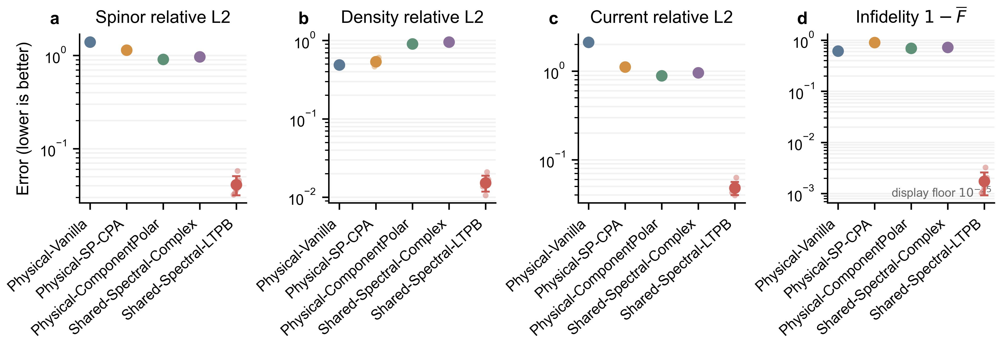
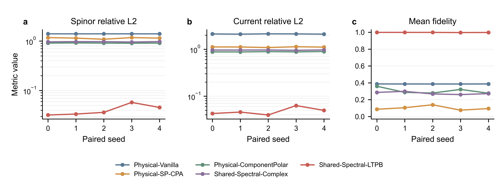
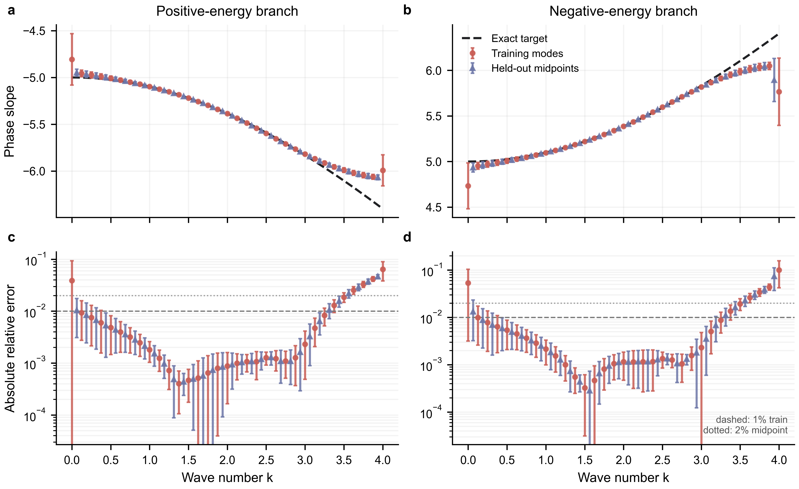
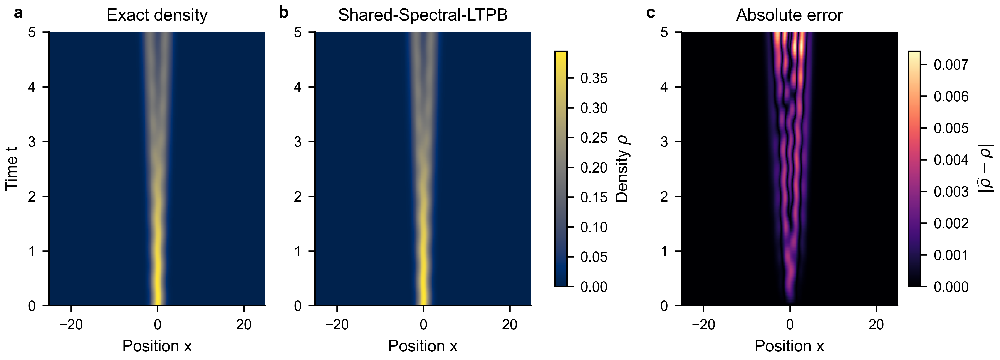
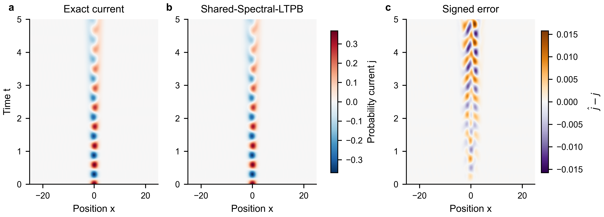
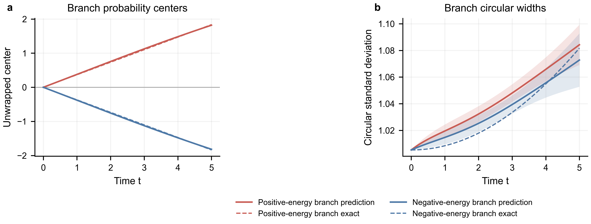
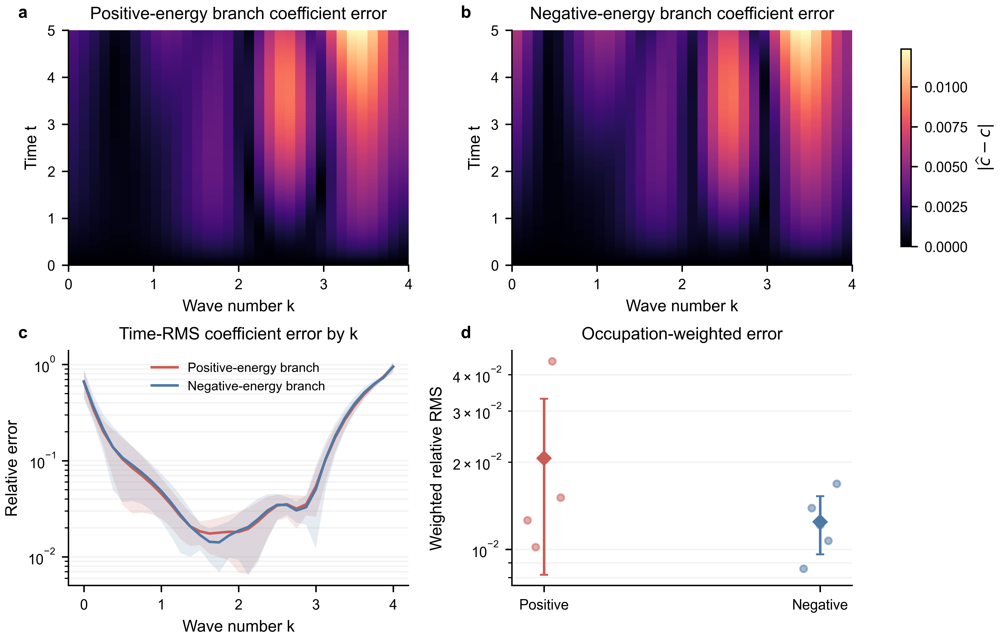
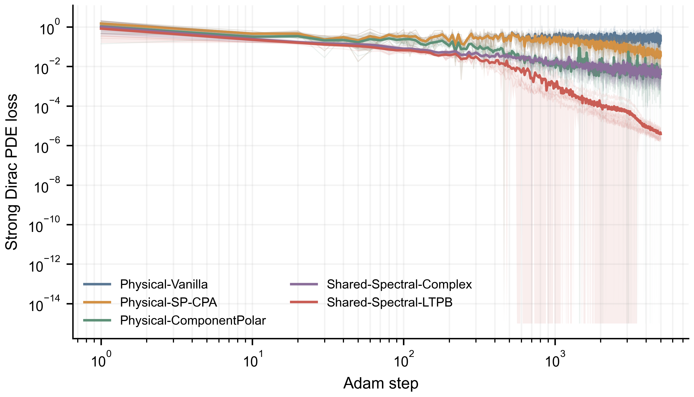
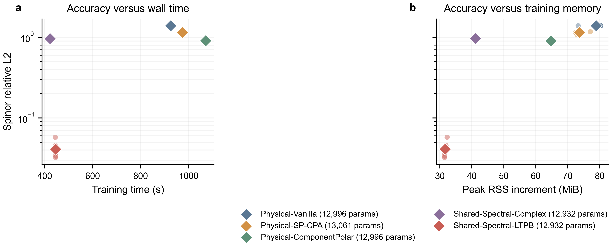

# 自由 Dirac 连续高斯波包的共享谱 LTPB 实验报告

> 本报告对应 5 个 learned models × 5 个预注册 seeds。Spectral oracle 直接使用精确色散，只作参考上限，不进入 learned 排名。

## 1. 已有证据与本次唯一问题

此前实验从公共单相位在正负能支混合态中的退化出发，证明单动量 LTPB 可以在不写入精确时间频率时自行学习两支相反载频；双离散波数 Multi-LTPB 又在四个预先列出的 `(k,±)` 通道上通过了预注册判据。然而，那些网络仍显式枚举有限通道，参数化并未回答一个网络能否在波数方向共享规律。

本实验只回答：一个共享 `(k,t)` 网络能否用自由 Dirac 谱残差统一表示 33 个高斯占据波数，并在未参与训练的相邻中点上保持正确相位斜率，从而恢复连续波包的场、密度、流和正负支分裂。

## 2. 物理问题、谱规范与 Parseval

在 `x∈[-8π,8π), L=16π, t∈[0,5], m=5` 上求解自由一维 Dirac 方程。训练波数为 `k_n=n/8, n=0,...,32`，初始高斯中心 `k0=2`、宽度 `σk=0.5`，正负支等权。采用正交 Fourier 规范

$$\psi(x,t)=L^{-1/2}\sum_n e^{ik_nx}\widetilde\psi_n(t),\qquad c_{n,\pm}(0)=g_n/\sqrt2,$$

因此总范数为 1、每支占据为 1/2。谱训练直接计算非对角强残差

$$R_n=i\partial_t\widetilde\psi_n-(k_n\sigma_x+m\sigma_z)\widetilde\psi_n,$$

而不是含精确 `E(k)` 的支方程。Parseval 给出 `∫|R(x)|²dx=Σ_n|R_n|²`；实现中谱 loss 的缩放与物理空间平均残差完全一致。该等价限于 33 模态 Fourier 子空间；物理基线可能生成的带外残差不被伪装为带内谱残差。

## 3. 方法、控制模型与精确 oracle

Shared-Spectral-LTPB 使用一个共享 `4×64 tanh` MLP 接收归一化 `(k,t/T)` 并输出 `(r+,r-,q+,q-)`：

$$a_\pm(k,t)=g(k)/\sqrt2+(t/T)r_\pm(k,t),\qquad S_\pm(k,t)=(t/T)q_\pm(k,t),$$

$$\widehat{\widetilde\psi}=a_+u_+(k)e^{iS_+}+a_-u_-(k)e^{iS_-}.$$
`u±(k)` 由已知符号 `H(k)` 的连续实规范构造。learned forward、loss、输入、optimizer、config 与 checkpoint 均没有精确能量或解析时间载波；精确 `E(k)` 首次出现在 reference/evaluator 中。

| Model | 输入/参数化 | 参数量 |
|---|---|---:|
| Physical-Vanilla | 物理空间笛卡尔旋量修正 | 12,996 |
| Physical-SP-CPA | 物理空间公共单相位 | 13,061 |
| Physical-ComponentPolar | 物理旋量分量双极坐标相位 | 12,996 |
| Shared-Spectral-Complex | 共享能支基底、普通复分支系数 | 12,932 |
| Shared-Spectral-LTPB | 共享能支基底、逐支实振幅与相位 | 12,932 |

两个共享谱模型具有完全相同的 MLP、参数量、初始权重和逐步时间样本。17、33、65 个有效模态的构造测试均保持同一可训练参数量；这只证明参数量不随模态数线性增长，不证明三种分辨率都能训练成功。Spectral oracle 直接写入精确 `E(k)`，参数为 0，明确排除于排名。

## 4. 预注册与公平性

[预注册](preregistration.md) 在任何正式结果前固定了物理参数、五种模型、seeds `0–4`、5000 steps、Adam `1e-3`、float64/complex128、网络规模、测试网格和全部阈值。[代码冻结清单](../../../results/summary/wavepacket_shared_spectral_ltpb/preregistration_sha256.json) 记录正式代码 SHA-256；[旧结果保护清单](../../../results/summary/wavepacket_shared_spectral_ltpb/protected_baseline.json) 保护 670 个已有文件。

每一步对所有模型共享 32 个时间样本；谱模型在全部 33 个 `k` 上得到 1056 个点，物理模型将同一时间批与 32 个空间点组合得到 1024 点。初始化、时间采样和物理空间采样采用相互独立的显式随机流。所有 learned runs 只使用 PDE loss，没有标签、能量、相位或守恒监督，且没有选择性重跑。

## 5. 逐 seed 正式结果

| Model | Seed | Spinor | Density | Current | Fidelity | Train phase | Held-out phase | PDE RMS | Train s | Peak ΔRSS MB |
|---|---:|---:|---:|---:|---:|---:|---:|---:|---:|---:|
| Physical-ComponentPolar | 0 | 0.9085 | 0.8997 | 0.8784 | 0.359343 | 0.0645 | N/A | 0.0711 | 1071.3 | 64.8 |
| Physical-ComponentPolar | 1 | 0.9172 | 0.8925 | 0.8768 | 0.286864 | 0.1156 | N/A | 0.0757 | 1071.5 | 64.8 |
| Physical-ComponentPolar | 2 | 0.9083 | 0.9095 | 0.8908 | 0.278592 | 0.1026 | N/A | 0.0714 | 1070.5 | 64.8 |
| Physical-ComponentPolar | 3 | 0.9041 | 0.8959 | 0.8785 | 0.321817 | 0.1002 | N/A | 0.0720 | 1071.0 | 64.6 |
| Physical-ComponentPolar | 4 | 0.9090 | 0.9146 | 0.8956 | 0.276751 | 0.1056 | N/A | 0.0702 | 1072.8 | 64.8 |
| Physical-SP-CPA | 0 | 1.1725 | 0.5142 | 1.1203 | 0.086093 | 0.7685 | N/A | 0.2149 | 973.6 | 77.1 |
| Physical-SP-CPA | 1 | 1.1441 | 0.4655 | 1.1181 | 0.104761 | 0.8531 | N/A | 0.2071 | 973.4 | 72.5 |
| Physical-SP-CPA | 2 | 1.0851 | 0.5732 | 1.0878 | 0.139287 | 0.6983 | N/A | 0.2090 | 974.4 | 72.9 |
| Physical-SP-CPA | 3 | 1.1740 | 0.5203 | 1.1332 | 0.075574 | 0.8220 | N/A | 0.2253 | 974.3 | 72.9 |
| Physical-SP-CPA | 4 | 1.1441 | 0.6051 | 1.1110 | 0.094287 | 0.7733 | N/A | 0.2111 | 974.6 | 72.9 |
| Physical-Vanilla | 0 | 1.3968 | 0.4926 | 2.1220 | 0.386333 | 1.0000 | N/A | 0.5401 | 925.4 | 73.3 |
| Physical-Vanilla | 1 | 1.3969 | 0.4692 | 2.1010 | 0.386187 | 1.0000 | N/A | 0.5402 | 925.7 | 80.3 |
| Physical-Vanilla | 2 | 1.3973 | 0.5084 | 2.1365 | 0.385853 | 1.0000 | N/A | 0.5405 | 926.9 | 80.3 |
| Physical-Vanilla | 3 | 1.3979 | 0.4978 | 2.1258 | 0.385690 | 1.0000 | N/A | 0.5409 | 924.7 | 80.2 |
| Physical-Vanilla | 4 | 1.3965 | 0.4676 | 2.1022 | 0.386495 | 1.0000 | N/A | 0.5399 | 926.8 | 80.3 |
| Shared-Spectral-Complex | 0 | 0.9616 | 0.9552 | 0.9615 | 0.286141 | 0.4426 | 0.4427 | 0.0697 | 421.4 | 41.3 |
| Shared-Spectral-Complex | 1 | 0.9704 | 0.9539 | 0.9605 | 0.298649 | 0.5308 | 0.5304 | 0.0743 | 422.5 | 41.2 |
| Shared-Spectral-Complex | 2 | 0.9699 | 0.9538 | 0.9648 | 0.267974 | 0.7517 | 0.7541 | 0.0781 | 421.7 | 41.2 |
| Shared-Spectral-Complex | 3 | 0.9524 | 0.9465 | 0.9479 | 0.260484 | 0.5469 | 0.5439 | 0.0660 | 421.5 | 41.2 |
| Shared-Spectral-Complex | 4 | 0.9732 | 0.9591 | 0.9682 | 0.272067 | 0.5522 | 0.5528 | 0.0753 | 421.4 | 41.2 |
| Shared-Spectral-LTPB | 0 | 0.0321 | 0.0137 | 0.0426 | 0.998971 | 0.0008 | 0.0008 | 0.0014 | 445.0 | 31.5 |
| Shared-Spectral-LTPB | 1 | 0.0335 | 0.0142 | 0.0457 | 0.998880 | 0.0013 | 0.0013 | 0.0016 | 445.8 | 31.5 |
| Shared-Spectral-LTPB | 2 | 0.0363 | 0.0105 | 0.0396 | 0.998692 | 0.0007 | 0.0007 | 0.0015 | 445.3 | 31.4 |
| Shared-Spectral-LTPB | 3 | 0.0577 | 0.0209 | 0.0628 | 0.996761 | 0.0017 | 0.0017 | 0.0026 | 443.8 | 32.3 |
| Shared-Spectral-LTPB | 4 | 0.0456 | 0.0169 | 0.0497 | 0.997942 | 0.0012 | 0.0012 | 0.0025 | 445.1 | 31.9 |

## 6. 五 seed 均值与 population SD

| Model | Spinor | Density | Current | Fidelity | Coefficient | PDE RMS | Train s | Peak ΔRSS MB |
|---|---:|---:|---:|---:|---:|---:|---:|---:|
| Physical-Vanilla | 1.397100 ± 0.000483 | 0.487106 ± 0.016120 | 2.117518 ± 0.013821 | 0.386112 ± 0.000299 | 1.396922 ± 0.000468 | 0.540308 ± 0.000324 | 925.892617 ± 0.817370 | 78.871094 ± 2.804767 |
| Physical-SP-CPA | 1.143949 ± 0.032192 | 0.535669 ± 0.048676 | 1.114057 ± 0.014969 | 0.100000 ± 0.021858 | 1.072026 ± 0.022886 | 0.213493 ± 0.006430 | 974.040428 ± 0.469920 | 73.650000 ± 1.711081 |
| Physical-ComponentPolar | 0.909412 ± 0.004262 | 0.902442 ± 0.008318 | 0.884010 ± 0.007660 | 0.304673 ± 0.031811 | 0.908674 ± 0.003912 | 0.072057 ± 0.001902 | 1071.411689 ± 0.769446 | 64.744531 ± 0.084815 |
| Shared-Spectral-Complex | 0.965506 ± 0.007602 | 0.953713 ± 0.004079 | 0.960592 ± 0.006882 | 0.277063 ± 0.013644 | 0.965506 ± 0.007602 | 0.072683 ± 0.004305 | 421.701812 ± 0.414051 | 41.205469 ± 0.049138 |
| Shared-Spectral-LTPB | 0.041038 ± 0.009540 | 0.015262 ± 0.003475 | 0.048057 ± 0.008090 | 0.998249 ± 0.000827 | 0.041038 ± 0.009540 | 0.001918 ± 0.000525 | 444.992823 ± 0.646742 | 31.703125 ± 0.324797 |

## 7. 训练波数与 held-out 中点相位

成功判据中的斜率来自预测总场的 Fourier–能支投影，只移除一个全时空常数规范相位；不使用网络内部 `S±` 代替物理相位。中点没有进入训练，且没有重新归一化高斯初值。

| Seed | Training weighted slope error | Training min valid | Midpoint weighted slope error | Midpoint min valid | Midpoint PDE RMS |
|---:|---:|---:|---:|---:|---:|
| 0 | 0.000836 | 1.000 | 0.000833 | 1.000 | 0.001703 |
| 1 | 0.001324 | 1.000 | 0.001337 | 1.000 | 0.001937 |
| 2 | 0.000658 | 1.000 | 0.000657 | 1.000 | 0.001908 |
| 3 | 0.001741 | 1.000 | 0.001730 | 1.000 | 0.003250 |
| 4 | 0.001196 | 1.000 | 0.001193 | 1.000 | 0.003098 |

预注册中点判据：**PASS**。完整的 33×2 训练斜率和 32×2 中点斜率、目标、误差、有效比例与曲率均保存在每个 target run 的 `dense_grid.npz` 及图表 source data 中。

## 8. 波包密度、概率流与分支动力学

| Seed | + center RMSE | − center RMSE | + velocity rel | − velocity rel | + width rel L2 | − width rel L2 |
|---:|---:|---:|---:|---:|---:|---:|
| 0 | 0.016685 | 0.013912 | 0.001289 | 0.009824 | 0.006009 | 0.003314 |
| 1 | 0.005627 | 0.008563 | 0.001337 | 0.006709 | 0.018350 | 0.007121 |
| 2 | 0.012341 | 0.011204 | 0.009739 | 0.002026 | 0.008420 | 0.008984 |
| 3 | 0.035023 | 0.031694 | 0.012357 | 0.003824 | 0.018558 | 0.014381 |
| 4 | 0.019071 | 0.018332 | 0.008343 | 0.001635 | 0.010245 | 0.013152 |

自动分支动力学判据：**PASS**。中心和宽度均由各支 Fourier–能支投影重建后的密度圆周矩得到，不由总密度目测判断。

## 9. 预注册自动判定

总判定：**PASS**。机器可读详情见 [decision JSON](../../../results/summary/wavepacket_shared_spectral_ltpb/decision.json)。

| 条件 | 实际值 | 阈值 | 结果 |
|---|---:|---:|---|
| Mean spinor | 0.041038 | `<= 0.05` | PASS |
| Mean current | 0.048057 | `<= 0.1` | PASS |
| Mean fidelity | 0.998249 | `>= 0.99` | PASS |
| spinor vs best learned baseline (physical_component_polar) | 22.16× | `>=10×` | PASS |
| current vs best learned baseline (physical_component_polar) | 18.40× | `>=10×` | PASS |
| Paired-seed joint advantage | 5/5 | `>=4/5` | PASS |
| Training weighted phase slope | 0.001151 | `<0.01` | PASS |
| Held-out weighted phase slope | 0.001150 | `<0.02` | PASS |
| Branch center/width/splitting joint rule | — | frozen compound rule | PASS |

## 10. 优化、时间与内存

训练时间仅覆盖 5000 个 Adam steps；peak RSS 使用训练进程内统一轮询口径，报告训练期间绝对峰值及相对训练起点增量。参数量不随共享谱模态数增长并不意味着计算量或内存不增长：每步谱配置点数仍与模态数成正比。

## 11. 结论解释与失败归因

全部预注册条件同时通过，因此结果支持：在这个已知自由 Dirac Fourier 表示和 `[0,4]` 波数区间内，共享能支相位网络不仅拟合了 33 个训练模态，也在相邻中点上插值了正确的物理相位斜率，并恢复了正负支分裂传播。

机制上必须区分：Shared-Spectral-LTPB 的表示集合、显式逐支相位带来的载波预条件、5000-step Adam 的优化结果、低占据模态可辨识性，以及已知 `H(k)` 与 `u±(k)` 带来的物理先验。已知符号本身已经包含产生色散的物理规律；本实验检验网络能否从离散残差约束统一插值该规律，不是从无物理先验的数据中发现色散。

## 12. 本实验不能推出的结论

1. 中点是 `H(k)` 参数化 ODE 的区间内插值探针，不是同一 `L=16π` 周期盒允许的 Fourier 模态。
2. 初始 Fourier 支撑、质量和自由符号均已知；实验没有发现未知谱，也没有检验区间外波数。
3. 自由问题中不同 `k` 完全解耦；外势会造成动量耦合，本轮没有加入也不能代表这种情况。
4. 参数量与模态数无关不等于运行成本无关，更不等于无穷连续谱已被解决。
5. 本结果不是通用 Dirac 求解器、传统谱方法的替代性证明、文献新颖性结论或“世界首次”声明。

## 13. 数据、图表与审计索引

- [逐 run CSV](../../../results/summary/wavepacket_shared_spectral_ltpb/runs.csv)、[五 seed 汇总](../../../results/summary/wavepacket_shared_spectral_ltpb/summary.csv)、[baseline 比较](../../../results/summary/wavepacket_shared_spectral_ltpb/comparisons.csv)
- [自动判定](../../../results/summary/wavepacket_shared_spectral_ltpb/decision.json)、[最终审计](../../../results/summary/wavepacket_shared_spectral_ltpb/audit.json)
- [预注册代码散列](../../../results/summary/wavepacket_shared_spectral_ltpb/preregistration_sha256.json)、[旧结果保护清单](../../../results/summary/wavepacket_shared_spectral_ltpb/protected_baseline.json)
- Figure manifest（本地档案）、[FIGURE_QA](../../../results/figures/wavepacket_shared_spectral_ltpb/FIGURE_QA.md)、[`per_seed_results` 布局修复审计](../../../results/figures/wavepacket_shared_spectral_ltpb/POSTFREEZE_FIGURE_CORRECTION.json)
- Oracle config（本地档案）、metrics（本地档案）、time series（本地档案）、dense grid（本地档案）

正式目视 QA 发现最初的 `per_seed_results` 图因轴外图例与 tight 保存边界相互作用而压缩坐标轴。修复只用未改变的 75 行 source CSV 重排版面；原 PNG/SVG/PDF 和原 figure manifest 已保留，修复前后 SHA-256 写入上述审计 JSON。模型、checkpoint、原始 run、指标、汇总、判定阈值、图表 source data 和冻结代码均未改变。

### 每个 learned run 的六件套

| Model | Seed | Raw artifacts |
|---|---:|---|
| Physical-Vanilla | 0 | config.json（本地档案） · metrics.json（本地档案） · loss_history.csv（本地档案） · time_series.csv（本地档案） · dense_grid.npz（本地档案） · model_state.pt（本地档案） |
| Physical-Vanilla | 1 | config.json（本地档案） · metrics.json（本地档案） · loss_history.csv（本地档案） · time_series.csv（本地档案） · dense_grid.npz（本地档案） · model_state.pt（本地档案） |
| Physical-Vanilla | 2 | config.json（本地档案） · metrics.json（本地档案） · loss_history.csv（本地档案） · time_series.csv（本地档案） · dense_grid.npz（本地档案） · model_state.pt（本地档案） |
| Physical-Vanilla | 3 | config.json（本地档案） · metrics.json（本地档案） · loss_history.csv（本地档案） · time_series.csv（本地档案） · dense_grid.npz（本地档案） · model_state.pt（本地档案） |
| Physical-Vanilla | 4 | config.json（本地档案） · metrics.json（本地档案） · loss_history.csv（本地档案） · time_series.csv（本地档案） · dense_grid.npz（本地档案） · model_state.pt（本地档案） |
| Physical-SP-CPA | 0 | config.json（本地档案） · metrics.json（本地档案） · loss_history.csv（本地档案） · time_series.csv（本地档案） · dense_grid.npz（本地档案） · model_state.pt（本地档案） |
| Physical-SP-CPA | 1 | config.json（本地档案） · metrics.json（本地档案） · loss_history.csv（本地档案） · time_series.csv（本地档案） · dense_grid.npz（本地档案） · model_state.pt（本地档案） |
| Physical-SP-CPA | 2 | config.json（本地档案） · metrics.json（本地档案） · loss_history.csv（本地档案） · time_series.csv（本地档案） · dense_grid.npz（本地档案） · model_state.pt（本地档案） |
| Physical-SP-CPA | 3 | config.json（本地档案） · metrics.json（本地档案） · loss_history.csv（本地档案） · time_series.csv（本地档案） · dense_grid.npz（本地档案） · model_state.pt（本地档案） |
| Physical-SP-CPA | 4 | config.json（本地档案） · metrics.json（本地档案） · loss_history.csv（本地档案） · time_series.csv（本地档案） · dense_grid.npz（本地档案） · model_state.pt（本地档案） |
| Physical-ComponentPolar | 0 | config.json（本地档案） · metrics.json（本地档案） · loss_history.csv（本地档案） · time_series.csv（本地档案） · dense_grid.npz（本地档案） · model_state.pt（本地档案） |
| Physical-ComponentPolar | 1 | config.json（本地档案） · metrics.json（本地档案） · loss_history.csv（本地档案） · time_series.csv（本地档案） · dense_grid.npz（本地档案） · model_state.pt（本地档案） |
| Physical-ComponentPolar | 2 | config.json（本地档案） · metrics.json（本地档案） · loss_history.csv（本地档案） · time_series.csv（本地档案） · dense_grid.npz（本地档案） · model_state.pt（本地档案） |
| Physical-ComponentPolar | 3 | config.json（本地档案） · metrics.json（本地档案） · loss_history.csv（本地档案） · time_series.csv（本地档案） · dense_grid.npz（本地档案） · model_state.pt（本地档案） |
| Physical-ComponentPolar | 4 | config.json（本地档案） · metrics.json（本地档案） · loss_history.csv（本地档案） · time_series.csv（本地档案） · dense_grid.npz（本地档案） · model_state.pt（本地档案） |
| Shared-Spectral-Complex | 0 | config.json（本地档案） · metrics.json（本地档案） · loss_history.csv（本地档案） · time_series.csv（本地档案） · dense_grid.npz（本地档案） · model_state.pt（本地档案） |
| Shared-Spectral-Complex | 1 | config.json（本地档案） · metrics.json（本地档案） · loss_history.csv（本地档案） · time_series.csv（本地档案） · dense_grid.npz（本地档案） · model_state.pt（本地档案） |
| Shared-Spectral-Complex | 2 | config.json（本地档案） · metrics.json（本地档案） · loss_history.csv（本地档案） · time_series.csv（本地档案） · dense_grid.npz（本地档案） · model_state.pt（本地档案） |
| Shared-Spectral-Complex | 3 | config.json（本地档案） · metrics.json（本地档案） · loss_history.csv（本地档案） · time_series.csv（本地档案） · dense_grid.npz（本地档案） · model_state.pt（本地档案） |
| Shared-Spectral-Complex | 4 | config.json（本地档案） · metrics.json（本地档案） · loss_history.csv（本地档案） · time_series.csv（本地档案） · dense_grid.npz（本地档案） · model_state.pt（本地档案） |
| Shared-Spectral-LTPB | 0 | config.json（本地档案） · metrics.json（本地档案） · loss_history.csv（本地档案） · time_series.csv（本地档案） · dense_grid.npz（本地档案） · model_state.pt（本地档案） |
| Shared-Spectral-LTPB | 1 | config.json（本地档案） · metrics.json（本地档案） · loss_history.csv（本地档案） · time_series.csv（本地档案） · dense_grid.npz（本地档案） · model_state.pt（本地档案） |
| Shared-Spectral-LTPB | 2 | config.json（本地档案） · metrics.json（本地档案） · loss_history.csv（本地档案） · time_series.csv（本地档案） · dense_grid.npz（本地档案） · model_state.pt（本地档案） |
| Shared-Spectral-LTPB | 3 | config.json（本地档案） · metrics.json（本地档案） · loss_history.csv（本地档案） · time_series.csv（本地档案） · dense_grid.npz（本地档案） · model_state.pt（本地档案） |
| Shared-Spectral-LTPB | 4 | config.json（本地档案） · metrics.json（本地档案） · loss_history.csv（本地档案） · time_series.csv（本地档案） · dense_grid.npz（本地档案） · model_state.pt（本地档案） |
