# 能支对齐可学习多相位 PINN 求解含时 Dirac 方程

## 研究介绍与阶段性报告

> 更新日期：2026 年 9 月 1 日  
> 当前进度：理论分析、单波数验证、方法构造、机制消融、双波数推广和连续波包实验均已完成；下一阶段研究外势导致的动量耦合。

## 摘要

本研究关注含时 Dirac 方程中正、负能支共存时 PINN 的长时间相位学习问题。公共单相位 CPA-PINN 在纯能支上能够显著提高精度，但在正、负能支混合时无法同时提取方向相反的时间载频，其优化优势明显下降。针对这一问题，研究提出能支对齐的可学习双相位网络 LTPB：先按 Dirac 正、负能支分解旋量，再为每个能支设置独立的实振幅和可学习相位。单波数实验、等参数机制消融和双波数实验均表明，能支对齐与独立相位必须同时存在。进一步构造共享谱 LTPB，使同一个网络在波数方向共享相位规律，并在 33 模态高斯波包及未训练波数中点上恢复了正确的场、概率流和色散相位。目前证据支持该方法在已知自由 Dirac 谱结构下具有显著的载频预条件优势；外势耦合、稀疏数据和传统算法比较仍待完成。

## 1. 研究问题

一维含时 Dirac 方程写为

$$
i\hbar\partial_t\psi=
\left(-i\hbar c\sigma_x\partial_x+mc^2\sigma_z+V(x,t)I_2\right)\psi,
\qquad \psi=(\psi_1,\psi_2)^\mathsf{T}.
$$

其概率密度和概率流为

$$
\rho=\psi^\dagger\psi,
\qquad
j=c\psi^\dagger\sigma_x\psi,
\qquad
\partial_t\rho+\partial_xj=0.
$$

若直接使用公共相位参数化

$$
\psi=Ae^{iS/\hbar},
$$

则

$$
\rho=A^\dagger A,
\qquad
j=cA^\dagger\sigma_xA.
$$

公共相位 $S$ 在密度和概率流中完全消去。另一方面，若写成分量相位

$$
\psi_j=a_je^{iS_j/\hbar},
$$

则

$$
j=2ca_1a_2\cos\!\left(\frac{S_2-S_1}{\hbar}\right),
$$

说明概率流直接依赖相对相位。自由 Dirac 方程的正、负能支又分别携带 $e^{-iEt}$ 和 $e^{+iEt}$。因此，一个公共相位不能同时把两种相反载频都变为慢变量，只能让复振幅继续承担快速振荡。

这里的“失效”是**固定网络和训练预算下的优化退化**，不是数学上的不可表示性结论。

## 2. 总体研究路线

| 阶段 | 内容 | 状态 | 一句话结论 |
|---|---|---|---|
| 1 | 理论分析 | 已完成 | 公共相位不能直接分辨 Dirac 正、负能支之间的相对相位。 |
| 2 | 单波数失效验证 | 已完成 | CPA-PINN 在纯支有效，在正负能混合支中优势大幅下降。 |
| 3 | LTPB 方法构造 | 已完成 | 给正、负能支设置独立可学习相位可恢复混合支动力学。 |
| 4 | 机制消融 | 已完成 | 能支对齐与逐支独立相位必须同时存在。 |
| 5 | 双波数实验 | 已完成 | 方法可从两个载频推广到四个已知载频。 |
| 6 | 连续波包实验 | 已完成 | 共享谱网络可统一学习 33 个模态并插值未训练波数。 |
| 7 | 外势或散射 | 下一步 | 检验不同动量发生耦合时方法是否仍有效。 |
| 8 | 稀疏含噪数据 | 待开展 | 检验状态重建和参数反演价值。 |
| 9 | 完整 benchmark | 待开展 | 与现代 PINN 和传统数值方法比较精度、稳定性与成本。 |
| 10 | 论文整理 | 待开展 | 形成失效机制、算法、消融、通用性和数据应用的完整证据链。 |

## 3. 阶段一：理论分析

### 3.1 自由能支

在自然单位 $\hbar=c=1$ 下，固定波数 $k$ 的自由 Dirac 符号为

$$
H(k)=k\sigma_x+m\sigma_z,
\qquad
H(k)u_\pm=\pm E_k u_\pm,
\qquad
E_k=\sqrt{k^2+m^2}.
$$

正、负能混合解为

$$
\psi_\eta(x,t)=\frac{e^{ikx}}{\sqrt{L(1+\eta^2)}}
\left(u_+e^{-iE_kt}+\eta u_-e^{+iE_kt}\right).
$$

当 $\eta=1$ 时，密度和总范数可以保持稳定，概率流却以 $2E_k$ 频率振荡。这构成了检验相对相位学习能力的最小问题。

### 3.2 守恒量的边界

记 Dirac PDE 残差为 $R_D=i\partial_t\psi-H_D\psi$，则

$$
\partial_t\rho+\partial_xj=2\operatorname{Im}(\psi^\dagger R_D).
$$

连续性方程是 PDE 残差的投影，范数和能量也是整体量；它们可以改善部分物理约束，却不能单独确定局部相对相位。这一结论为后续实验提供了理论假设：真正有效的参数化应显式区分正、负能支的载频。

## 4. 阶段二：CPA-PINN 直接迁移实验

### 4.1 实验条件

取 $m=5$、$k=2$、$T=5$、周期区间 $L=2\pi$，比较：

- `Case P`：仅含正能支；
- `Case M`：正、负能支等权混合。

统一采用 4 层、每层 64 个神经元的 `tanh` 网络，Adam 训练 5000 步，每步 1024 个配置点，learned models 使用 3 个随机种子。

### 4.2 结果

| 模型 | Case P 旋量误差 | Case M 旋量误差 | Case M 流误差 | Case M fidelity |
|---|---:|---:|---:|---:|
| Vanilla | 0.9228 | 0.9452 | 0.9693 | 0.2254 |
| SP-CPA | **0.0067** | 0.7991 | 0.9392 | 0.5935 |
| SP-CPA-Conservative | 0.0111 | 1.0785 | 1.0698 | 0.1631 |
| 精确双载频 oracle | 0.0079 | **0.0062** | **0.0105** | 0.999990 |

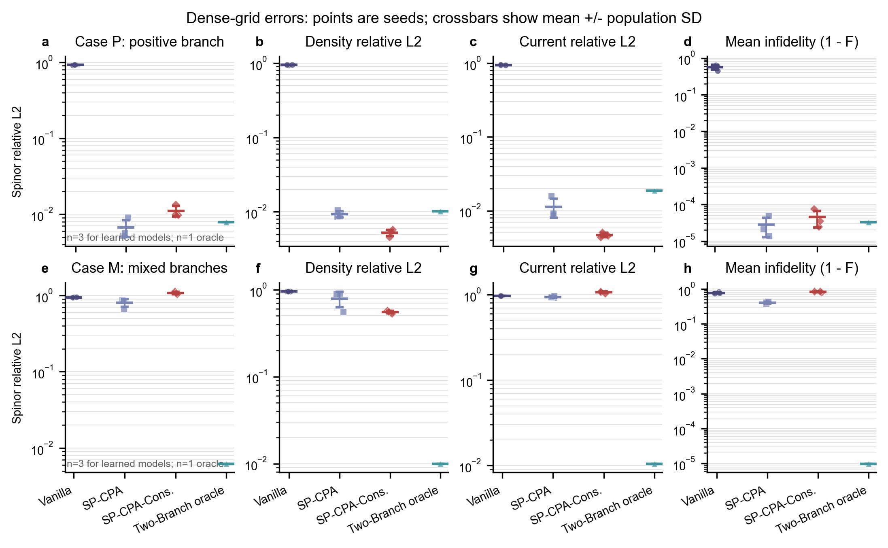

*图 1　公共单相位在纯正能支上有效，但在正、负能支混合时优势显著下降。*

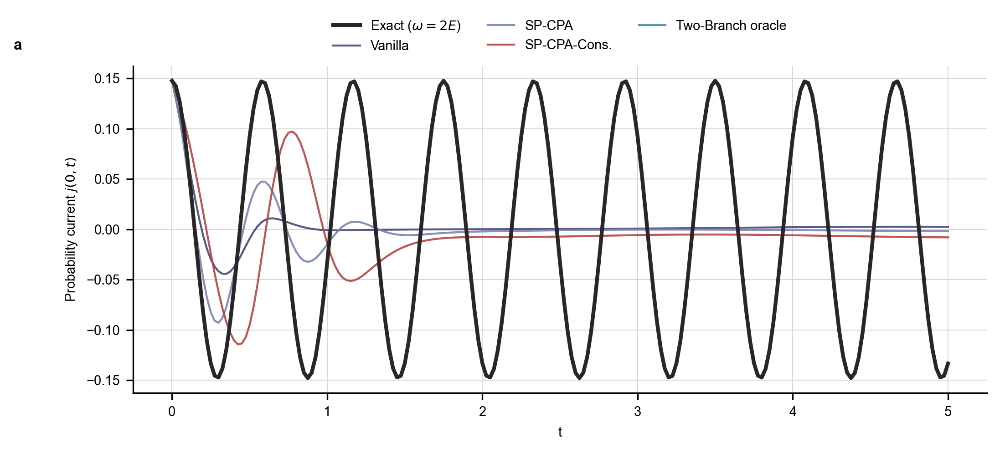

*图 2　SP-CPA 未能恢复由支间相干产生的快速概率流振荡。*

SP-CPA 相对 Vanilla 在 Case P 上降低 `99.3%` 的旋量误差，在 Case M 上仅降低 `15.5%`。增加连续性、范数和能量损失没有恢复概率流与相对相位；解析 wrong-phase 场也表明守恒量接近正确时，局部场和流仍可明显错误。

**阶段结论：** CPA 的直接迁移并非普遍无效，但公共相位不能为混合正负能支提供充分的载频预条件。

## 5. 阶段三：LTPB 方法与初步验证

### 5.1 方法

构造能支对齐的可学习双相位网络

$$
\widehat\psi=e^{ikx}
\left[a_+(x,t)u_+e^{iS_+(x,t)}+a_-(x,t)u_-e^{iS_-(x,t)}\right],
$$

并采用

$$
a_\pm=a_{\pm,0}+\tau r_\pm,
\qquad
S_\pm=\tau q_\pm,
\qquad \tau=t/T,
$$

从而严格满足初值。前向模型、损失和优化器均不写入精确能量 $E_k$ 或精确载频，网络只从 Dirac PDE 残差学习两支相位。

### 5.2 结果

| 指标 | SP-CPA | LTPB | 改善倍数 |
|---|---:|---:|---:|
| Case M 旋量误差 | 0.7991 | **0.0025** | 约 320 倍 |
| 概率流误差 | 0.9392 | **0.0046** | 约 204 倍 |
| 相对相位 RMSE | 1.5864 | **0.0030** | 约 529 倍 |
| Fidelity | 0.5935 | **0.999996** | — |

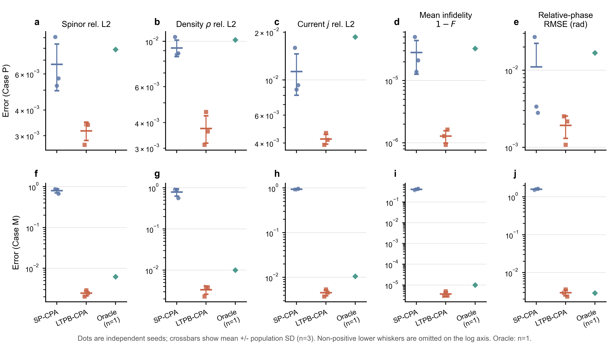

*图 3　LTPB 在不使用精确频率的条件下同时解决纯支和混合支问题。*

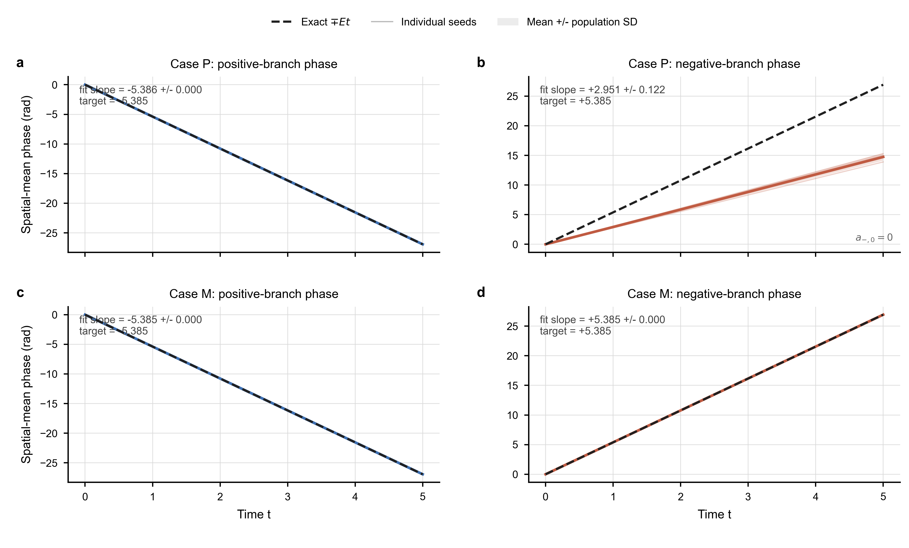

*图 4　网络自行学得接近 $-E_kt$ 和 $+E_kt$ 的两条相位。*

目标斜率为 $\mp5.3851648$，网络学习结果为 `-5.3855` 和 `+5.3854`，线性拟合 $R^2$ 接近 1，振幅漂移低于 `0.3%`。

**阶段结论：** 对每个物理能支设置独立显式相位，可以恢复公共相位遗漏的相对载频结构。

## 6. 阶段四：关键结构消融

### 6.1 消融设计

五个模型均为 12996 左右参数，并使用配对初始化和配点序列：

| 模型 | 能支对齐 | 独立振幅/相位 |
|---|:---:|:---:|
| LTPB | 是 | 是 |
| BranchComplex | 是 | 否 |
| ComponentPolar | 否 | 是 |
| Rotated LTPB $15^\circ$ | 部分破坏 | 是 |
| Rotated LTPB $30^\circ$ | 进一步破坏 | 是 |

### 6.2 结果

| 模型 | 旋量误差 | 流误差 | 相对相位 RMSE |
|---|---:|---:|---:|
| LTPB | **0.0025** | **0.0045** | **0.0029** |
| BranchComplex | 0.9014 | 0.9342 | 1.6268 |
| ComponentPolar | 0.8907 | 0.9309 | 1.4802 |
| Rotated LTPB $15^\circ$ | 0.8996 | 0.9426 | 1.5579 |
| Rotated LTPB $30^\circ$ | 0.9306 | 0.9590 | 1.6830 |

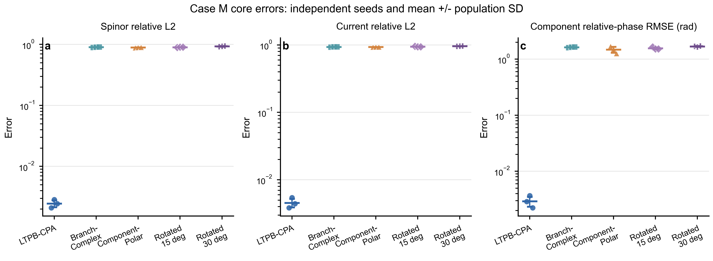

*图 5　仅有能支基底或仅有极坐标相位均不能复现 LTPB 精度。*

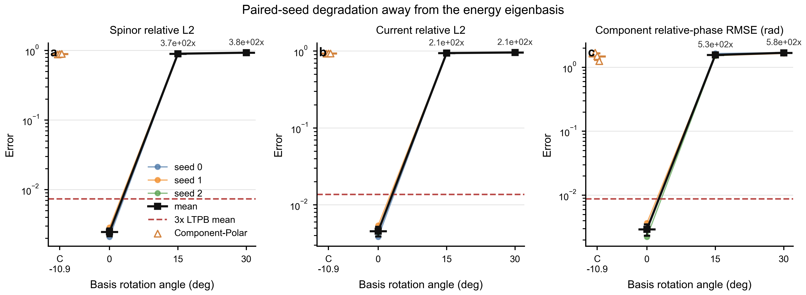

*图 6　轻度破坏能支对齐后，误差迅速进入接近单位误差的平台。*

预注册的“每增加一级旋转，误差至少再增大 1.25 倍”强判据未通过，因为 $15^\circ$ 时模型已进入失败平台，$15^\circ\to30^\circ$ 仅继续增加约 `1.02–1.08` 倍。该结果不能支持固定比例退化，但不影响以下较窄结论：在当前受控问题中，能支对齐与独立相位缺一不可。

**阶段结论：** 性能提升不是参数量或一般极坐标表示造成的，而是能支对齐与逐支相位分解的联合结果。

## 7. 阶段五：双波数四载频推广

### 7.1 问题与方法

取 $k_1=2$、$k_2=5$，构造

$$
\psi=\frac{1}{2\sqrt L}\sum_{l=1}^2
\left[u_+(k_l)e^{ik_lx-iE_lt}+u_-(k_l)e^{ik_lx+iE_lt}\right].
$$

Multi-LTPB 为四个 `(k_l,\pm)` 通道分别设置可学习相位，但不使用精确 $E_l$。五个 learned models 使用近似相同参数量、5000 步训练和 5 个配对随机种子。

### 7.2 结果

| 指标 | Multi-LTPB | 最佳 learned baseline | 优势 |
|---|---:|---:|---:|
| 旋量误差 | **0.006594** | 0.939819 | 142.52 倍 |
| 概率流误差 | **0.010976** | 0.957364 | 87.22 倍 |
| Fidelity | **0.999965** | 0.3172 | — |
| 配对种子 | **5/5 通过** | — | — |

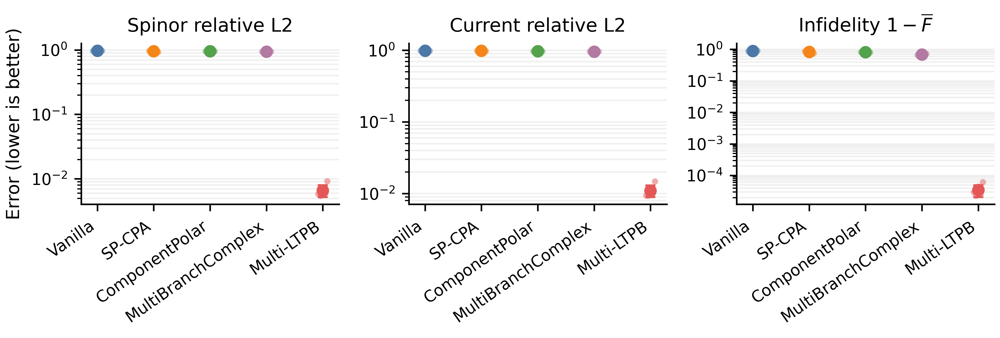

*图 7　Multi-LTPB 将单波数的双载频优势推广到两个波数的四载频问题。*

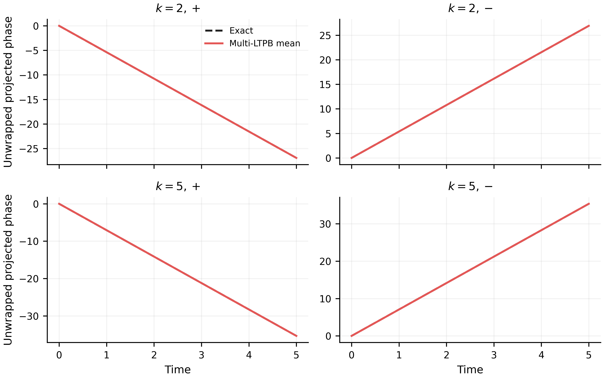

*图 8　四个投影相位斜率均与目标载频一致，平均相对误差约为 `0.03%`。*

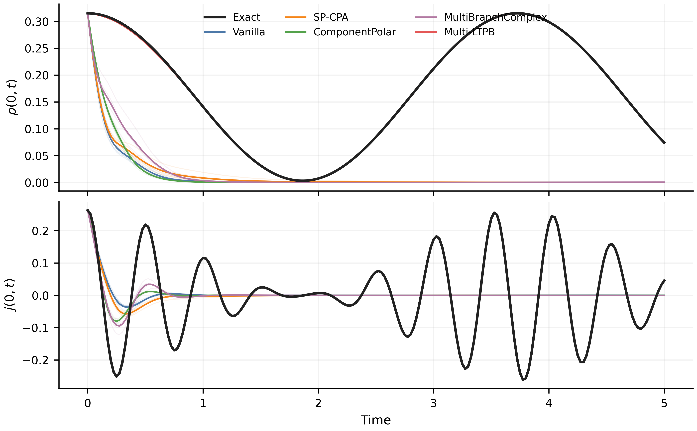

*图 9　模型恢复了不同空间模态和正负能支共同产生的密度与概率流干涉。*

**阶段结论：** 第五阶段通过全部预注册判据，说明能支相位机制可以扩展到多个已知离散载频；但波数和能支基底仍由初值预先给出。

## 8. 阶段六：连续高斯波包与共享谱 LTPB

### 8.1 问题

在 $L=16\pi$、$m=5$、$T=5$ 上取 33 个波数 $k_n=n/8\in[0,4]$，初始谱为中心 $k_0=2$、宽度 $\sigma_k=0.5$ 的高斯分布，正、负能支等权。该问题由几十个载频共同组成，不能继续为每个波数增加独立网络输出。

### 8.2 共享谱方法

使用一个共享网络接收 $(k,t)$，输出两支振幅和相位：

$$
\widehat{\widetilde\psi}(k,t)=
a_+(k,t)u_+(k)e^{iS_+(k,t)}
+a_-(k,t)u_-(k)e^{iS_-(k,t)}.
$$

训练使用非对角谱残差

$$
R_k=i\partial_t\widetilde\psi-(k\sigma_x+m\sigma_z)\widetilde\psi,
$$

而不是写入精确 $E(k)$ 的对角方程。自由周期问题中，Parseval 恒等式保证该谱残差与相应物理空间残差等价。网络参数量保持 12932，不随模态数线性增长。

### 8.3 结果

| 指标 | Shared-Spectral-LTPB | 最佳 learned baseline | 判定 |
|---|---:|---:|---|
| 旋量误差 | **0.041038** | 0.909412 | 22.16 倍优势 |
| 密度误差 | **0.015262** | 0.487106 | — |
| 概率流误差 | **0.048057** | 0.884010 | 18.40 倍优势 |
| Fidelity | **0.998249** | 0.386112 | 通过 |
| 配对种子 | **5/5 通过** | — | 通过 |
| 训练波数相位误差 | **0.115%** | — | <1% |
| 未训练中点相位误差 | **0.115%** | — | <2% |

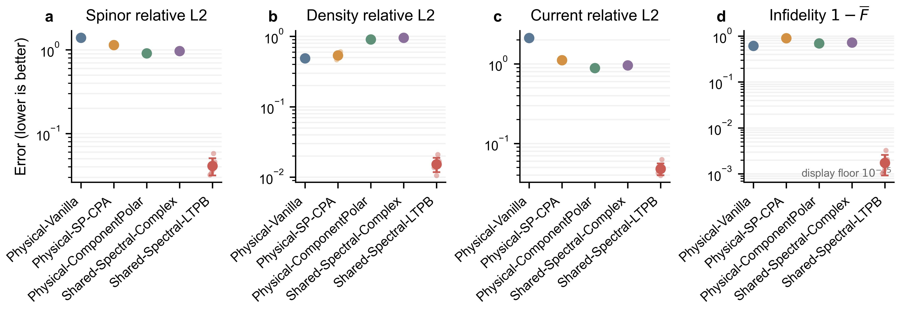

*图 10　共享谱 LTPB 在固定参数量下显著优于物理空间和同基底复系数模型。*

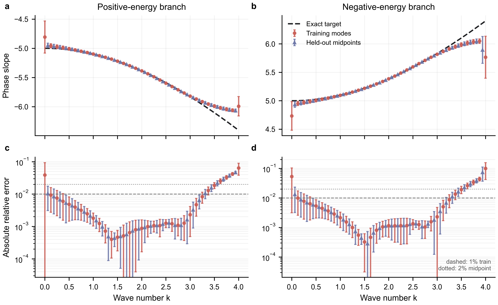

*图 11　共享网络在未参与训练的波数中点上仍保持正确相位斜率。*

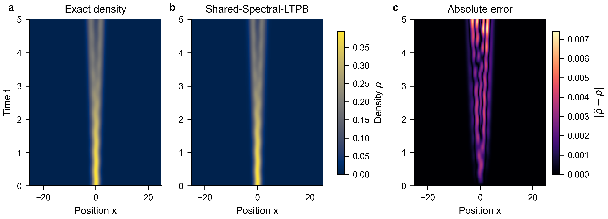

*图 12　模型重建了高斯波包的密度传播与展宽，绝对误差保持较低。*

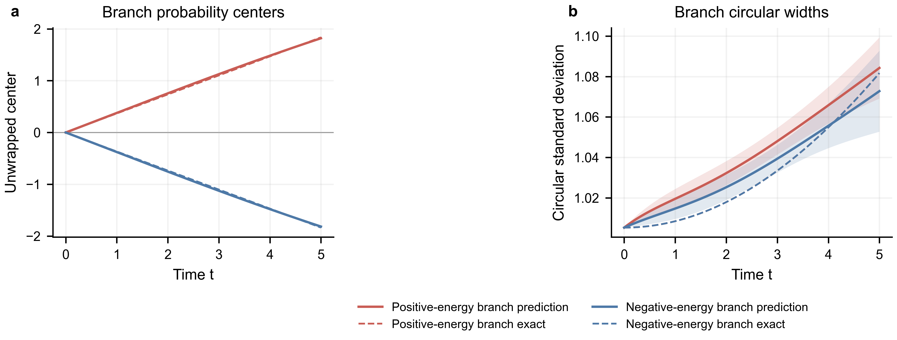

*图 13　正、负能波包分别向相反方向传播，中心速度和宽度变化均通过预注册判据。*

共享谱 LTPB 的平均正、负支速度分别为 `+0.3665` 和 `-0.3659`，未训练中点 PDE RMS 为 `0.0017–0.0033`。误差由双波数阶段的 `0.0066` 增至 `0.0410`，说明问题变复杂后精度余量正在缩小；但 5 个种子仍全部获得至少 10 倍的场和流误差优势。

**阶段结论：** 第六阶段通过全部预注册判据。方法已从逐个枚举载频发展为在已知自由 Dirac 谱区间内共享学习连续相位规律，但尚未处理外势导致的动量耦合。

## 9. 阶段性证据链

### 9.1 已回答的问题

1. **CPA-PINN 为什么退化：** 一个公共相位不能同时预条件正、负能支的相反载频，相对相位主要被迫留在复振幅中学习。
2. **什么方法有效：** 先按 Dirac 能支分解，再为每支设置独立可学习相位。
3. **什么结构关键：** 能支对齐和独立相位必须同时存在，任意一项缺失都会使固定预算精度明显下降。
4. **方法能推广到什么程度：** 已从单波数推广到两个离散波数，再推广到自由谱区间内的高斯波包。

### 9.2 精度随问题复杂度变化

| 问题 | 方法 | 旋量误差 | 概率流误差 | Fidelity |
|---|---|---:|---:|---:|
| 单波数正负能混合 | LTPB | 0.0025 | 0.0046 | 0.999996 |
| 双波数四载频 | Multi-LTPB | 0.0066 | 0.0110 | 0.999965 |
| 33 模态高斯波包 | Shared-Spectral-LTPB | 0.0410 | 0.0481 | 0.998249 |

结果显示方法在复杂度提高后仍保持明显优势，但绝对误差逐步增加。后续研究重点应从“能否学习独立载频”转向“能否处理通道之间的动态耦合”。

## 10. 下一阶段计划

### 10.1 阶段七：弱光滑外势

首先考虑周期标量势

$$
V(x)=V_0\cos(qx)I_2.
$$

谱空间中相邻动量通道满足

$$
i\partial_t\widetilde\psi_k=
H(k)\widetilde\psi_k+\frac{V_0}{2}
\left(\widetilde\psi_{k-q}+\widetilde\psi_{k+q}\right).
$$

这一问题保持物理背景简单，却首次引入真实的动量转移。实验将检验现有共享谱 LTPB 能否恢复模态占据交换、概率流和支间相干；若在低占据或新生模态处失败，则需要研究零振幅附近的相位正则化或复数/极坐标混合表示。

### 10.2 后续阶段

- **阶段八：** 加入稀疏、含噪密度或概率流观测，研究状态重建与质量、势参数反演。
- **阶段九：** 与自适应采样 PINN、损失平衡方法、傅里叶谱法和分裂算子法统一比较。
- **阶段十：** 整理理论、算法、消融、通用性、数据实验、复杂度和失败边界，形成投稿材料。

## 11. 当前结论边界

现阶段可以确认的是：在一维自由 Dirac 方程、已知 Fourier 表示和固定训练预算下，能支对齐的独立可学习相位显著改善了正负能混合态的场、流和相位精度。

现阶段还不能宣称：

- 方法能够自动发现未知谱或未知能支；
- 方法在一般外势、高维或强耦合 Dirac 方程中仍然有效；
- 方法在简单正向问题上优于成熟的谱方法或分裂算子法；
- 当前结果已经构成通用求解器、最终投稿结论或“世界首次”证明。

要形成 SCI 二区至三区或同等级会议的完整论文，至少还需要一个外势耦合主实验、稀疏数据应用、传统求解器参考和完整计算成本分析。

## 12. 原始材料

- [开题报告](../CPA_PINN%E6%8E%A8%E5%B9%BF%E8%87%B3Dirac%E6%96%B9%E7%A8%8B%E7%9A%84%E5%B1%80%E9%99%90%E4%B8%8E%E6%97%8B%E9%87%8F%E5%8F%8C%E7%9B%B8%E4%BD%8D%E6%96%B9%E6%B3%95_%E5%BC%80%E9%A2%98%E6%8A%A5%E5%91%8A.md)
- [CPA 直接迁移实验报告](EXPERIMENT_REPORT.md)
- [LTPB 初步实验报告](LEARNED_TWO_PHASE_PILOT_REPORT.md)
- [机制消融预注册](LTPB_MECHANISM_ABLATION_PREREGISTRATION.md)
- [机制消融实验报告](LTPB_MECHANISM_ABLATION_REPORT.md)
- [双波数实验预注册](MULTIMODE_LTPB_PREREGISTRATION.md)
- [双波数实验报告](MULTIMODE_LTPB_EXPERIMENT_REPORT.md)
- [连续波包实验预注册](WAVEPACKET_SHARED_SPECTRAL_LTPB_PREREGISTRATION.md)
- [连续波包实验报告](WAVEPACKET_SHARED_SPECTRAL_LTPB_REPORT.md)

本文使用的图片均直接引用项目现有 `results/figures/` 目录，不需要额外复制图片文件即可在当前项目中预览。
