# 一维 Dirac / Klein–Gordon 定态散射 PINN 实验报告

计算日期：2026-10-04。全部数字由实际保存的训练和评价数据生成，失败与开发试验不删除。

## 已确认的结果

主随机特征物理网络（PIELM 类）完成两模型×四指定能量×三种子，共 24 次正式运行，24 次通过联合验收。最大波函数相对 L² 误差 **6.218e-07**，最大 R/T 绝对误差 **7.328e-07**。常规全权重 MLP 完成同样的 24 次运行，当前预算下通过 **0/24**；失败结果完整保留。

条件网络在 41 个能量节点上仅由方程训练；101 点扫描中，三个种子共有 594 个未训练能量评价样本，通过 594/594，最大波形 L² 误差 9.052e-06，最大 R/T 绝对误差 7.560e-06。这只验证同一固定势下能量插值，不能视为对新势的泛化。

Dirac 与 KG 的散射结果存在可分辨差异；不预设两者相同。基础一维散射求解和随机特征输出层训练都有已有方法基础，本项目定位为可复现验证与方法比较，不宣称原创物理成果，也不预设 PINN 比传统方法更好。

## 物理与相位约定

ℏ=c=1、m=1、S=0、V(x)=−0.5 exp(−x²/8)，时间分量矢量耦合。E>m 是指定入射能量，网络没有可训练能量。k=√(E²−1)，左入射系数固定为 1+0i，全局参考场使用 exp(ikx)，右侧无入射。Dirac 的单位通量自由旋量为 C_D(1,±k/(E+1))ᵀ，C_D=√((E+1)/(2k))；KG 自由幅度 C_K=1/√(2k)。

Dirac 流 j=ψ†σ_xψ，KG 流 j=2 Im(φ*φ')、密度 ρ=2(E−V)|φ|²。相同自由介质给出 R=|r|²、T=|t|²。所有波形保持固定入射相位，不作事后符号/相位拟合或幅度归一化。散射态不作全空间 L² 归一化，不使用束缚态的实分量或偶奇宇称。

复数 Dirac 重建 ψ₂=−iψ₁'/(E−V+1)，消元方程 ψ₁''+[V'/(E−V+1)]ψ₁'+[(E−V)²−1]ψ₁=0；它比 KG 多导数项。原两条复一阶残差在独立网格评价，重建恒等满足的那一条仅作为符号/实现检查。完整渐近式、Robin 条件、自由旋量及可解析方阱公式见 [理论核对](docs/theory.md)。

## 参考解可信度

DOP853 反向 Jost 和独立四实分量 BVP 的波形、幅度、相位与流交叉核验；无势检验 r=0、t=1，方势阱对照解析复振幅。扩域、容差和测试网格检验中，可靠细设置最大波形差 4.135e-13。

第一次固定验证的波形通过，但部分复振幅比双精度参考差只大数倍，未通过严格的 100 倍误差分离门。保留原失败门与指标后，增加 60/70 位 Taylor 求解器；阶数、步长与 L=20→24 最大振幅差 **1.511e-22**。固定能量振幅评价采用该参考，波形仍由验证过的 Jost 提供。complex128 存储的振幅参考分辨率保守记为 1e−15，最终 24/24 固定运行通过参考分离。

| 模型 | E | 波形最小误差/参考差 | r 最小误差/参考差 | t 最小误差/参考差 |
|---|---|---|---|---|
| DIRAC | 1.02 | 2.5e+04 | 1.9e+03 | 2.4e+03 |
| DIRAC | 1.2 | 7.8e+03 | 2.6e+03 | 2.6e+03 |
| DIRAC | 1.5 | 5.1e+04 | 8.5e+03 | 3.3e+04 |
| DIRAC | 2 | 2.2e+05 | 7.6e+05 | 9.9e+05 |
| KG | 1.02 | 4.7e+03 | 8.3e+02 | 6.0e+02 |
| KG | 1.2 | 2.7e+03 | 3.7e+03 | 1.7e+03 |
| KG | 1.5 | 2.1e+04 | 4.1e+03 | 8.9e+03 |
| KG | 2 | 7.6e+04 | 1.5e+06 | 1.5e+06 |

无势最大 |r|=2.77e-15、|t−1|=4.77e-13；方阱最大复振幅差=3.81e-13。

以上是数值收敛证据，不是严格误差上界。加密评价网格用于检查误差积分与残差是否稳定，不把同一求解器同配置的零差当成独立准确性证明。见 参考原始数据（本地档案）、收敛 CSV（本地档案）、任意精度记录（本地档案）。

## 固定能量结果：所有三种子

主网络为已知入射场加复网络修正、硬通道边界、固定随机 Gaussian RBF 隐藏层；只训练复输出层。N=32，132 个实可训练参数、64 个冻结隐藏参数，总计 196。方程残差 SVD 最小二乘，无参考标签或流损失。种子反映隐藏特征位置/尺度；与深 MLP 的 Xavier 初始化分布不同。详见 [方法与先验](docs/methods.md)。

下表误差为均值±样本标准差（n=3），近零 R 使用绝对误差。参考值来自高精度复振幅，所有波函数按固定入射相位评价。

| 模型 | E | 参考 R | 参考 T | ΔR 绝对误差 | ΔT 绝对误差 | 波形相对 L² | 独立残差 RMS |
|---|---|---|---|---|---|---|---|
| DIRAC | 1.02 | 0.1003469915 | 0.8996530085 | 8.00e-11 ± 1.2e-10 | 4.86e-10 ± 4.4e-10 | 1.95e-08 ± 2.7e-08 | 2.05e-07 ± 2.8e-07 |
| DIRAC | 1.2 | 0.001087551611 | 0.9989124484 | 1.98e-13 ± 1.1e-13 | 1.28e-11 ± 7.3e-12 | 1.01e-08 ± 1.1e-08 | 7.59e-08 ± 7.0e-08 |
| DIRAC | 1.5 | 1.088152368e-06 | 0.9999989118 | 1.86e-12 ± 3.1e-12 | 2.12e-09 ± 3.4e-09 | 4.35e-08 ± 2.5e-08 | 3.22e-07 ± 2.2e-07 |
| DIRAC | 2 | 3.565317603e-11 | 1 | 1.35e-12 ± 2.3e-12 | 2.49e-07 ± 4.2e-07 | 2.64e-07 ± 3.1e-07 | 1.61e-06 ± 1.8e-06 |
| KG | 1.02 | 0.07022123981 | 0.9297787602 | 2.38e-11 ± 3.3e-11 | 1.57e-10 ± 1.9e-10 | 4.14e-09 ± 5.7e-09 | 1.79e-07 ± 2.4e-07 |
| KG | 1.2 | 0.001595860306 | 0.9984041397 | 3.64e-13 ± 1.2e-13 | 2.02e-10 ± 3.3e-10 | 2.50e-09 ± 2.1e-09 | 8.18e-08 ± 5.3e-08 |
| KG | 1.5 | 1.487210189e-06 | 0.9999985128 | 2.26e-12 ± 3.8e-12 | 2.16e-09 ± 3.6e-09 | 1.53e-08 ± 1.1e-08 | 4.63e-07 ± 4.0e-07 |
| KG | 2 | 6.500836918e-11 | 0.9999999999 | 1.85e-12 ± 3.1e-12 | 2.49e-07 ± 4.2e-07 | 1.65e-07 ± 2.3e-07 | 2.71e-06 ± 3.2e-06 |

| 模型 | E | r 复振幅误差 | t 复振幅误差 | r 相位误差/rad | t 相位误差/rad | 最大通量和偏差 | 最大边界误差 | 训练秒均值±SD |
|---|---|---|---|---|---|---|---|---|
| DIRAC | 1.02 | 1.37e-10 ± 2.0e-10 | 3.48e-10 ± 3.1e-10 | 1.68e-10 ± 2.5e-10 | 1.96e-10 ± 2.8e-10 | 1.08e-09 | 1.39e-16 | 8.71e-02 ± 2.7e-03 |
| DIRAC | 1.2 | 6.33e-12 ± 3.9e-12 | 9.98e-12 ± 6.7e-12 | 1.67e-10 ± 1.1e-10 | 7.21e-12 ± 6.5e-12 | 1.94e-11 | 2.15e-16 | 8.68e-02 ± 3.7e-03 |
| DIRAC | 1.5 | 9.22e-10 ± 1.5e-09 | 1.06e-09 ± 1.7e-09 | 1.89e-07 ± 2.7e-07 | 7.68e-11 ± 1.2e-10 | 6.08e-09 | 2.49e-16 | 8.96e-02 ± 2.8e-03 |
| DIRAC | 2 | 1.17e-07 ± 2.0e-07 | 1.26e-07 ± 2.1e-07 | 不解释（小幅度） | 2.02e-08 ± 3.3e-08 | 7.32e-07 | 2.63e-16 | 8.64e-02 ± 1.7e-03 |
| KG | 1.02 | 5.08e-11 ± 6.9e-11 | 8.79e-11 ± 9.5e-11 | 8.84e-11 ± 1.1e-10 | 1.92e-11 ± 2.8e-11 | 4.25e-10 | 1.58e-16 | 8.66e-02 ± 1.3e-03 |
| KG | 1.2 | 9.66e-12 ± 5.3e-12 | 1.83e-10 ± 3.0e-10 | 2.10e-10 ± 1.3e-10 | 1.53e-10 ± 2.6e-10 | 5.81e-10 | 2.93e-16 | 8.43e-02 ± 2.1e-03 |
| KG | 1.5 | 9.50e-10 ± 1.6e-09 | 1.09e-09 ± 1.8e-09 | 1.41e-07 ± 2.0e-07 | 1.04e-10 ± 1.7e-10 | 6.27e-09 | 2.29e-16 | 8.52e-02 ± 1.5e-03 |
| KG | 2 | 1.18e-07 ± 2.0e-07 | 1.26e-07 ± 2.1e-07 | 不解释（小幅度） | 1.90e-08 ± 3.0e-08 | 7.33e-07 | 1.03e-16 | 8.73e-02 ± 2.9e-03 |

主组独立网格最大局部流跨度 7.469e-06；Dirac/ KG 分量误差、反射/透射复数、训练时间、参数量、通道误差及全部种子见 逐次 CSV（本地档案）。边界硬约束和重建恒等满足的残差达到机器精度是结构性质，不作为求解精度的唯一证明。

## 失败及优化局限

| 模型 | E | 成功数/三种子 | 波形 L² 均值±SD | 残差 RMS 均值±SD | 边界误差最大 | 训练秒均值±SD |
|---|---|---|---|---|---|---|
| DIRAC MLP | 1.02 | 0/3 | 1.02e+00 ± 1.6e-02 | 3.03e-02 ± 1.1e-04 | 1.72e-04 | 2.29e+01 ± 4.8e-02 |
| DIRAC MLP | 1.2 | 0/3 | 9.37e-01 ± 2.7e-02 | 6.12e-02 ± 6.2e-03 | 9.63e-04 | 2.26e+01 ± 3.0e-01 |
| DIRAC MLP | 1.5 | 0/3 | 8.78e-01 ± 3.7e-02 | 5.54e-02 ± 7.2e-03 | 5.42e-04 | 2.12e+01 ± 9.7e-01 |
| DIRAC MLP | 2 | 0/3 | 8.69e-01 ± 6.6e-03 | 5.38e-02 ± 2.3e-03 | 3.35e-04 | 2.26e+01 ± 7.1e-02 |
| KG MLP | 1.02 | 0/3 | 5.72e-01 ± 5.5e-02 | 2.47e-02 ± 1.1e-03 | 2.86e-04 | 3.31e+01 ± 6.4e-01 |
| KG MLP | 1.2 | 0/3 | 6.38e-01 ± 5.4e-02 | 4.27e-02 ± 2.9e-03 | 3.76e-04 | 3.25e+01 ± 2.3e-01 |
| KG MLP | 1.5 | 0/3 | 7.34e-01 ± 6.0e-02 | 6.37e-02 ± 4.0e-03 | 5.62e-04 | 3.26e+01 ± 4.4e-01 |
| KG MLP | 2 | 0/3 | 7.11e-01 ± 4.2e-02 | 7.84e-02 ± 1.6e-03 | 8.43e-04 | 3.23e+01 ± 1.6e-01 |

常规 MLP 的全部权重使用 Adam 500→L-BFGS 250、软边界权重 10，直接表达复总场。Dirac 可训练参数 1348、KG 1282，无冻结隐藏参数。当前预算下的残差和小边界误差仍不足以确定正确散射波形、R/T 及相位，近阈值条件性与振荡表示均可能影响收敛。这里只能确认当前配置的优化/精度失败；没有 NTK 或 Hessian 因果分析，不声称识别了全部失败机制，更不声称所有深 PINN 都失败。

开发低容量（8 个 RBF 单元）在 E=2 的 Dirac 试验具有精确入射/出射边界，却出现严重透射与波形错误，直接说明边界正确不是充分精度证明。低阶条件原型在靠近阈值的未训练能量也未通过流/波形联合标准。全部开发模型、残差、训练曲线、错误和失败门在 `results/pilot_*`、`results/conditional_pilot` 和 `results/archived_reference_resolution_gate`。首次自动微分实现的复/实矩阵 dtype 问题已由独立 AD 测试发现并修复；修复前源码归档。

早期条件原型在正式固定门完成前曾作开发试验，这是开发阶段的顺序偏离，单列保留，不混入正式统计。正式条件组只在固定门通过后执行。MLP 训练期间发生过评价代码短暂编辑和文件行尾转换；已恢复实际进程导入的原始源码，并记录元数据哈希校正，模型和历史不改动。

## 条件网络与未训练能量

空间随机特征相同，但每个复输出系数由 k(E) 的 20 阶 Chebyshev 特征统一表达；2772 个实可训练参数、64 个冻结参数。41 个 k 的 Lobatto 训练节点、每能量 256 个空间配点，联合物理最小二乘。推理输入 (x,E)，不再解方程、逐能量拟合或更新权重。三个种子全部评价，扫描步长 ΔE=0.0099。

| 模型 | 未训练能量数/种子 | 通过/全部样本 | 波形 L² 均值±SD | 最大波形 L² | 最大 R 绝对误差 | 最大 T 绝对误差 | 最大复 t 误差 |
|---|---|---|---|---|---|---|---|
| DIRAC | 99 | 297/297 | 1.23e-06 ± 1.3e-06 | 7.82e-06 | 1.05e-06 | 6.80e-06 | 4.97e-06 |
| KG | 99 | 297/297 | 1.07e-06 ± 1.3e-06 | 9.05e-06 | 7.68e-07 | 7.56e-06 | 5.61e-06 |

此处跨能量 SD 不是纯种子方差。每能量各三种子的均值、样本 SD 和范围另在 aggregate CSV，表中跨能量结果只描述误差分布。训练能量和未训练能量逐行标明；小 |r| 相位不解释。

## 扫描成本：实际整条运行

| 模型 | 方法 | 扫描能量 | 训练/积分秒 | 全部推理秒 | 总秒 | 最大波形 L² | 最大 T 绝对误差 |
|---|---|---|---|---|---|---|---|
| DIRAC | Jost | 101 | 29.220 | 3.513 | 32.733 | — | — |
| DIRAC | Jost rtol 1e-8 | 101 | 5.688 | 0.837 | 6.525 | 2.52e-08 | 1.88e-08 |
| DIRAC | Retrain RBF | 101 | 8.818 | 2.570 | 11.389 | 6.22e-07 | 7.32e-07 |
| DIRAC | Conditional RBF | 101 | 17.131 | 2.610 | 19.741 | 7.82e-06 | 6.80e-06 |
| KG | Jost | 101 | 28.867 | 3.477 | 32.344 | — | — |
| KG | Jost rtol 1e-8 | 101 | 5.518 | 0.829 | 6.347 | 2.53e-08 | 1.87e-08 |
| KG | Retrain RBF | 101 | 8.639 | 2.500 | 11.139 | 4.26e-07 | 7.33e-07 |
| KG | Conditional RBF | 101 | 16.541 | 2.545 | 19.086 | 9.05e-06 | 8.12e-06 |

逐能量重训列为每模型种子 0 的 101 次独立实际训练；条件网络列为三个种子分别进行一次训练加 101 能量推理后的成本均值。传统列同时给出高精度 Jost 和实际 rtol=1e−8 的扫描求解及同网格波形采样，较松容差解的真实误差也列出。各方法精度不同；不以推理时间掩盖训练，也不以高容差传统参考的成本代替最快传统算法。

较松容差 Jost 的实际扫描约 6.3–6.5 秒，最大波形误差约 2.6e−8；本轮逐能量 RBF 约 11 秒，条件网络约 19–20 秒，最大波形误差均更大。在此固定势、101 点网格与实际背景负载下，传统方法给出更小的最大波形误差和更低实测总成本。条件网络没有在本轮扫描规模下摊薄联合训练成本；更大查询量的盈亏点需要另测，不能直接外推。

训练时间含配点/残差矩阵构造及求解，不含导入、保存、开发和参考评价；传统时间含积分与场采样，不含导入/保存。机器上已有 R12 五个训练 worker 持续运行，部分开发参考与 MLP 也并发；表中为背景负载下的实测墙钟时间，不能称为隔离资源的严格公平速度排名。需要在空闲机器重复效率验证。详细成本和口径见 [扫描成本](results/scan_costs.csv)、[范围说明](results/cost_scope.json)。当前结果没有证据证明 PINN 全面优于传统方法。

## 透射极值与解释范围

先用每模型 1001 个参考能量搜索局部 R 最小值，再连续局部优化并以 L=20、更小步长和更紧容差核验。以下为实能轴上确认的透射极大值，不等同于已找到复能共振极点。

| 模型 | 透射极大 E | R | T | 独立设置复 t 差 |
|---|---|---|---|---|
| DIRAC | 1.3419634272 | 1.315e-35 | 1.000000000000 | 5.73e-23 |
| DIRAC | 1.7980741322 | 1.267e-39 | 1.000000000000 | 4.60e-23 |
| KG | 1.3620289278 | 8.464e-36 | 1.000000000000 | 5.63e-23 |
| KG | 1.8248727930 | 3.815e-40 | 1.000000000000 | 4.57e-23 |

没有解析延拓、S 矩阵复能极点、寿命或束缚态关联计算；不得据这些峰宣称束缚态能量与透射峰一一对应。精细极值搜索成本独立于 101 点扫描基准。

## 区间与配点敏感性

两模型、E=1.02/2、种子 0 分别加密空间配点至 768 或扩大训练半区间至 20；保留全部结果。不是多种子敏感性验证，扩大区间后固定特征数的覆盖密度变化也会影响误差。

| 设置 | 模型 | E | 波形 L² | 残差 RMS | T 绝对误差 | 成功 |
|---|---|---|---|---|---|---|
| grid_refined_v1 | DIRAC | 1.02 | 4.94e-09 | 5.70e-08 | 1.79e-11 | True |
| domain_extended_v1 | DIRAC | 1.02 | 1.13e-07 | 1.11e-06 | 2.42e-09 | True |
| grid_refined_v1 | DIRAC | 2 | 6.22e-07 | 3.74e-06 | 7.32e-07 | True |
| domain_extended_v1 | DIRAC | 2 | 7.80e-05 | 1.00e-04 | 4.21e-05 | True |
| grid_refined_v1 | KG | 1.02 | 1.07e-09 | 5.41e-08 | 6.25e-11 | True |
| domain_extended_v1 | KG | 1.02 | 2.93e-08 | 1.13e-06 | 5.08e-09 | True |
| grid_refined_v1 | KG | 2 | 4.26e-07 | 6.44e-06 | 7.33e-07 | True |
| domain_extended_v1 | KG | 2 | 6.81e-05 | 1.48e-04 | 3.38e-05 | True |

## 图表与来源

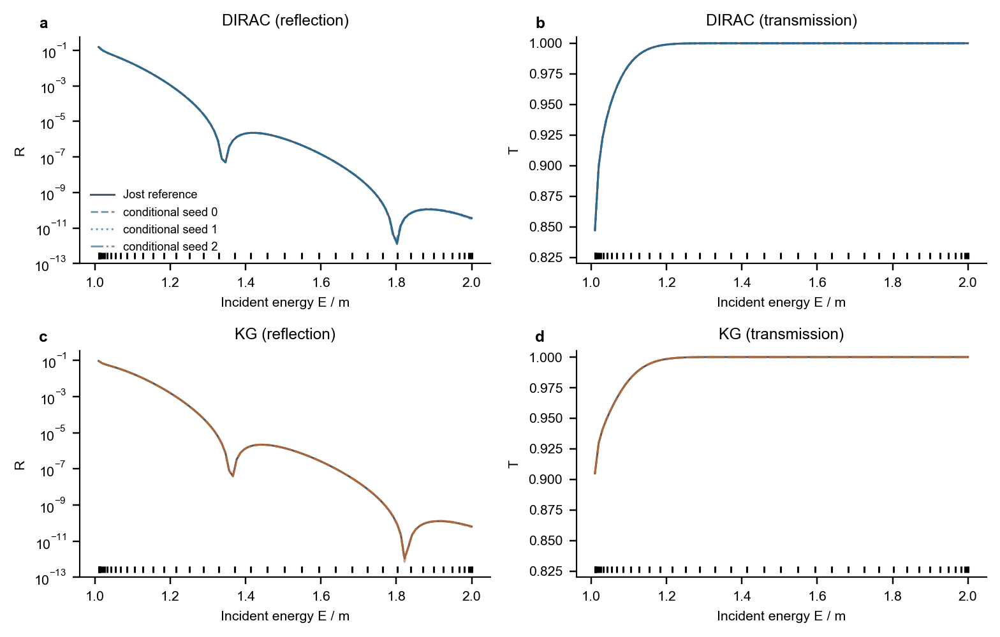

两模型参考与三个条件网络的 R(E)、T(E)；底部刻线为训练能量，扫描点多数为未训练能量。 原始数据：`results/reference/scan.csv`、`results/conditional_v1_summary.csv`。

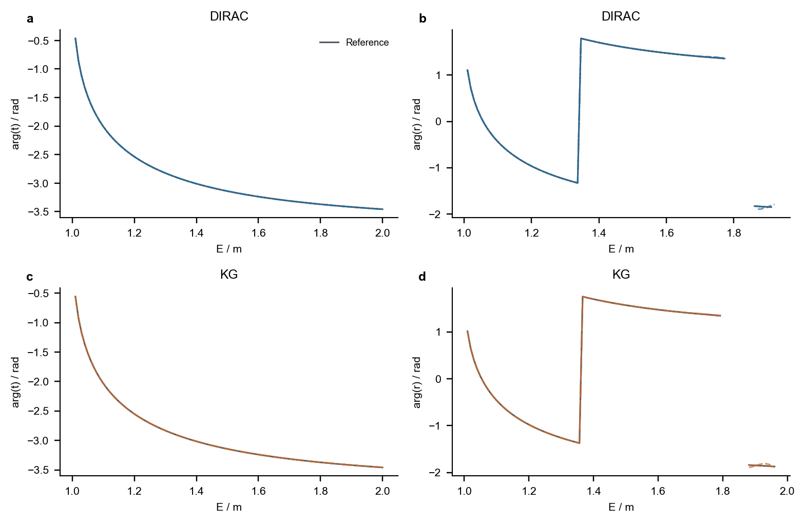

固定入射相位后的透射与反射相位；各连续有效段展开，|r|<10⁻⁵ 的反射相位屏蔽，段间不解释相位跳跃。 原始数据：`results/reference/scan.csv`、`results/conditional_v1_summary.csv`。

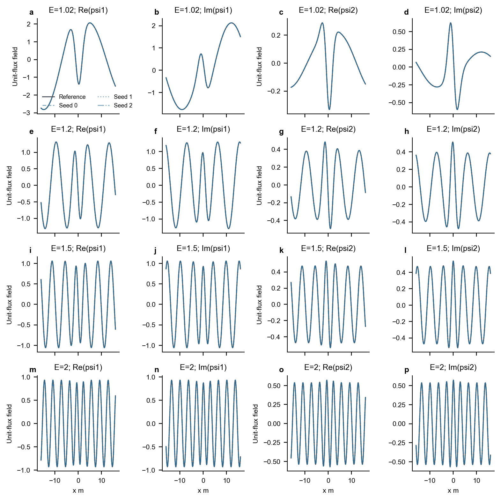

四个指定能量的复波函数逐分量，三种子全部显示；重合曲线表示误差低于此尺度的可见度，误差另图显示。 原始数据：`results/formal_v1/dirac/E_*/seed_*/evaluation.npz`。

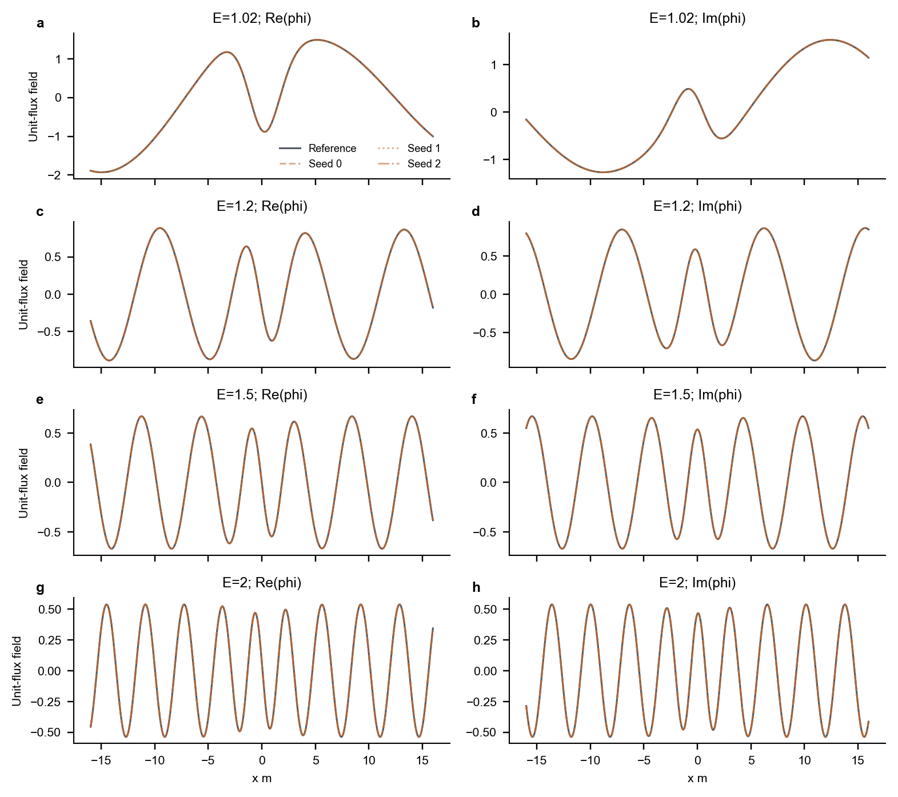

四个指定能量的复波函数逐分量，三种子全部显示；重合曲线表示误差低于此尺度的可见度，误差另图显示。 原始数据：`results/formal_v1/kg/E_*/seed_*/evaluation.npz`。

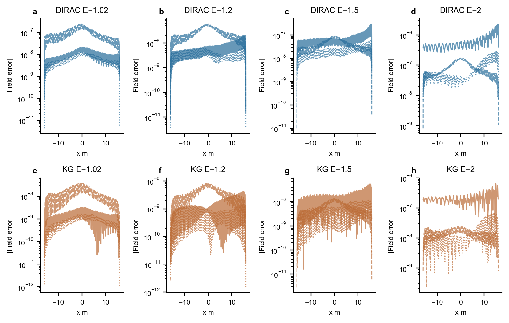

固定入射相位后的逐点波形误差，Dirac 为复旋量模、KG 为复 φ 的模；全部三种子，不进行事后缩放。 原始数据：`results/formal_v1/*/E_*/seed_*/evaluation.npz`。

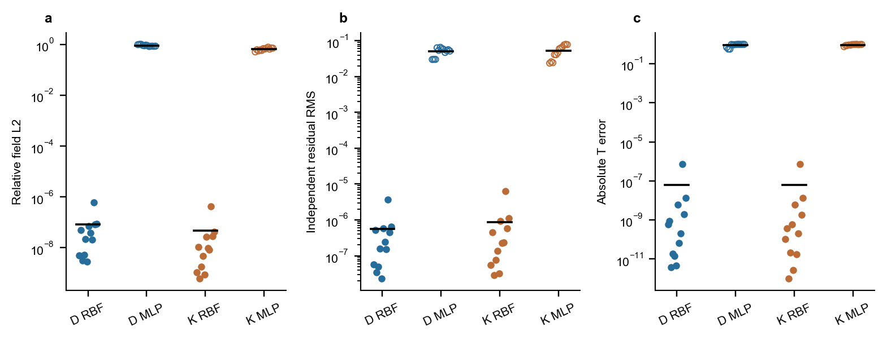

全部固定能量与三种子的误差分布；每组 n=12（四能量×三种子），短黑线为算术均值；失败 MLP 不剔除。组间不是等参数单因素对照。 原始数据：`results/formal_v1_summary.csv`、`results/mlp_baseline_summary.csv`。

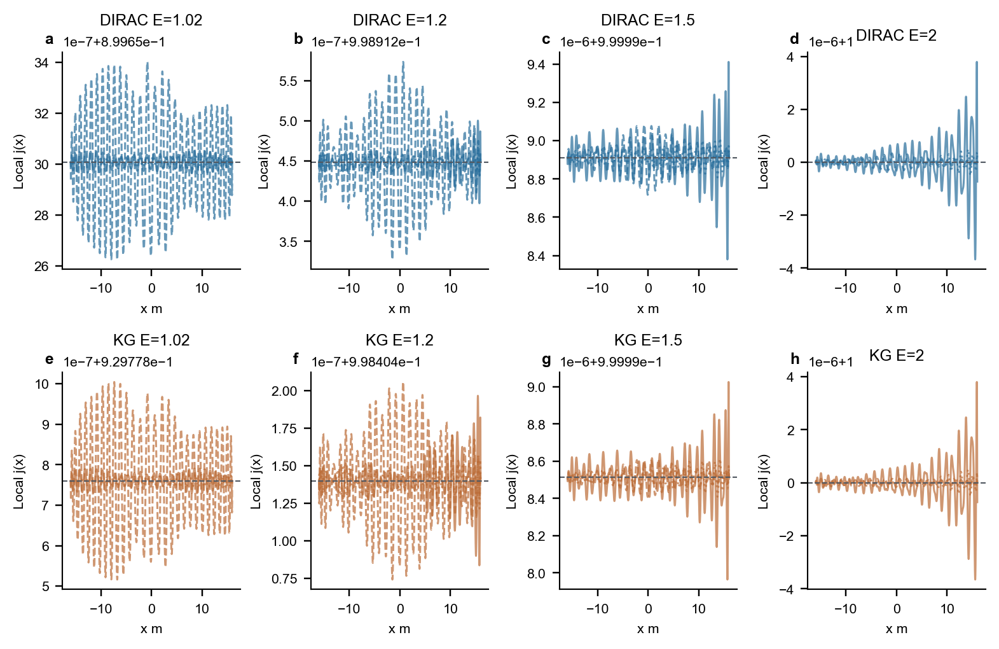

单位入射通量下 j(x) 和参考透射流；坐标科学计数偏移使微小流变化可见。守恒为辅助证据，训练没有流损失。 原始数据：`results/formal_v1/*/E_*/seed_*/evaluation.npz`。

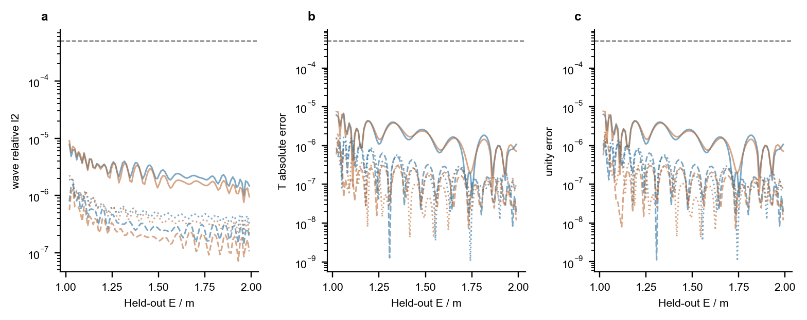

未训练能量上三种子条件网络的波形、T 绝对误差与流守恒偏差；水平线为统一验收阈值。 原始数据：`results/conditional_v1_summary.csv`。

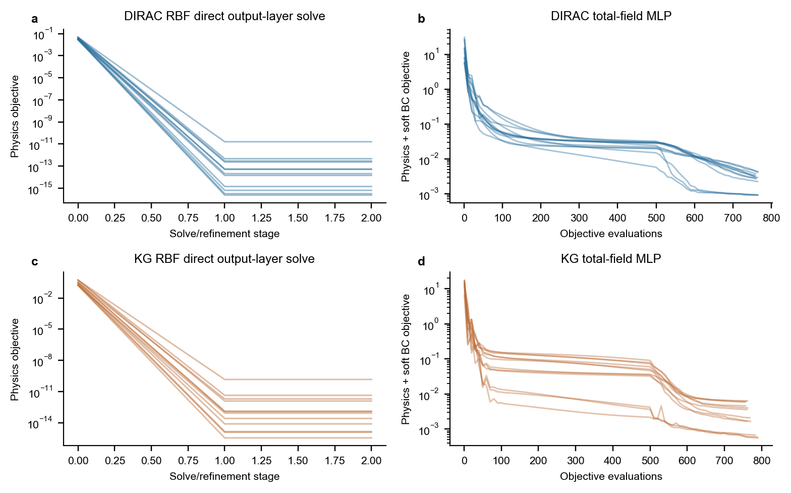

全部固定能量/种子的训练记录。RBF 为直接解及细化阶段，MLP 为 Adam/L-BFGS 目标调用；损失尺度不同，不比较曲线绝对值。 原始数据：`results/formal_v1/*/E_*/seed_*/history.csv`、`results/mlp_baseline/*/E_*/seed_*/history.csv`。

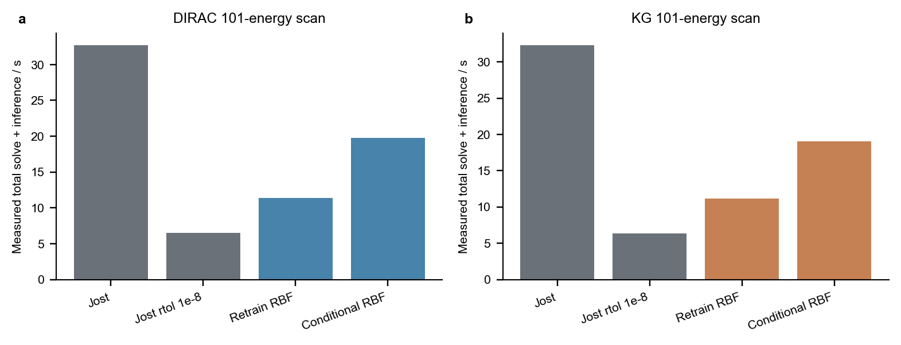

同一扫描的传统积分、逐能量重训、条件网络训练加全部推理成本；条件网络为三个种子成本的均值。机器已有 R12 后台训练，时间为实际负载下的墙钟值；准确度不同，不是隔离资源的速度排名。 原始数据：`results/scan_costs.csv`。

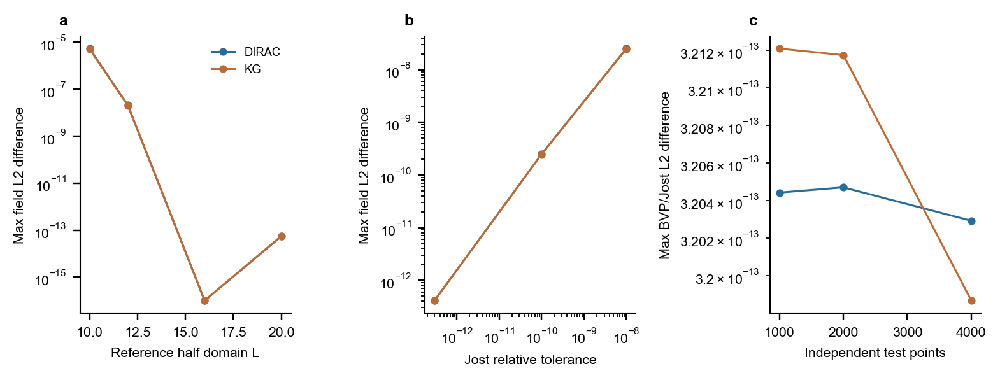

参考区间、容差和测试网格加密证据；值为四个固定能量的最大差异。零差仅为同算法同设置的恒等复算，不证明准确性。 原始数据：`results/reference/convergence.csv`。

## 复现、证据和待改进问题

代码、配置、测试、每次模型与配点、奇异值/条件数、训练曲线、4001/1601 点复波形、参考和所有残差均在本目录。NPZ 使用 NumPy 读取，无 pickle；MLP `model.pt` 为 state_dict，使用 weights_only=True 加载。

```powershell
Set-Location 'E:\PINN for Quantum Physics\projects'
python -m pytest scattering_dirac_kg/tests -q
python -m scattering_dirac_kg.run --stage all
```

相同配置与源码的完成训练会复用；源代码或训练配置改变时拒绝静默覆盖，使用新运行组。参考与扫描阶段复用已验证原始输出。全新重训和源码版本复制流程见 README；不能仅改配置却沿用旧参考或门控。

待改进：为全权重 MLP 开展预算与表示消融、近阈值的自适应能量分辨率、随机特征条件数和压缩、同精度传统方法成本比较、更广势函数与更大区间覆盖。当前没有三维、强场、超临界、反粒子通道或复能共振验证。

原始相关论文、具体支持范围和 DOI 见 [文献核实](docs/references.md)，原始 Crossref 响应及规范化说明已保存。现有四项目的 15,202 个基线文件中 15,150 个字节一致；52 个变化均来自开始前已运行的 R12 训练输出，零文件丢失。束缚态代码和数据全部字节一致；本任务没有改写旧项目。完整差异及进程证据见 保留审计说明（本地档案），不能声称整个活跃旧目录字节冻结。新交付完整性见 [审计](results/audit.json) 和 SHA256 清单；最终测试日志另存 [tests.txt](results/tests.txt)。
